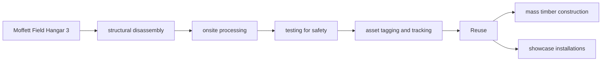

logo: Google

## **Environmental Report**

### **2026**

photo: solar panels on a wooden structure

logo: Google Sustainability

photo: offshore wind turbines and industrial facility

photo: smartphone displaying Google Maps navigation

logo: Google | Introduction Impact stories Detailed disclosures Appendix | icon: menu icon: home

## Contents

<table><tr><td rowspan="4"><strong>Introduction</strong></td><td><strong>4</strong></td><td><strong>Executive summary</strong></td></tr>
<tr><td><strong>8</strong></td><td><strong>Highlights</strong></td></tr>
<tr><td><strong>9</strong></td><td><strong>Global challenges and dependencies</strong></td></tr>
<tr><td><strong>10</strong></td><td><strong>Our climate and energy moonshots</strong></td></tr>
<tr><td rowspan="11"><strong>Impact stories</strong></td><td><strong>12</strong></td><td><strong>Energy</strong></td></tr>
<tr><td>13</td><td>Energy for our data centers</td></tr>
<tr><td>29</td><td>Energy for our supply chain</td></tr>
<tr><td><strong>34</strong></td><td><strong>Resources</strong></td></tr>
<tr><td>35</td><td>Water stewardship</td></tr>
<tr><td>40</td><td>Waste reduction</td></tr>
<tr><td>43</td><td>Nature on our campuses</td></tr>
<tr><td>45</td><td>Consumer hardware devices</td></tr>
<tr><td><strong>49</strong></td><td><strong>AI solutions</strong></td></tr>
<tr><td>50</td><td>Mitigating high-impact sectors</td></tr>
<tr><td>59</td><td>Extreme weather and crisis resilience</td></tr>
<tr><td>65</td><td>Protecting the planet</td></tr>
<tr><td rowspan="4"><strong>Detailed disclosures</strong></td><td><strong>69</strong></td><td><strong>Progress updates</strong></td></tr>
<tr><td>69</td><td>Carbon footprint</td></tr>
<tr><td>70</td><td>Avoided emissions</td></tr>
<tr><td>72</td><td>Ambitions</td></tr>
<tr><td rowspan="4"><strong>Appendix</strong></td><td><strong>82</strong></td><td><strong>Environmental data</strong></td></tr>
<tr><td><strong>98</strong></td><td><strong>Engagement</strong></td></tr>
<tr><td><strong>108</strong></td><td><strong>Governance</strong></td></tr>
<tr><td><strong>110</strong></td><td><strong>Company and report details</strong></td></tr>
<tr><td></td><td><strong>111</strong></td><td><strong>Certifications and recognitions</strong></td></tr>
<tr><td></td><td><strong>112</strong></td><td><strong>Endnotes</strong></td></tr></table>

photo: Google logo on a green leafy background

photo: offshore wind turbines

photo: server racks with blue and green lights

2

logo: circular mark with two bars | icon: house | Introduction Impact stories Detailed disclosures Appendix

Executive summary Highlights Global challenges and dependencies Our climate and energy moonshots

## **Introduction**

photo: industrial facility with colorful pipes and a yellow bicycle

3

logo: Google | Introduction | Impact stories | Detailed disclosures | Appendix | icon: menu | icon: home | Executive summary | Highlights | Global challenges and dependencies | Our climate and energy moonshots

## Executive summary

### **A year of impact at scale**

At Google, we’re deeply committed to responsibly managing the environmental footprint of our operations and unlocking the power of AI for the planet. While the path to achieving our climate ambitions will not be linear—given our AI infrastructure buildout is currently accelerating faster than the grid is decarbonizing—we remain focused on **scaling abundant and affordable clean power globally and progressing technological innovations that drive down emissions** across our operations and the broader industry.

The AI revolution has made the last five years especially transformative, and we’re proud of the progress we’ve achieved. In 2025 alone, we signed agreements for over **12 GW of net-new clean energy**.1 By combining this record-breaking procurement with our <u>industry-leading infrastructure</u>, we’re working to ensure that every megawatt is used as efficiently as possible. We’re investing in reliable, clean capacity on the local grids that support our data centers, and we’re advancing the next generation of clean energy sources like <u>nuclear</u> and <u>enhanced geothermal</u> while making long-term bets on breakthrough technologies like <u>fusion</u>. This progress is a testament to the power of tenacity and creativity.

It was with this same bold spirit that, at the beginning of the decade, we set net zero and 24/7 carbon-free energy2 (CFE) moonshots that were intentionally aspirational and designed to push the frontiers of what’s possible in energy systems and data center operations. From the start, we were clear that these moonshots would require significant innovation in technology and policy. Over the past few years, the rapid rise of AI has reshaped global infrastructure and placed new demands on the grid. Our moonshots pushed us to meet this moment, and the scale of our impact has similarly undergone a step-change. In 2025, we contracted for **eight times more clean energy than we did in 2019**. Furthermore, the emissions we successfully avoided in 2025 represent **seven times the size of our 2019 ambition-based carbon footprint**, our moonshot baseline.3 While our growth has widened the gap between our continued progress and our ambitions, our moonshots have energized our work, moving both Google and global markets toward a cleaner, more reliable future than we once thought possible.

This isn’t just about operating Google more sustainably—it’s also about using our technology to build a better future for everyone. Our data centers are powering AI products used by billions of people around the world to drive progress across science, health, the economy, and more. We also see a huge <u>opportunity</u> for AI to help drive progress on environmental issues specifically. For example, we’re enabling others to mitigate emissions through efficiencies in high-impact sectors; in 2025, nine of our solutions enabled individuals, cities, and partners to collectively **reduce an estimated 41 million metric tons of carbon dioxide equivalent (tCO2e)**4—**for context, that’s roughly three times Google’s own emissions**.5 And we’re also supporting communities in staying safe during extreme events and natural disasters, and protecting ecosystems and biodiversity. As we scale new AI solutions to meet global challenges, our task is to maximize the <u>immense good</u> AI can do for the planet while minimizing its resource intensity.

This eleventh annual Environmental Report provides a holistic view of our 2025 performance: one that navigates the tension between hyper-growth and environmental stewardship, and proves our enduring commitment to a more sustainable future.

### **Energy and other resources**

<u>Clean energy</u> is our first choice because it makes good business sense, and it remains our most critical operational lever for managing the environmental footprint of the AI era. In 2025, we navigated our largest load growth in history—a 37% annual increase in electricity demand. Despite this, we again matched 100% of our electricity consumption with renewable energy purchases (on a global and annual basis)

4

logo: Google | Introduction | Impact stories | Detailed disclosures | Appendix | icon: menu | icon: home | Executive summary | Highlights | Global challenges and dependencies | Our climate and energy moonshots

for the ninth consecutive year.6 Even with our growing energy needs, we’ve successfully **reduced our operational emissions by 2% year-over-year.** While this is a significant milestone, maintaining this decoupling of electricity-related emissions from our rapid growth will require even more clean energy investments and closer partnerships with local stakeholders in the years ahead.

To continue navigating the AI era while maintaining our commitment to sustainability, we’re working across three levels: AI stack efficiencies, clean energy procurement, and energy innovation.

## **AI stack efficiencies**

We’re investing heavily in efficiency across our AI stack—from infrastructure and chip design to model deployment. At the data center level, we’ve been leaders in developing extremely energy efficient facilities. Google’s data centers are among the **industry’s <u>most efficient</u>**, operating with a 2025 fleet-wide average power usage effectiveness (PUE) of 1.09 and using 83% less overhead energy than the industry average.7

We’ve been designing our Tensor Processing Units (TPUs) for over a decade to maximize performance while minimizing energy and emissions. In early 2025, we launched <u>Ironwood</u>, our seventh-generation TPU—which is nearly **30 times more power efficient** than our first Cloud TPU from 2018,8 and which delivers double the performance-per-watt than our sixth-generation TPU <u>Trillium</u> from 2024. And our recently announced <u>eighth-generation TPUs</u> deliver up to two times better performance-per-watt over Ironwood.9

We also co-design our AI models and TPUs, ensuring our software takes full advantage of our hardware—and that our hardware will be able to efficiently run our future AI software. Through our AI stack innovations (including model optimizations, software efficiencies, infrastructure and chip designs, clean energy procurement, and more), the <u>energy and total carbon footprint</u> of the median Gemini Apps text prompt dropped by factors of 33 and 44, respectively, over a 12-month period10—all while delivering higher-quality responses.

We’ve also developed capabilities that allow us to <u>dynamically manage workloads</u> based on the carbon intensity or needs of the grid, like our <u>demand response capability</u> to limit or shift a portion of machine learning workloads running in our data centers. As of early 2026, we’ve <u>integrated</u> over a gigawatt of demand response capacity into our long-term energy contracts with multiple utilities across the United States.

## **Energy procurement**

As an early pioneer of corporate Power Purchase Agreements (PPAs) and, more recently, approaches like the <u>Capacity Commitment Framework</u> and

photo: Server racks in our data center in Mayes County, Oklahoma.

5

logo: Google | Introduction Impact stories Detailed disclosures Appendix icon: menu icon: home | Executive summary Highlights Global challenges and dependencies Our climate and energy moonshots

the <u>Clean Transition Tariff</u>, we continue to invest in innovative procurement models that accelerate this transition for both Google and the world. In 2025 alone, our agreements to purchase **more than 12 GW of net-new clean energy** were the largest annual total in our history and more than our total procurement from the previous two years combined.11

We’re committed to being a good neighbor, which begins with ensuring our expansion doesn’t burden local communities or other utility customers. We intentionally structure our energy deals to cover 100% of the costs of the power we use. Our responsible growth strategy also focuses on expanding access to **affordable, reliable, and clean energy for everyone** in the communities where we operate. Through efforts like <u>establishing</u> a $30 million Energy Impact Fund in Texas, <u>supporting</u> home weatherization in Nebraska, and <u>more</u>, we’re funding meaningful local energy efficiency and weatherization programs across the country to help stabilize energy costs and support local grids.

photo: Rødby solar farm in Denmark

## **Energy innovation**

We can’t decarbonize at the scale and speed needed if the grid is stuck in the past, so we’ve moved beyond just buying power to helping spur new clean energy sources and modernizing the infrastructure that delivers it. By investing in the next generation of clean energy and grid technologies, we’re helping improve grid resilience and supporting long-term economic growth for everyone.

In 2025 and early 2026, this included announcing a collaboration with NextEra Energy to restart Iowa’s Duane Arnold Energy Center, which will provide 600 MW of “always-on” **<u>nuclear power</u>** once it’s operational (likely in early 2029), securing regulatory approval for 115 MW of **<u>enhanced geothermal</u>** energy in Nevada, and funding the **<u>largest battery capacity</u>** to date to support grid reliability in Minnesota. We also established a first-of-its-kind **<u>hydropower framework agreement</u>** to deliver up to 3,000 MW across the PJM and MISO grid regions.12 And we’re making long-term bets on the frontier of energy, including signing the largest direct corporate purchase agreement for **<u>fusion</u>** energy.

Beyond advancing technology, we’re actively advocating for permitting reform and developing AI solutions to streamline interconnection queues, helping clear the path for new clean energy to reach the grid faster. By using our scale to reduce the risk of emerging solutions, we’re turning Google’s growth into an engine for global energy innovation.

## **Other resources**

Our pursuit of efficiency extends beyond energy to the rest of our operations and value chain. In 2025, our <u>water stewardship projects</u> **replenished approximately 7.7 billion gallons** of water13—roughly 78% of our 2025 freshwater14 consumption, marking progress toward our 120% replenishment ambition. We’re scaling ways to keep resources in use across our data centers, where we **diverted 88% of operational waste** from landfills15 and harvested more than 7.5 million components for internal reuse. And these efforts extend to our <u>consumer hardware</u>; the enclosure of all Pixel phones from Pixel 6 through Pixel 10 has been made with 100% recycled aluminum,16 and the Pixel 10 series is made with the most recycled content of any Pixel phone generation yet.17

6

logo: Google | Introduction | Impact stories | Detailed disclosures | Appendix | icon: menu | icon: home | Executive summary | Highlights | Global challenges and dependencies | Our climate and energy moonshots

## **AI solutions**

While there’s focus on AI’s environmental costs, it’s also proving to be an incredibly powerful tool for enabling mitigation, adaptation, and ecosystem protection in ways previously impossible to imagine.

### **Climate mitigation**

We’ve begun to estimate how much our AI efforts are helping others to reduce their emissions. So far, the work looks very promising.

Nine of our solutions (including fuel-efficient routing in Google Maps and Nest thermostats) **helped others reduce an estimated 41 million tCO2e** in 202518—equivalent to the emissions from the annual electricity use of over 8.5 million U.S. homes19 and, for context, roughly three times Google’s own emissions in 2025.20

### **Adaptation and crisis resilience**

Beyond optimization, AI is a powerful tool in enabling global resilience to natural disasters and extreme weather. For example, we’re using AI to expand <u>flood forecasting</u> to more than two billion people in around 150 countries for the most significant and impactful riverine flood events21 and partnering to develop <u>FireSat</u>, a satellite constellation designed to detect wildfires in near-real time.

### **Ecosystem protection**

We’re also deploying the tools needed to accelerate global conservation, from decoding bioacoustics with our <u>Perch</u> model to open-sourcing <u>SpeciesNet</u> to help hundreds of global organizations identify species.

This year we developed two new product strategies to guide our work: first, to enable a world where no one is surprised by a natural disaster; and second, to help nature and people flourish together with AI-powered tools to empower governments, businesses, and communities to conserve 30% of the world’s land and oceans by 2030.

## **Our commitment to sustainability**

While we remain deeply committed to sustainability, reaching our climate moonshot is getting harder. Growing our data center footprint to build out the infrastructure needed to make AI as helpful as possible to everyone requires energy and resources. Like everyone in our industry, we experienced a surge in electricity demand last year. Our load grew 37% year-over-year—a rate tempered by our AI-stack efficiencies. Long waits to connect to the grid, fragmented markets, supply chain delays, and regulatory bottlenecks continue to slow down new carbon-free energy from coming online. We’re working within energy systems that simply aren’t clean enough or flexible enough yet.

Consequently, while we managed to **reduce our operational emissions by 2%** year-over-year, our supply chain emissions grew by 25%. This increase reflects not only the scale of new AI infrastructure, but also an Asia-Pacific supply chain operating on grids that remain undersupplied with carbon-free energy—due to land constraints, high construction costs, and policy and regulatory hurdles. We’ll continue to work across the industry to further reduce incremental electricity demand and the full lifecycle emissions associated with the infrastructure we build and operate.

Notwithstanding these challenges, our two decades of sustainability work have yielded meaningful progress. In 2025 alone, initiatives like machine hardware efficiencies, software and compute efficiencies, and clean energy procurement collectively avoided over 58 million tCO2e.22 In fact, without these decarbonization interventions, we estimate that our ambition-based **carbon footprint in 2025 would have been five times larger.**

While these efforts are avoiding significant emissions, we continue to evolve our approach in tandem with the technology we build—regularly assessing our strategy as we move forward with steady execution, **balancing bold ambition with real-world impact.** We remain committed to prioritizing AI-stack efficiencies, clean energy, and innovation to ensure our efforts leverage the transformative potential of AI to enhance lives globally—staying true to Google’s founding mission.

7

logo: Google | Introduction Impact stories Detailed disclosures Appendix | Executive summary **Highlights** Global challenges and dependencies Our climate and energy moonshots

## **Highlights**

As evidence of our enduring commitment to sustainability, this section provides a snapshot of highlights across our operations, products, and partnerships from 2025 and the first half of 2026.

### **Operations**

#### **Procured 12 GW of net-new clean energy**

We signed agreements to purchase over 12 GW of net-new clean energy.23 Google is one of the largest corporate purchasers of clean energy in the world.

icon: wind turbine

➔ Learn more on page 18.

#### **Avoided 58 million tCO2e across our operations and supply chain**

Our carbon reduction initiatives collectively avoided over 58 million tCO2e.24 Without these interventions, our ambition-based carbon footprint in 2025 would have been five times larger.

icon: server room

➔ Learn more on page 70.

#### **Reduced median Gemini text prompt energy and carbon footprint by 33x and 44x**

The <u>energy</u> and total carbon footprint of the median Gemini Apps text prompt <u>dropped</u> by factors of 33 and 44, respectively, over a 12-month period.25

icon: smartphone

➔ Learn more on page 17.

#### **Achieved a 3.7x carbon efficiency gain with Ironwood TPU**

Ironwood, our seventh-generation TPU, demonstrated an approximately <u>3.7x improvement</u> in Compute Carbon Intensity26 compared to TPU v5p.27

icon: TPU chip

➔ Learn more on page 15.

#### **Replenished 78% of our freshwater consumption**

Our <u>water stewardship portfolio</u> of 165 projects28 spanning 97 watersheds replenished 7.7 billion gallons of water, or roughly 78% of our 2025 freshwater consumption.29

icon: river landscape

➔ Learn more on page 37.

### **AI solutions**

#### **Enabled 41 million tCO2e of emissions reductions through our products**

Nine of our solutions helped individuals, cities, and partners collectively reduce an estimated 41 million tCO2e.30 For context, that’s roughly three times Google’s own emissions.31

icon: worker with solar panels

➔ Learn more on page 50.

#### **Achieved 7x greater environmental benefit than contrails model’s footprint**

Our contrails model generated 380 tCO2e of compute emissions32 while enabling 3,000 tCO2e in contrail avoidance33—over 7 times its own carbon footprint.

icon: airplane

➔ Learn more on page 58.

#### **Expanded riverine flood forecasting to cover two billion people**

Our <u>flood forecasting</u> information covers more than two billion people in around 150 countries for the most significant and impactful riverine flood events.34

icon: world map

➔ Learn more on page 60.

#### **Enabled AI-powered monsoon forecasts for 38 million farmers**

NeuralGCM, a Google Research model, was used to more <u>accurately predict</u> the monsoon season in India. As a result, the Government of India sent AI-powered forecasts predicting its start to 38 million farmers.

icon: weather map of India

➔ Learn more on page 64.

#### **Open-sourced SpeciesNet for improved wildlife tracking**

We open-sourced <u>SpeciesNet</u>, an Earth AI model capable of recognizing more than 2,000 animal species in images from motion-triggered wildlife cameras with over 94% identification accuracy.

icon: elephant with AI detection box

➔ Learn more on page 66.

8

logo: Google | Introduction Impact stories Detailed disclosures Appendix icon: menu icon: home | Executive summary Highlights **Global challenges and dependencies** Our climate and energy moonshots

## **Global challenges and dependencies**

While our <u>highlights</u> show our efforts to date, minimizing AI’s footprint and maximizing its positive environmental impact isn’t a guaranteed outcome. Collective progress requires navigating a complex web of interconnected challenges shaped by many external factors—like grid resilience, CFE adoption, policy and standards reform.

### **Scaling AI infrastructure**

Data centers are the nerve centers of the digital world, powering the tools people rely on every day. But as their footprint grows to support these services, it’s become clear that how they’re built is just as important as what they’re built for. The environmental footprint of the data centers that power AI is growing, creating a dual challenge: managing that environmental footprint while simultaneously building infrastructure to meet growing demand and realize AI’s full potential.

### **Accelerating clean energy adoption**

Companies still face market barriers when sourcing CFE for their own global operations and encouraging adoption within their supply chains. Interconnection delays, market fragmentation, and regulatory bottlenecks continue to limit how fast clean energy can come online. Some of these hurdles are particularly pronounced in certain regions in Asia Pacific and parts of the United States. Progress will increasingly depend on a global energy transition that prioritizes grid resilience and the rapid scaling of energy innovations. Next-generation technologies like advanced geothermal and small modular reactors (SMRs) hold promise for providing dispatchable, around-the-clock, carbon-free power; however, they’re not yet commercially available at scale. Their widespread adoption will require further cost declines and supply chain maturation into the 2030s. Accelerating these innovations is critical to ensuring the energy system can deploy clean solutions fast enough to keep pace with AI’s evolving needs.

### **Navigating evolving standards**

Evolving reporting frameworks complicate the reporting landscape, making it more challenging for organizations to continuously align their established strategies with changing disclosure requirements. Improving and aligning standards would provide the consistency organizations need to take ambitious, long-term action. Ultimately, this predictability is what drives investments in clean energy and supply chain emission reductions.

### **Addressing policy and regulatory uncertainty**

Fluctuating climate and energy policies and regulations introduce uncertainty and volatility into corporate energy planning and emissions forecasting. This changing macro environment directly impacts the feasibility, cost, and timelines for new clean energy projects. Consistent and durable policy frameworks will enable the investments in energy infrastructure required to meet growing demand.

### **Bridging the supply chain transformation gap**

Decarbonizing a global supply chain requires building relationships and coordinating action with a vast network of independent organizations, each navigating its own unique contexts, regulatory environments, infrastructure limitations, and financial constraints. Meaningful progress requires collective action—from facility upgrades to new procurement agreements—to move beyond today’s constraints toward a more resilient and sustainable global supply chain.

photo: Dawn lights up the sky over one of our data centers in the Lowcountry, South Carolina.

9

logo: Google | Introduction Impact stories Detailed disclosures Appendix | Executive summary Highlights Global challenges and dependencies <u>Our climate and energy moonshots</u>

## **Our climate and energy moonshots**

When we set our environmental <u>ambitions</u>—including running on 24/7 carbon-free energy and achieving net-zero emissions—we knew they were moonshots. We intentionally picked ambitions that we didn’t yet have the technology or the systems to reach.

As we’ve mentioned in previous reports, the path to these ambitions continues to be complex and non-linear. While our long-term commitment to reducing our environmental impact remains the same, our progress is being shaped by rapid shifts in technology and the slow evolution of global power grids. To maintain the trust of our stakeholders, we believe it’s our responsibility to report on this journey with clarity—being open about our wins, but also being honest about the challenges we’re facing.

The biggest change to our environmental impact is the expansion of our technical infrastructure—and the energy needed to operate it. Since 2019, our total electricity demand has increased by over 250% to support our products and digital services. This includes the accelerating growth of Google Cloud, continued investments in Search, the expanding reach of YouTube, as well as AI capabilities that are unlocking meaningful <u>societal and economic benefits</u>. We recognize that AI also represents a powerful tool for global climate action—from predicting extreme weather to optimizing global traffic patterns—but we’re equally clear-eyed about its immediate environmental costs. This rapid expansion in energy demand is a reality we must manage actively, and we’re committed to ensuring that the growth of AI doesn’t become a rationale for lowering our environmental standards.

Despite this intense load growth, we’re demonstrating that near-term mitigation is possible. Through disciplined execution, we, once again, effectively decoupled our total electricity demand from our scope 2 (market-based) emissions in 2025. By diligently pursuing clean energy agreements and applying limited Granular Certificates purchased from the marketplace, we’ve reduced our scope 2 (market-based) emissions by 3% year-over-year, even as our energy consumption continues to climb. More broadly, since 2019, we’ve reduced our own emissions per gigawatt-hour (GWh) by 47%.35 This meaningful reduction across our value chain demonstrates that we’re driving more value out of every watt we consume without a proportional increase in emissions, helping minimize the carbon footprint of our operations. While the macro path toward net-zero is becoming steeper, we’re moving the needle on daily operational decarbonization.

To complement these operational mitigations, we’re advancing policy advocacy and cross-industry coalitions. We’re championing state and federal policies in the United States, Europe, and Asia-Pacific to accelerate grid modernization, permitting reform, market design improvements, and infrastructure deployment. Additionally, we’re partnering with international organizations and nonprofits to drive shared sustainability initiatives around the world.

We’ve made a lot of progress, and we’re proud of what we’ve achieved, but the path to success relies on addressing entrenched, systemic limitations within global energy systems. The transition to a decarbonized economy is currently constrained by interconnection delays, fragmented power grids, and a lack of mature, clean firm generation. We aren’t letting these market hurdles slow us down: we’re viewing them as a challenge to innovate. We’re working to clear the path for a cleaner grid for everyone and signaling our capability to drive long-term change. By securing the world’s <u>first corporate agreements</u> for nuclear energy from small modular reactors and advancing <u>next-generation geothermal</u> and <u>carbon capture technologies</u>, we’re building the resilient infrastructure necessary for the clean energy landscape well beyond our 2030 ambitions.

As AI transforms our business, we must continuously review our ambitions to ensure we remain focused on our most critical environmental impacts in a rapidly evolving world—one that looks very different than it did at the start of the decade.

10

logo: circular mark with two bars | Introduction **Impact stories** Detailed disclosures Appendix | icon: chart icon: home | Energy Resources AI solutions

## Impact stories

photo: modern glass building with a wavy roof reflected in a body of water

11

logo: Google | Introduction **Impact stories** Detailed disclosures Appendix | icon: menu icon: home | Energy Resources AI solutions

photo: wind turbines on a green hillside

## **Energy**

13 **Energy for our data centers**

29 **Energy for our supply chain**

Powering our global infrastructure requires significant energy, and we’re leveraging our demand to scale the global supply of carbon-free, resilient, and affordable power. By innovating across our products and platforms, we can deliver broad societal benefits while helping to modernize grids.

Our strategy also extends to our supply chain, where we’re partnering with suppliers to transition their operations to cleaner sources and pioneering <u>direct procurement approaches</u> for high-quality energy certificates that catalyze systemic change.

However, as the rapid evolution of AI is increasing our energy needs, the shift to clean energy is hitting major bottlenecks—like long delays in connecting new energy projects to the grid, fragmented power grids, and a shortage of reliable, around-the-clock clean power.

And in key regions like Asia Pacific, land constraints, high construction costs, and other unique challenges mean electricity grids remain undersupplied with carbon-free energy.

While these hurdles make the path ahead difficult, they also reinforce our commitment to helping spur new clean energy sources and grid technologies for everyone.

12

logo: Google | Introduction **Impact stories** Detailed disclosures Appendix | icon: menu icon: home | Energy Resources AI solutions

## **Energy for our data centers**

<table><tr><td>14</td><td><strong>The AI stack:</strong> Our approach to innovation and efficiency</td></tr>
<tr><td>17</td><td><strong>Building the supply:</strong> Scaling clean energy to meet the moment</td></tr>
<tr><td>19</td><td><strong>Beyond the horizon:</strong> Accelerating the next generation of clean energy</td></tr>
<tr><td>22</td><td><strong>Same time, same place:</strong> Using Granular Certificates to meet rising AI demand</td></tr>
<tr><td>24</td><td><strong>Being a good neighbor:</strong> Google’s approach to enabling more affordable power</td></tr>
<tr><td>27</td><td><strong>From annually to hourly:</strong> Focusing on 24/7 carbon-free energy—every hour, on every grid</td></tr></table>

Innovating across our AI stack is the foundation of our strategy to minimize our systems’ energy profile. This includes both increasing the energy efficiency of our data centers with custom-built hardware and more efficient model architecture and supporting grid reliability by using demand response and flexibility, when possible, to help grids meet their highest need events.

Rising demand from AI is putting new pressure on global power grids. As a large electricity consumer, the challenges we face are incredibly complex and beyond our ability to solve alone, but we aren’t letting that prevent us from making progress. We’re using our growth to scale clean energy innovation and deploying proven technologies like solar, wind, and hydropower.

We aren’t just scaling what works now; we’re also betting on what comes next. We’re investing in next-generation innovations that can provide steady, “always-on” power, and making long-term bets on emerging technologies like fusion. By supporting these technologies today, we’re helping build a more resilient grid for everyone.

Our growth isn’t responsible if it means burdening our neighbors, so our approach is built on the principle of paying our own way and supporting the communities where we build data centers. We’re focused on protecting energy affordability for households, speeding new energy breakthroughs, and accelerating the construction of energy infrastructure to create a more reliable, robust, and carbon-free energy system.

photo: The sun shines over the Google solar field at our data center in St. Ghislain, Belgium.

The sun shines over the Google solar field at our data center in St. Ghislain, Belgium.

13

logo: Google | Introduction Impact stories Detailed disclosures Appendix | icon: menu icon: home | Energy Resources AI solutions

## **The AI-stack: Our approach to innovation and efficiency**

By optimizing every layer of the AI stack—from infrastructure and chip design to world-class research and product deployment—we take a comprehensive approach to AI innovation (Figure 1). This integrated strategy drives efficiencies across the entire system, helping maximize the value of every watt.

And as we continue to scale, we’re getting dramatically more efficient: We were able to lower Gemini serving unit costs by 78% over 2025 through model optimizations, efficiency, and utilization improvements.36

This approach to our AI stack is a key differentiator, allowing us to deploy cutting-edge technology with greater speed and agility while minimizing our environmental footprint.

**Figure 1.**
**Google’s AI stack**

image: Google's AI stack infographic

<table><tr><th>AI stack</th><th>Outcomes</th></tr>
<tr><td>Services</td><td><strong>1.09</strong> fleet-wide average PUE</td></tr>
<tr><td>Models</td><td><strong>83% less</strong> overhead energy than the industry average37</td></tr>
<tr><td>AI infrastructure software</td><td><strong>3.7x improvement</strong> in Compute Carbon Intensity from TPU v5p to Ironwood38</td></tr>
<tr><td>AI infrastructure hardware</td><td><strong>44x year-on-year improvement</strong> in total carbon footprint of median Gemini Apps text prompt39</td></tr>
<tr><td>Data center land and enclosures</td><td><strong>33x year-on-year improvement</strong> in energy of median Gemini Apps text prompt40</td></tr>
<tr><td>Energy</td><td></td></tr></table>

14

logo: Google | Introduction **Impact stories** Detailed disclosures Appendix | icon: menu icon: home | Energy Resources AI solutions

## **Custom-built infrastructure and hardware**

Our infrastructure enables us to power our own products and support the services we provide to our Google Cloud customers—allowing them to scale their workloads without the energy overhead of building and managing their own on-premises facilities.

Google’s data centers are among the industry’s <u>most efficient</u>, operating with a 2025 fleet-wide average PUE of 1.09 (Figure 2) and using 83% less overhead energy than the industry average.41 In 2025, our data centers delivered over 3 times more compute performance per unit of energy than five years ago, driven largely by TPU energy efficiency improvements and their deployment to support AI.42

We’ve been designing our TPUs for over a decade to maximize performance per watt, with integrated power management that dynamically adjusts the power draw based on real-time demand. We also co-design our AI models with our TPUs, ensuring our software takes full advantage of our hardware—and vice versa.

In early 2025, we launched <u>Ironwood</u>, our seventh-generation TPU—which is nearly 30 times more power efficient than our first Cloud TPU from 2018,43 and which delivers double the performance-per-watt than our sixth-generation TPU <u>Trillium</u> from 2024. Most recently, our <u>eighth-generation TPUs</u> (TPU 8t, optimized for training, and TPU 8i, optimized for inference) deliver up to two times better performance-per-watt over Ironwood.44

In 2025, we published a <u>first-of-its-kind study</u> on the <u>lifetime emissions of our TPU hardware</u>—from raw material extraction and manufacturing to energy consumption during operation. We’ve since <u>updated</u> that analysis and included Ironwood, which demonstrated an approximately 3.7x improvement in Compute Carbon Intensity45 compared to TPU v5p, the previous generation of performance-optimized TPUs (Figure 3).46 Our newer generations of TPUs are designed to provide cutting-edge performance while further reducing carbon emissions for equivalent AI workloads.

In addition to our own chips, we offer the industry’s widest variety of compute options, including NVIDIA’s <u>Blackwell Graphics Processing Units</u> (GPUs), which NVIDIA estimates are 25 times as energy efficient as the NVIDIA H100.47

Beyond hardware efficiency, we’re optimizing how our data centers interact with the electrical grids that serve them. For years, we’ve worked to ensure our operations consume power

#### **Figure 2.** **Data center energy efficiency (PUE)** — **Legend**: Fleet-wide trailing 12-month PUE; **Year**: 2009–2025

<table><tr><th>Year</th><th>Fleet-wide trailing 12-month PUE</th></tr>
<tr><th>2009</th><td>1.19</td></tr>
<tr><th>2010</th><td>1.18</td></tr>
<tr><th>2011</th><td>1.16</td></tr>
<tr><th>2012</th><td>1.13</td></tr>
<tr><th>2013</th><td>1.12</td></tr>
<tr><th>2014</th><td>1.12</td></tr>
<tr><th>2015</th><td>1.12</td></tr>
<tr><th>2016</th><td>1.12</td></tr>
<tr><th>2017</th><td>1.12</td></tr>
<tr><th>2018</th><td>1.11</td></tr>
<tr><th>2019</th><td>1.11</td></tr>
<tr><th>2020</th><td>1.10</td></tr>
<tr><th>2021</th><td>1.10</td></tr>
<tr><th>2022</th><td>1.10</td></tr>
<tr><th>2023</th><td>1.10</td></tr>
<tr><th>2024</th><td>1.09</td></tr>
<tr><th>2025</th><td>1.09</td></tr></table>

15

logo: Google | Introduction | Impact stories | Detailed disclosures | Appendix | icon: menu | icon: home | Energy | Resources | AI solutions

## **Figure 3.**

### **TPU efficiency improvements**

CCI improvement trends across Google’s versatile and performance-optimized TPU cohorts, considering January 2026 workloads.48

### Compute Carbon Intensity (gCO2e/EFLOP) by TPU Cohort and Year — categories: **Versatile TPUs**, **Performance-optimized TPUs**; series: Indirect emissions from manufacturing, Indirect emissions from data center construction, Indirect emissions from transportation, Indirect emissions from energy use, Direct emissions from energy use; Legend included

<table><tr><th rowspan="2">TPU Cohort</th><th rowspan="2">Year</th><th colspan="5">Emissions (gCO2e/EFLOP)</th><th rowspan="2">Notes</th></tr>
<tr><th>Indirect emissions from manufacturing</th><th>Indirect emissions from data center construction</th><th>Indirect emissions from transportation</th><th>Indirect emissions from energy use</th><th>Direct emissions from energy use</th></tr>
<tr><th rowspan="3"><strong>Versatile TPUs</strong></th><th>v4i</th><td>80</td><td>20</td><td>10</td><td>180</td><td>5</td><td>2020</td></tr>
<tr><th>v5e</th><td>45</td><td>15</td><td>10</td><td>105</td><td>5</td><td>2023</td></tr>
<tr><th>Trillium</th><td>25</td><td>10</td><td>5</td><td>75</td><td>5</td><td>2024</td></tr>
<tr><th rowspan="3"><strong>Performance-optimized TPUs</strong></th><th>v4</th><td>65</td><td>15</td><td>5</td><td>155</td><td>5</td><td>2022</td></tr>
<tr><th>v5p</th><td>45</td><td>15</td><td>5</td><td>170</td><td>5</td><td>2023</td></tr>
<tr><th>Ironwood</th><td>10</td><td>5</td><td>5</td><td>45</td><td>5</td><td>2025; <strong>3.7x improvement</strong> vs v5p</td></tr></table>

more flexibly via demand response, a capability that allows us to <u>reduce power demand</u> during certain hours when the grid is stressed by shifting non-urgent compute tasks to other times and locations, without impacting our products and services used every day.

We’ve evolved our demand response capability to limit or shift a portion of the machine learning workloads running in our data centers. Since announcing <u>initial agreements</u> with Indiana Michigan Power (I&M) and Tennessee Valley Authority (TVA) in 2025, we’ve signed contracts with Entergy Arkansas, Minnesota Power, and DTE Energy that incorporate demand response as a key resource for new data centers to connect more rapidly to local grids. As of early 2026, we’ve <u>integrated</u> a total of 1 GW of demand response capacity into our long-term energy contracts with multiple utilities across the United States.

Demand flexibility can help energy utilities and power system operators better utilize existing grid resources, enabling the power systems we rely on to run more efficiently, reliably, and cost-effectively for everyone.49

## **More efficient model architectures**

Over the last decade, our research teams have pushed the boundaries of AI. We offer an extensive model portfolio, using years of research to make training and serving less compute-intensive. Gemini models are built on the <u>Transformer model architecture</u> developed by Google researchers, which provided an efficiency boost over the previous state-of-the-art architectures. Gemini 3 was designed to deliver advanced multimodal understanding and represents our most capable iteration of agentic and generative coding technologies.

Refining how models deliver information is just as critical as how they’re built. We use <u>Accurate Quantized Training</u> and <u>speculative decoding</u>—where a smaller model makes predictions verified by a larger one—to serve more responses with fewer chips. Techniques like <u>distillation</u> create smaller, more efficient models like Gemini Flash and Flash-Lite by using our larger, more capable models as teachers. And with all 15 of our half-billion-user products—including seven with two billion users—using our Gemini models, this efficiency work is vital to our global impact.

16

logo: Google | Introduction Impact stories Detailed disclosures Appendix icon: menu icon: home | Energy Resources AI solutions

## **Outcomes from our AI stack innovation**

Comprehensive data on the energy and environmental impact of AI inference has been limited, which is why we <u>published</u> a <u>technical paper</u> detailing our comprehensive methodology for measuring the energy, emissions, and water impact of Gemini prompts as of May 2025.

Using this methodology, we estimated that the median Gemini Apps text prompt uses 0.24 watt-hours (Wh) of energy, emits 0.03 grams of carbon dioxide equivalent (gCO2e), and consumes 0.26 milliliters (or about five drops) of water50—figures that are substantially lower than many public estimates. The per-prompt energy impact is equivalent to watching TV for less than nine seconds.51

Our AI systems are becoming more efficient through research innovations and software and hardware efficiency improvements. Over a 12 month period, the energy and total carbon footprint of the median Gemini Apps text prompt <u>dropped</u> by factors of 33 and 44, respectively,52 all while delivering higher-quality responses (Figure 4).

### **Building the supply:** Scaling **clean energy to meet the moment**

Electricity powers everything we do—from training AI models to delivering Search results and YouTube videos. As our energy needs grow, we remain committed to meeting that demand responsibly and working to unlock cleaner, smarter, and more resilient grids.

#### **Clean energy procurement**

Clean energy is our first choice because it makes good business sense. In many markets it’s already the most cost-effective option, and it provides valuable energy security in a time of significant market volatility. Longer-term, we believe it’s the best option for our users and the planet.

#### **Figure 4. Gemini efficiency improvements** — Energy and carbon efficiency improvements per median Gemini Apps text prompt from May 2024 to May 2025.

<table><tr><th>Measure</th><th>Date</th><th>Value</th><th>Improvement Factor</th></tr>
<tr><th rowspan="2"><strong>Energy</strong> (Watt-hour)</th><th>May 2024</th><td>7.92</td><td rowspan="2"><strong>33x</strong> improvement</td></tr>
<tr><th>May 2025</th><td>0.24</td></tr>
<tr><th rowspan="2"><strong>Carbon</strong> (gCO2e)</th><th>May 2024</th><td>1.32</td><td rowspan="2"><strong>44x</strong> improvement</td></tr>
<tr><th>May 2025</th><td>0.03</td></tr></table>

17

logo: Google | Introduction Impact stories Detailed disclosures Appendix | Energy Resources AI solutions

Google’s work to procure clean energy began in 2010 when we signed our first power purchase agreement. Since then, Google and other corporate clean energy buyers have played a critical role in scaling clean energy deployment.

Google is one of the largest corporate purchasers of clean energy in the world. From 2010 to 2025, we signed more than 240 agreements to purchase nearly 35 GW of net-new clean energy, with more than 12 GW contracted in 2025 alone53—the largest annual total in our history and more than our total procurement from the previous two years combined. Through these cumulative agreements, we’re expanding the global power supply with enough new capacity to power over 28 million U.S. homes,54 or roughly every household in New York, Texas, and Pennsylvania combined.55

Our 240 cumulative agreements have spanned the globe, totaling over 29 GW in North America, over 4 GW in Europe, over 400 MW in Latin America, and nearly 600 MW in Asia Pacific (Figure 5).

In the United States, we scaled our clean energy procurement by diversifying into a broader range of “around-the-clock” clean energy technologies. These include restarting Iowa’s Duane Arnold Energy Center for <u>600 MW of nuclear energy,</u> establishing a first-of-its-kind hydropower <u>framework agreement</u> to deliver up to 3,000 MW across the PJM and MISO grid regions, and <u>securing regulatory approval</u> for 115 MW of enhanced geothermal power in Nevada. Across these deals, we’re continuing to build a resilient, carbon-free future for the American energy grid.

In Europe, we announced a major <u>portfolio expansion</u> with Engie in Germany to assemble a flexible suite of clean energy sources—including new onshore wind and solar projects—while optimizing our existing portfolio through battery and hydro storage systems. We pioneered <u>innovative solutions</u> in the United Kingdom, selecting a 24/7 Carbon-Free Energy Manager with access to battery energy storage systems to better match our hourly demand with clean energy. In the Netherlands, we signed the <u>first corporate PPA</u> to extend the lifespan of an offshore wind farm,56 and in Belgium, we signed new <u>agreements</u> to develop new onshore wind farms.

In Asia Pacific, we continued to grow our CFE portfolio, navigating the region’s unique grid constraints. We signed our first solar deals in Malaysia for approximately 50 MW and expanded our <u>solar portfolio</u> to support our data center in Japan. We also achieved two regional firsts for Google in

**Figure 5.**
**Clean energy agreements**

map: A world map showing Google's clean energy agreements by region, with callouts for North America (29+ GW across 148 projects), Europe (4+ GW across 75 projects), Latin America (400+ MW across 4 projects), and Asia Pacific (~600 MW across 17 projects).

18

logo: Google | Introduction **Impact stories** Detailed disclosures Appendix icon: menu icon: home | Energy Resources AI solutions

Taiwan by signing an <u>offshore wind</u> PPA and a <u>geothermal</u> investment for reliable, “always-on” power.

As demand for our products has risen, so too have our electricity needs. To support all our products and digital services—including AI—our total electricity consumption grew by 37% in 2025, up from 27% in 2024. But our long-term clean energy procurement strategy is yielding impressive results. In 2025, more than 25 contracted projects came online, adding nearly 2 GW of new clean energy to the grids supporting our operations.

Also in 2025 alone, we signed over 70 new clean energy agreements which we estimate, once operational, could generate nearly four times more electricity than our incremental load growth from 2024 to 2025.57 Looking ahead, we’re focused on bringing new capacity to the grids where our energy demand is growing, to ensure that we’re helping make the grids that serve us more reliable, affordable, and clean over the long-term.

But we’re not just buyers of clean energy; we’re also investing to accelerate and increase clean energy supply. From 2010 to 2025, we entered into agreements to invest more than $3.8 billion in projects and partnerships which are expected to bring online around 7.5 GW of clean electricity.58 Our participation, especially in early stages when risk is higher, helps provide the catalytic capital necessary to move these projects forward.

photo: A Google Data Center Operations Facility Technician stands in front of an electric substation near our data center under construction in Clarksville, Tennessee.

Beyond these targeted deals, we also invest in frontier clean energy technologies, including <u>geothermal energy</u> in the <u>United States</u> and <u>Asia Pacific</u>, <u>fusion energy</u>, and other emerging solutions.

## **Beyond the horizon:**
## **Accelerating the next generation of clean energy**

To meet growing electricity demands, energy systems must be modernized to ensure they’re reliable, efficient, and cost-effective. Beyond today’s mature energy technologies, we’re focused on developing round-the-clock clean energy sources and investing in a resilient grid capable of supporting long-term economic growth.

In 2025, we continued to accelerate the <u>next generation of clean energy</u> through catalytic efforts to commercialize technologies including <u>advanced nuclear</u>, <u>fusion energy</u>, <u>enhanced geothermal</u>, <u>long-duration energy storage</u>, and <u>natural gas with carbon capture and storage</u>. We also recognize that these breakthroughs require time to reach commercial scale, so creative interim solutions are essential to maintain progress in the meantime.

This innovation cycle is incomplete, however, without a parallel focus on modernizing a fragmented and aging grid. To optimize power delivery, we’re investing in grid technologies like <u>advanced reconductoring technologies</u> that expand transmission capacity, or <u>computational tools</u> that maximize the efficiency and reliability of existing grid infrastructure.

However, scaling these technologies requires navigating complex market design gaps and evolving regulatory frameworks. Overcoming these barriers will take time, but we’re committed to partnering across the ecosystem to build the frameworks necessary for long-term success. We make these investments to drive global impact. By funding early-stage projects and lowering long-term costs, we help new technologies scale up—turning Google’s growth into an engine for energy innovation.

19

logo: Google | Introduction **Impact stories** Detailed disclosures Appendix icon: menu icon: home | Energy Resources AI solutions

## **Nuclear**

Nuclear energy has a long history providing safe, reliable, carbon-free power—and we’re entering an exciting period of new innovation and growth for the industry. To accelerate this growth, we’re pursuing a dual-track strategy: supporting the revitalization of today’s proven nuclear infrastructure while investing in the next-generation nuclear technologies of tomorrow.

In October 2025, we announced a <u>collaboration</u> with NextEra Energy to <u>restart</u> the Duane Arnold Energy Center. Reopening an existing plant is the fastest way for us to secure bulk quantities of reliable, carbon-free capacity. We expect Duane Arnold to be back online in early 2029, and the plant will provide 600 MW of clean, safe, “always-on” nuclear energy to the regional grid. This will support our growing cloud and AI infrastructure in Iowa and bring <u>thousands of jobs</u> and substantial economic benefits to the region.

By pioneering a newer generation of SMRs, we can simultaneously advance a safe, versatile energy source that can be sited nearly anywhere and bring significant economic benefits to local communities. Marking a major milestone in the first-ever corporate offtake agreement for SMRs, Google, Kairos Power, and the Tennessee Valley Authority (TVA) <u>broke ground</u> at our first project site: the Hermes 2 Plant in Oak Ridge, Tennessee. <u>This agreement</u> will enable 50 MW of nuclear energy on TVA’s grid —which powers our data centers in Montgomery County, Tennessee and Jackson County, Alabama—once operational in 2030. It’s part of Google’s <u>long-term collaboration</u> with Kairos to unlock up to 500 MW of nuclear power for the U.S. electricity system through multiple deployments of its small modular reactor. Kairos Power’s Hermes 2 Demonstration Plant will help re-establish Oak Ridge as a nuclear innovation hub, including through <u>new programs</u> developed in partnership with the University of Tennessee and other local universities to grow <u>local workforce talent</u> for high-paying jobs as plant operators and engineers.

Google Cloud and Westinghouse announced a <u>joint effort</u> to deploy a custom AI-powered platform that can predict bottlenecks, optimize construction task sequences, adjust staffing levels, and account for external factors like supply chain constraints for the construction of their AP1000 nuclear reactors.

### **Long-duration energy storage**

To bridge the gap between renewable generation and demand, Google <u>announced</u> a partnership with Energy Dome to deploy long-duration energy storage (LDES). Energy Dome uses a novel "CO2 battery" technology that can store excess renewable energy and dispatch it back to the grid for 8 to 24 hours, providing capacity and reliability to the system.

photo: nuclear cooling tower with text overlay

**We’re partnering to use AI to**
**accelerate the construction,**
**safety, and operations of state-**
**of-the-art nuclear reactors**
**(Photo credit: Georgia Power).**

20

logo: Google | Introduction **Impact stories** Detailed disclosures Appendix | icon: menu icon: home | Energy Resources AI solutions

By bringing this first-of-a-kind LDES technology to market faster, we aim to rapidly share its potential with communities everywhere—making reliable, affordable electricity available around the clock and supporting the resilience of grids as they integrate growing amounts of renewable energy sources.

Additionally, through a <u>collaboration</u> with Salt River Project (SRP), Google will also support multiple LDES pilot projects in Arizona—including a 50 MWh system from <u>ESS Tech</u>—enabling these technologies to come onto the grid before 2030. These pilots will help prove this technology at scale, all while providing value to the grid.

More recently, in early 2026, we announced a <u>partnership</u> with Xcel Energy and Form Energy to deploy a battery capable of delivering 300 MW of power and storing 30 GWh of energy, making it the largest battery by capacity announced so far. This battery will act as a critical grid resource, providing reliability to the grid even during extended periods of low wind or solar production.

## **Carbon capture and storage**

Natural gas with carbon capture and storage (CCS) is a critical source of clean “firm” power that can increase generating capacity while enabling emissions reductions.

Google announced a first-of-its-kind <u>offtake agreement</u> from the Broadwing Energy project in Illinois, a new natural gas power plant equipped with CCS. The facility is designed to capture and permanently store at least 90% of its CO2 emissions deep underground. By agreeing to buy the majority of the power it generates, Google is helping get this new, baseload power source built and connected to the grid that supports our data centers in the region. This first project will help fast-track critical technical and operational improvements, from continuing to raise CO2 capture rates to improving system performance and economics.

Transparency will also be critical to ensure the environmental integrity of our projects. That’s why the project will also incorporate a newly-released <u>standard</u> for CCS-specific Energy Attribute Certificates59 (EACs), developed by industry experts to ensure CCS projects can be accurately quantified in emissions reporting.

## **Long-term bets on fusion**

Commercializing fusion is one of our boldest bets for a cleaner energy future, and we’re taking significant steps to move this technology from the lab to the grid.

In 2025, we signed the largest direct corporate <u>offtake agreement</u> for fusion energy with Commonwealth Fusion Systems (CFS) to purchase 200 MW of CFE from its first commercial plant in Chesterfield, Virginia, which is expected to begin operations in the 2030s. This partnership aims to prove the company’s pathway to commercial power and catalyze the broader fusion market.

Our support for fusion also includes long-term research collaborations, applying our AI expertise to solve complex physics challenges. We’ve been an investor in TAE Technologies since 2015, and have collaborated to <u>use machine learning</u> to improve plasma stability and simplify machine design, helping make fusion power more economically viable. We’re also bringing the plasma research we’ve developed to a <u>partnership</u> with CFS to accelerate the timeline to deliver fusion energy to the grid.

While the diverse range of actions we’ve taken have helped advance the next generation of energy solutions, there’s much more to be done. Commercializing fusion is immensely challenging, and success is not guaranteed. As we build on our momentum in the years to come, we’ll continue to refine our approach and push for the innovations needed to create more reliable, affordable, and sustainable energy systems for the world.

photo: Commonwealth Fusion Systems facility

We’re partnering with Commonwealth Fusion Systems to bring clean, safe, limitless fusion energy closer to reality.

21

logo: Google | Introduction **Impact stories** Detailed disclosures Appendix | icon: menu icon: home | Energy Resources AI solutions

## **Grid technologies**

Generating CFE is only half the battle; a modern grid is needed to deliver it. While physical upgrades can take decades, digital tools can help maximize the capacity of existing infrastructure and support the integration of more renewable energy.

In 2025, <u>Tapestry</u>—a part of <u>X</u>, Alphabet’s moonshot factory—launched <u>HyperQ</u>, the first milestone in a <u>multi-phase initiative</u> with PJM Interconnection to develop new AI tools to accelerate interconnection. This tool uses agentic AI to pre-screen the site control portion of a generator’s submission—a critical phase of the interconnection process—in less than 10 minutes, enabling expert reviewers to begin their assessments without delay. Streamlining these reviews can accelerate the timeline for solar, wind, and storage projects, which make up the vast majority of new energy requests.60

Inspecting the grid is a difficult task, made only more difficult by surging energy demand, frequent extreme weather, and increasing structural complexity. That’s why Tapestry is working with Vector, New Zealand’s largest electric utility, to <u>modernize the inspection</u> of critical grid assets like poles and transformers. With GridAware, Tapestry’s grid management and intelligence platform, this <u>collaboration</u> increased Vector’s grid network visibility by 221% and made roadside pole inspections five times faster. This success has since expanded into a first-of-its-kind <u>national consortium</u> that now serves over half of New Zealand’s electricity customers, providing a scalable model for AI-driven climate adaptation and infrastructure resilience.

In early 2026, Google Cloud and Tapestry announced a <u>partnership</u> with CTC Global Corporation to accelerate advanced reconductoring, which can double the capacity of existing lines. By integrating high-resolution data from CTC’s GridVista hardware into Tapestry’s AI tools, we’re turning static power lines into intelligent assets that unlock the grid’s untapped potential to deliver more CFE.

## **Same time, same place:**
## **Using Granular Certificates to meet rising AI demand**

<u>Granular Certificates</u>61 (GCs)—also known as Time-based Energy Attribute Certificates (T-EACs)—are new tools designed to accelerate grid decarbonization and incentivize clean energy and storage.

Our long-standing commitment to more credible and impactful clean energy purchasing has helped shape the development of GCs globally. By transitioning from <u>pilot programs</u> starting in 2021 to the application of GCs to our scope 2 (market-based) footprint in 2025, we achieved three critical outcomes: effectively managing our energy-related emissions, more precisely matching our consumption with CFE on the same grid and at the same hour, and supporting the expansion of a global GC ecosystem.

## **Moving from annual averages to hourly precision**

Traditional annual EACs have spurred renewable energy, but they fail to capture the variability of these resources. Because of this, they don’t incentivize the critical investments—like storage, demand flexibility, and clean firm power—needed to reliably deliver clean energy around the clock.

By contrast, GCs represent clean energy that is generated in the same time and location as electricity demand, enabling more credible claims to clean energy use. GCs also allow clean energy to be purchased, traded, and tracked on an hourly basis, creating a transparent price signal which steers investments that accelerate decarbonization in a secure, reliable way. <u>Leading research</u> finds that when adopted at scale, hourly and locational matching enabled by GCs can support electricity grid management and reduce electricity system costs; provide price incentives that drive clean energy, storage, and flexibility deployment; and reduce barriers to high levels of hourly clean energy matching, accelerating grid decarbonization.

22

logo: circular mark with two bars | Introduction **Impact stories** Detailed disclosures Appendix icon: home | Energy Resources AI solutions

To demonstrate that hourly accounting is a mature and scalable solution, we certify our GC portfolio—whether sourced through long-term clean energy agreements or purchased from the marketplace—in accordance with the EnergyTag <u>Granular Certificate Scheme Standard</u>. This large-scale implementation proves that hourly energy accounting is operationally feasible at scale, creating a robust audit trail that prevents double counting and supports hourly matching goals. Additionally, we collaborated with Dutch utility Eneco to complete a bilateral exchange of excess wind and solar GCs with a Dutch telecommunications company—demonstrating how such trades can improve each party’s hourly matching.

## **Expanding the toolkit with marketplaces and registry enablement**

We aren’t just participants in the GC ecosystem; as an early pioneer and advocate for hourly tracking, we’ve spent years driving the standards and infrastructure needed to build the GC ecosystem. As a founding member of the <u>Granular Certificate Trading Alliance (GCTA)</u>, we helped launch a first-of-its-kind trading and management platform designed to facilitate the hourly trading of CFE. And in 2025, we participated in the first-ever granular certificate spot auction in PJM, facilitated by the GCTA. This pilot demonstrated a transparent, hourly marketplace capable of providing the precise price signals needed to incentivize clean energy exactly when and where the grid needs it most. While we work to expand the marketplace, we’re also engaging directly with developers and brokers across the United States, Asia Pacific, Europe, and Latin America to build the GC market.

Long-term clean energy agreements remain our primary focus, however, marketplace GCs serve as a complementary mechanism to signal hourly demand and drive investments where and when they’re needed most. For scope 2 procurement in 2025, we ensured that the majority of our market-based reductions resulted from our long-term clean energy agreements (81%), while GCs purchased from the marketplace accounted for far less (19%) (Figure 6).62

Scaling GCs requires widespread registry adoption, so we’re also pushing for another major ecosystem shift: enabling registries to issue and trade GCs directly via the <u>Registry Acceleration Fund</u>, which is supported by the GCTA. This initiative removes a major barrier—insufficient resources for technical upgrades—and helps build the foundational infrastructure required to scale GC issuance and trading at a global scale. <u>Funding</u> was announced in 2025 for registries that collectively issue or track more than 4,000 TWh of certificates across over 70 countries for more than 40,000 account holders.

### **Figure 6.** **Scope 2 market-based reductions**; Million tCO2e

<table><tr><th>Category</th><th>Million tCO2e</th><th>Reduction from previous category</th></tr>
<tr><th>Scope 2 (location-based)</th><td>15.0</td><td></td></tr>
<tr><th>Long-term clean energy agreements</th><td>5.3</td><td>81% reduction</td></tr>
<tr><th>GCs purchased from the marketplace</th><td>4.0</td><td>19% reduction</td></tr>
<tr><th>Scope 2 (market-based)</th><td>2.8</td><td></td></tr></table>

23

logo: Google | Introduction <u>Impact stories</u> Detailed disclosures Appendix | icon: menu icon: home | Energy Resources AI solutions

We continue to <u>advocate</u> for improving the physical alignment of clean energy accounting—ensuring generation and consumption are linked by time and location—as a foundational tool to advancing clean energy across all regions of the world.

By prioritizing hourly data access in our contracts and supporting global data infrastructure, we’re helping ensure that rapidly growing electricity demand can be met with clean generation everywhere, every hour.

## **Being a good neighbor: Google’s approach to enabling more affordable power**

To power the next generation of AI and digital services, our energy needs are increasing—a reality that requires us to be more than just energy consumers. We’re committed to being a good neighbor, which begins with ensuring our expansion doesn’t burden local communities or ratepayers. We intentionally structure our energy deals to cover 100% of the costs of the power we use. Our responsible growth strategy also focuses on expanding access to affordable, reliable, and clean energy for everyone in the communities we call home.

### **Investing in grid stability and affordability**

We’re committed to strengthening the local energy supply and grid system everywhere we operate, investing in net-new energy supply to meet our needs without shifting costs onto ratepayers.63 To achieve this, we’re proactively collaborating with our utility partners and regulators to develop new market innovations that enable us to cover the costs of new infrastructure driven by our growth.

In the United States, we’ve worked closely with our utility partners and regulators to develop frameworks like the <u>Capacity Commitment Framework,</u> a contract model that enables large energy users to fund the specific infrastructure needed to serve them through long-term financial promises and guaranteed minimum payments, and the <u>Clean Transition Tariff,</u> which creates a scalable pathway for utilities and large energy users to invest in clean, reliable electricity and accelerate advanced technologies. Through these solutions—which are designed to shield U.S. families from bearing the costs of large energy customers—we pay the full costs for the energy we use and we’ll cover the infrastructure needs directly attributable to our growth.64

photo: Rødby solar farm in Denmark

Rødby solar farm in Denmark
(55 MW for Google).

24

logo: Google | Introduction Impact stories Detailed disclosures Appendix icon: menu icon: home | Energy Resources AI solutions

Beyond funding our own needs, we’re helping to improve the grid for everyone by accelerating the deployment of modern grid technology. For example, we’re partnering with CTC Global Corporation to accelerate the deployment of <u>advanced conductors</u> in the United States, which can double the power transfer capacity of existing transmission corridors in months, for a fraction of the cost of building new ones.65

Finally, we’re using data center flexibility to get the most out of our existing infrastructure. By shifting or reducing power use during peak times, we help balance supply and demand—supporting reliability during times of grid stress and reducing the need for investment in new generating capacity. In places like Indiana and Tennessee, we have <u>demand response agreements</u> to reduce power consumption from machine learning workloads when the grid is strained. This supports grid stability during peak demand, reduces the need for new infrastructure, and lowers overall system costs.

To codify these efforts, in early 2026, Google <u>signed</u> the White House <u>Ratepayer Protection Pledge</u>, demonstrating our confidence that energy growth and ratepayer protection can go hand-in-hand.

> When built responsibly, data centers provide long-term, reliable electricity demand that stimulates new investments in energy generation and transmission in a way that helps all consumers. Importantly, large load customers can help put downward pressure on utility rates by spreading the fixed costs of essential grid upgrades across more energy usage. For example, a study from Lawrence Berkeley National Laboratory found that states with higher electricity load growth from 2019 to 2024 saw reductions in average retail electricity prices, whereas states with contracting loads generally saw prices rise.66

## **Helping our neighbors**

Working together with our partners, we’re helping bring relief to households experiencing high energy bills. We’re funding affordability initiatives to stabilize energy costs and support the local grids where we operate. These initiatives affirm our long-held commitment to protect ratepayers, create jobs, and keep the grid reliable as our business grows.

Across the United States, we’re putting our principles into action through targeted energy initiatives. Below are just a few examples:

* **Arkansas:** We <u>launched</u> a $25 million Energy Impact Fund that will help scale and accelerate critical affordability initiatives for the local community, including the deployment of cost-saving efficiency technologies and home weatherization improvements.
* **Georgia:** In 2025, we <u>supported</u> the City of Atlanta to <u>expand</u> the WeatheRISE ATL program, which delivers attic insulation, HVAC repairs, and critical home fixes to households in historically disinvested neighborhoods. To ensure these improvements scale, we supported a workforce development initiative that trains residents in building science and energy efficiency while also providing contractor upskilling in these sectors. Additionally, we’re partnering with <u>Georgia Power</u> to fund <u>health and safety repairs</u>—like fixing roofs and broken doors—helping previously ineligible customers qualify for efficiency upgrades. This effort also includes replacing inefficient air conditioners in homes with modern technologies like heat pumps, empowering more Georgians to reduce their long-term energy costs.
* **Nebraska:** We’re <u>supporting</u> a United Way of the Midlands and Omaha Public Power District program to help weatherize low-income homes in Douglas County. This is expected to save participating local families between $840–$1,260 every year on their utility bills. Google is also supporting Lincoln Electric System’s <u>efficiency program</u>, which will provide low-income multifamily properties with upgrades such as high-efficiency heat pumps, insulation, and smart thermostats.

25

logo: Google | Introduction <u>Impact stories</u> Detailed disclosures Appendix | icon: menu icon: home | Energy Resources AI solutions

* **North and South Carolina:** We’re collaborating with Sol Systems to <u>help reduce energy costs</u> and expand access to clean power for our data center communities in both North and South Carolina. For example, our support of local weatherization readiness and health and safety repairs led to annual cost savings estimated at $545–$729 per participating home.67 We also announced an <u>investment</u> with the Berkeley Electric Cooperative—in partnership with the local nonprofit Hope Repair—that will support home repairs, pre-weatherization, and energy efficiency upgrades to help families in Berkeley and Charleston counties in South Carolina lower their monthly energy costs.

* **Oklahoma:** We announced a donation to Stillwater Public Schools for <u>energy efficiency upgrades</u> that are projected to save the district over $340,000 each year, enabling those funds to be reinvested into academic programs and technology.

* **Texas:** We <u>established</u> a $30 million Energy Impact Fund to scale and accelerate energy initiatives. We’re also collaborating with the Texas Energy Poverty Research Institute to create <u>energy resilience hubs</u> at multi-tenant facilities in the Dallas-Fort Worth metro that will protect vulnerable communities during extreme weather and reduce monthly electricity costs, freeing up capital for more social services.

* **Virginia:** In Southwest Virginia, we’re collaborating with Appalachian Voices to develop <u>community resilience</u> hubs. These facilities use solar and battery storage to provide shelter and power during emergencies, while feeding energy back to the grid during peak times to help drive down overall costs for the community.

In Europe, we’re building our new data centers with the infrastructure needed to support off-site heat recovery, if an offtaker is identified. By partnering with local providers to feed this heat into district networks, we can support local community energy needs:

* **Finland:** In Hamina, the <u>recovered heat</u> from Google’s data center is expected to cover 80% of the annual heat needs for the Hamina district heating network—according to Haminan Energia—and was provided free of charge to local households, schools, and public service buildings.68

* **Germany:** In Dietzenbach, Google is collaborating with the local district heating provider to capture and <u>repurpose excess heat</u> from a forthcoming data center to be fed into the district heating network and used by local households.

At Google, we’re committed to continuing to accelerate initiatives like these that help lower energy bills and strengthen local power grids across our data center communities.

photo: A beautiful landscape forms during winter outside our data center in Hamina, Finland.

26

logo: Google | Introduction **Impact stories** Detailed disclosures Appendix | icon: menu icon: home | Energy Resources AI solutions

## **From annually to hourly:**
## **Focusing on 24/7 carbon-free energy—every hour, on every grid**

Many organizations focus on matching their total annual electricity use with purchases of clean energy. However, this global accounting method doesn’t tell the whole story: even companies that meet a 100% annual match continue to rely on power generated by fossil fuels during times when, or in places where, carbon-free generation isn’t available (Figure 7).

As large power consumers like Google experience rapid demand growth—evidenced by our own electricity consumption rising 37% year-on-year in 2025—the limitations of this approach have never been more clear. Under this framework, a company can claim to be “powered by 100% renewable energy” through a global match of renewable energy purchased in distant regions, even if their local growth is actually run on fossil fuel generation. To truly decarbonize grids and ensure long-term affordability for everyone, large users must shift their focus from simply procuring clean megawatts—wherever and whenever they might be available—to investing in reliable, clean capacity on the local grids that actually serve them.

That’s why we’ve sharpened our focus to scaling real-world solutions for decarbonizing local grids, through our 24/7 carbon-free energy ambition. Going further than a 100% renewable energy match, 24/7 CFE requires an hourly and local match. It demands a diverse technology portfolio—including variable renewables, battery storage, and clean firm technologies—to meet our electricity demand more efficiently around the clock, all while driving down the cost and increasing the accessibility of these technologies for everyone. It involves employing smarter computing that shifts work to when and where the grid is least carbon-intensive. And it depends on market tools like GCs that track exactly when and where CFE is produced, providing the data and market instruments needed to achieve hourly matching of CFE procurement to power consumption. Ultimately, it shifts the focus from offsetting emissions from fossil generation to high-impact solutions that can credibly supply growing electricity loads and meet the real-world needs of local grids.

#### **Figure 7. Hourly CFE performance at a hypothetical site** — Hourly energy supply vs Electricity demand; Jan 1 to Dec 31

<table><tr><th>Date</th><th>Electricity demand</th><th>Hourly energy supply</th><th>Notes</th></tr>
<tr><th>January 1</th><td>Constant</td><td>Variable (Green and Black)</td><td>High variability in supply</td></tr>
<tr><th>February</th><td>Constant</td><td>Variable (Green and Black)</td><td>Significant gaps in supply</td></tr>
<tr><th>March</th><td>Constant</td><td>Variable (Green and Black)</td><td>Supply closely follows demand with gaps</td></tr>
<tr><th>April</th><td>Constant</td><td>Variable (Green and Black)</td><td>Periods of high supply and low supply</td></tr>
<tr><th>May</th><td>Constant</td><td>Variable (Green and Black)</td><td>Consistent gaps in carbon-free energy</td></tr>
<tr><th>June</th><td>Constant</td><td>Variable (Green and Black)</td><td>Supply fluctuates significantly</td></tr>
<tr><th>July</th><td>Constant</td><td>Variable (Green and Black)</td><td>High variability in supply</td></tr>
<tr><th>August</th><td>Constant</td><td>Variable (Green and Black)</td><td>Supply meets demand with gaps</td></tr>
<tr><th>September</th><td>Constant</td><td>Variable (Green and Black)</td><td>Significant gaps in supply</td></tr>
<tr><th>October</th><td>Constant</td><td>Variable (Green and Black)</td><td>Supply fluctuates significantly</td></tr>
<tr><th>November</th><td>Constant</td><td>Variable (Green and Black)</td><td>High variability in supply</td></tr>
<tr><th>December 31</th><td>Constant</td><td>Variable (Green and Black)</td><td>Supply meets demand with gaps</td></tr></table>

Due to the variability associated with renewable energy (symbolized by green spikes above), operators still sometimes rely on carbon-based resources from the grid during periods of low wind or solar.

**Legend**
* [icon: green] Carbon-free energy supply
* [icon: black] Gaps in carbon-free energy

27

logo: Google | Introduction **Impact stories** Detailed disclosures Appendix | icon: menu icon: home | Energy Resources AI solutions

In 2012, we set out on a pursuit to match 100% of our annual global electricity consumption with renewable energy purchases, and after five years of scaling clean energy through direct purchases and partnerships with utilities, we became the first major company to <u>achieve it</u> in 2017.69 In 2025, we achieved this milestone again (Figure 8)—with more than 25 contracted projects coming online, adding nearly 2 GW of new clean energy to the grids supporting our operations.

photo: Norther Offshore wind farm in Belgium

**Norther Offshore wind farm in Belgium (92 MW for Google).**

And while we’re proud of the legacy of this progress, we’re working to align our resources toward the most effective way to drive grid decarbonization while strengthening the stability and long-term affordability of the worldwide energy systems we all share.70 To achieve this, we’re prioritizing next-generation energy innovations. This includes pioneering new pathways for neighborhood-level investments in distributed energy resources (DERs) to empower local grids, alongside deepening our commitments to energy affordability. Furthermore, we’re scaling up investments in advanced technologies and developing leading-edge data centers designed to serve as living blueprints for what can be accomplished through innovations in infrastructure and CFE technology.

### **Figure 8.**
### **Renewable energy matching**

### Terawatt-hours by Year — Google's pursuit of 100% renewable energy match; Legend: Total electricity consumption, Global renewable energy matching

<table><tr><th>Year</th><th>Total electricity consumption (Terawatt-hours)</th><th>Global renewable energy matching (Terawatt-hours)</th><th>Notes</th></tr>
<tr><th>2010</th><td>2.5</td><td>0.0</td><td>Google signed our first PPA</td></tr>
<tr><th>2011</th><td>3.0</td><td>0.0</td><td></td></tr>
<tr><th>2012</th><td>4.0</td><td>1.0</td><td>Google announced pursuit of 100% renewable energy match</td></tr>
<tr><th>2013</th><td>4.5</td><td>1.5</td><td></td></tr>
<tr><th>2014</th><td>5.0</td><td>2.0</td><td></td></tr>
<tr><th>2015</th><td>6.0</td><td>3.0</td><td></td></tr>
<tr><th>2016</th><td>7.0</td><td>4.0</td><td></td></tr>
<tr><th>2017</th><td>7.5</td><td>7.5</td><td>Google first achieved 100% renewable energy match</td></tr>
<tr><th>2018</th><td>10.0</td><td>10.0</td><td></td></tr>
<tr><th>2019</th><td>13.0</td><td>13.0</td><td></td></tr>
<tr><th>2020</th><td>15.0</td><td>15.0</td><td></td></tr>
<tr><th>2021</th><td>18.5</td><td>18.5</td><td></td></tr>
<tr><th>2022</th><td>21.0</td><td>21.0</td><td></td></tr>
<tr><th>2023</th><td>25.5</td><td>25.5</td><td></td></tr>
<tr><th>2024</th><td>31.5</td><td>31.5</td><td></td></tr>
<tr><th>2025</th><td>44.0</td><td>44.0</td><td></td></tr></table>

28

logo: Google | Introduction **Impact stories** Detailed disclosures Appendix | icon: menu icon: home | Energy Resources AI solutions

## **Energy for our supply chain**

<table><tr><td>29</td><td><strong>Catalyzing new capacity:</strong> Partnering on innovative, localized clean energy projects</td></tr>
<tr><td>30</td><td><strong>Shifting hotspots:</strong> Leading tools and partnerships for supply chain transformation</td></tr>
<tr><td>32</td><td><strong>Sustainable standards:</strong> Using innovative design and materials to transform construction</td></tr></table>

Effecting change across a global supply chain can be daunting. It means navigating a web of energy-intensive manufacturing facilities, diverse local contexts, and varying levels of supplier maturity.

The Asia-Pacific region is a critical hub for Google’s hardware manufacturing, but the region faces hurdles for clean energy deployment. Many of our semiconductor suppliers operate on grids heavily reliant on fossil fuels, where policy barriers, land constraints, and high construction costs can limit clean energy availability.

We’re working to transform the clean energy landscape across our supply chain, from supplier engagement and targeted support to clean energy technologies like geothermal and hydropower. But decarbonizing our supply chain requires more than contracts and conversations. It requires deep partnerships to overcome systemic barriers and accelerate the transition toward carbon-free grids.

Despite these challenges, we’re building a more resilient supply chain by partnering with our suppliers on innovative solutions. And by sharing open-source tools and collaborating across the industry, we’re making efficiency and clean energy more accessible for everyone.

### **Catalyzing new capacity:**
### **Partnering on innovative, localized clean energy projects**

When it comes to engaging our suppliers on emissions and energy, we’re focused on scalable impact. That means looking at our emissions hotspots and prioritizing engagement with our highest-impact suppliers to drive meaningful change across both our supply chain and the global energy system.

### **Empowering suppliers and piloting direct procurement**

One of the ways we do this is through the Google Clean Energy Addendum (CEA), an agreement that asks our highest-impact hardware suppliers to commit to a 100% clean electricity match by the end of 2029 for the electricity they use to manufacture Google products.71 This initiative moves beyond providing recommendations, establishing a shared agreement to accelerate the transition toward cleaner energy together. As of the end of 2025, the majority of our highest-impact hardware suppliers have signed our CEA.

We’re now focused on deepening our engagement with these high-impact suppliers, helping them overcome technical hurdles and resource constraints. Through the <u>Catalyze</u> program—of which Google is a founding member—we’re helping increase access to clean energy for our suppliers using a renewable energy certificate procurement platform and a cohort approach for PPAs.

We also support participation in regionally-focused clean electricity training programs like the Corporate Energy Buyers Association’s <u>Clean Energy Procurement Academy</u> (which was co-founded by Google). These programs help suppliers build the technical capabilities needed to drive progress through a combination of <u>in-person workshops</u> and e-learning courses across key markets in Asia Pacific. Ultimately, we believe

29

logo: Google | Introduction Impact stories Detailed disclosures Appendix icon: menu icon: home | Energy Resources AI solutions

in sharing what has worked for us—like in our <u>Consumer Hardware Carbon Reduction Guide</u>—in the hopes that it might offer a helpful roadmap for others. Accelerating the transition to clean energy is a challenge that requires collaboration among many players.

While we’ll continue to work with suppliers to boost clean energy adoption, we do have some blind spots in our supply chain. Sometimes we lack the visibility to trace emissions to a specific partner. In other cases, there simply isn’t a supplier to engage—such as when tracking grid transmission losses or the electricity used to power consumer devices.

To address these emissions, we’re pioneering a <u>direct procurement approach</u> using high-quality EACs. Using this approach, we’re piloting long-term agreements for new clean energy capacity in certain supply chain regions, such as Asia Pacific. This allows us to credibly address value chain emissions even without full data transparency into a supplier’s footprint, catalyzing the market and directing capital to rapidly growing grids where it can have the greatest decarbonization impact.

## **Innovative clean energy outcomes**

Through this dual approach of deepening supplier engagement and pioneering direct procurement, our tailored strategies are now delivering new clean energy to regional grids, accelerating the transition to a more sustainable and reliable power supply for our supply chain:

* **Taiwan:** In 2024, we announced a partnership to enable 1 GW of new <u>solar energy</u> in Taiwan, advancing clean energy for both the local electricity grid and our own operations. We expect to procure up to 300 MW of solar energy from this pipeline, and we may offer a portion of it to our semiconductor suppliers and manufacturers in the region. As part of this partnership, in 2025, New Green Power signed a PPA to <u>provide 77 GWh</u> of new solar power to Taiwan’s electricity grid annually, which will help decarbonize our supply chain and the overall grid in the region.
* **Japan:** We’re collaborating with Kioxia Corporation to enable 160 GWh of clean electricity annually from a <u>hydropower retrofit</u> project in the Chūbu region of Japan, demonstrating how upgrading existing infrastructure can increase clean power generation with minimal environmental impact. This project supports our work with Kioxia Corporation to match its manufacturing of products for Google with 100% clean electricity.

* **India:** We partnered with ReNew Energy to enable a 150 MW <u>solar project</u> in Rajasthan, India. We’ll use the EACs from this project to address emissions that aren’t traceable to a specific supplier. This deal puts into practice the principles outlined in our co-authored <u>white paper</u>, which provides a guide for scope 3 emissions decarbonization through direct procurement of EACs.
* **Thailand:** We partnered with the <u>Catalyze program</u> to enable one of our suppliers to procure 20 GWh of clean energy, which will help decarbonize our supply chain and the overall grid in the region.

By directing our supplier engagement efforts to these rapidly growing grids with high clean energy needs, we’re acting as a market catalyst, adding new clean energy to systems where it has the highest impact.

## **Shifting hotspots: Leading tools and partnerships for supply chain transformation**

We’re working to transform how electronics are made and how their emissions are accounted for by targeting our supply chain’s biggest emissions hotspots. Beyond supporting clean energy solutions, we’re pioneering open-source resources and cross-industry collaborations to accelerate a more sustainable electronics sector.

### **Industry collaborations**

Decarbonizing semiconductors is a top priority for the technology sector. Semiconductors are at the heart of all our hardware—both servers and consumer devices—and the industry is energy-intensive and relies on potent fluorinated greenhouse gases (F-GHGs).

30

logo: circular mark with two bars | Introduction Impact stories Detailed disclosures Appendix icon: menu icon: home | Energy Resources AI solutions

At the <u>2025 SEMI Global Executive Summit</u>, we partnered with SEMI to bring together executives from the sector and accelerate lower global warming potential172 (GWP) process gas development, emissions abatement, clean energy adoption, and upstream supplier engagement. Recognizing that no single company can solve these challenges on its own, we’re leading a <u>gas substitution initiative</u> for the semiconductor value chain to develop experimental plans to accelerate the adoption of a low-GWP gas. Industry-wide change requires targeted engagements to tackle the technical challenges of reducing process emissions and increasing clean electricity access to drive measurable decarbonization progress.

## **Open-source resources**

To improve transparency, we’re standardizing how the technology industry accounts for emissions from <u>data center hardware</u>. Through the <u>Open Compute Project (OCP) Foundation</u> and <u>SEMI’s Semiconductor Climate Consortium</u>, we’ve collaborated with other hyperscalers to develop <u>Product Category Rules</u>, which will enable more accurate, consistent, and actionable carbon footprinting for servers. This is critical work, especially as compute hardware manufacturing grows to a trillion dollar industry.73

The <u>development</u> of Product Category Rules for data center hardware aims to provide guidance for generating actionable carbon footprints across Information and Communication Technology hardware. This framework standardizes hardware categories—from server racks down to individual circuit boards—and sets strict data quality rules to ensure consistent emissions tracking. By replacing rough estimates with reliable data, the framework allows companies to move beyond guesswork toward transparent data needed not only for corporate reporting, but also for design decisions that can actually lower supply chain emissions.

## **Energy assessment tool**

Energy efficiency improvements help manufacturers reduce costs and emissions. However, a lack of in-house expertise and other challenges can block these improvements. As a result, simple efficiency projects are often overlooked.

That’s why we <u>launched</u> the <u>Energy Assessment tool</u>, to help manufacturing facility and plant managers identify potential energy-saving opportunities (Figure 9). This free, self-service platform allows facility managers to evaluate more than 20 types of efficiency projects, such as energy-efficient air compressors, heating and cooling systems, LED lighting upgrades, and more—without needing specialized expertise. The tool provides customized recommendations and estimates the return on investment and energy savings for each project. To ensure the tool is easy to use across global manufacturing regions, it’s available in English, Chinese (simplified and traditional), Thai, and Vietnamese.

As of the end of 2025, the Energy Assessment tool has helped roughly 150 companies assess nearly 300 projects. Together, these assessments identified more than 100 GWh in potential energy savings. This tool simplifies a complex process, allowing suppliers to prioritize investments that have the greatest impact. By equipping everyone with this resource, we’re accelerating energy efficiency and strengthening the resilience of our supply chain and beyond.

**Figure 9.**
**Energy Assessment tool illustration**

image: Energy Assessment tool illustration showing a user interface with steps for selecting systems, entering equipment data, and viewing results.

31

logo: Google | Introduction **Impact stories** Detailed disclosures Appendix | icon: menu icon: home | Energy Resources AI solutions

## **Sustainable standards:**
## **Using innovative design and materials to transform construction**

We aim to optimize efficiency across our AI stack, which includes the construction of our technical infrastructure. While we expect a near-term increase in emissions from data center construction—which in 2025 reached approximately 2.3 million tCO2e, or 20% of our total ambition-based scope 3 emissions—we’re actively working to decouple this technical infrastructure growth from its associated carbon impact.

A key focus is reducing the embodied carbon of our facilities—the emissions generated constructing our data center infrastructure. By addressing these emissions through infrastructure optimization, updated designs, and low-carbon materials, we reduced the emissions intensity of our data center construction by 53% from 2019 to 2025 (Figure 10).74 In fact, we estimate that these initiatives avoided approximately 2.6 million tCO2e in 2025 alone.75

### **Designing for efficiency**

Building data centers at scale means small design changes create major opportunities to minimize our footprint. So we’re standardizing and optimizing our designs to prioritize efficiency, which reduces the infrastructure emissions intensity of our new buildings.

**Figure 10.**
**Data center construction emissions intensity**

#### Emissions intensity (tCO2e/MW) by Year — 2019 to 2025; includes 53% reduction annotation for 2025

<table><tr><th>Year</th><th>Emissions intensity (tCO2e/MW)</th><th>Notes</th></tr>
<tr><th>2019</th><td>100</td><td></td></tr>
<tr><th>2020</th><td>90</td><td></td></tr>
<tr><th>2021</th><td>80</td><td></td></tr>
<tr><th>2022</th><td>70</td><td></td></tr>
<tr><th>2023</th><td>55</td><td></td></tr>
<tr><th>2024</th><td>53</td><td></td></tr>
<tr><th>2025</th><td>48</td><td>53% reduction from 2019</td></tr></table>

**Legend**
* [icon: blue square] Data center construction emissions intensity

32

logo: Google | Introduction **Impact stories** Detailed disclosures Appendix | icon: menu icon: home | Energy Resources AI solutions

By updating our U.S.-based data center design specifications with details about alternative materials and reporting expectations, we’ve established baselines for our general contractors to follow. In addition to using low-embodied carbon construction material, these specifications call for our contractors to report the greenhouse gas footprint of their material purchases using <u>Building Transparency</u>’s EC3 platform, and to prioritize low-carbon materials. We also ask our general contractors to sign the <u>Contractor’s Commitment</u> and use third-party frameworks to report on their sustainability performance.

## **Low-carbon materials**

Steel and concrete are the backbones of our data centers, but they remain some of the most carbon-intensive materials in the world. To address this, we’re rethinking our procurement practices by prioritizing low-carbon concrete and low-carbon steel. We estimate that using low-carbon steel and concrete can reduce the embodied carbon emissions from data center infrastructure by up to 40%.76 In 2025, we successfully integrated low-carbon concrete, steel, or a combination of both across more than 20 construction projects. Beyond our own operations, we’re also championing broader industry change by endorsing U.S. federal legislation like the IMPACT Act 2.0, which aims to scale the production and adoption of low-emissions concrete and asphalt nationwide.

Because heavy machinery and backup power traditionally rely on fossil fuels, we’re also changing how our construction sites operate. In 2025, we used renewable diesel for construction equipment and backup generators at several data center construction sites across North America. We’re also piloting the electrification of on-site construction activities. These shifts allow us to tackle the direct impact of our building activities while signaling a demand for cleaner technology in the broader construction market. We’ve also adjusted our baseline cost models for new data center projects to include renewable fuels and electric vehicle infrastructure from the start.

## **Industry partnerships**

The construction industry relies on complex, tiered responsibility, making it difficult for any single entity to move the needle alone. That’s why we participate in several partnerships to drive innovation: we’re members of the <u>iMasons Climate Accord</u> governing body, and we hold a board seat at <u>Building Transparency</u>. We also joined the <u>Sustainable Concrete Buyers Alliance</u> and the <u>Sustainable Steel Buyers Platform</u> to collaborate with peers in advancing the development and procurement of low-carbon concrete and steel. In 2025, we collaborated with the <u>OCP Foundation</u> and others to launch the <u>Embodied Carbon Disclosure Base Specification</u>, a framework that establishes a common language for reporting the carbon impact of data center equipment. This simplifies information sharing and empowers all buyers to make data-driven, low-carbon decisions.

photo: A Google Data Center Construction Program Manager at a construction site in South Carolina.

A Google Data Center Construction Program Manager at a construction site in South Carolina.

33

logo: Google | Introduction **Impact stories** Detailed disclosures Appendix | icon: menu icon: home | Energy **Resources** AI solutions

photo: Google building with greenery

## **Resources**

35 **Water stewardship**

40 **Waste reduction**

43 **Nature on our campuses**

45 **Consumer hardware devices**

Resource efficiency means maximizing the utility of materials across our operations, products, and supply chains—and enabling others to do the same.

We’re building a more resource-efficient Google by advancing responsible water use and replenishing local watersheds, maximizing reuse and designing out waste across our data centers and offices, and supporting biodiversity on our campuses. We’re also engineering our consumer hardware devices with circularity in mind, embedding recycled content and designing for longevity to create lasting value for our customers and the planet.

34

logo: Google | Introduction **Impact stories** Detailed disclosures Appendix | icon: menu icon: home | Energy **Resources** AI solutions

## **Water stewardship**

<table><tr><td>35</td><td><strong>Cooling with care:</strong> Advancing water resilience in Oregon</td></tr>
<tr><td>37</td><td><strong>Replenishment through innovation:</strong> Scaling technology for local water security</td></tr></table>

We understood early on that, as the demand for digital services grew, so too would the need for water to cool data centers. The aggregate water consumption of data centers is actually fairly small—U.S. data centers use less than 1% of the water that Americans use on their lawns annually77—but data centers can still impact local watersheds. That’s why we set out to find a responsible, sustainable way to manage this vital resource.

In 2021, we announced our <u>water stewardship strategy:</u> to advance responsible water use across our operations, replenish more freshwater than we consume and support watershed health where we operate, and support water security with technology.

### **Cooling with care: Advancing water resilience in Oregon**

Data centers generate heat and often <u>use water</u> as a highly efficient means of cooling that requires less energy than air-cooling technologies. In 2025, we consumed 10.9 billion gallons (41 billion liters or 41 million cubic meters) of water across our data centers and offices. For context, that’s about what it takes to irrigate 73 golf courses annually, on average, in the southwestern United States.78 And as our business expands, our water use grows, too. Our water consumption increased 34% from 2024 to 2025 as we continued to meet the world’s increasing demand for digital services, underlying the importance of managing this resource responsibly.

We apply our <u>water risk framework</u> to Google data centers to evaluate local watershed health and quantify scarcity and depletion risks. This data guides our technology choices and helps us minimize our impact on local water supplies from the start.

Let’s explore our data centers in <u>The Dalles, Oregon,</u> to discover how we’re building sustainability into our sites with smart cooling systems and thoughtful water use.

### **Water stewardship and efficiency at our Oregon data centers**

In 2006, we began building and operating our own data centers—and it all started in The Dalles, Oregon. We’ve grown our presence there over two decades, and our newest campus sits on a former Superfund site that once housed an aluminum smelter, turning a piece of industrial history into a hub for the digital economy.

As part of our climate-conscious approach to cooling, we used our data center water risk framework to evaluate the water sources for our campuses in The Dalles. This site-level evaluation showed that the local water sources weren’t at high risk for depletion or scarcity, meaning that water cooling is a suitable, energy-efficient solution for this location.79

Our facilities in The Dalles are among the most energy efficient in our fleet. During the fourth quarter of 2025, these sites required only 6% to 10% of additional energy for overhead—such as cooling and power distribution—relative to the energy used by their IT equipment, far lower than the 54% industry average.80 This efficiency is made possible in part due to our water cooling, meaning that, while we consumed 469 million gallons of water in The Dalles in 2025, our advanced cooling systems allowed us to squeeze more compute out of every watt. By using these efficient systems, we’re minimizing our operational water footprint and working to ensure more responsible use of local water resources.

35

logo: G | Introduction **Impact stories** Detailed disclosures Appendix icon: menu icon: home | Energy **Resources** AI solutions

## **Investing in shared water infrastructure**

Our commitment to responsible water use goes beyond assessing water risk; we also invest in infrastructure that enhances water resilience for the broader community (Figure 11). In 2025, we <u>completed</u> a new <u>aquifer storage and recovery</u> (ASR) system in The Dalles—a project that functions like an underground water savings account for the city.

The system captures and stores treated water during the rainy season that would otherwise be lost as runoff. By banking this surplus, the city can draw on it during peak summer months when local supplies are most strained. Rather than relying on lower quality groundwater to meet summer demand, the community can now tap into its “savings” of supplemental water, helping to reduce reliance on its primary water source during dry spells and supporting the city’s overall water reliability efforts.

Upon completion, we permanently transferred ownership of the ASR system and associated groundwater rights to the City of The Dalles at no cost. By making this resource available for public benefit, we’ve helped enhance the community’s water supply.

To support local utility resilience, we’ve invested more than $28 million specifically for public water and wastewater infrastructure in The Dalles, including the ASR system. This funding supported the construction of new wells, reservoirs, a pump station, and a sanitary sewer lift station, helping to secure the area’s water future for decades.

### **Figure 11.**
### **Shared water infrastructure in The Dalles**

drawing: 3D diagram of the Riverside Sewer Pump Station and aquifer storage and recovery system

36

logo: Google | Introduction **Impact stories** Detailed disclosures Appendix | icon: menu icon: home | Energy **Resources** AI solutions

We also recognize that our operations share the same resources as our neighbors, so we’re funding local replenishment and watershed health initiatives, like dam rehabilitation to protect downstream communities and support the reintroduction of salmon. These efforts ensure that as we grow, the local ecosystem and the community remain resilient.

photo: Plumes of steam rising above cooling towers at a data center

**Plumes of steam rise above our cooling towers at our data center at The Dalles, Oregon. When water vapor forms, it means that humidity and temperatures are low—indicating our cooling towers are at their most efficient.**

## **Replenishment through innovation: Scaling technology for local water security**

Our water stewardship strategy goes beyond managing our own water use—we’re also actively working to improve watershed health in the communities where we operate. To meet our water replenishment ambition, we continue to direct investments toward projects and partnerships.

In selecting these initiatives, we prioritize projects that address the unique hydrological challenges of each watershed, ensuring that impacts on local water security are specifically tailored to the needs of that region. By working with external partners to implement these projects, we deliver volumetric water benefits while addressing the relevant aspects of watershed health, such as water quality, community access, and biodiversity.

Local water issues vary by region, so we prioritize projects that address specific community needs. In 2025, we added 54 new <u>water stewardship projects</u> to our <u>portfolio</u>, increasing our total portfolio to 165 projects spanning 97 watersheds (Figure 12).81 These water stewardship projects replenished approximately 7.7 billion gallons of water (29 billion liters or 29 million cubic meters) in 2025 alone, roughly 78% of our 2025 freshwater consumption.82 This amount of water replenished is roughly equivalent to the average annual water use of 70,000 U.S. households.83

And we estimate that these 165 projects will have the capacity to replenish more than 19.7 billion gallons of water in 2030, once projects are fully implemented.84 This volume would be enough water to supply the city of Los Angeles for more than 40 days.85

37

logo: G | Introduction | Impact stories | Detailed disclosures | Appendix | icon: menu | icon: home | Energy | Resources | AI solutions

**Figure 12.**
**Global water stewardship project map**

map: Global water stewardship project map

**Legend**

<table><tr><th>Project category</th><th>Total</th></tr>
<tr><td>Land conservation &#x26; restoration</td><td>29</td></tr>
<tr><td>Water supply reliability</td><td>68</td></tr>
<tr><td>Water, sanitation, &#x26; hygiene (WASH)</td><td>11</td></tr>
<tr><td>Aquatic habitat restoration</td><td>34</td></tr>
<tr><td>Water quality</td><td>23</td></tr>
<tr><td><strong>Total projects</strong></td><td><strong>165</strong></td></tr></table>

38

logo: Google | Introduction Impact stories Detailed disclosures Appendix | Energy Resources AI solutions

Our expanding global portfolio does more than just deliver volumetric benefits—it enhances water security and builds resilience for a diverse range of communities. Many of our latest replenishment projects are deploying new innovative technologies to conserve water and improve water quality. Below are a few notable examples from regions around the world:

* **Asia-Pacific:** Bengaluru faces a widening gap between water demand and supply, leaving local schools struggling to provide consistent, clean water for students. We’re partnering with <u>FluxGen</u> to reduce water inefficiencies and establish reliable on-site water sources for these institutions. FluxGen uses smart sensors and AI to monitor water use, identify leaks, and quickly address wasted water. The system also harvests rainwater and recharges groundwater to replenish water on-site. Beyond the technology, students at FluxGen’s partner schools in Bengaluru will learn about responsible water use and replenishment through student-led Water Clubs.

* **Europe:** Non-residential buildings can lose a meaningful amount of water to undetected leaks. We’re working with <u>Agua Segura</u> to address this in Mons, Belgium, by supporting the installation of Shayp’s <u>smart leak detection systems</u> across 240 public buildings. This technology tracks real-time water flow to flag anomalies, enabling faster repairs that can save both water and public funds. The project will improve water supply reliability in Belgium’s Haine River watershed and expand local knowledge of water use and management.

* **Latin America:** In Chile’s Maipo River basin, prolonged drought and rising temperatures have placed pressure on the region’s water supply. To help, we’re expanding our partnership with Agua Segura in Santiago, Chile, to optimize irrigation across 150 hectares (370 acres) of farmland. By using <u>Agrow Analytics</u>’s management software, farmers can integrate local weather forecasts with crop conditions to irrigate with precision. This data-driven approach prevents overwatering and excess runoff, helping secure critical savings for a watershed that serves as a lifeline for much of Chile’s population.

* **North America:** We’re enabling the deployment of technology for farmers to conserve water across the United States, from the Carolinas to Texas, Oregon, and the Midwest. In Arizona, we’re supporting the <u>Gila River Indian Community</u> in deploying <u>Rubicon Water</u>’s advanced smart sensor, automation, and software network across approximately 590 acres of agricultural land. This technology optimizes the timing and duration of irrigation to boost crop yields while conserving water—a critical effort for stabilizing Lake Mead, the Lower Colorado Basin’s vital reservoir.

Our water stewardship extends beyond digital tools. We implement a diverse portfolio of interventions tailored to local watershed needs, including community water access, water quality, and ecosystem health. This work enables communities to build greater resilience against a changing climate.

photo: An aerial view of tidal marshes

An aerial view of tidal marshes where a restoration project aims to revive degraded salt ponds and advance carbon removal research right next to Google’s campus in Mountain View, California (Photo credit: Cris Benton, kite aerial photography).

39

logo: Google | Introduction **Impact stories** Detailed disclosures Appendix | icon: menu icon: home | Energy **Resources** AI solutions

## **Waste reduction**

<table><tr><td>40</td><td><strong>Zeroing in:</strong> Diverting waste in our data center operations</td></tr>
<tr><td>41</td><td><strong>Deconstructing Hangar 3:</strong> A landmark opportunity for reuse</td></tr></table>

We’re working toward becoming a more circular Google by maximizing the reuse of finite resources across our operations, products, and supply chains—and enabling others to do the same. Our belief that the world must accelerate the circular economy is grounded in our commitment to minimizing environmental impacts and maximizing resource efficiency.

### **Zeroing in: Diverting waste in our data center operations**

Responsibly scaling our data centers to meet the demand for AI requires keeping resources in use and minimizing waste—which we’re advancing by launching innovative recycling pilots for complex packaging and scaling reverse logistics to give decommissioned hardware a second life. We’re also pursuing rigorous site-level zero-waste certifications to verify our progress and ensure that operational waste is diverted from landfills and back into use.

#### **Packaging recovery pilots**

We’re committed to reducing operational material needs and responsibly recycling data center waste. To optimize deployment efforts, we’re working to decrease the packaging entering our facilities, which in turn can reduce transportation needs and overall waste generation. Even with these efforts, equipment maintenance, hardware upgrades, or simply daily operations all inevitably generate waste in our data centers.

To tackle this waste, we collaborate closely with the teams that manage materials in our data centers every day, analyzing waste types and volumes to identify exactly what’s still heading to landfills. So when we saw an opportunity to reduce packaging waste at data center sites in North Carolina and South Carolina, we launched two packaging recovery pilots.

We partnered with specialized recyclers to handle complex packaging materials. By streamlining how we remove packaging on our loading docks, we made it easier to sort waste without slowing down daily operations. The results show that better logistics lead to better outcomes: these 2025 pilot sites achieved a 30% increase in site-managed waste diversion compared to local municipal diversion rates for each pilot site.86 We’re now expanding this program to more sites across the United States and Europe.

#### **Giving hardware a second life**

Decommissioned data center equipment often risks becoming e-waste. To manage this at scale, our Reverse Supply Chain program finds ways to keep our components in use for longer. In 2025, we harvested more than 7.5 million components from our decommissioned hardware for internal reuse through our build, upgrade, and spares programs, reducing the need for new manufacturing. That’s millions of parts kept in circulation instead of being newly made.

Our first priority is internal redeployment, but when components aren’t needed for our own operations, we work to find them a home elsewhere. From 2015 to 2025, we’ve resold more than 54 million hardware components into the secondary market for reuse by other organizations—including 2.6 million in 2025 alone. By extending the lifespan of these parts, we help others avoid the need for new manufacturing—and the environmental impacts that come with it.

40

logo: Google | Introduction **Impact stories** Detailed disclosures Appendix | Energy **Resources** AI solutions

## **Certifying our zero-waste progress**

In 2025, we diverted 88% of our operational waste from disposal across our global Google-owned and -operated data centers.87 This progress is the result of long-term work rethinking waste as a resource—from refining site-level management to extending the lifespan of server components and more.

While this global rate shows portfolio-wide momentum, waste management often requires local solutions to address site-specific nuances. To ensure meaningful progress at the individual facility level, we’ve adopted the UL 2799 certification, a rigorous third-party verification of zero-waste performance.88

In 2025, we achieved <u>UL 2799 Zero Waste to Landfill Validation</u> for three facilities—two data center sites in South Carolina and Finland, and a warehouse in Ireland. Our South Carolina site achieved Zero Waste to Landfill Silver designation with a 94% diversion rate, while our facility in Finland achieved Zero Waste to Landfill Platinum designation by diverting 100% of its waste. By successfully adapting our model to navigate regional infrastructure and unique local challenges, we’re proving that our waste reduction strategies are effective across diverse geographies. Furthermore, with our warehouse in Ireland reaching Zero Waste to Landfill Gold designation with a 99% diversion rate, we’re also demonstrating that our data center waste model can be successful in other operational areas like logistics.

Third-party validation is a demanding but essential undertaking. It requires high-fidelity data, cross-team collaboration, and scalable new approaches. Moving forward, we’ll continue to tackle complex waste streams, keep materials in circulation, and seek to expand site-level certifications.

## **Deconstructing Hangar 3: A landmark opportunity for reuse**

We’re focused on maximizing the reuse of finite resources across our footprint and helping others do the same. Deconstruction and salvage not only keeps high-value materials in use, but can also decarbonize building material supply chains and create local jobs. As an example, between 2012 and 2017, we completed various interior salvage projects that helped us recover over 1,000 tons of material across our real estate portfolio—equivalent to nearly one tenth of the total weight of the Eiffel Tower.89

More recently, we put our salvage strategy to the test at the Moffett Federal Airfield, reclaiming high-quality lumber from a historic hangar for alternate use. Planetary Ventures is a subsidiary of Google that was created to oversee our lease of the historic Moffett Federal Airfield at NASA’s Ames Research Center in the San Francisco Bay Area. The lease includes a commitment to manage three historic hangars that were designed to house airships in the first half of the 20th century.

Despite extensive efforts to repair the hangar’s timber-frame structure, the building was deemed too high of a risk to remain in place. Rather than proceed with traditional demolition, we recognized the inherent value of the lumber and went the extra mile to carefully deconstruct the structure piece by piece. We worked to reclaim all salvageable lumber from the hangar, which yielded roughly 119,000 board feet of high-quality old growth Douglas fir—our most ambitious deconstruction operation to date.

photo: A worker in a cherry picker dismantling a wooden structure.

A worker carefully dismantles the historic framework of Hangar 3 at Moffett Field.

41

logo: Google | Introduction **Impact stories** Detailed disclosures Appendix | Energy **Resources** AI solutions

## **Our multi-phase salvage and reuse process**

Deconstruction and reuse is still an emerging practice in the commercial building industry, so we had to thoughtfully craft a strategy that addressed anticipated obstacles (Figure 13).

We kicked off this unique salvage project by working with EKI to evaluate the suitability of the structural wood within the hangar for potential reuse. Once all salvageable wood was identified, the team proceeded with careful disassembly of the structure and on-site processing of all non-hazardous lumber. Finally, in partnership with ToxServices, we developed guidelines for the safe reuse of the wood. We then partnered with Cambium Carbon and Turner & Townsend for digital inventory management and asset tagging to catalog the wood and track it throughout the salvage process.

To ensure that the lumber was reused efficiently and appropriately, we prioritized on-campus installations. Much of the salvaged lumber is being used for mass timber construction at supporting office facilities on Google data center campuses. Mass timber provides a low-carbon alternative to traditional structural materials like steel and concrete.

Additional lumber salvaged from Hangar 3 is showcased in applications on various Google campuses in the San Francisco Bay Area. At the Moffett Park Green Link bridge on our Sunnyvale, California campus, salvaged wood from Hangar 3 is used to clad the retaining wall, providing a publicly accessible landmark to experience the iconic lumber.

### **A triple win: lower emissions, stronger communities, and less waste**

The carbon impact from salvaged wood is immediate: it retains carbon while reducing the demand for energy-intensive new lumber.

Beyond emissions, this approach delivers community co-benefits. Repurposing wood supports local trades and celebrates community history while avoiding emissions-intensive global supply chains. Deconstruction also captures value from the construction waste stream and ensures its diversion from landfill.

Hangar 3 is one example of how we’re implementing deconstruction and reuse into our real estate portfolio. We’re continuing to pioneer new processes to stay at the forefront of commercial-scale deconstruction for a more circular Google.

**Figure 13.**
**Hangar 3’s multi-phase lumber salvage process**

flow_chart: Hangar 3's multi-phase lumber salvage process

42

logo: Google | Introduction **Impact stories** Detailed disclosures Appendix | Energy **Resources** AI solutions

## **Nature on our campuses**

43 **Building for biodiversity:** Creating thriving habitats and measuring our impact

Nature provides essential benefits like clean water, pollination, and climate stability, in addition to supporting healthy ecosystems. We strive to restore and enhance nature and biodiversity on our campuses, creating resilient urban habitats where nature is otherwise scarce. By bringing nature back into cities, we’re building spaces that can foster human connection, improve well-being, and support flourishing biodiversity.

### **Building for biodiversity:**
### **Creating thriving habitats and measuring our impact**

As of the end of 2025, we created or restored over 80 acres of habitat on our global campuses, including over 75 acres in the San Francisco Bay Area. On our Bay Area campuses, we’re rebuilding oak woodlands and willow groves impacted by decades of development—reintroducing native plant species and creating the right conditions for wildlife to thrive. Globally, we’re creating native habitat hotspots in urban contexts, including at <u>St. John’s Terminal</u> in New York City, which features roughly 1.5 acres of native vegetation at street level, in railbed gardens, and on terraces.

Restoring native habitat on our campuses is a critical first step, but maintaining these ecosystems is an equally important long-term effort. We’re using science and technology to ensure these habitats continue to thrive. Using both expert advice and AI-assisted wildlife monitoring, we gather detailed data that informs our adaptive management—a process of actively restoring habitat, monitoring the results, and applying the learnings to future maintenance and restorations. This data-driven approach helps us maintain more resilient habitats for local wildlife.

### **Insect and bird monitoring**

Our Bay View campus in Mountain View, California, features over 17 acres of natural areas—including wet meadows, woodlands, and a marsh—designed to reestablish native landscapes. In 2025, we monitored insects and birds to ensure these restored habitats were continuing to thrive. We documented more than 100 bird species using our Bay View campus to forage, roost, and raise their young. We’ve observed wintering waterfowl using the open water, song sparrows and common yellowthroats hiding in dense marshes, cliff swallows gathering mud for their nests, and migratory warblers finding cover in riparian trees. We also monitored pollinators, recording a diverse array of native bees using the native flowering plants onsite, and bumblebee queens searching for nest sites in ground squirrel burrows.

Results from monitoring at Bay View and our nearby San Francisco Bay Area campuses show the impact of our work: native habitats support approximately twice as many bird species and pollinators as conventional sites at our campuses. At our New York City campus, bird monitoring also shows the value of onsite habitat. From fall 2023 to fall 2025, we recorded nearly 80 bird species using the native landscaping at St. John’s Terminal, including migratory birds like the indigo bunting and orange-crowned warbler, compared to only 10 bird species at nearby sites without any greening and fewer than 40 species at nearby sites with non-native plantings. Resident birds are using the habitat to breed: northern mockingbirds and American robins had 11 chicks on the St. John’s Terminal terraces during the spring and summer of 2025.

43

logo: circular mark with two bars | Introduction **Impact stories** Detailed disclosures Appendix | Energy **Resources** AI solutions

## **Adaptive management for low intervention and big impact**

Our monitoring data informs landscaping best practices that can maximize ecological functions. For example, at Bay View, observations of seed-eating birds like the lesser goldfinch tell us the importance of minimizing pruning to retain seeds. Data on plant-pollinator interactions shows us which species do the most to support diverse native bees, helping us identify what to plant more of.

At St. John’s Terminal, bird monitoring found insect-eating and omnivorous birds using the rooftop habitat, compared to mostly grain-eating and ubiquitous urban birds like pigeons on roofs without habitat. This information shows the value of a healthy insect population on the roof, emphasizing the importance of avoiding pesticides and maintaining native landscaping to support insects.

We’re also making changes where monitoring data shows a need for improvement. Working with NYC Bird Alliance, we installed bird-safe films on high priority windows at two of our New York City buildings to make glass visible to birds and prevent collisions. Monitoring just after film installation found a large reduction in collisions at one of our retrofitted sites compared to non-retrofitted locations at the same building—a promising sign that our efforts are saving birds.

### **Using technology to advance biodiversity monitoring**

In 2025, we piloted passive acoustic monitoring for birds at Bay View, using AI-assisted models to identify bird species from audio data alongside more traditional expert-led monitoring. This approach will allow us to collect audio data continuously throughout the day and across seasons.

The passive devices recorded 69 bird species, including 22 species that the human surveyor didn’t see, such as nocturnal great-horned owls. Meanwhile, another 36 species were recorded by the human surveyor but missed by the passive devices, such as quiet ruddy ducks and northern shovellers. Combining passively collected data with human observation can provide ongoing feedback on management and habitat quality. Going forward, we’re planning to expand this pilot, using technology to scale high-value biodiversity monitoring.

photo: circular image of a black-necked stilt flying over grass

photo: vertical image of a black-necked stilt flying over open water

Flying over open water at our Bay View campus, a black-necked stilt represents just one of the many shorebird and wintering waterfowl species that rely on this habitat (Photo credit: Rick Miskiv).

44

logo: Google | Introduction <u>Impact stories</u> Detailed disclosures Appendix | icon: menu icon: home | Energy <u>Resources</u> AI solutions

## **Consumer hardware devices**

<table><tr><td>45</td><td><strong>Pixel 10:</strong> Engineering for longevity and circularity</td></tr>
<tr><td>47</td><td><strong>Learnings from Việt Nam:</strong> Assessing biological ecosystems in consumer electronics supply chains</td></tr></table>

Our circular economy strategy for consumer hardware is rooted in maximizing the value of every material we use. We engineer products for longevity, embed recycled content, and drive emissions reductions across our hardware supply chain—creating lasting value for people while protecting the ecosystems that sustain our operations.

### **Pixel 10: Engineering for longevity and circularity**

Since launching our <u>first consumer hardware devices</u> a decade ago, we’ve set out to integrate <u>sustainability</u> into every aspect of our devices—from how we source our materials, engineer and package our products, operate our supply chain, and design our retail stores. While designing hardware for both people and the planet is a complex journey, we’re making consistent progress. Our latest series—the Pixel 10—showcases the best of our three-pillar approach: engineering products to last, designing intentionally with responsible materials, and advancing collective progress through sharing.

#### **Engineering our products to last**

We’ve built the Pixel 10 series to last, reducing the need for replacement. To make sure your phone stays useful, we provide seven years of OS and security updates. <u>Pixel 10 Pro</u> is also carefully crafted to handle everyday drops, scratches, spills, and dust with aluminum and Corning® Gorilla® Glass Victus® 2.90

Beyond phones, <u>Pixel Watch 4</u> offers robust protection with water resistance to 50 meters91 and a redesigned process for display and battery replacement so you’ll have options for fixing or replacing parts. These improvements helped Pixel Watch 4 earn a 9 out of 10 <u>repairability score</u> from iFixit, which declared it the most repairable smartwatch on the market.

photo: A person repairing a Google Pixel phone on a wooden desk

We’re extending the life of our devices like the Pixel through accessible repair.

45

logo: Google | Introduction **Impact stories** Detailed disclosures Appendix | icon: menu icon: home | Energy **Resources** AI solutions

## **Designing intentionally with responsible materials**

Great design is circular, so we’ve been striving to expand our portfolio of recycled ingredients across our devices since 2015 (Figure 14). While exact percentages and applications vary across products, our goal is to maximize recycled content everywhere possible.

We’re proud that the Pixel 10 series is made with the most recycled content of any Pixel phone generation yet.92 In fact, <u>Pixel 10a</u> is made with at least 36% recycled materials.93 We introduced recycled aluminum in the enclosure of <u>Pixel 5</u> in 2020 and, since <u>Pixel 6</u>, the aluminum in the enclosure of all Pixel phones—through <u>Pixel 10</u> series—has been made with 100% recycled aluminum.94 This singular intervention reduces the carbon footprint of the aluminum portion of the phone’s enclosures by at least 35% compared to 100% primary aluminum.95

Our focus on high-impact materials is central to our strategy to embed recycled content throughout our devices. For example, <u>Pixel 10 Pro</u> is made with at least 30% recycled materials, including recycled plastic, aluminum, glass, and rare earth elements.96 For the first time, the device also features recycled cobalt, copper, gold, and tungsten.97

Using responsible materials also means that we restrict many hazardous substances through our <u>Restricted Substances Specification</u>. Beyond that, we’re collaborating with ChemFORWARD to commission chemical hazard assessments that populate the shared <u>Data Trust</u>, expanding the industry’s knowledge beyond regulated chemicals and

**Figure 14.**
#### **A decade of recycled materials progress**

<table><tr><th>Recycled material</th><th>2015</th><th>2016</th><th>2017</th><th>2018</th><th>2019</th><th>2020</th><th>2021</th><th>2022</th><th>2023</th><th>2024</th><th>2025</th></tr>
<tr><td>Recycled copper</td><td></td><td></td><td></td><td></td><td></td><td></td><td></td><td></td><td></td><td></td><td>✓</td></tr>
<tr><td>Recycled gold</td><td></td><td></td><td></td><td></td><td></td><td></td><td></td><td></td><td></td><td></td><td>✓</td></tr>
<tr><td>Recycled tungsten</td><td></td><td></td><td></td><td></td><td></td><td></td><td></td><td></td><td></td><td></td><td>✓</td></tr>
<tr><td>Recycled cobalt</td><td></td><td></td><td></td><td></td><td></td><td></td><td></td><td></td><td></td><td>✓</td><td>✓</td></tr>
<tr><td>Recycled tin</td><td></td><td></td><td></td><td></td><td></td><td></td><td></td><td></td><td>✓</td><td>✓</td><td>✓</td></tr>
<tr><td>Recycled rare earth elements</td><td></td><td></td><td></td><td></td><td></td><td></td><td></td><td>✓</td><td>✓</td><td>✓</td><td>✓</td></tr>
<tr><td>Recycled stainless steel</td><td></td><td></td><td></td><td></td><td></td><td></td><td></td><td>✓</td><td>✓</td><td>✓</td><td>✓</td></tr>
<tr><td>Recycled glass</td><td></td><td></td><td></td><td></td><td></td><td></td><td>✓</td><td>✓</td><td>✓</td><td>✓</td><td>✓</td></tr>
<tr><td>Recycled aluminum</td><td></td><td></td><td></td><td></td><td></td><td>✓</td><td>✓</td><td>✓</td><td>✓</td><td>✓</td><td>✓</td></tr>
<tr><td>Recycled yarn</td><td></td><td></td><td></td><td></td><td>✓</td><td>✓</td><td>✓</td><td>✓</td><td>✓</td><td>✓</td><td>✓</td></tr>
<tr><td>Recycled plastics</td><td>✓</td><td>✓</td><td>✓</td><td>✓</td><td>✓</td><td>✓</td><td>✓</td><td>✓</td><td>✓</td><td>✓</td><td>✓</td></tr></table>

46

logo: Google | Introduction Impact stories Detailed disclosures Appendix | Energy Resources AI solutions

helping organizations find alternatives to hazardous substances. In 2025, Google commissioned 125 chemical hazard assessments, making a total of 321 assessments commissioned from 2019 to 2025. These assessments help inform the material choices that we, and others, make when designing our products.

## **Advancing collective progress through sharing**

Collaboration is key to advancing sustainability, and we’re committed to sharing our progress to help fuel industry-wide change. Examples include:

* Our <u>Consumer Hardware Carbon Reduction Guide</u> shares our approach to reducing the carbon footprint of our consumer hardware, empowering others who want to evolve their reporting-focused carbon functions to also include carbon-aware design and operation.
* Our <u>Plastic-Free Packaging Design Guide</u> includes insights from Google’s design, engineering, and operations efforts to create plastic-free packaging that’s more easily recycled.
* Our <u>Recycled Materials Guide</u> details insights from our engineering, design, and operations efforts to integrate recycled materials—including plastics, aluminum, stainless steel, cobalt, copper, gold, tin, tungsten, and rare earth elements—into electronics.

At Google, we’re proving that high quality and environmental responsibility can go hand in hand. By engineering our devices to last longer, ditching plastic packaging, and making repairs simpler than ever, we’re moving toward a more circular future. By using recycled components and extending product lifespans, we’re reducing waste and making sure you get the most out of your devices.

## **Learnings from Việt Nam: Assessing biological ecosystems in consumer electronics supply chains**

Ecosystem services are the essential benefits nature provides, such as clean water, clean air, pollination, disease resistance, climate stability, the raw materials to make products, and more. These services are not only vital for human life, they also underpin supply chains. Yet measuring their complexity is notoriously difficult, as global data often lacks the local, actionable detail needed to mitigate negative ecosystem impacts.

photo: A top-down view of a desk with a pink smartphone, a cardboard box, and various small objects, with a caption overlay.

Since launching our first devices, we’ve worked to improve the sustainability of how we make our products and the services we create around them.

47

logo: Google | Introduction <u>Impact stories</u> Detailed disclosures Appendix | icon: menu icon: home | Energy <u>Resources</u> AI solutions

## **A new methodology for measuring ecosystem impact**

To bridge the data gap, we’ve detailed a new approach that combines broad geospatial analysis with site-specific, ground-truth assessments, enabling us to measure and manage ecosystem impacts within our consumer electronics supply chain. We’re sharing this methodology—found in our <u>case study</u> on Northern Việt Nam—to provide a repeatable model that can help other businesses protect the natural world.

To achieve this, we use a two-part methodology to get a holistic view of ecosystem health within a supply chain. We augment the NGIS TraceMark platform, which uses <u>Google Earth Engine</u> and <u>Google Cloud</u>, to analyze large-scale datasets for ecosystem conditions. We then couple this with insights from local experts who identify species of ecological, economic, and cultural significance to that local community—enabling actionable, site-specific intervention for these “focal species.”

### **Northern Việt Nam pilot**

In 2025, we piloted this approach in the Red River Delta of Northern Việt Nam, a region vital for both biodiversity and electronics manufacturing. Working with local experts helped us focus on focal species important to the local community that survive in human-developed areas. This led to a new species cohort-based approach for conservation: Rather than focusing on a single endangered species, we can now address the needs of many locally important species simultaneously.

This pilot identified mitigation opportunities for approximately 200 local species. We found that 39% of these species could benefit from water-related interventions, while 31% would be helped by better nesting habitats. We’re now working with factory owners to support these efforts and have completed assessments in additional sites in India and Taiwan. It’s a practical way to turn technical data into real-world protection for local wildlife.

Our work on this topic has led to a compelling finding: even highly industrialized sites can support a surprising number of species. This means that biodiversity programs—such as habitat restoration or local species protection—don’t have to be isolated projects; they can be a core part of consumer electronics supply chain engagement. And beyond the environmental impact, these efforts may offer co-benefits like improved worker wellbeing and better operational resilience to extreme weather.

By open-sourcing this <u>approach</u>, we hope to help the entire industry move toward industrial-scale conservation—not just on remote lands, but right inside industrial zones.

photo: Sunset over Northern Việt Nam with a boat on the water

Sunset over Northern Việt Nam, where we’re piloting new methodologies to assess and protect local biological ecosystems within our supply chain (Photo credit: Jessica Li).

48

logo: Google | Introduction **Impact stories** Detailed disclosures Appendix | icon: menu icon: home | Energy Resources **Al solutions**

photo: grid of satellite imagery and AI-enhanced maps

## **Al solutions**

50 **Mitigating high-impact sectors**

59 **Extreme weather and crisis resilience**

65 **Protecting the planet**

AI opens new possibilities for improving the quality of life for people around the world. From increasing industrial efficiency, to monitoring air quality, to protecting communities from natural disasters—AI can serve as a force multiplier in addressing some of the world’s most pressing environmental challenges.

Applying AI to our understanding of the planet represents one of our most impactful opportunities. That’s why we launched <u>Google Earth AI</u>, a collection of geospatial tools, datasets, and AI models designed for deep planetary intelligence. Through Earth AI, we’re unifying remote sensing data with cutting-edge AI for diverse geospatial analysis and forecasting—from land use to object detection—and we’re delivering actionable weather and climate insights. This includes our work on <u>AlphaEarth Foundations</u>, <u>AnthroKrishi98 APIs</u>, <u>ForestCast</u>, <u>NeuralGCM</u> and <u>MetNet</u> models, <u>WeatherNext</u>, and <u>Contrails</u>, as well as various crisis resilience solutions across <u>wildfire detection</u>, <u>tropical cyclone modeling</u>, and <u>flood forecasting</u>. By providing advanced technical infrastructure, Earth AI empowers businesses, communities, and nonprofits to address the planet’s most pressing environmental and humanitarian needs.

But success will require focused effort to ensure that AI has a net-positive impact on the environment and the people and communities who depend on it. We’re still at the beginning of our journey to unlock AI’s environmental potential, but the following stories point the way to an exciting future where AI enables efficiencies and opportunities across a wide range of industry sectors and natural systems, creating benefits for people and the planet at a global scale.

49

logo: Google | Introduction **Impact stories** Detailed disclosures Appendix | icon: menu icon: home | Energy Resources **AI solutions**

## **Mitigating high-impact sectors**

<table><tr><td>50</td><td><strong>1 gigaton aspiration:</strong> Enabling others to mitigate climate change at scale</td></tr>
<tr><td>54</td><td><strong>Harvesting innovation:</strong> Accelerating a more resilient agriculture future</td></tr>
<tr><td>57</td><td><strong>Smarter flight paths:</strong> Scaling contrail avoidance in Europe</td></tr></table>

Our unique opportunity to help people and protect the planet extends beyond reducing the environmental footprint of our own operations. By organizing information about the world and making it actionable through our technology, we’re giving others the information they need to mitigate carbon emissions at a global scale.

With products used by billions of people, we’re uniquely positioned to turn individual intent into collective impact. For the past four years, we’ve provided information to over 1 billion users annually to help them make more sustainable choices through our products.99

We’re directing our technology toward the highest-emitting sectors—including energy, transportation, and agriculture—with tools that do everything from predicting contrail formation to mapping long-term agricultural resilience.

### **1 gigaton aspiration: Enabling others to mitigate climate change at scale**

We aspire to help individuals, cities, and other partners collectively reduce 1 gigaton (GT) of their carbon equivalent emissions annually by 2030. To put the scale of this aspiration into perspective, 1 GT is comparable to the annual emissions of Japan.100

This monumental opportunity represents one of the most consequential environmental contributions Google can help make for the planet. In contrast to managing our own operational carbon footprint, this effort is a way for us to use our unique technological capabilities, state-of-the-art AI research, and global reach to inspire and enable others to mitigate climate change. These solutions also provide co-benefits that improve people’s daily lives—from saving drivers money on fuel to reducing city congestion.

Our role in enabling users and partners to reduce emissions takes many forms, with the degree of our contribution varying depending on the technology. In some cases, we act as a direct enabler where reductions depend on Google’s technology, like with Nest thermostats, fuel-efficient routing in Google Maps, or Green Light. For other solutions, we provide actionable data that guides decision-making, as with our Solar API or the work of Ignite Energy Access. While these solutions don’t reduce emissions themselves, they’re essential to carbon-reducing action. Lastly, some technologies act as broader catalysts for change. A prime example is Google Earth Engine, which provides the geospatial data necessary for diverse actions—from identifying deforestation risks to selecting sites for clean energy projects.

Below, we share how we’re enabling others to reduce emissions in energy and transportation, along with examples from additional sectors where our carbon impact estimation is ongoing. Regardless of how we help, for every solution included in the estimate of our impact, we ensure our contribution is sufficiently significant to the real-world emission-reducing action, following our published <u>principles</u>.

While many of our solutions help users and partners take climate action, we’ve estimated the specific impact for nine solutions so far. We estimate nine solutions helped individuals, cities, and partners collectively reduce 41 million tCO2e in 2025

50

logo: Google | Introduction **Impact stories** Detailed disclosures Appendix | icon: menu icon: home | Energy Resources **AI solutions**

## **Figure 15.**
### **Emissions reductions enabled by Google products**

<table><tr><th colspan="4">Energy</th></tr>
<tr><td>photo: Google Earth</td><td>photo: Nest thermostat</td><td>photo: Solar API</td><td>photo: Ignite Energy Access</td></tr>
<tr><td><strong>Google Earth</strong> 27.8M tCO2e</td><td><strong>Nest thermostats</strong> 8.8M tCO2e</td><td><strong>Solar API</strong> 1.3M tCO2e</td><td><strong>Ignite Energy Access</strong> 280K tCO2e</td></tr></table>

<table><tr><th colspan="5">Transportation</th></tr>
<tr><td>photo: Fuel-efficient routing</td><td>photo: Alternative route suggestions</td><td>photo: Waymo</td><td>photo: Green Light</td><td>photo: Contrails</td></tr>
<tr><td><strong>Fuel-efficient routing in Google Maps</strong> 3M tCO2e</td><td><strong>Alternative route suggestions in Google Maps</strong> 75K tCO2e</td><td><strong>Waymo</strong> 18K tCO2</td><td><strong>Green Light</strong> 13K tCO2e</td><td><strong>Contrails</strong> 3K tCO2e</td></tr></table>

(Figure 15).101 This is roughly equivalent to the emissions from the annual electricity use of over 8.5 million U.S. homes.102 For context, that’s roughly three times Google’s total ambition-based emissions, which were approximately 14.5 million tCO2e in 2025.103

## **Energy**

By providing AI-driven insights, we aim to enable everyone—from homeowners to utility providers—to accelerate clean power deployment and advance energy efficiency.

### **Google Earth**

<u>Google Earth</u> helps solar and wind developers <u>accelerate clean energy project development</u> by evaluating potential sites and streamlining site design and construction estimates. The platform’s ability to overlay datasets like flood plains, habitat information, and topography, combined with historical imagery, allows developers to identify potential constraints and optimize layouts efficiently and cost-effectively. By supporting the siting and design of clean energy projects, we estimate that Google Earth helped enable our partners to reduce over 27.8 million tCO2e in the United States in 2025.104

### **Nest thermostats**

For over a decade, our Nest thermostats have used machine learning to <u>help people save energy</u> and money at home by automatically adjusting temperatures based on habits and preferences. We estimate that, in 2025 alone, Nest thermostats helped customers save more than 28 billion kWh of energy,105 enabling over 8.8 million tCO2e reductions.106 These small, automated changes create a <u>massive collective impact</u> over time. We estimate that Nest thermostats helped customers cumulatively save more than 190 billion kWh of energy from 2011 to 2025,107 which is more than the total annual electricity consumption of Malaysia.108

51

logo: Google | Introduction **Impact stories** Detailed disclosures Appendix | icon: menu icon: home | Energy Resources **AI solutions**

## **Solar API**

Google’s <u>Solar API</u> uses AI to transform high-resolution aerial imagery into precise 3D rooftop models, calculating shading from nearby structures and trees to determine optimal solar placement. With solar information available for more than 650 million buildings,109 this tool is <u>used globally</u> by solar installers, city planners, and energy companies to target rooftops with the highest potential and generate permit-ready designs without costly site visits. We estimate that our partners in the United States used Solar API to enable over 1.3 million tCO2e reductions in 2025,110 while simultaneously helping companies scale their operations and create new jobs in the clean energy sector.

## **Ignite Energy Access, a Startups for Sustainable Development partner**

Millions of people across Sub-Saharan Africa still lack access to reliable, affordable electricity, often relying on carbon-intensive fuels for basic energy needs. Through Google’s <u>Startups for Sustainable Development</u>, we’re partnering with <u>Ignite Energy Access</u>—a leading developer and distributed renewable energy provider—to scale solar power across the continent. We’ve developed a machine learning model using high-resolution satellite imagery that identifies small-scale solar panels, helping us map and accelerate energy deployment. While ground-truth validation remains a challenge, we’re working with Ignite Energy Access to pilot logistics optimization tools that streamline the delivery of solar devices in rural areas. Having delivered 2.5 million solar devices across the region by the end of 2025, Ignite Energy Access is now working to deploy an additional 1 million Distributed Renewable Energy solutions in 2026 with support from Google. We estimate that our partnership with Ignite Energy Access enabled over 280,000 tCO2e reductions in 2025.111

## **Transportation**

By offering insights into lower-carbon alternatives, we’re empowering travelers, passengers, and pilots alike to <u>choose more sustainable routes</u>, whether across town or across the planet.

### **Fuel-efficient routing**

With Google Maps, we’ve taken the guesswork out of how to drive more efficiently by suggesting the route that gets you to your destination in roughly the same time while optimizing fuel or energy use and saving money. Here’s how it works: our AI models analyze factors like your vehicle’s engine type, real-time traffic, and road conditions to pick the most fuel-efficient path. We estimate that fuel-efficient routing enabled over 3 million tCO2e reductions in 2025112—equivalent to taking roughly 700,000 gasoline-powered cars off the road for a year.113

### **Alternative route suggestions in Google Maps**

Alternative route suggestions in Google Maps are empowering individuals in cities to make small, consistent changes that can lead to substantial collective impact. The feature shows options for walking or taking public transportation when these modes are just as fast, if not faster, and are more cost-effective than driving (Figure 16). By sharing lower-carbon options with users, this feature can reduce both emissions and urban traffic congestion. We estimate that alternative route suggestions in Google Maps empowered people to shift over 180 million trips from driving to lower-carbon options in 2025,114 enabling over 75,000 tCO2e reductions.115

**Figure 16.**
**Alternative route suggestions**

In Google Maps, alternative routes appear as suggestions to “also consider.”

Also consider

52

logo: Google | Introduction <u>Impact stories</u> Detailed disclosures Appendix | icon: menu icon: home | Energy Resources <u>AI solutions</u>

## **Waymo**

Alphabet’s <u>Waymo</u> is a leader in autonomous electric mobility, demonstrating how AI can make transportation safer and more <u>sustainable</u>. Committed to being the most trusted driver for all road users, Waymo aims to empower everyone to move sustainably by expanding access to shared electric vehicles and fostering more walkable, bikeable, and transit-rich communities. Waymo is committed to driving real progress toward <u>Vision Zero</u>—the global mission to eliminate traffic fatalities and serious injuries, which disproportionately impact pedestrians and bicyclists. The impact is already measurable: in the communities it serves, Waymo has <u>demonstrated</u> 92% fewer pedestrian injury crashes and an 85% reduction in those involving cyclists.116 By expanding access to electric vehicles, we <u>estimate</u> that Waymo’s shared, autonomous, electric fleet <u>enabled its riders to reduce</u> over 18,000 tCO2 in 2025.117

## **Green Light**

<u>Green Light</u> uses AI and Google Maps driving trends to <u>optimize traffic light</u> timing, ensuring drivers experience less stop-and-go traffic. From the project’s start in 2022 through 2025, Green Light has shared recommendations for roughly 540 signalized intersections globally—about 420 of which were added in 2025 alone—helping optimize traffic flow at intersections crossed by approximately 220 million vehicles every month.118 In 2025, city partners implemented Green Light recommendations at a scale that achieved critical density in major urban centers, like successfully optimizing around 10% of all intersections in <u>Boston, Monterrey, and Bangkok</u>. We estimate that Green Light enabled over 13,000 tCO2e reductions in 2025119—and we expect even greater impact as we continue to expand Green Light to hundreds of cities over the next few years. Beyond enabling emissions reductions, these improvements also ease urban congestion and lower local pollution—improving resident health and creating more livable, efficient cities.

## **Contrails**

While air travel connects the world, it can also leave behind contrails—the thin, white clouds that trap heat in our atmosphere. Predicting contrail formation is a complex atmospheric challenge. We’re supporting airlines by providing <u>AI predictions</u> for where these heat-trapping clouds will form, so they can make slight altitude adjustments to navigate around sensitive areas without compromising safety or significantly increasing fuel use. We estimate that the contrail avoidance enabled by this model reduced approximately 3,000 tCO2e in 2025.120 Refer to *<u>Smarter flight paths: Scaling contrail avoidance in Europe</u>* to learn more about how we’re mitigating warming from contrails.

photo: A Waymo vehicle yielding to pedestrians at a crosswalk in San Francisco, California.

53

logo: Google | Introduction **Impact stories** Detailed disclosures Appendix | icon: menu icon: home | Energy Resources **AI solutions**

## **Additional sectors**

While energy and transportation remain our primary areas of focus as two of the highest-emitting sectors,121 they aren’t the only areas we’re supporting with our products. Nature-based solutions, from sustainable agriculture to wildfire detection, represent other critical avenues for mitigating climate change. While we haven’t yet quantified enabled emissions reductions from these, Google’s tools and technologies being used by others to mitigate emissions in these areas are incredibly impactful. Ultimately, our 1 GT aspiration is designed to inspire others to drive broader change—which includes sharing examples of our mitigation tools and technologies even as we continue the rigorous work of quantifying their impact.

In agriculture, we’re using AI to transform vast, complex datasets into actionable insights that help partners identify which solution will work best for their local environment. By providing tools like the <u>AlphaEarth Foundations</u> and <u>AnthroKrishi</u> APIs, we help partners identify more sustainable, resilient practices. Refer to *<u>Harvesting innovation: Accelerating a more resilient agriculture future</u>* to learn more about how we’re supporting agricultural solutions that mitigate climate change.

Our work in wildfire detection reached a critical milestone in 2025 with the <u>launch</u> of the first <u>FireSat</u> proto-satellite. FireSat will enable rapid intervention before small fires escalate into “megafires” that release massive amounts of carbon. When the full satellite constellation is operational in the coming years, it’ll provide global high-resolution imagery updated every 20 minutes, enabling the detection of wildfires roughly the size of a classroom.

## **From aspiration to impact**

Reaching a gigaton of enabled emissions reductions is a massive undertaking, and estimating the emissions we help others reduce is inherently difficult and imprecise—which is why we apply a <u>robust and credible methodology</u> for estimating progress.

We expect the path ahead to be non-linear. Nascent solutions often require years of development before achieving global impact. Take fuel-efficient routing in Google Maps: <u>launched</u> initially in the United States in 2021, we continued developing and adapting it for international markets before reaching worldwide availability in early 2025.

Since setting our 1 GT aspiration in 2020, we’ve learned a lot and remain both humbled and motivated by the scale of the work ahead. We continue to navigate significant industry hurdles, such as a lack of high-quality data in certain sectors and a lack of scientific consensus on measuring impact. We also faced a setback with the <u>loss of MethaneSAT</u>, which was expected to be a core contributor to our roadmap.

Although our impact is increasing year-over-year, bridging the remaining gap to 1 GT requires both the scaling of early-stage technology and the maturation of industry measurements across high-impact sectors. However, we aren’t letting these long-term challenges or measurement complexities stall our progress, and we remain focused on immediate actions that can help people and partners today. This includes investing in platforms like Google Earth Engine and <u>Jurisdictional REDD+</u> to improve transparency across the industry.

Looking ahead, we hope to expand products that help developers accelerate clean energy deployment—with a specific focus on the Asia-Pacific region—while also working to secure funding to bring FireSat to fruition and providing technical frameworks and research to inform contrail avoidance around the world. These are just some of the building blocks of the systemic change needed to turn early-stage solutions for our partners into global impact.

## **Harvesting innovation:**
## **Accelerating a more resilient agriculture future**

Agriculture is vital for human well-being, but the industry faces a difficult reality: it’s a significant contributor to global emissions and is highly vulnerable to climate change. Potential solutions range from reducing food loss and waste to optimizing fertilizer use, improving irrigation, or adopting

54

logo: circular mark with two bars | Introduction **Impact stories** Detailed disclosures Appendix icon: menu icon: home | Energy Resources **AI solutions**

new crop breeds. While there’s no silver bullet, we know that the most effective approaches will look different in every region.

We’re using AI to process complex information and share specific insights that help partners identify which of these solutions will work best for their local environment. By turning vast datasets into tools like AlphaEarth Foundations and AnthroKrishi APIs, we support a more sustainable, resilient future for global food production.

## **Mapping our planet in unprecedented detail with AlphaEarth Foundations**

Accurately mapping agricultural land at scale is a massive technical challenge, but it’s essential for building a more climate-resilient food system. AI and geospatial technologies are now giving scientists the tools they need to tackle this and other urgent sustainability challenges.

<u>AlphaEarth Foundations</u>—a part of Earth AI—is an AI model that functions like a virtual satellite. It integrates petabytes of Earth observation data covering the planet’s terrestrial land and coastal waters into unified digital representations—or **“<u>embeddings</u>”**—that computer systems can easily process. When we provide scientists with a more complete and consistent picture of our planet’s evolution, they can make more informed decisions on critical issues like food security, deforestation, urban expansion, and water resources.

Our <u>collection of annual embeddings</u> is already empowering organizations worldwide to create powerful custom maps that classify unmapped ecosystems and track environmental changes—all with increased speed and accuracy.

When applied to agricultural challenges, this data allows the agricultural sector to map land use and crop patterns with speed and precision. In 2025, the United States Department of Agriculture published its first <u>Hawaii Cropland Data Layer</u> using this model. The technology’s applications extend to <u>forest carbon monitoring</u> and research on <u>corn and soybean agriculture</u>. And in Brazil, <u>MapBiomas</u> is testing the dataset to incorporate improvements in the monitoring of land cover and land use change and its impacts on agricultural and environmental changes across the country.

Granular maps created with these embeddings inform smarter land-management strategies and sustainable development initiatives. Providing this detail at scale makes sustainable agriculture and climate mitigation more accessible, efficient, and effective.

photo: A false-color geospatial embedding field from AlphaEarth Foundations showing land-use plots and circular center-pivot irrigation fields along a winding river.

55

logo: Google | Introduction | Impact stories | Detailed disclosures | Appendix | icon: menu | icon: home | Energy | Resources | AI solutions

## **Empowering farmers with AI-powered agricultural tools**

While AlphaEarth provides the broad landscape data needed for regional strategies, transforming global food systems also requires insights at the individual field level. But agricultural landscapes, especially in the Global South, are complex; a single small area may contain crops, trees, and water storage. Analysts need to digitize and monitor activity at the field level to enable data-driven decisions—a challenge our <u>AnthroKrishi models</u> solve.

Our <u>first model</u>, the <u>Agricultural Landscape Understanding (ALU) API</u>, uses high-resolution imagery and machine learning to accurately draw boundaries down to one-meter resolution. The model is able to identify every farm field, map its boundaries, and calculate its size. Similarly, it can identify other landscapes as well, such as water bodies and trees. As of early 2026, the ALU API has become the most accessed machine-generated data layer on Google Earth since its launch in 2024.

Built on top of ALU, <u>our second model</u>, the <u>Agricultural Monitoring & Event Detection (AMED) API</u>, uses high-frequency public satellite imagery to monitor events like sowing and harvesting at a 15-day cadence (Figure 17).

What began as a <u>groundbreaking initiative</u> in India is now <u>expanding</u> to vital farmlands across Japan and Southeast Asia (including Malaysia, Vietnam, and Indonesia). One such example is our <u>partnership</u> with CarbonFarm, where we’re advancing methane mitigation in rice farming through satellite-based monitoring, reporting, and verification. By improving how sustainable rice practices are tracked and emissions reductions are quantified, this partnership can help create pathways for farmers to access carbon finance and build more resilient livelihoods.

### **Figure 17.**

#### **Agricultural Monitoring and Event Detection (AMED)**

Historical and current in-season crop monitoring via the AMED API shows predicted crop labels in chronological seasons at the field level.

map: Aerial view of agricultural fields with a legend and field details sidebar

screenshot: Agricultural field details and historical crop practices timeline

56

logo: Google | Introduction **Impact stories** Detailed disclosures Appendix | icon: menu icon: home | Energy Resources **Al solutions**

Refer to <u>*Preparing for wind and rain: Using AI to simulate monsoons and global precipitation*</u> to learn how our AI-powered monsoon forecasting helped Indian farmers make better planting decisions with weeks of lead time.

## **Smarter flight paths: Scaling contrail avoidance in Europe**

Contrails—the thin streaks of condensation behind airplanes—trap heat in the atmosphere and account for roughly 35% of the global warming impact from flying.122 To address this, we use <u>AI to predict</u> where contrails are likely to form. In our most <u>recent study</u>, Google’s AI contrail forecasts were integrated into American Airlines flight planning software and used in a trial of 2,400 transatlantic flights that were part of the airline’s standard schedule. For the flights that successfully flew the contrail avoidance plans, there was a 62% reduction in contrail formation rate compared to the control group.123 By providing the data needed to fly slightly above or below humid air pockets, we’re helping the aviation industry meaningfully reduce its climate footprint.

## **Partnering with air navigation service providers for systemic impact**

Having proven contrail avoidance technology’s potential through years of development and <u>successful flight trials</u>, the next step was moving from airline-specific successes to industry-wide adoption. In 2025, we reached a major milestone by expanding our focus to the management of entire airspaces through direct partnerships with air navigation service providers.

As a primary example, we joined forces with EUROCONTROL’s <u>Maastricht Upper Area Control Centre</u> (MUAC), which manages the upper airspace over Belgium, the Netherlands, Luxembourg, and northwest Germany. Because MUAC holds centralized routing authority over dense, complex airspaces, this partnership enables the wide-scale application of Google’s AI predictions where they’re needed most. By using our predictive models integrated directly into MUAC’s air traffic control systems, controllers can seamlessly advise pilots on minor fuel-efficient altitude adjustments (Figure 18).

photo: Aerial view of airplanes on a tarmac with a circular overlay

We’re using AI and satellite imagery to help airlines predict and navigate around contrail-forming zones, helping to reduce the aviation industry’s climate impact.

57

logo: circular mark with two bars | Introduction **Impact stories** Detailed disclosures Appendix icon: home | Energy Resources **AI solutions**

## **Figure 18.**

### **Contrail predictions**

Real-time contrail prediction and flight monitoring dashboard developed by MUAC integrating Google forecasts (on September 5, 2025).124

map: A map of Europe showing contrail forecast regions and flight sectors over countries like Germany, Poland, and the UK.

**Legend**

icon: green square **Contrail forecast regions:** Areas with high probability of contrail formation

icon: grey square **Flight sectors:** MUAC-defined airspaces where air traffic controllers may suggest altitude adjustments based on our forecasts to avoid contrail formation

Our success in Europe’s busiest skies proves this technology is ready for the world. We’re now scaling this blueprint by expanding our partnerships with global airlines and air traffic services. And beyond the cockpit, we’re focused on the policy and science needed to make this a global standard, including advancing key research to help establish contrail warming measurement and verification standards.

This multipronged effort focuses on immediate operational efficiencies that empower the industry to deliver massive near-term climate impact. While longer-term solutions like sustainable aviation fuel continue to scale, AI is already proving its net-positive potential from the flight deck: The compute emissions from our contrails model were approximately 380 tCO2e in 2025,125 while the contrail avoidance it enabled reduced approximately 3,000 tCO2e.126 This means the environmental benefit was over seven times greater than the model’s environmental cost. These small shifts in how we fly today are creating a clearer path for the future of flight for everyone.

58

logo: Google | Introduction **Impact stories** Detailed disclosures Appendix | Energy Resources **AI solutions**

## **Extreme weather and crisis resilience**

<table><tr><td>59</td><td><strong>Our hope for adaptation:</strong> No one is surprised by a natural disaster</td></tr>
<tr><td>62</td><td><strong>Anticipating the surge:</strong> Supporting better tropical cyclone prediction with AI</td></tr>
<tr><td>63</td><td><strong>Preparing for wind and rain:</strong> Using AI to simulate monsoons and global precipitation</td></tr></table>

Extreme weather reached a critical inflection point in 2025. As one of the three warmest years on record, it was defined by “mega-disasters”—from wildfires in North America to historic flooding in Europe and record heat affecting 770 million people across Asia.127

Communities need help strengthening their resilience to the changing planet. By combining novel research with engineering innovation and global reach, we’re building tools that help people around the world prepare for future impacts while managing the environmental crises of today.

We’re meeting this challenge by integrating AI-powered forecasting with global partnerships, providing the advanced technologies necessary for early warning and disaster alerts. By scaling flood forecasting to around 150 countries, enabling real-time wildfire detection, or developing models for tropical cyclones and monsoons, we’re helping communities move from simply reacting to crises to actively anticipating them.

Bridging the gap between AI models and real-world response gives communities the information they need to act quickly and stay out of harm’s way. Beyond providing helpful information, we’re also supporting humanitarian response efforts. We work closely with community leaders globally to provide funding for immediate relief and long-term recovery following major disasters. For example, in response to the Los Angeles Wildfires in 2025, we provided $15 million to <u>support local communities.</u>

### **Our hope for adaptation:**
### **No one is surprised by a natural disaster**

Our mission is to make information accessible and useful, and nowhere is this more vital than during a crisis. With Americans enduring a major billion-dollar weather or climate disaster every 10 days in 2025,128 these events are a widespread and growing reality—making timely data a prerequisite for safety.

We want to enable a world where no one is surprised by a natural disaster. To work toward this pursuit, we’re focused on accurately predicting natural disasters to keep as many people as possible safe. The need for this support is staggering: in 2025, Google helped connect people with crisis information for natural disasters and other types of crises over 10 million times per day, on average.129

Our <u>crisis resilience solutions</u> provide actionable information on weather and extreme events to help people stay safe. Below are just a few examples of how we’re helping to reduce surprises through flood forecasting, wildfire mapping and modeling, and weather nowcasting.

59

logo: Google | Introduction **Impact stories** Detailed disclosures Appendix | icon: menu | icon: home

Energy Resources **AI solutions**

## **Flood forecasting**

Floods are one of the most common types of natural disaster. That’s why we’re using our technology to provide information that can help people prepare for these events. In 2025, we generated more than 570 <u>crisis alerts</u> on Google Search that shared critical flood information, including mappings of estimated flooded areas, which were viewed by nearly 30 million users.

We also developed <u>Flood Hub</u>, which displays forecasts for riverine floods up to <u>seven days in advance</u> using a breakthrough global hydrological AI model (Figure 19). As of 2025, our <u>flood forecasting</u> information covers more than two billion people in around 150 countries for the most significant and impactful riverine flood events.130

More recently, in 2026, we added <u>urban flash flood forecasts</u> to Flood Hub. With a new <u>AI-powered methodology</u>, we can predict the risk of flash floods in urban areas up to 24 hours in advance. We focused our initial launch on urban areas and are actively working to improve the model’s generalization to rural areas, reduce the spatial resolution for more hyper-local forecasts, and integrate even more real-time weather data sources.

## **Wildfire mapping and modeling**

Our AI-powered <u>wildfire boundary tracking</u> tool uses satellite data to create fire maps in countries around the world. We refresh these fire maps as frequently as every 15 to 20 minutes in select regions, and at least every 12 hours elsewhere, offering an up-to-date picture of an existing fire’s spread. These updates appear in Google Search, Google Maps, and push notifications sent to nearby users. In 2025, we generated more than 520 <u>crisis alerts</u> on Google Search that provided timely wildfire information to over 75 million users around the world. As one example, this critical information helped Chilean families and emergency responders navigate dangerous <u>forest fires</u> in January 2026.

**Figure 19.**
**Flood Hub view showing coverage for riverine floods**

screenshot: Google Flood Hub map interface

60

logo: Google | Introduction **Impact stories** Detailed disclosures Appendix icon: menu icon: home | Energy Resources **AI solutions**

We’re also working to detect wildfires faster, before they become devastating blazes, and provide better information as they unfold. That’s the idea behind <u>FireSat</u>, a partner-driven initiative led by the Earth Fire Alliance in partnership with Muon Space and Google Research, which uses high-resolution infrared satellite imagery and applied AI to provide near real-time insights on wildfires. The Earth Fire Alliance in partnership with Muon Space launched the <u>first proto-satellite</u> in early 2025, with plans for three to be deployed in 2026, for a total of more than 50 satellites in the years to come. Once fully operational, the program will provide near real-time data on the location, size, and intensity of all wildfires on Earth.

There’s been a lot of excitement around this data. For example, a national research organization in Australia is preparing to <u>use FireSat data</u> to improve detection, tracking, and responding to bushfires (Figure 20). And in 2025, Muon Space released the <u>first images</u> from this satellite, demonstrating how the satellites will detect thermal signatures from space.

Through the <u>AI Collaborative: Wildfires</u>, Google.org is facilitating a cross-sector initiative harnessing AI to transform how the world prepares for and responds to wildfires. By coordinating funding and enabling organizations to integrate emerging technology and on-the-ground applications, we’re equipping collaborators with the tools they need to identify and track wildfires in near real time, quantify wildfire risk, and reduce damages from catastrophic wildfires. As of 2025, Google.org has contributed more than $35 million to the AI Collaborative: Wildfires. This funding has supported organizations such as Watch Duty—a trusted source of vital information during the Los Angeles wildfires in 2025—and the Woodwell Climate Research Center, which supports wildfire research around the world including in northern <u>boreal forests</u> and in the <u>Amazon</u>.

As we continue to expand these solutions, our objective remains clear: to put potentially life-saving data into the hands of those who need it most as early as possible, ensuring that even in a changing climate, no one is surprised or left unprepared.

## **Figure 20.**
### **First images of wildfires detected by FireSat**

map: Satellite map showing wildfire detection by FireSat near Borroloola, Australia, with MWIR and LWIR channel insets.

Multiple active fires were detected near Borroloola, Northern Territory, Australia, on July 11, 2025. FireSat’s Mid-Wave Infrared (MWIR) channel identified a number of active fire areas and burning fire fronts scattered throughout the region. Both the MWIR and Long-Wave Infrared (LWIR) channels reveal variations in surface temperatures across the landscape, providing environmental context alongside precise fire detection (Photo credit: Muon Space and Earth Fire Alliance).

61

logo: Google | Introduction **Impact stories** Detailed disclosures Appendix | icon: menu icon: home | Energy Resources **AI solutions**

## **Anticipating the surge:**

### **Supporting better tropical cyclone prediction with AI**

Tropical cyclones—also known as typhoons or hurricanes—are extremely dangerous storms, endangering lives and devastating communities in their wake. And during the 50-year period since 1970, they’ve caused $1.4 trillion in economic losses.131 Predicting where a cyclone will hit is difficult, but predicting how strong it’ll be is even harder.

In 2025, we launched <u>Weather Lab</u>, an interactive website for sharing our AI weather models, including our latest <u>experimental tropical cyclone model</u>. This model can predict a cyclone’s formation, track, intensity, size, and shape—generating 50 possible scenarios, up to 15 days ahead of time (Figure 21).

### **Modeling in action**

We partnered with the U.S. National Hurricane Center (NHC), along with other organizations and advisors, to both validate our approach and outputs and to <u>support their forecasts</u> and warnings during the 2025 cyclone season. Our model’s predictions helped the NHC forecast the <u>intensity of Hurricane Melissa</u>, the Category 5 hurricane that struck Jamaica in October 2025. NHC noted that the Google DeepMind model along with National Weather Service regional hurricane models increased forecaster confidence in predicting rapid intensification at unusually long lead times.132 The historic forecast was the first time the NHC accurately predicted a storm would become a Category 5 cyclone at its Category 1 genesis.133

Earlier predictions for these types of hazards can give crisis responders more time to prepare, which can save lives and reduce economic loss. Our current models are closing critical information gaps, and we’re refining these tools to ensure all communities have the data they need to prepare for tropical storms.

**Figure 21.**
**Cyclone Alfred prediction**
Our model’s prediction for Cyclone Alfred when it was a Category 3 cyclone in the Coral Sea off the northeast coast of Australia.

map: Cyclone Alfred prediction map

62

logo: Google | Introduction **Impact stories** Detailed disclosures Appendix icon: menu icon: home | Energy Resources **AI solutions**

## **Preparing for wind and rain:**
### **Using AI to simulate monsoons and global precipitation**

Monsoons—seasonal wind pattern shifts that trigger heavy rainfall across tropical regions—present a forecasting challenge that’s lasted over a century. Because these chaotic atmospheric systems are hypersensitive to minute changes, long-term forecasting has remained elusive. This unpredictability can create a critical information gap for millions of people whose livelihoods depend on the reliability of seasonal rains.

AI is now bridging this gap. <u>NeuralGCM</u>—an open-source model developed by Google Research—combines traditional physics-based modeling with machine learning to simulate Earth’s atmosphere with unprecedented speed and precision. By training NeuralGCM directly on satellite observations, we’ve achieved more accurate <u>precipitation simulations</u>. Notably, the model excels at predicting extreme precipitation events—phenomena that have historically been difficult to forecast and understanding of which is essential for planning across public safety, infrastructure resilience, and climate adaptation.

#### **Advanced monsoon forecasting**

In 2025, the Indian Ministry of Agriculture and Farmers Welfare partnered with an international team of researchers to select its monsoon forecast model. The University of Chicago’s Human-Centered Weather Forecasts Initiative led the effort to evaluate forecasting models, recruiting researchers from IIT Bombay, IISc Bengaluru, and the University of California, Berkeley. They found that Google’s NeuralGCM model and the Artificial Intelligence Forecasting System from the European Centre for Medium-Range Weather Forecasts best predicted the monsoon.

The AI forecasts used in India were generated using a hybrid system that blended statistics from the India Meteorological Department’s extensive rain gauge network with two of the AI models that best predicted the localized onset of the Indian

photo: A farmer in a field looking at a smartphone showing weather forecast data.

In the summer of 2025, 38 million farmers in India received AI-powered forecasts of the start of the monsoon season (Photo credit: Precision Development [PxD]).

63

logo: Google | Introduction **Impact stories** Detailed disclosures Appendix | icon: menu icon: home | Energy Resources **AI solutions**

monsoon, including Google’s NeuralGCM. This enabled the models to more <u>accurately predict</u> the onset of the monsoon season in India—up to a month in advance. The model’s high-fidelity simulations even identified an unusual dry spell during the monsoon’s progression.

As a result, the Government of India sent AI-powered forecasts predicting the start of the monsoon season to 38 million farmers. This gave the farmers multiple weeks’ notice to make more informed decisions about when to plant their crops—allowing them to adapt to an unusually delayed monsoon season. In fact, by enabling proactive decision-making, these month-ahead forecasts have the potential to nearly double annual farmer income.134

## **Near-real-time weather nowcasting**

Beyond long-term seasonal shifts, we’re also solving for the “here and now” of global precipitation. Through nowcasting—hyperlocal, short-term weather predictions—we’re improving access to reliable real-time weather information.

Using our MetNet model, we’re bringing <u>AI-driven precipitation forecasts</u> directly to people across Africa via Google Search. Our model uses satellite data and ground observations to produce state-of-the-art precipitation forecasts in data-sparse regions of the world, forecasting precipitation with high accuracy. For coastal and agricultural communities, the near-real-time data can enable rapid responses to shifting conditions. By facilitating real-time decision-making, nowcasting can help people know what weather to expect and strengthen overall resilience in the face of a changing planet.

screenshot: Google Search weather forecast on a smartphone

Nowcasting on Google Search is live for users in Africa, displaying weather searches across the continent with more precision than ever before.

64

logo: Google | Introduction **Impact stories** Detailed disclosures Appendix icon: menu icon: home | Energy Resources **AI solutions**

## **Protecting the planet**

<table><tr><td>65</td><td><strong>Bio-intelligence:</strong> Decoding the science of species</td></tr>
<tr><td>66</td><td><strong>Shared prosperity:</strong> Protecting the nature that sustains our economy</td></tr></table>

For more than two decades, Google has been providing a clearer view of the changing planet through transformative tools like <u>Google Earth</u> and <u>Google Earth Engine</u>. Building on this long-standing work, we’re combining efforts from across Google toward an important pursuit: helping nature and people flourish together with AI-powered tools to empower governments, businesses, and communities to conserve 30% of the world’s land and oceans by 2030.

By pairing a 3D digital twin of the globe with actionable AI-powered nature insights, we aim to accelerate global conservation efforts and support the restoration of the vital ecosystems that sustain both humanity and the planet.

### **Bio-intelligence: Decoding the science of species**

The world is facing a biodiversity crisis of unprecedented scale: studied animal populations have declined by an average of 73% since 1970,135 and approximately one million species are currently at risk of extinction from human activity.136 By working together, the world can reverse these trends.

While countries worldwide have already <u>committed</u> to protect 30% of the world’s land and ocean by 2030, it remains challenging to know if these collective efforts are effectively conserving the biodiversity essential to our world. At Google, we’re using AI to better identify, model, and understand species—an important step toward protecting and preserving them.

### **The soundtrack of survival**

A powerful tool in this effort is <u>Perch</u>, a scalable bioacoustic embedding model we developed to allow conservationists to analyze massive bioacoustic datasets significantly faster than previously possible. The highly adaptable <u>Perch 2.0 model</u> provides state-of-the-art identification of vocalizing species—like birds, frogs and insects—to monitor diverse species and habitats, ranging from threatened bird populations in the <u>Pacific Northwest</u> to <u>underwater coral reefs</u>.

In Australia, we <u>partnered</u> with the Australian Acoustic Observatory to fine-tune our Perch model for their local ecosystems. Using this model, researchers <u>discovered</u> a new population of the critically endangered plains-wanderer—a bird that hadn’t been seen in Melbourne’s western region for 30 years. This collaboration makes Perch available to roughly 300 conservation projects via the <u>Ecosounds</u> platform, helping to safeguard biodiversity across the continent.

In Brazil, Perch is being used to quantify the biodiversity impact of large-scale reforestation through our <u>partnership</u> with Mombak. By tracking the return of native species, the model acts as a “digital witness” to the recovery of these vital Amazonian ecosystems. This work is bolstered by our <u>Forest Listeners</u> platform, where citizen scientists have helped label over 150,000 recordings to fine-tune Perch for tracking restoration success across Brazilian rainforests.137

These capabilities make nature protection more accessible, affordable, and effective. By lowering the technical barriers to conservation, we help ensure that local communities can directly participate in protecting their environments—and benefit from the data that makes it possible.

65

logo: Google | Introduction **Impact stories** Detailed disclosures Appendix | Energy Resources **AI solutions**

## **Identifying global wildlife species**

Beyond sound, we’re using AI to interpret visual field data to better track wildlife populations. In 2025, we open-sourced <u>SpeciesNet</u>, a powerful <u>Earth AI</u> model capable of recognizing more than <u>2,000 animal species</u> in images from motion-triggered wildlife cameras with over <u>94% identification accuracy</u>. One year later, SpeciesNet is being used by hundreds of organizations globally—including the <u>Snapshot Serengeti</u> program and the <u>Idaho Department of Fish and Game</u>—to <u>monitor wildlife</u>. SpeciesNet also powers the <u>Wildlife Insights</u> platform, which has processed over 300 million images from 119 countries around the world.138

## **Scaling open science**

We’re supporting the foundational science needed to map life on Earth through Google.org and Google’s specialized <u>genomics tools</u> like <u>DeepPolisher</u>, <u>DeepVariant</u>, and <u>DeepConsensus</u>. The Rockefeller University is using these tools, alongside <u>$2 million in Google.org funding</u>, to sequence species as part of the <u>Earth BioGenome Project</u>. With Google’s funding, support, and cutting-edge AI tools, the genetic code of <u>13 endangered species</u> has been preserved across several animal classes, including mammals, birds, amphibians, and reptiles. To further address biodiversity data gaps, Google.org is providing a <u>$2 million contribution to the UN Environment Programme World Conservation Monitoring Centre</u> to use AI to enhance species conservation by addressing distribution and overexploitation risks—particularly for plants—in support of global conservation decision-making.

We aim to make species insights as available and accessible as possible. <u>World Wide Wood</u>, a Google Arts & Culture project, features contributions from over 100 international partners to digitize nearly 450,000 plant specimens and use Gemini to create a <u>Botanic Atlas</u> that enables the rapid discovery of plant data. Additionally, Google.org is providing <u>$1.5 million</u> in funding to support <u>iNaturalist</u> in its effort to scale expert species knowledge by creating an AI-powered field guide that’ll improve the quality of biodiversity data used for conservation and AI training.

We’re also equipping the global community with foundational AI to better understand and manage the planet. Our <u>Satellite Embedding</u> dataset in Google Earth Engine—produced by <u>AlphaEarth Foundations</u>—is already being used by the <u>Global Ecosystems Atlas</u> and will help countries classify unmapped ecosystems, develop national ecosystem maps, and prioritize conservation and restoration areas to achieve global United Nations biodiversity goals.

## **Shared prosperity: Protecting the nature that sustains our economy**

Over half of global GDP—roughly $58 trillion—depends directly on nature,139 making the preservation of ecosystem services like clean water and pollination essential for global economic stability and human wellbeing.

photo: Hawaiian honeycreepers in a tree

Google’s Perch model analyzes vast bioacoustic data to track and protect vulnerable species, like these Hawaiian honeycreepers.

66

logo: Google | Introduction <u>Impact stories</u> Detailed disclosures Appendix | icon: menu icon: home | Energy Resources <u>AI solutions</u>

We’re embedding biodiversity and nature-based solutions into our offerings for urban planning, <u>supply chains,</u> and industrial operations to create a sustainable blueprint for growth.

## **Growing trees for human wellbeing**

In cities, trees are essential to public health. They reduce heat islands, filter air, dampen noise, and promote exercise and mental health. Google’s high-resolution tree canopy data helps hundreds of cities with tree canopy assessment. The same data powers the <u>Tree Equity Score</u> and <u>Tree Equity Score platforms,</u> developed by American forests, which help cities prioritize equitable tree planting and target investments in the communities with the greatest need.

Just as urban trees improve local health, forest ecosystems provide a range of benefits—such as clean water, climate stability, and food security—that sustain human well-being and economic prosperity. Our research empowers companies to reduce deforestation in their supply chains and supports governments and forest stewards in protecting these critical habitats.

In 2025, we worked with partners to release <u>Natural Forests of the World 2020</u>, a globally consistent, 10-meter resolution map of the world’s natural forests. Using AI to differentiate natural forests from commercial plantations provides a critical baseline for monitoring ecosystem health and helps organizations comply with deforestation-free regulations. We also released <u>ForestCast</u>, a first-of-its-kind dataset that helps researchers train AI to predict where forests might be lost next (Figure 22). This allows conservationists to move from simply tracking past damage to predicting—and protecting—areas most at risk.

While our research provides these foundational insights, forest nations also rely on large-scale analytical platforms like Google Earth Engine and Google Earth to map, monitor, and report forest change. By turning satellite imagery into verifiable data, these platforms enable countries to measure their conservation progress (and meet the requirements to receive <u>results-based payments</u> through jurisdictional REDD+).

By <u>combining AI and geospatial technologies</u> like these, we’re empowering everyone to help protect our planet’s critical ecosystems.

### **Figure 22.**
**ForestCast**
ForestCast’s deep learning vision model providing a one year estimate of deforestation risk.

map: ForestCast deforestation risk forecast map

**Legend**
* <mark>Lower deforestation risk forecast</mark>
* <mark>Higher deforestation risk forecast</mark>

## **Empowering local stewards**

Supporting nature conservation supports local economies and empowers local people. In Brazil, Google.org funded <u>initiatives</u> in the areas of regenerative agriculture, bioeconomy, and reversing biodiversity loss—including AI for real-time monitoring of indigenous lands and platforms designed to facilitate sustainable rural financing and land management. We’ve also released <u>high-resolution maps</u> of hedgerows and woodland to help landowners in Europe and the United Kingdom highlight their biodiversity potential.

We’re even bringing the benefit of nature to people via their phones. The <u>“Wild Hokkaido” Pixel sound collection,</u> inspired by the Japanese practice of forest bathing, has been downloaded more than 2.1 million times as of December 2025.

Through AI-powered innovations and global partnerships, we’re providing the actionable insights needed to help both people and nature flourish in a changing world.

67

logo: Google | Introduction Impact stories **Detailed disclosures** Appendix | Progress updates Data Engagement Governance

## **Detailed disclosures**

photo: Google building with large glass windows and the Google 'G' logo, with two people standing on a paved walkway in front

68

logo: circular mark with two bars | Introduction Impact stories **Detailed disclosures** Appendix | icon: double bars icon: house | Progress updates Data Engagement Governance

## **Progress updates**

<table><tr><td>69</td><td><strong>Carbon footprint</strong></td></tr>
<tr><td>70</td><td><strong>Avoided emissions</strong></td></tr>
<tr><td>72</td><td><strong>Ambitions</strong></td></tr></table>

### **Carbon footprint**

In 2025, our total ambition-based emissions were approximately 14.5 million tCO2e (Figure 23). This represents our “ambition-based” carbon footprint, the primary metric for tracking progress toward our net zero climate ambition. Derived from Greenhouse Gas Protocol (GHGP)-aligned emissions, this metric incorporates adjustments to scope 3—specifically ambition-based boundary exclusions and market instrument reductions beyond what GHGP currently recognizes. Refer to the *<u>Methodology</u>* section for full details, the *<u>Climate ambitions</u>* section for boundary information, and the *<u>Environmental metrics data table</u>* for all reported emissions metrics.

Our total ambition-based emissions increased 18% compared to 2024—primarily driven by increases in supply chain activities that supported the rapid expansion of our business. We recognize that our climate impact has been growing alongside the unprecedented growth of AI, and we’re actively working to minimize this impact. In fact, without our decarbonization interventions, we estimate that our 2025 ambition-based carbon footprint would have been five times larger.

**Figure 23.**
**2025 ambition-based carbon footprint**

#### Figure 23. 2025 ambition-based carbon footprint — Total ambition-based emissions: 14.5M tCO2e

<table><tr><th>Scope</th><th>Category</th><th>tCO2e</th></tr>
<tr><th>Scope 1</th><td>Direct emissions</td><td>86,100</td></tr>
<tr><th>Scope 2</th><td>market-based</td><td>2,815,000</td></tr>
<tr><th>Scope 3</th><td>ambition-based</td><td>11,600,000</td></tr></table>

#### Legend

<table><tr><th>Scope</th><th>tCO2e</th><th>%</th></tr>
<tr><td>Scope 1</td><td>86,100</td><td>1</td></tr>
<tr><td>Scope 2 (market-based)</td><td>2,815,000</td><td>19</td></tr>
<tr><td>Scope 3 (Category 1: Purchased goods and services)</td><td>1,056,000</td><td>7</td></tr>
<tr><td>Scope 3 (Category 2: Capital goods) and (Category 11: Use of sold products)</td><td>7,634,000</td><td>53</td></tr>
<tr><td>Scope 3 (Category 3: Fuel- and energy-related activities)</td><td>718,000</td><td>5</td></tr>
<tr><td>Scope 3 (Category 4: Upstream transportation and distribution)</td><td>1,067,000</td><td>7</td></tr>
<tr><td>Scope 3 (Category 5: Waste generated in operations)</td><td>9,000</td><td>&#x3C;1</td></tr>
<tr><td>Scope 3 (Category 6: Business travel)</td><td>449,000</td><td>3</td></tr>
<tr><td>Scope 3 (Category 7: Employee commuting)</td><td>140,000</td><td>1</td></tr>
<tr><td>Scope 3 (Category 8: Upstream leased assets)</td><td>499,000</td><td>3</td></tr>
<tr><td><strong>Total ambition-based emissions</strong></td><td><strong>14,473,100</strong></td><td><strong>100</strong></td></tr></table>

69

logo: Google | Introduction Impact stories Detailed disclosures Appendix | Progress updates Data Engagement Governance

## **Scope 1**

The primary sources of our scope 1 emissions are natural gas used for building heating, refrigerant leakage, and fuel used for backup generators and company vehicles. In 2025, our scope 1 emissions were approximately 86,100 tCO2e, representing less than 1% of our total 2025 carbon footprint.

**Compared to 2024, our scope 1 emissions increased by 20%,** primarily due to our expanding data center portfolio and associated increases in fuel consumption for backup generator utilization. Our scope 1 emissions reduction efforts to date have focused on electrification, refrigerant mitigation, and renewable fuel use.

## **Scope 2**

The primary source of our scope 2 emissions is electricity purchased for our data centers and offices. In 2025, our scope 2 (market-based) emissions were approximately 2.8 million tCO2e, representing 19% of our total 2025 carbon footprint.

**Compared to 2024, our scope 2 (market-based) emissions decreased by 3%** despite a 37% year-over-year increase in total electricity, primarily due to progress sourcing more clean energy in key grid regions, like in the United States and Japan, as well as through the limited application of GCs purchased from the marketplace.140 Because we have more control over our data centers and offices than many other parts of our value chain, scope 2 emissions remain a key focus of our decarbonization efforts. Our scope 2 emissions reduction efforts include energy management and clean energy procurement, including GCs.

> Refer to the *<u>Energy for our data centers</u>* section to learn more about how we’re scaling clean energy for our operations, advancing next-generation energy technologies, and leveraging GCs to meet the rapid growth in energy demand from compute growth.

## **Scope 3 (ambition-based)**

Scope 3 emissions are indirect emissions that occur across the supply chain, making them further removed from our direct control and therefore requiring more complex, long-term interventions to make significant progress. In 2025, our total scope 3 (ambition-based) emissions were approximately 11.6 million tCO2e, representing 80% of our total 2025 carbon footprint.

**Compared to 2024, our total scope 3 (ambition-based) emissions increased by 25%,** primarily due to technical infrastructure hardware manufacturing and their logistics as well as data center construction.

We also applied market instruments (primarily EACs) in accordance with our ambition-based methodology to account for reductions in our scope 3 emissions; without these instruments, the year-on-year increase in our reported scope 3 emissions would have been 26%.

> Refer to the *<u>Energy for our supply chain</u>* section to learn more about how we’re partnering with suppliers on innovative clean energy projects, providing tools for supply chain transformation, and using new designs and materials to decarbonize data center construction.

## **Avoided emissions**

Our total ambition-based emissions have increased annually since 2020, including a 18% increase from 2024 to 2025. This growth can obscure the global mitigation efforts we’ve advanced for over two decades that are having a measurable impact today.

Initiatives like machine hardware efficiencies, software and compute efficiencies, clean energy for our operations, and more continue to avoid significant emissions. We estimate that in 2025 our carbon reduction initiatives collectively avoided over 58 million tCO2e.141 Without these interventions, we estimate that our ambition-based carbon footprint in 2025 would have been five times larger (Figure 24).

### **Operational clean energy**

By procuring clean energy for our data centers and other operations for over a decade, we’ve avoided a substantial amount of emissions. We estimate our clean energy purchasing cumulatively avoided approximately 57 million tCO2e from 2012 to 2025142—more than the emissions from the annual electricity use of over 11.8 million homes143—with approximately 12 million tCO2e avoided in 2025 alone.144 Long-term PPAs accounted for the majority (81%) of these savings in 2025, with retired Granular Certificates purchased from the marketplace contributing the remaining minority (19%).145 Refer to the *<u>Energy for our data centers</u>* section to learn more about how we’re scaling clean energy for our operations, advancing next-generation energy technologies, and using GCs to meet the rapid growth in energy demand from compute growth.

### **Supply chain clean energy**

Transitioning our supply chain to clean electricity is one of our most critical decarbonization levers. Through the Google Clean Energy Addendum, we ask our highest-impact hardware suppliers to commit to a 100% clean electricity match by the end of 2029 for the electricity they use to manufacture Google products.146 For emissions in our supply chain where we lack visibility to trace to a specific supplier or where there’s no supplier to engage, we’re pioneering a <u>direct procurement approach</u> using high-quality energy certificates. We estimate these combined supply chain clean energy efforts avoided approximately 1.2 million tCO2e in 2025.147 Refer to *<u>Catalyzing new capacity: Partnering on innovative, localized clean energy projects</u>* to learn more about how we’re partnering with suppliers and piloting direct procurement to address emissions from electricity in our supply chain.

70

logo: Google | Introduction Impact stories **Detailed disclosures** Appendix | icon: menu icon: home | Progress updates Data Engagement Governance

### **Figure 24.** **Avoided emissions**148 — Million tCO2e by Year and Category

<table><tr><th>Year</th><th>Total ambition-based emissions</th><th>Machine hardware efficiencies</th><th>Software and computing efficiencies</th><th>Operational clean energy</th><th>PUE improvement</th><th>Data center design and construction</th><th>Supply chain clean energy</th><th>Fleet Deployment Sustainability</th><th>Total Avoided</th></tr>
<tr><th>2019</th><td>8.0</td><td>0.5</td><td>0.1</td><td>4.0</td><td>0.4</td><td>0.1</td><td>0.0</td><td>0.0</td><td>13.1</td></tr>
<tr><th>2020</th><td>7.5</td><td>0.5</td><td>0.1</td><td>4.5</td><td>0.4</td><td>0.1</td><td>0.0</td><td>0.0</td><td>13.1</td></tr>
<tr><th>2021</th><td>9.0</td><td>1.0</td><td>0.1</td><td>4.5</td><td>0.4</td><td>0.1</td><td>0.0</td><td>0.0</td><td>15.1</td></tr>
<tr><th>2022</th><td>10.0</td><td>1.5</td><td>0.1</td><td>6.0</td><td>1.0</td><td>0.1</td><td>0.0</td><td>0.0</td><td>18.7</td></tr>
<tr><th>2023</th><td>12.0</td><td>4.0</td><td>4.0</td><td>5.0</td><td>0.5</td><td>0.1</td><td>0.0</td><td>0.0</td><td>26.6</td></tr>
<tr><th>2024</th><td>14.0</td><td>12.0</td><td>8.0</td><td>10.0</td><td>0.5</td><td>0.1</td><td>0.0</td><td>0.0</td><td>44.6</td></tr>
<tr><th>2025</th><td>14.1</td><td>24.3</td><td>14.1</td><td>20.0</td><td>0.5</td><td>0.1</td><td>0.0</td><td>1.5</td><td>70.6</td></tr>
<tr><td colspan="10"><strong>Legend</strong></td></tr>
<tr><td></td><td>Total ambition-based emissions</td><td>Machine hardware efficiencies</td><td>Software and computing efficiencies</td><td>Operational clean energy</td><td>PUE improvement</td><td>Data center design and construction</td><td>Supply chain clean energy</td><td>Fleet Deployment Sustainability</td><td></td></tr></table>

### **PUE improvement**

Google’s data centers are among the industry’s <u>most efficient</u>, operating with a 2025 fleet-wide average PUE of 1.09. This efficiency was hard won; since 2008, we’ve consistently lowered our average annual fleet-wide PUE and successfully maintained those gains during periods of rapid growth. These gains help ensure that as we scale, we do so with the most efficient use of energy. Without these efforts, Google’s data center efficiency would have remained stagnant (or even decreased), resulting in higher energy consumption and a corresponding increase in emissions. We estimate that our data center energy efficiency avoided approximately 2.9 million tCO2e in 2025 alone.149 Refer to <u>*The AI stack: Our approach to innovation and efficiency*</u> to learn more about how we’re constantly working to improve our PUE.

### **Machine hardware efficiency**

By consistently adopting newer, more resource-efficient hardware, we’re able to deliver more computing power using less electricity and fewer manufactured machines. We estimate that these machine hardware efficiencies avoided approximately 24.3 million tCO2e in 2025.150 Refer to <u>*The AI stack: Our approach to innovation and efficiency*</u> to learn more about how we’ve been designing our TPUs for over a decade to maximize performance per watt.

### **Software and computing efficiency**

By constantly optimizing our code and deploying more efficient memory and compute allocation strategies, we can increase Google’s fleet utilization and run complex workloads—like cloud computing and AI—without needing to manufacture, ship, and power as many physical servers. These software and computing efficiencies increase fleet-wide utilization without compromising on performance, reducing our demand for new machines and data center space. We estimate that these software and computing efficiencies avoided approximately 14.1 million tCO2e in 2025.151 Refer to <u>*The AI stack: Our approach to innovation and efficiency*</u> to learn more about some of our software and computing efficiency efforts.

### **Data center design and construction**

We’re reducing the carbon footprint of our physical infrastructure by optimizing data center design and construction. By using lower-carbon materials and construction site fuels like renewable diesel, while maximizing the capacity enabled per building, we’re working to reduce the emissions impact of our data center fleet. We estimate these data center design and construction initiatives avoided approximately 2.6 million tCO2e in 2025.152 Refer to <u>*Sustainable standards: Using innovative design and materials to transform construction*</u> to learn more about how we design for efficiency and advance lower-carbon materials at our data center campuses.

### **Fleet Deployment Sustainability**

Our Fleet Deployment Sustainability program manages the lifecycle of our data center hardware through initiatives that optimize resources, like those that <u>centralize fleet management</u>—treating resources as a unified, interchangeable pool rather than as individual machines—or that <u>harvest</u> perfectly good parts from older machines for reuse. By optimizing the deployment, use, and reuse of our server fleet, we improve efficiency, extend hardware lifespans, minimize electronic waste, and reduce the embodied carbon associated with manufacturing new equipment. We estimate our Fleet Deployment Sustainability efforts avoided approximately 1.5 million tCO2e in 2025.153

The magnitude of our avoided emissions proves our decarbonization tools are working, even though we’re growing at hyperscale. We’ll continue to advance these efforts to ensure we maximize the value of every watt.

71

logo: Google | Introduction Impact stories **Detailed disclosures** Appendix | Progress updates Data Engagement Governance

## **Ambitions**

### **Energy ambition**

24/7 carbon-free energy—a moonshot we always knew would stretch the limits of what’s possible—remains a North Star for our operational energy strategy. It enables us to think holistically about grid solutions and ensures our strategies actively drive the technology, transaction, and policy innovations needed to realize a round-the-clock carbon-free future for everyone. While we’ve made meaningful progress, the rapid growth of our infrastructure—coupled with persistent external headwinds—means that this ambition remains a continuous, uphill pursuit. Nevertheless, we’re proud of what we have accomplished, and our focus remains on our ultimate objective: the systemic decarbonization of the grids that support our global operations while strengthening the stability and long-term affordability of the worldwide energy systems that we all share.

### Carbon-free energy ambition

**We aim to run on 24/7 carbon-free energy on every grid where we operate by 2030.**

#### Progress

In 2025, we achieved a global average of approximately 65% CFE across our data centers and offices, remaining relatively flat compared to 66% in 2024 (Figure 25).154 This performance is meaningful given that we faced our largest load growth in history—a 37% annual increase in electricity demand. Overall, we increased our Google CFE in 7 of our grid regions that contain Google-owned and -operated data centers in 2025. And our <u>clean energy efforts</u> in Asia Pacific are yielding results, with increases to our regional CFE driven primarily by gains in <u>Japan</u> and <u>India</u>, where both our operational and contracted CFE increased compared to 2024.

Research indicates that 24/7 CFE procurement accelerates grid decarbonization while improving the security and reliability of the electricity system, particularly once hourly matching reaches 70–80%.155 Given this, we view grid regions exceeding this threshold as a major milestone. We’re proud to have achieved at least 80% CFE across 9 out of 22 grid regions with Google-owned and -operated data centers in 2025 (Figure 26).

Granular Certificates are a <u>foundational building block for 24/7 CFE procurement</u>, a critical tool—whether from long-term clean energy agreements or purchased directly from the marketplace—that help drive grid decarbonization and incentivize the growth of clean energy and storage. Because GCs are still a relatively new tool, we spent 2025 establishing rigorous internal quality criteria, while also working with external partners to build the tools and methodologies needed for scale. While we’re building the marketplace where any company can transparently buy, sell, and retire hourly certificates, we chose not to apply the impact of our GCs purchased from the marketplace to our 24/7 CFE performance in 2025, and instead focused on new clean energy contracts. However, if we were to apply GCs purchased from the marketplace, we estimate that our global CFE performance would have been 69% in 2025. Moving forward, we’ll begin applying GCs purchased from the marketplace to our 24/7 CFE performance in 2026—following specific criteria156—and we’ll continue to evaluate our methodology for GC application to CFE as the market develops. Our primary focus remains bringing new capacity to the grids where our energy demand is growing, to ensure that our growth contributes to making grids more reliable, affordable, and clean.

#### Challenges

Advancing 24/7 CFE involves navigating a complex landscape of interconnected structural and temporal challenges. Grid decarbonization is increasingly limited by physical infrastructure and administrative delays. In many regions, electricity grid constraints and long interconnection timelines remain a significant bottleneck for the deployment of CFE technologies. For instance, in the U.S. alone, over 2,000 GW of CFE projects are sitting in interconnection queues, waiting for the necessary grid upgrades to come online.157 These delays create a significant lag—often four to five years—between the signing of a PPA and the actual delivery of clean power to the grid. This could result in a decrease in our CFE percentage, even as we continue to procure clean energy. This is exacerbated by a broader global surge in electricity demand. While data centers and AI are a portion of this growth, other meaningful drivers include industrial manufacturing, electric transport, and increasing cooling needs amid rising temperatures.158

While wind and solar are foundational, achieving 24/7 CFE requires “firm” power that’s available every hour. Technologies like advanced geothermal and SMRs are advancing rapidly and hold significant promise for providing this <u>dispatchable carbon-free power</u>, but they’re not yet commercially available at large scale. Their widespread adoption will require further cost declines and supply chain maturation, which are underway but unlikely to yield scaled, globally competitive industries until the 2030s.

Lastly, progress remains highly uneven globally, particularly in resource-constrained markets like the Asia-Pacific region, which remains significantly undersupplied with clean power. These areas often face unique hurdles, including geographic and land constraints, lower availability of commercially scalable wind and solar resources, and higher construction costs. These issues can be compounded by structural barriers outside of any single company’s control, such as restrictive market designs and policy uncertainties. Given our increasing rate of electricity demand and the limits on our ability to procure CFE, there’s the possibility that our CFE percentage will fluctuate year over year. Despite these challenges, we believe that working to run on CFE every hour of every day, on every grid where we operate, remains the highest-impact strategy for accelerating global grid decarbonization.

#### **Additional details**

We set this ambition in 2020. The load-weighted average of CFE percentages across Google’s global portfolio of data centers and offices is referred to as “Google CFE.” This metric includes third-party data centers, and it represents the clean energy purchased to meet our electricity needs at every hour of every day, and within every grid where we operate. For more details, refer to “<u>24/7 Carbon-Free Energy: Methodologies and Metrics</u>.”

72

logo: Google | Introduction Impact stories Detailed disclosures Appendix | Progress updates Data Engagement Governance

## **Figure 25.**
### **CFE performance**

### CFE performance — Terawatt-hours by Year; series: Total electricity consumption across our data centers and offices, Global average CFE percentage; annotation: Additional CFE impact had we applied GCs purchased from the marketplace (2025)

<table><tr><th>Year</th><th>Total electricity consumption across our data centers and offices (Terawatt-hours)</th><th>Global average CFE percentage</th><th>Additional CFE impact had we applied GCs purchased from the marketplace (Terawatt-hours)</th></tr>
<tr><th>2022</th><td>22</td><td>64</td><td>0</td></tr>
<tr><th>2023</th><td>25</td><td>64</td><td>0</td></tr>
<tr><th>2024</th><td>32</td><td>66</td><td>0</td></tr>
<tr><th>2025</th><td>44</td><td>65</td><td>4</td></tr></table>

**Legend**
* [icon: grey square] Total electricity consumption across our data centers and offices
* [icon: blue square] Global average CFE percentage

## **Figure 26.**
### **CFE map of grid regions with Google-owned and -operated data centers**

map: CFE map of grid regions with Google-owned and -operated data centers

**Legend**
**% hourly match with carbon-free energy**
* [icon: dark green] 90%-100%
* [icon: green] 80%-89%
* [icon: green] 70%-79%
* [icon: light green] 60%-69%
* [icon: light green] 50%-59%
* [icon: white] 40%-49%
* [icon: light grey] 30%-39%
* [icon: grey] 20%-29%
* [icon: dark grey] 10%-19%
* [icon: black] 0%-9%

73

logo: Google | Introduction Impact stories **Detailed disclosures** Appendix | icon: menu icon: home | Progress updates Data Engagement Governance

## **Climate ambitions**

**We aim to reach net-zero emissions across all of our operations and value chain by 2030.**

We remain deeply committed to our climate strategy, yet it’s become clear that achieving our climate ambition is more complex and challenging than ever. To maintain momentum, we must remain flexible, continuously evaluating a broad range of solutions that balance cost and quality with the necessary speed of grid decarbonization and emissions reductions.

We continue to be guided by a core set of principles: prioritizing the highest emissions impact, scaling decarbonization efforts thoughtfully through strategies that solve for both Google and the broader ecosystem, and managing uncertainty by remaining flexible in our approach.

In 2021, we set an ambition to reach net-zero emissions across all of our operations and value chain by 2030. We aim to reduce over time our absolute, combined scope 1, 2 (market-based), and 3 emissions by 50% from a 2019 base year,159 and we plan to invest in a range of carbon removal solutions to neutralize our remaining emissions.

### **Progress**

We prioritize emissions reductions first before counterbalancing remaining emissions. Overall, total emissions have grown in recent years driven by the growth of our business and growing adoption by users around the world, though our carbon reduction initiatives have succeeded in avoiding even greater increases. The majority of our emissions are indirect, coming from our supply chain—making them further removed from our direct control.

In 2025, our total ambition-based emissions were approximately 14.5 million tCO2e, representing an 18% year-on-year increase and an 81% increase compared to our 2019 base year—primarily driven by increases in supply chain activities (Figure 27). This highlights the challenge of absolute emissions reductions for high-growth businesses, as our infrastructure and computational demands have both scaled significantly since 2019.

* **Operations:** Combined scope 1 and scope 2 (market-based) emissions were 2.9 million tCO2e, representing a 240% increase compared to 2019.
* **Supply chain:** Our scope 3 (ambition-based) emissions were 11.6 million tCO2e, representing a 62% increase compared to 2019.

While our total footprint grew in 2025, this increase was significantly tempered by our decarbonization efforts across our operations and supply chain. Most notably, our carbon reduction initiatives avoided over 58 million tCO2e in 2025—without which we estimate our ambition-based carbon footprint would have been five times larger.160

Focusing on our operations—where we have more direct control—we successfully reduced our operational emissions by 2% year-over-year, despite our largest annual increase in electricity consumption. We achieved this by combining GCs from our long-term clean energy agreements with GCs purchased from the marketplace, using the latter to bridge supply gaps in regions where grid and market constraints outpaced our long-term clean energy agreement volumes.

Ultimately, the scale of our impact has undergone a step-change since our 2019 baseline. In 2025, we contracted for eight times more clean energy than we did in 2019, and the emissions we successfully avoided represent seven times the total volume of our 2019 ambition-based carbon footprint.161 Our ambition has energized our work, moving both Google and global markets toward a cleaner, more reliable future than we once thought possible.

#### **Figure 27.** **Operational and supply chain emissions** — Million tCO2e by Year; Legend: Operational emissions (Total operational emissions, Scope 2 (market-based), Scope 1), Supply chain emissions (Total scope 3 (ambition-based) emissions, Scope 3 (ambition-based))

<table><tr><th>Year</th><th>Scope 1 (Million tCO2e)</th><th>Scope 2 (market-based) (Million tCO2e)</th><th>Scope 3 (ambition-based) (Million tCO2e)</th><th>Total operational emissions (Million tCO2e)</th><th>Total scope 3 (ambition-based) emissions (Million tCO2e)</th></tr>
<tr><th>2019</th><td>0.1</td><td>0.6</td><td>7.0</td><td>0.7</td><td>7.0</td></tr>
<tr><th>2020</th><td>0.1</td><td>0.8</td><td>6.1</td><td>0.9</td><td>6.1</td></tr>
<tr><th>2021</th><td>0.1</td><td>1.7</td><td>6.5</td><td>1.8</td><td>6.6</td></tr>
<tr><th>2022</th><td>0.1</td><td>2.4</td><td>7.0</td><td>2.5</td><td>7.0</td></tr>
<tr><th>2023</th><td>0.1</td><td>3.3</td><td>7.4</td><td>3.4</td><td>7.5</td></tr>
<tr><th>2024</th><td>0.1</td><td>2.9</td><td>9.2</td><td>3.0</td><td>9.3</td></tr>
<tr><th>2025</th><td>0.1</td><td>2.8</td><td>11.6</td><td>2.9</td><td>11.7</td></tr></table>

74

logo: Google | Introduction Impact stories **Detailed disclosures** Appendix | Progress updates Data Engagement Governance

<table><tr><th><strong>Emissions</strong></th><th><strong>Unit</strong></th><th>2022</th><th>2023</th><th>2024</th><th>2025</th></tr>
<tr><td>Operations: Scope 1 + scope 2 (market-based)</td><td>Year-on-year % change</td><td>38% increase</td><td>33% increase</td><td>12% reduction</td><td>2% reduction</td></tr>
<tr><td>Supply chain: Scope 3 (ambition-based)</td><td>Year-on-year % change</td><td>6% increase</td><td>7% increase</td><td>23% increase</td><td>25% increase</td></tr>
<tr><td><strong>Total ambition-based emissions</strong></td><td><strong>Year-on-year % change</strong></td><td><strong>13% increase</strong></td><td><strong>14% increase</strong></td><td><strong>12% increase</strong></td><td><strong>18% increase</strong></td></tr></table>

## Key reduction areas

To address growth-driven headwinds, we’ve sharpened our focus on the levers that offer the highest decarbonization potential. Building on the lessons and achievements from our first two decades of climate action, we developed a company-wide approach to carbon reduction initiatives across our operations and value chain. We’re prioritizing three key areas of emissions reductions that are expected to be most impactful: clean electricity for our data centers, clean electricity for our supply chain, and low-carbon data center construction.162

### **Clean electricity for our data centers**

Reducing our operational footprint is a massive undertaking amid rapid growth, but it remains our largest reduction opportunity. In 2025, about 96% of our scope 2 (market-based) emissions resulted from the electricity needed to power our data centers and offices. And unlike our broader value chain, we have more direct control over the energy supply of our own operations.

Our approach starts with maximizing data center efficiency to minimize electricity demand. This focus resulted in a 2025 average annual PUE of 1.09 for our global data center fleet—meaning that Google data centers used 83% less overhead energy than the industry average.163 After efficiency, we prioritize expanding clean energy procurement in every region where we operate. This past year was a record-breaker, with contracts signed for over 12 GW of net-new clean energy.164 By using our engineering expertise and buying power, we’re also commercializing advanced carbon-free technologies, and we’re advocating for policies that unlock reliable, affordable power. And when local clean energy is unavailable, we supplement our efforts with GCs. By retiring GCs purchased from the marketplace, we avoided approximately 2.3 million tCO2e in 2025, accounting for 19% of our scope 2 (market-based) emissions reduction in 2025.165

When combined, our focus on operational efficiency and clean energy procurement translates into meaningful climate benefits. We estimate that our operational clean energy procurement avoided 12 million tCO2e in 2025.166

> Refer to the *<u>Energy for our data centers</u>* section to learn more about our efforts in this key reduction area.

### **Clean electricity for our supply chain**

While effecting change across a global supply chain is a complex endeavor and is further removed from our direct operational control, it’s a critical reduction area: In 2025, approximately 80% of our ambition-based carbon footprint came from scope 3 emissions, with electricity use across our supply chain accounting for roughly half of that total.

Our approach centers on prioritizing engagement with our highest-impact suppliers. A cornerstone of this strategy is the Google Clean Energy Addendum (CEA), an agreement that asks these suppliers to commit to a 100% clean electricity match by the end of 2029 for the electricity they use to manufacture Google products.167 The CEA has strong momentum, with the majority of our highest-impact hardware suppliers having signed our CEA as of the end of 2025, and we’re now focused on deepening our engagement with these suppliers to help them overcome technical hurdles and resource constraints. And beyond supplier engagement, we’re also pioneering a <u>direct procurement approach</u> to reduce electricity-related emissions in our supply chain that lack full data transparency or supplier traceability. We estimate these combined supply chain clean energy efforts avoided approximately 1.2 million tCO2e in 2025.168

> Refer to *<u>Sustainable standards: Using innovative design and materials to transform construction</u>* to learn more about our efforts in this key reduction area.

### **Low-carbon data center construction**

After clean electricity across our operations and supply chain, low-carbon data center construction is our third most impactful reduction area—particularly given increasing compute capacity demands. While construction emissions reached approximately 2.3 million tCO2e in 2025, we reduced our data center construction emissions intensity by 53% from 2019 to 2025 through infrastructure optimization, carbon-aware design, and material innovation.169 By integrating low-carbon steel, concrete, or a combination of both across more than 20 construction projects in 2025, we’re using materials that can reduce embodied carbon by up to 40%.170 In fact, we estimate that our data center design and construction initiatives avoided approximately 2.6 million tCO2e in 2025.171 Additionally, we’ve updated our U.S.-based data center design specifications, calling for our contractors to report the emissions of their material purchases using <u>Building Transparency’s</u> EC3 platform and to prioritize low-carbon materials.

> Refer to *<u>Catalyzing new capacity: Partnering on innovative, localized clean energy projects</u>* to learn more about our efforts in this key reduction area.

## Counterbalancing remaining emissions

Even as we work to reduce our emissions as much as feasible, we know there will be remaining emissions in our footprint. That same dynamic applies to the planet, which will increasingly need solutions over and above decarbonization to remediate the atmosphere. That’s why we support a

75

logo: Google | Introduction Impact stories Detailed disclosures Appendix | Progress updates Data Engagement Governance

wide variety of projects around the world designed to counterbalance the warming impact of our remaining emissions, with an eye to developing approaches anyone can use to help restore our planet—not just Google.

We’re building a portfolio of those projects through a range of independent purchases, deals contracted through buying consortia, and other strategic research and partnerships—and choosing projects we hope will have maximum catalytic impact for the planet. In 2025, we signed 16 deals representing over $100 million for roughly 600,000 tCO2 of carbon removal credits over the coming years, and also contracted for 1 million tCO2 e (GWP100) of superpollutant credits.172 This brings our cumulative contracted carbon removal credits portfolio to over 1.3 million tCO2 as of the end of 2025. For more details, refer to the <u>*Environmental metrics data tables*</u> section.

Here are some of the ways we’re advancing this field:

* **Long-duration removals:** These technologies remove CO2 from the atmosphere and store it for centuries. Methods range from biomass carbon removal and storage to alkalinity-based solutions like field weathering. These technologies can be powerful levers for addressing excess CO2 in the long term, but can take years to reach climate-significant scale. We’re seeking breakthroughs in long-duration removal credits, in part, through our participation in <u>Frontier</u>, which Google co-founded in 2022.

* **Nature-based solutions:** These projects restore ecosystems using our planet’s oldest carbon removal technology: photosynthesis. The solutions play an important role in achieving near-term, scaled climate impact that persists for decades. We’re following the latest science to scale accurately measured nature-based carbon removal through our participation in <u>Symbiosis</u>—a multi-company coalition that Google <u>co-founded</u> in 2024.

* **Superpollutant elimination:** These projects target “superpollutants,” or non-CO2 gases that warm the atmosphere more potently than CO2. While superpollutants are short-lived and have a smaller impact on long-term warming, they have an enormous impact on near-term warming and are responsible for nearly half of atmospheric warming to date.173 In early 2026, we <u>pledged</u> $50 million through 2030 to take action on superpollutants, because we believe their elimination is a key step toward limiting near-term warming.

We’ve worked with leading climate experts to create an accurate <u>way of measuring</u> the time-dependent impact of each intervention. By capturing the true impact of each project we fund in the terms that matter most to the planet—temperature over time—we can overlay these approaches to maximize their combined effectiveness in addressing both near- and long-term warming (Figure 28). For example, one way to neutralize the total warming impact of one ton of CO2 would be to use superpollutant credits that are replaced with longer-lived credits as their atmospheric impact expires.

### **Figure 28.** **Illustrative warming impact profile of each credit category**

<table><tr><th>Time</th><th>Superpollutant elimination (Warming impact profile of each category (illustrative))</th><th>Nature-based solutions (Warming impact profile of each category (illustrative))</th><th>Long-duration removals (Warming impact profile of each category (illustrative))</th></tr>
<tr><th>Start</th><td>High</td><td>Low</td><td>Low</td></tr>
<tr><th>Early</th><td>High</td><td>Increasing</td><td>Low</td></tr>
<tr><th>Middle</th><td>Decreasing</td><td>High</td><td>Increasing</td></tr>
<tr><th>Mid-late</th><td>Low</td><td>High</td><td>High</td></tr>
<tr><th>End</th><td>Zero</td><td>Zero</td><td>High</td></tr></table>

**Legend**
* Superpollutant elimination
* Nature-based solutions
* Long-duration removals

76

logo: Google | Introduction Impact stories **Detailed disclosures** Appendix | Progress updates Data Engagement Governance

## Challenges

The rapid expansion of AI marks a critical inflection point for Google and the broader industry, driving non-linear growth that complicates long-term planning and forecasting.

Meeting the unprecedented infrastructure and energy demands of AI creates significant headwinds to reducing absolute emissions. Furthermore, shifting government policies introduce regulatory uncertainty and economic considerations. These combined factors impact the precision of our roadmaps and necessitate ongoing strategic adjustments. These challenges are detailed further in the opening of the <u>Ambitions</u> section.

For counterbalancing remaining emissions, achieving rigorously quantified impact on planetary warming via a range of highly disparate approaches is an inherently ambitious task. And since the most catalytic projects we support in this area are—by definition—at a relatively early stage, some of them may underperform expectations. We will share openly when this happens, and continuously evolve our portfolio of climate solutions based on what is working best to help the atmosphere.

## Additional details

**Science Based Targets initiative (SBTi) validation:** In 2025, the SBTi validated Alphabet’s near-term science-based emissions reduction ambition based on our data, company structure, and activities at that time, ensuring our ambition meets the most rigorous standards for emissions reductions and contributes to limiting climate change.174

**Scope:** Comprises all Alphabet scope 1, 2 (market-based), and 3 emissions, with the exception of food program purchases, certain purchased goods and services associated with Alphabet’s day-to-day operations,175 and Other Bets capital goods.176 Starting in 2024, in line with SBTi’s guidelines, we’ve excluded these scope 3 activities because they’re peripheral to our core operations or our ability to influence emissions reductions is limited. These boundary exclusions are reflected for all reported years of our ambition-based emissions data, and they collectively account for 25% of our 2019 scope 3 footprint—well within SBTi’s guidelines to exclude no more than 33% of base year scope 3 emissions.177 To learn more about the methodology behind our scope 3 boundary exclusions, refer to the <u>*Methodology*</u> section.

**Base year:** When setting our carbon reduction ambition in 2021, the most recent emissions inventory available was from 2020. However, since operations were significantly impacted by the COVID-19 pandemic that year, we determined the data wasn’t representative of a typical year. Instead, we selected 2019—the most recent year with representative data—as the base year (Figure 29).

It’s important to note that both Google and the world have transformed dramatically since 2019. For example, our total electricity demand has increased by over 250% since 2019. And in 2025, we contracted for eight times more clean energy than we did in 2019, and the emissions we successfully avoided in 2025 represent seven times the total volume of our 2019 ambition-based carbon footprint.178

### **Figure 29.** **Carbon reduction ambition base year (2019) emissions**

<table><tr><th>Category</th><th>Million tCO2e</th></tr>
<tr><th>Exclusions from scope 3 (Category 2: Capital goods) and (Category 11: Use of sold products)</th><td>2.1</td></tr>
<tr><th>Exclusions from scope 3 (Category 1: Purchased goods and services)</th><td>1.9</td></tr>
<tr><th>Scope 3 (Category 8: Upstream leased assets)</th><td>0.1</td></tr>
<tr><th>Scope 3 (Category 7: Employee commuting)</th><td>0.2</td></tr>
<tr><th>Scope 3 (Category 6: Business travel)</th><td>0.5</td></tr>
<tr><th>Scope 3 (Category 5: Waste generated in operations)</th><td>0.0</td></tr>
<tr><th>Scope 3 (Category 4: Upstream transportation and distribution)</th><td>0.5</td></tr>
<tr><th>Scope 3 (Category 3: Fuel-and-energy-related activities)</th><td>0.4</td></tr>
<tr><th>Scope 3 (Category 2: Capital goods) and (Category 11: Use of sold products)</th><td>4.5</td></tr>
<tr><th>Scope 3 (Category 1: Purchased goods and services)</th><td>0.9</td></tr>
<tr><th>Scope 2 (market-based)</th><td>0.8</td></tr>
<tr><th>Scope 1</th><td>0.1</td></tr>
<tr><th><strong>Total 2019 base year emissions</strong></th><td><strong>8.0</strong></td></tr></table>

### Legend

<table><tr><th>Category</th><th>Million tCO2e</th></tr>
<tr><td>Exclusions from scope 3 (Category 2: Capital goods) and (Category 11: Use of sold products)</td><td>440,000</td></tr>
<tr><td>Exclusions from scope 3 (Category 1: Purchased goods and services)</td><td>1,912,000</td></tr>
<tr><td>Scope 3 (Category 8: Upstream leased assets)</td><td>127,000</td></tr>
<tr><td>Scope 3 (Category 7: Employee commuting)</td><td>203,000</td></tr>
<tr><td>Scope 3 (Category 6: Business travel)</td><td>472,000</td></tr>
<tr><td>Scope 3 (Category 5: Waste generated in operations)</td><td>14,000</td></tr>
<tr><td>Scope 3 (Category 4: Upstream transportation and distribution)</td><td>476,000</td></tr>
<tr><td>Scope 3 (Category 3: Fuel-and-energy-related activities)</td><td>430,000</td></tr>
<tr><td>Scope 3 (Category 2: Capital goods) and (Category 11: Use of sold products)</td><td>4,502,000</td></tr>
<tr><td>Scope 3 (Category 1: Purchased goods and services)</td><td>925,000</td></tr>
<tr><td>Scope 2 (market-based)</td><td>788,200</td></tr>
<tr><td>Scope 1</td><td>65,300</td></tr>
<tr><td><strong>Total 2019 base year emissions</strong></td><td><strong>8,002,500</strong></td></tr></table>

77

logo: Google | Introduction Impact stories **Detailed disclosures** Appendix | icon: menu icon: home | Progress updates Data Engagement Governance

## **Water ambition**

We aim to replenish more water than we consume and help improve water quality and ecosystem health in the communities where we operate.

### Water replenishment

**We aim to replenish 120% of the freshwater volume we consume, on average, across our offices and data centers by 2030.**

#### Progress

In 2025, our water stewardship projects replenished approximately 7.7 billion gallons of water (29 billion liters or 29 million cubic meters), or roughly 78% of our freshwater consumption (Figure 30).179 This marks another year of steady progress from 63%180 in 2024.181 This was the result of both the continued success of our existing projects and the implementation of new projects that have started delivering volumetric replenishment benefits. We supported 54 new water stewardship projects in 2025, increasing our total portfolio to 165 projects spanning 97 watersheds.182 We estimate these 165 projects will have the capacity to replenish more than 19.7 billion gallons of water in 2030, once projects are fully implemented.183

#### Challenges

Scaling our water replenishment portfolio to keep up with the growth of our business is an increasingly complex task. Our replenishment ambition is tied directly to our freshwater consumption, which rose by 37% in 2025 as we expanded our data center infrastructure to meet the demands of AI and other digital services. We expect our data center water consumption to continue to grow, meaning our replenishment efforts must accelerate to keep pace. At the same time, we’re focused on identifying and sourcing high-impact projects within the watersheds where we operate. This requires searching for new partners, developing new project opportunities where existing ones may not exist, and assessing the unique environmental contexts of each region to ensure that our projects aren’t just matching volumes, but also supporting local water security and ecosystem health.

#### Additional details

We set this ambition in 2021, and it covers water that’s replenished as a percentage of the amount of freshwater we consume each year at our offices and data centers (i.e., excluding seawater and reclaimed wastewater). A third-party partner uses the Volumetric Water Benefit Accounting (VWBA 2.0) methodology to quantify the estimated eligible replenishment benefits. We count replenishment benefits from projects that are active within the watersheds that our operations rely on and that have confirmed volumetric benefits from the reporting year.

#### **Figure 30.** **Water replenishment performance**; **Million gallons**

<table><tr><th>Year</th><th>Estimated water replenished</th><th>Total freshwater consumption for offices and Google-owned and -operated data centers</th><th>Estimated water replenishment capacity of the portfolio in 2030 once fully implemented</th></tr>
<tr><th>2022</th><td>6%</td><td>4,600</td><td>1,000</td></tr>
<tr><th>2023</th><td>18%</td><td>5,400</td><td>2,800</td></tr>
<tr><th>2024</th><td>63%</td><td>7,000</td><td>8,200</td></tr>
<tr><th>2025</th><td>78%</td><td>9,800</td><td>20,000</td></tr></table>

**Legend**
* [icon: blue] Estimated water replenished
* [icon: grey] Total freshwater consumption for offices and Google-owned and -operated data centers
* [icon: light blue] Estimated water replenishment capacity of the portfolio in 2030 once fully implemented

78

logo: Google | Introduction Impact stories **Detailed disclosures** Appendix | Progress updates Data Engagement Governance

## **Waste ambitions**

Our initial circularity programs, launched in 2019, provided a strong foundation, and we’re now accelerating those efforts to meet the demands of a changing technology industry. This evolution focuses on scaling our successes and finding new ways to keep resources in use longer. We execute this vision through three core principles:

1. **Design for circularity:** We build our technology and workplaces with a focus on circularity and safer chemistry.
2. **Maximize value:** We prioritize circular operations that recover, repair, and redeploy products and materials to make waste obsolete.
3. **Empower others:** We help everyone participate in the circular economy through our technology and partnerships.

We remain committed to maximizing the reuse of finite resources across our operations, products, and supply chain—while enabling others to do the same—and to discovering and scaling a more sustainable and more circular economy for everyone.

### Data center Zero Waste to Landfill

**We aim to achieve Zero Waste to Landfill for our global data center operations.**

#### Progress

In 2025, 50% of Google-owned and -operated data center campuses achieved Zero Waste to Landfill, up from 35% in 2024 (Figure 31). This progress reflects our commitment to advancing the maturity of our waste operations, underpinned by a new approach to UL certification that introduces more rigorous tracking and accounting for waste streams. Despite three new data center campuses coming into scope of this ambition in 2025, we successfully increased the number of campuses achieving this ambition by six, demonstrating that our diversion strategies kept up with rapid growth of our global data center infrastructure.

#### Challenges

Continuing to make progress toward our data center Zero Waste to Landfill ambition is an increasingly complex task due to a variety of factors. Our data center portfolio growth has led to an increase in onsite packaging waste, a challenge we’re mitigating by partnering with our packaging team to centralize recycling and return processes—improving both diversion rates and deployment efficiency. However, achieving global consistency remains a significant hurdle, as every site operates at a different scale and maturity level. This inherent variability requires us to navigate unique local constraints in waste tracking and diversion infrastructure, ensuring our global strategy is effectively adapted to the specific operational context of each data center.

#### Additional details

We set this ambition in 2016. With regard to annual operational waste for all Google-owned and -operated data center campuses globally, we consider “Zero Waste to Landfill” to mean that more than 90% of waste is diverted from landfill and incineration, in line with industry standards. Our waste diversion methodology considers thermally processed waste (i.e., incineration), with or without energy recovery, as waste disposal. Reporting for this ambition is limited to Google-owned and -operated data center campuses that have at least six months of data in the reporting year.

**Figure 31.**
**Data center Zero Waste to Landfill performance**

#### Figure 31. Data center Zero Waste to Landfill performance — **Legend**: Data center campuses yet to achieved our Zero Waste to Landfill ambition, Data center campuses that have achieved our Zero Waste to Landfill ambition; **Year**: 2022, 2023, 2024, 2025; **Data center campuses**

<table><tr><th>Year</th><th>Data center campuses that have achieved our Zero Waste to Landfill ambition (%)</th><th>Data center campuses yet to achieved our Zero Waste to Landfill ambition (%)</th></tr>
<tr><th>2022</th><td>6</td><td>20</td></tr>
<tr><th>2023</th><td>9</td><td>18</td></tr>
<tr><th>2024</th><td>11</td><td>20</td></tr>
<tr><th>2025</th><td>17</td><td>18</td></tr></table>

79

logo: Google | Introduction Impact stories **Detailed disclosures** Appendix | Progress updates Data Engagement Governance

## Food waste

**We aim to divert all food waste from landfill by 2025.**

### Progress

In 2025, the final year of this ambition, we held our diversion rate steady by diverting 84% of food waste from landfill—compared to 85% in 2024 (Figure 32). Since <u>setting this ambition</u> in 2022, we’ve made progress addressing food waste across each stage of our operations. Upstream, we prevented waste by sourcing “imperfect” produce and incorporating upcycled ingredients. Within our own kitchens, we reinforced small-batch cooking and used AI to track waste patterns. For unavoidable surplus, we strengthened our downstream impact by reinforcing guidelines for food donations and improving composting infrastructure in the communities where we operate.

Furthermore, by prioritizing the prevention of waste before it’s ever created—through efforts like just-in-time cooking and menu optimization—we exceeded our complementary ambition of cutting food waste in half for each Googler by 2025. We ultimately reduced food waste per Googler by approximately 56% compared to a 2019 baseline.184 This represents a significant improvement over the 39% reduction in 2024, and demonstrates that we’re successfully producing less waste per person, even as our landfill diversion percentage remained stable.

### Challenges

While we fell short of our ambition, our 84% diversion rate is about three times the U.S. national average.185 Nonetheless, headwinds included changes to municipal waste policies and limited access to food waste processing infrastructure, particularly in parts of Asia Pacific.

Our work to measure, manage, and reduce food waste continues, and we’ve already doubled down on our operational expectations. In addition, we’re expanding our technology partnerships with companies such as <u>Mill,</u> integrating AI-driven insights to further refine our operations and keep food out of landfills.

### Additional details

We set this ambition in 2022, and it covered annual food waste diverted from landfills and incinerators in kitchens and cafes at Google’s offices globally. We defined “zero food waste to landfill” as 99% diversion via composting, anaerobic digestion, donations, or other on-site processing methods—which went further than the 90% industry standard for Zero Waste to Landfill.

#### **Figure 32.** **Food waste performance** — **Legend**: Percentage of food waste diverted from landfill, Percentage reduction of food waste per Googler; **Year**: 2022, 2023, 2024, 2025

<table><tr><th>Year</th><th>Percentage of food waste diverted from landfill (%)</th><th>Percentage reduction of food waste per Googler (%)</th></tr>
<tr><th>2022</th><td>85</td><td>18</td></tr>
<tr><th>2023</th><td>82</td><td>38</td></tr>
<tr><th>2024</th><td>85</td><td>39</td></tr>
<tr><th>2025</th><td>84</td><td>56</td></tr></table>

80

logo: Google | Introduction Impact stories **Detailed disclosures** Appendix | icon: menu icon: home | Progress updates Data Engagement Governance

## Recycled plastic

**We aim to use recycled or renewable material in at least 50% of plastic used across our consumer hardware product portfolio by 2025.**

### Progress

In 2019, we <u>announced</u> an ambition to use recycled materials in all our new consumer hardware products. In 2020, we reached that goal ahead of schedule and set a <u>new ambition</u> to use at least 50% recycled or renewable plastic in our hardware products by 2025, prioritizing recycled plastic everywhere we could. We’ve come a long way: 48% of the plastic Google used in products manufactured in 2025 was recycled content (Figure 33).186 This represents an increase from 40% in 2024.187

We reached this level of recycled content by embedding circularity into our core design process, moving beyond simple components to complex structural parts. For instance, the Pixel 10 series is made with the most recycled content of any Pixel phone generation yet.188 By proving that recycled materials don’t require a compromise on the premium feel or durability of Pixel and Nest products, we’ve normalized more sustainable sourcing across our supply chain.

### Challenges

Despite this progress, we didn’t reach our 50% ambition by a narrow margin, due to changes in our product mix, among other factors. Some product types use less plastic than others, which can reduce opportunities to use recycled content. For example, of the 14 plastic parts in <u>Pixel 10a,</u> 11 are made with recycled content that is at least 30% recycled plastic.189

While we fell short of this plastic-focused ambition, the work catalyzed a broader shift in our materials strategy. We’ve learned that the fastest path to meaningful impact is to examine all the materials across our devices, like the recycled rare-earth elements in our magnets and the recycled tin in our circuit board solder.

Looking ahead, we’re focused on integrating recycled content across all materials, not just plastic. This broader vision is reflected in the fact that at least 26% of all material used in our new products launched and manufactured in 2025 was recycled content.190

#### Additional details

We set this ambition in 2020, and it included the minimum percentage of recycled or renewable plastic content calculated as a percentage of total plastic (by weight) in Google’s consumer hardware portfolio for products manufactured in a given year. The following may have been excluded from the calculation of percentage: plastics in printed circuit boards, labels, cables, connectors, electronic components and modules, optical components, electrostatic discharge components, electromagnetic interference components, films, coatings, and adhesives. Renewable content consisted of plastic made from bio-based material. This ambition didn’t include third-party products such as the Nest x Yale Lock.

#### **Figure 33.** **Recycled plastic performance**; **Legend**: Percentage of recycled or renewable material in plastic used across our consumer hardware product portfolio; **Year**

<table><tr><th>Year</th><th>Percentage</th></tr>
<tr><th>2021</th><td>36</td></tr>
<tr><th>2022</th><td>41</td></tr>
<tr><th>2023</th><td>34</td></tr>
<tr><th>2024</th><td>40</td></tr>
<tr><th>2025</th><td>48</td></tr></table>

81

logo: Google | Introduction Impact stories Detailed disclosures Appendix | Progress updates Data Engagement Governance

## **Environmental data**

<table><tr><td>82</td><td><strong>Methodology</strong></td></tr>
<tr><td>90</td><td><strong>Environmental metrics data tables</strong></td></tr></table>

### **Methodology**

The reporting period for our environmental data covers our fiscal year January 1, 2025, through December 31, 2025. Most of our environmental data covers Alphabet Inc. and its subsidiaries. All reported data is global and annual unless otherwise specified. The below methodologies apply to our GHG emissions, as well as certain other carbon, energy, water, and waste metrics, for all years presented in our Environmental metrics data tables.

### **Greenhouse gas emissions**

#### **GHG emissions reporting standards**

GHG emissions are calculated according to the Greenhouse Gas Protocol (GHGP) standards and guidance developed by the World Resources Institute (WRI) and The World Business Council for Sustainable Development (WBCSD), including <u>A Corporate Accounting and Reporting Standard (Revised Edition)</u> and the WRI/WBCSD GHG Protocol <u>Scope 2 Guidance</u> (an amendment to the GHG Protocol Corporate Standard) (collectively, the “Corporate Standard”), as well as the <u>Technical Guidance for Calculating Scope 3 Emissions</u> (“Scope 3 Technical Guidance”), and the <u>Corporate Value Chain (Scope 3) Accounting and Reporting Standard</u> (“Scope 3 Standard”) (collectively, “the Greenhouse Gas Protocol”).

#### **Our inventory**

We use the operational control approach to define our organizational boundary, which means we account for all emissions from operations over which we have control. The GHGP defines operational control as having the authority to introduce and implement operational policies over an asset, and we report all emissions for Alphabet Inc. and its subsidiaries’ data centers, offices, and other assets under our operational control.

Our inventory includes all seven GHGs addressed by the Kyoto Protocol, where relevant: carbon dioxide (CO2), methane (CH4), nitrous oxide (N2O), hydrofluorocarbons (HFCs), perfluorocarbons (PFCs), sulfur hexafluoride (SF6), and nitrogen trifluoride (NF3). However, perfluorocarbons (PFCs), sulfur hexafluoride (SF6), and nitrogen trifluoride (NF3) aren’t emitted as a result of our operations and are therefore appropriately excluded from our “GHG emissions by type” data table. We report emissions both in the unit of metric tons per gas (i.e., tCO2, tCH4, tN2O, tHFCs) and in the standardized unit of metric tons of carbon dioxide equivalent (tCO2e), with the exception of biogenic emissions which are reported as tCO2 only.

We source the global warming potentials (GWP) for each GHG from the Intergovernmental Panel on Climate Change (IPCC) Fourth Assessment Report (AR4), IPCC Fifth Assessment Report (AR5), and IPCC Sixth Assessment Report (AR6), and we use the most up-to-date emission factors available when calculating our emissions, based on our reporting timelines and requirements.

We round all reported emissions values to the nearest hundred, except for scope 3 emissions (which we round to the nearest thousand) and emissions per gas (which we round to the nearest hundred unless the total is less than 50 tons, in which case we report to the nearest one).

#### **Ambition-based emissions**

**Ambition-based emissions** serve as the primary metric for tracking progress toward our 2030 climate ambitions. They are derived from our GHGP-aligned emissions from scope 1, scope 2 (market-based), and scope 3, with scope 3 adjustments for boundary exclusions and market instrument reductions.

#### **Ambition-based scope 3 boundary exclusions**

In 2025, the SBTi validated Alphabet’s near-term science-based emissions reduction ambition based on our data, company structure, and activities at that time. Starting in 2024, in line with SBTi’s guidelines, we’ve excluded certain scope 3 activities from categories 1 and 2 that are peripheral to our core operations or where our ability to influence emissions reductions is limited. These boundary exclusions include food program purchases, certain purchased goods and services associated with Alphabet’s day-to-day operations (such as IT, marketing, professional services, legal services, software, real estate management, etc.), and Other Bets191 capital goods.

#### **Ambition-based scope 3 market instrument reductions**

We’ve updated our methodology to calculate ambition-based scope 3 emissions following criteria selected or developed by our team of experts. This approach allows us to account for reductions from market instruments beyond what GHGP currently recognizes for certain scope 3 categories. Because the GHGP does not address the use of market instruments for scope 3—beyond energy attribute certificates (EACs) to cover transmission and distribution losses in category 3—we developed a rigorous set of criteria to quantify their impact, providing a more complete picture of how our procurement strategy reduces our footprint. We account for two types of scope 3 market instruments:

82

logo: Google | Introduction Impact stories **Detailed disclosures** Appendix | Progress updates **Data** Engagement Governance

1. EACs from our long-term clean energy agreements or purchased from the marketplace: These cover a portion of the electricity emissions across our value chain.

2. Sustainable Aviation Fuel Certificates (SAFc): These cover a portion of the emissions from our logistics providers’ air transportation of our consumer products.

## **Scope 1 emissions**

Scope 1 emissions are direct emissions from sources such as company vehicles or generators at our offices and data centers. They represent direct emissions from Google-owned and -operated data centers, offices, and other assets, including fuel use from back-up generators, fuel consumption from our operated vehicles and aircraft, methane and nitrous oxide from biogenic fuel sources, natural gas usage, and refrigerant leakage. Where actual data isn’t available, for example from a utility bill, we estimate fuel consumption using the square footage of our data centers, offices, and other assets and internally developed fuel-specific intensity factors by office type based on data from the reporting period. Where actual refrigerant leakage data isn’t available, we estimate refrigerant leakage by using an average of GWP values from known refrigerants within our portfolio and leakage rates at our data centers, offices, and other assets.

The emission factors used to calculate scope 1 emissions include the 2025 U.S. Environmental Protection Agency (EPA) Emission Factors for Greenhouse Gas Inventories, the 2025 Climate Registry Default Emission Factors, and the 2025 Department for Energy Security and Net Zero (DESNZ) UK Government GHG Conversion Factors.

## **Scope 2 emissions**

Scope 2 emissions are indirect emissions from purchased electricity; natural gas use and refrigerant leakage in our leased offices; and purchased steam, hot water, and chilled water from district energy systems. We report scope 2 emissions using both location-based and market-based methods. The **location-based method** reflects the average carbon intensity of the electric grids where our operations are located and thus where our electricity consumption occurs. The **market-based method** incorporates our retirement of EACs and Granular Certificates (GCs) from our long-term clean energy agreements as well as GCs purchased from the marketplace.

We use actual data (such as third-party invoices, monthly utility bills, or meter readings) to calculate scope 2 emissions. Where actual data isn’t available, we estimate electricity consumption, natural gas consumption, and activity from district energy systems using the square footage of our data centers, offices, and other assets and internally developed intensity factors by office type, based on data from the reporting period.

The emission factors used to calculate scope 2 (location-based) emissions include the 2025 EPA Emission Factors for Greenhouse Gas Inventories, the 2025 DESNZ UK Government GHG Conversion Factors, the 2025 International Energy Agency (IEA) Emission Factors, the 2025 EPA eGRID Emission Factors, and the 2025 Climate Registry Default Emission Factors.

The emission factors used to calculate scope 2 (market-based) emissions are the same as scope 2 (location-based) with the addition of emission factors specific to EACs and GCs, as well as residual mix emission factors where available. Residual grid mix removes the proportion of renewable energy contracted to other parties—which have the rights to claim those clean electricity attributes through EACs—from the grid electricity mix, and therefore avoids double counting. Comprehensive residual mix emission factors are currently only available for Europe (the 2024 Association of Issuing Bodies’ European Residual Mixes). Outside of Europe, residual emission factors aren’t available from third-party sources to account for voluntary purchases, and this may result in double counting between electricity consumers.

When accounting for scope 2 (market-based) emissions reductions, we match GCs purchased from the marketplace to the same hour and within the same grid region as our electricity consumption. This approach is more stringent than the GHGP’s Scope 2 Guidance, which only requires matching across an annual timeframe and within broader market boundaries. These GCs purchased from the marketplace are supplemental and secondary to the EACs from our long-term clean energy agreements. We ensure that the combined volume of GCs and EACs we apply doesn’t exceed our total electricity consumption in any grid region.

## **Scope 3 emissions**

Scope 3 emissions are indirect emissions from other sources in our value chain. In 2025, we added category 8 to our scope 3 emissions inventory for all reported years. We calculate our scope 3 emissions using methodologies from the Scope 3 Technical Guidance for the following categories identified as relevant:

* Category 1: Purchased goods and services
* Category 2: Capital goods
* Category 3: Fuel- and energy-related activities (not included in scope 1 or scope 2)
* Category 4: Upstream transportation and distribution
* Category 5: Waste generated in operations
* Category 6: Business travel
* Category 7: Employee commuting
* Category 8: Upstream leased assets
* Category 11: Use of sold products

We’ve determined that the remaining scope 3 categories were either not relevant or not applicable based on the Scope 3 Standard’s relevance criteria, which is described further in our <u>2026 (FY2025) Independent Accountants’ Review Report.</u> The emissions associated with categories deemed not relevant are not significant to scope 3 emissions individually or in the aggregate.

For each relevant scope 3 category, we report emissions according to their minimum boundaries listed by the Scope 3 Standard. For certain categories, we’ve also included activities that the Scope 3 Standard deems optional.

For each relevant scope 3 category, we provide the following details, as applicable: the minimum and optional activities included, calculation methods, activity data, emission factors, percentage of category emissions from value chain partners, allocations, and any significant estimates or assumptions.

83

logo: Google | Introduction Impact stories **Detailed disclosures** Appendix | Progress updates **Data** Engagement Governance

**“Category 1: Purchased goods and services”** includes upstream emissions generated from manufacturing consumer devices and spare parts, our food program, and additional goods and services purchased for our operations. We use a combination of the average-data method and spend-based method, as defined by the Scope 3 Technical Guidance. To calculate supply chain emissions generated from manufacturing consumer devices and spare parts, we perform third-party-verified Life Cycle Assessments (LCAs) in accordance with International Organization for Standardization (ISO) 14040 and ISO 14044. We also account for emissions reductions from suppliers’ procurement of clean electricity matched to a portion of the electricity they use to manufacture consumer devices associated with our Clean Energy Addendum (CEA). We estimate CEA emissions reductions using EAC data provided by suppliers and verified by a third party, as well as lifecycle electricity emission factors from the Sphera Professional database 2025. To calculate emissions generated from our food program, we use HowGood’s Product Carbon Footprint software and procurement volumes from a subset of our offices. Where procurement volume data isn’t available for the remaining offices, we estimate remaining emissions by scaling emissions from procurement data based on global building admittance data. To calculate emissions generated from the remaining goods and services purchased for our operations, we estimate supplier emissions using spend data and the Cornerstone Sustainability Data Initiative’s U.S. Environmentally-Extended Input-Output (“USEEIO”) Supply Chain GHG Emission Factors (2025 v1.4), which are then adjusted for inflation using the U.S. Bureau of Labor Statistics’ Consumer Price Index Inflation Calculator (“USEEIO supply chain emission factors”). Approximately 2% of the data we use to calculate category 1 emissions are obtained from value chain partners.

**“Category 2: Capital goods”** includes upstream emissions generated from final goods used in the manufacturing and assembly of servers and networking equipment used in our technical infrastructure (“technical infrastructure hardware”), materials and fuels used in the construction of data centers and offices, and additional capital goods purchased for our operations. We use a combination of the average-data and spend-based methods, as defined by the Scope 3 Technical Guidance, as well as LCAs that are in accordance with ISO 14040, ISO 14044, and ISO 14067. To calculate emissions generated from technical infrastructure hardware, we primarily use <u>configurable LCA models (third-party reviewed)</u> for high-impact components (which account for the majority of our total technical infrastructure hardware emissions). This allows us to tailor calculations to our specific mix of data center hardware and incorporate supplier-specific process-level data. Where component- and supplier-specific information isn’t available, we use generic data and default model values to make estimates in the LCAs. For technical infrastructure hardware where LCA data is unavailable, we apply the spend-based method; we collect supplier emissions data from our contract manufacturers as well as component and fabless suppliers through the CDP Supply Chain Program. Alphabet’s share of these suppliers’ emissions is determined via economic allocation (i.e., based on revenue and spend). Where available and valid, we use scope 2 market-based method emissions from these suppliers. Where supplier-specific emissions data isn’t available through CDP, we estimate supplier emissions using spend data or proxy supplier emissions data. We also account for emissions reductions from suppliers’ procurement of clean electricity matched to a portion of the electricity they use to manufacture technical infrastructure hardware associated with our CEA. We estimate CEA emissions reductions using EAC data provided by suppliers and verified by a third party, as well as lifecycle electricity emission factors from the Sphera Professional database 2025. To calculate emissions generated from materials used in data center and office construction, we use data on annual construction area and lifecycle emission factors derived from LCAs conducted on our data centers and offices, as well as invoice-based material information. We input building mass by material data—either collected or estimated based on actual data when unknown—into LCA software (Tally, One Click LCA, and SimaPro—which reference emission factors from ecoinvent and Sphera) and the Embodied Carbon in Construction Calculator (EC3) webtool. For offices, the LCA results undergo third-party review (e.g., by the U.S. Green Building Council for Leadership in Energy and Environmental Design [LEED] certification). To calculate emissions generated from additional capital goods purchased for our operations, we estimate supplier emissions using spend data and USEEIO supply chain emission factors. Approximately 7% of the data we use to calculate category 2 emissions are obtained from value chain partners.

We report this category’s emissions based on both the GHGP and our ambition-based adjustments, the latter of which takes into account boundary exclusions and market instrument reductions from our EAC procurement applied to a portion of the electricity from the manufacturing and assembly of our technical infrastructure hardware and electricity from manufacturing materials used in data center construction. Exclusions include certain purchased goods associated with Alphabet’s day-to-day operations and Other Bets capital goods. We estimate electricity consumption from manufacturing technical infrastructure hardware based on supplier-specific data and reasonable assumptions. We estimate the location of electricity consumption from technical infrastructure hardware at the country scale based on proxy data from our value chain. We estimate electricity consumption from manufacturing data center materials based on activity data and reasonable assumptions. We estimate the location of electricity consumption from manufacturing these materials at the country scale based on representative LCAs and industry research. We calculate electricity-related emissions for both activities using lifecycle electricity emission factors from the Sphera Professional database 2025. EACs applied to these activities are from clean energy generated within the same market boundary, meeting Criteria 5 (market boundaries) and all other relevant criteria from the GHGP’s “quality criteria” provided in its Scope 2 Guidance.

**“Category 3: Fuel- and energy-related activities (not included in scope 1 or scope 2)”** includes upstream emissions from purchased fuels (e.g., natural gas, diesel, and gasoline) and purchased energy (i.e., electricity, steam, heating, and cooling), as well as emissions from transmission and distribution losses from purchased energy. We use the average-data method, as defined by the Scope 3 Technical Guidance. We calculate upstream emissions from purchased fuel, steam, heating, and cooling, in addition to emissions from transmission and distribution losses from steam, heating, and cooling using 2025 DESNZ UK Government GHG Conversion Factors. We calculate emissions from upstream electricity by country using the 2025 IEA Emission Factors. We calculate emissions from electricity transmission and distribution losses using grid loss values and emission factors derived from the 2025 IEA Emission Factors and, for the United States, the 2025 EPA eGRID Emission Factors. For upstream electricity, we calculate emissions using scope 2 market-based

84

logo: Google | Introduction Impact stories **Detailed disclosures** Appendix | Progress updates **Data** Engagement Governance

data (i.e., by using the remaining electricity not addressed by renewable energy). For electricity transmission and distribution losses, we use the market-based method to account for EACs we’ve purchased to cover a portion of grid losses. The GHGP permits the use of EACs to cover transmission and distribution losses and thus does not require separate ambition-based adjustments.

**“Category 4: Upstream transportation and distribution”** includes emissions generated primarily from the transportation and warehousing of our consumer products and data center equipment. We also include the optional activities of upstream emissions of transportation. For transportation emissions, we use a combination of the fuel-based and distance-based methods, as defined by the Scope 3 Technical Guidance. For transportation emissions, we collect well-to-wheel (WTW) emissions data—calculated based on fuel use or weight-distance data—and routing associated with a shipment from logistics providers. Logistics providers determine Alphabet’s share of a shipment’s transportation emissions via physical allocation (i.e., based on how much of the total shipment’s weight is from Alphabet’s goods). Where actual logistics provider emissions data isn’t available, we calculate WTW emissions using weight and distance data by shipment collected from our logistics providers, using emission factors from the 2024 Global Logistics Emissions Council (GLEC) Framework v3.2 or EPA SmartWay carrier performance data. Where logistics provider weight and distance data isn’t available, we estimate emissions based on reported data from other transportation providers and the weight shipped. For warehousing emissions, we use the site-specific method, as defined by the Scope 3 Technical Guidance. To calculate consumer product and data center equipment warehousing emissions, we collect energy data directly from the warehouses and calculate emissions using lifecycle electricity and fuel emission factors from the Sphera Professional database 2025. Alphabet’s share of a third party’s warehouse energy is determined via physical allocation (e.g., based on how much of the total warehouse area is used for Alphabet’s goods). Nearly 100% of the data we use to calculate category 4 emissions are obtained from value chain partners.

We report this category’s emissions based on both the GHGP and ambition-based adjustments, the latter of which takes into account market instrument reductions from our SAFc procurement applied to a portion of emissions from our logistics providers’ air transportation of consumer products. We used the World Economic Forum Sustainable Aviation Fuel Certificate (SAFc) Emissions Accounting and Reporting Guidelines to inform our methodology. Our logistics providers calculate the WTW emissions reductions reported in the certificates based on supplier-specific emission factors based on the fuel’s feedstock. We require SAFc providers to document the fuel’s feedstock, its chain-of-custody, its lifecycle carbon intensity, and proof that all certificates procured were allocated exclusively to Alphabet.

**“Category 5: Waste generated in operations”** includes emissions from solid waste generated at our offices, Google-owned and -operated data centers, and Google-owned warehouses. The waste is either composted, recycled, landfilled, or incinerated (with or without energy recovery). We calculate this category’s emissions to also include the optional activity of waste transportation, which is embedded in the emission factors we use. We use a combination of the waste-type-specific method and the average-data method, as defined by the Scope 3 Technical Guidance. The waste generation data comes from a combination of data from invoices and on-site measurements. Where actual waste data isn’t available for a specific facility, we estimate waste tonnage using waste container size and pickup frequency, actual waste data from similar facilities, or historical waste data from the same facility. We use waste type- and disposal type-specific emission factors from the 2025 EPA Emission Factors for Greenhouse Gas Inventories. We exclude emissions from wastewater treatment from this category.

**“Category 6: Business travel”** includes emissions from business-related air, rail, bus, personal vehicle (when the employee’s car is used for business purposes), taxi, rideshare, shuttle, and rental car travel—including emissions from relocation travel. We also include the optional activity of upstream emissions from business travel. We use a combination of the distance-based and fuel-based calculation methods, as defined by the Scope 3 Technical Guidance. We collect all travel data through either our online booking system or a third-party travel agency. To calculate emissions from the majority of our air travel, we use the <u>Travel Impact Model</u>, an emissions estimation model developed by Google that’s built from public and licensable external datasets. We calculate total plane WTW emissions and allocate an amount to the employee passenger based on the plane’s percentage of occupied seats (i.e., the passenger load factor) and the mass of cargo being carried. For all other modes of transport—including rail, taxi, rideshare, non-U.S. personal vehicles, non-U.S. shuttle travel, and a minority of air travel modes—we use the WTW emission factors from the 2025 DESNZ UK Government GHG Conversion Factors. We calculate emissions from car rental, U.S. personal vehicle, and U.S. shuttle travel using well-to-tank (WTT) emission factors from the 2025 DESNZ UK Government GHG Conversion Factors and tank-to-wheel (TTW) emission factors from the 2025 EPA Emission Factors for Greenhouse Gas Inventories. Approximately 6% of the data we use to calculate category 6 emissions are obtained from value chain partners.

**“Category 7: Employee commuting”** includes emissions from the transport of our full-time employees between their homes and their worksites by passenger car (i.e., carpool, dropoff, taxi, rideshare, or single-occupied vehicle), rail, bus, motorcycle, and gas-powered scooter. We also include the optional activity of upstream emissions of employee commuting. We use the distance-based method, as defined by the Scope 3 Technical Guidance. We survey our employees to determine typical commuting patterns and apply these patterns to our global employee population. We use a mode-specific commuting distance obtained from the American Public Transportation Association’s 2025 Fact Book and the U.S. Department of Transportation’s 2022 National Household Travel Survey. We calculate employee commuting emissions using mode-specific WTT emission factors from the 2025 DESNZ Government GHG Conversion Factors and TTW emission factors from the 2025 EPA Emission Factors for Greenhouse Gas Inventories. We use passenger distance-based emission factors for shared vehicles (i.e., carpool, taxi, rideshare, rail, bus) to allocate the total vehicle emissions to the employee passenger.

**“Category 8: Upstream leased assets”** includes emissions from overhead electricity (e.g., for cooling, lighting, and security systems) at colocation facilities where Google is a lessee. These emissions also include the optional activity of upstream electricity emissions. We account for emissions from our IT load electricity at colocation facilities within our scope 2 emissions because we have operational control over the IT equipment in these facilities. We similarly account for the emissions of our

85

logo: Google | Introduction Impact stories **Detailed disclosures** Appendix | Progress updates **Data** Engagement Governance

other upstream leased assets in scope 2 following the operational control approach. For this category, we use the asset-specific method, as defined by the Scope 3 Technical Guidance. We estimate overhead electricity based on actual asset-specific IT load electricity data (refer to the <u>Scope 2 *emissions*</u> section) and power usage effectiveness data (refer to the <u>*PUE*</u> section). For facilities with partially complete PUE data, we estimate the remainder using actual PUE data from the reporting period. For facilities with no PUE data, we use an average PUE based on the Uptime Institute Global Data Center Survey 2025 report. We calculate lifecycle emissions from this overhead electricity using transmission and distribution losses and emission factors from a mix of the 2025 IEA Emission Factors and 2025 EPA eGRID Emission Factors. Approximately 69% of the data we use to calculate category 8 emissions are obtained from value chain partners.

We report this category’s emissions based on both the GHGP and ambition-based adjustments, the latter of which takes into account market instrument reductions from our EAC procurement applied to a portion of our overhead electricity. We identify the grid and country location of electricity consumption for each colocation facility based on known asset locations. EACs applied to these activities are from clean energy generated within the same market boundary, meeting Criteria 5 (market boundaries) and all other relevant criteria from the GHGP’s “quality criteria” provided in its Scope 2 Guidance.

**“Category 11: Use of sold products”** includes direct use-phase emissions generated by Google’s flagship consumer devices192 sold in the reporting period that directly consume electricity during use.193 These emissions also include the optional activity of upstream electricity emissions of these devices by using LCA emission factors. We perform LCAs that are in accordance with ISO 14040 and ISO 14044 and are third-party reviewed. We publish summaries of the LCA results in Product Environmental Reports on Google’s <u>Sustainability Reports</u> webpage. We use laboratory power draw measurements, data on use patterns, and common industry assumptions on product lifetimes as inputs into the LCA models. We then apply LCA electricity emission factors from the 2025 Sphera LCA for Experts database to quantify associated emissions.

We report this category’s emissions based on both the GHGP and ambition-based adjustments, the latter of which takes into account market instrument reductions from our EAC procurement applied to a portion of electricity from consumer device use. We estimate the location of electricity consumption at the country scale based on sales locations. EACs applied to these activities are from clean energy generated within the same market boundary, meeting Criteria 5 (market boundaries) and all other relevant criteria from the GHGP’s “quality criteria” provided in its Scope 2 Guidance, except for Criteria 4 (vintage). Criteria 4 was designed for single-year scope 2 activity, requiring the EAC vintage to be “as close as possible” to the energy consumption; however, given that the GHGP Scope 3 Standard requires proactively accounting for the lifetime electricity (i.e., current year plus future years) from products sold in the reporting year, it is impracticable to apply this criteria to category 11.

### **Biogenic emissions**

In accordance with the GHGP, we report biogenic CO2 emissions separately from the scopes. Biogenic CO2 emissions are generated from combusting biofuel in our operated vehicles, generators, and equipment used to construct our data centers. They are also generated as part of our food program when crops that have sequestered carbon are harvested during production. We calculate biofuel biogenic emissions using emission factors from the 2025 EPA Emission Factors for Greenhouse Gas Inventories and food biogenic emissions using emission factors from HowGood’s Product Carbon Footprint software.

If we were to apply adjustments for market instruments similar to our ambition-based emissions accounting, biogenic emissions would include indirect biogenic emissions from SAFc procurement. However, these emissions are neutralized to zero by their corresponding biogenic removals. Furthermore, we take a conservative approach and exclude any additional removals from feedstock production that might result in net-negative biogenic emissions.

## **Other GHG emissions and energy metrics**

### **Carbon intensities**

We calculate and report two carbon intensity metrics. **Emissions per dollar of revenue** is based on total ambition-based emissions and consolidated revenues from the reporting year, rounded to the nearest tenth. **Emissions per gigawatt-hour** is based on total ambition-based emissions and total GWh of energy consumed in our operations, rounded to the nearest tenth.

### **Carbon removal and superpollutant credits**

In 2025, we did not apply any carbon removal or superpollutant credits to our emissions inventory. We plan to begin applying credits in 2030. When we do, we’ll provide detailed information about our methodology. In the meantime, we’ve reported our total procurement to date for transparency.

### **Energy and electricity**

We calculate **total energy consumption** as defined by GRI Disclosure 302-1e–f. Total energy consumption includes all fuel and natural gas consumption; purchased electricity, steam, heating, and cooling; and all electricity generated on-site from carbon-free energy technologies. We round reported energy consumption metrics to the nearest hundred.

We calculate **total electricity consumption** as both purchased electricity and electricity generated on-site from renewable and non-renewable sources. Where actual data isn’t available, we estimate electricity consumption, natural gas consumption, and activity from district energy systems using square footage of our data centers, offices, and other assets and internally developed intensity factors by office type, based on data from the reporting period.

Total electricity consumption differs slightly from **purchased electricity**, which is electricity sourced from an electrical grid and purchased from a local electric utility company. Consistent with GRI reporting, electricity generated on-site is excluded and reported under fuel consumption.

We calculate **electricity procured from renewable sources (%)** on an annual basis by dividing the megawatt-hours of renewable electricity

86

logo: Google | Introduction Impact stories **Detailed disclosures** Appendix | Progress updates **Data** Engagement Governance

procured (i.e., through contractual instruments, on-site renewable electricity generation, and renewable electricity in the electric grids where our facilities are located) by the total megawatt-hours of electricity consumed by our global operations. The numerator includes all renewable electricity procured, regardless of the market in which we consumed the renewable electricity. To achieve our 100% renewable energy match, we first consider both our on-site renewable electricity generation and the renewable electricity already in the electric grids where our facilities are located. We obtain grid renewable electricity mix data from the IEA’s 2025 World Energy Statistics and the 2024 Association of Issuing Bodies’ European Residual Mixes. We then procure renewable electricity through contractual instruments. We have a few facilities located in geographies where we’re not currently able to source large volumes of renewable electricity, so we make up for this by procuring surplus renewable electricity in regions where it’s abundant. For example, by procuring larger amounts of wind energy in Europe, we compensate for our lack of renewable energy purchases in the Asia-Pacific region. Refer to <u>“Achieving Our 100% Renewable Energy Purchasing Goal and Going Beyond”</u> for additional details on our custom criteria and methodology.

## **Carbon-free energy**

Google’s CFE metric is the percentage of Google’s electricity consumption on a given regional grid that is matched hourly with CFE. We calculate this metric at an hourly granularity, accounting for CFE from our long-term clean energy agreements (“Contracted CFE”) as well as CFE from the electricity grid (“Consumed Grid CFE”).

We calculate **Contracted CFE** as a percentage of our electricity consumption that’s matched with CFE on an hourly basis from our long-term clean energy agreements—without consideration of the CFE already on the grids where we operate. If Google’s total Contracted CFE exceeds our electricity consumption in a given hour and region, the contracted CFE consumed by Google is capped at the total electricity consumption; this means the CFE percentage in this hour would be 100% and that “consumed” Contracted CFE can never exceed 100%. The “excess CFE” from the projects under contract that generate MWhs of clean electricity above what Google consumes in a particular hour is not counted toward our Google CFE percentage; however, it still contributes to decarbonization of the broader grid.

**Grid CFE** is defined as the percentage of energy on the grid that is supplied by carbon-free energy sources (e.g., wind or solar) at that particular hour. Grid CFE is applied to Google’s electricity consumption for any hour where Google’s Contracted CFE is less than the electricity consumption. A third party, Electricity Maps, calculates hourly grid CFE percentages values. We calculate **Consumed Grid CFE** as a percentage of our electricity consumption in a given market that’s matched with CFE from the grid after the application of Contracted CFE. For hours when Contracted CFE is equal to or exceeds our electricity consumption, Consumed Grid CFE is equal to zero. If our Contracted CFE is less than our electricity consumption in an hour, then the Consumed Grid CFE is calculated by applying the hourly Grid CFE percentage to the remaining electricity consumption and then dividing that result by the total electricity consumption in that hour.

## **Regional average Google CFE across Google data center grid regions**

refers to the percentage of carbon-free energy sources consumed by Google’s data centers within a given global region per the previously defined methodology.

Our approach to CFE measurement may evolve as we continue to enhance our methodology and as data availability improves. For example, we currently do not use residual grid mix when calculating grid contributions to Google CFE because hourly residual grid mix data doesn’t yet exist.

## **Power Usage Effectiveness (PUE)**

PUE is a standard industry ratio that compares the amount of non-computing overhead energy (used for things like cooling and power distribution) to the amount of energy used to power IT equipment. A PUE of 2.0 means that for every watt of IT power, an additional watt is consumed to cool and distribute power to the IT equipment. A PUE closer to 1.0 means nearly all the energy is used for computing.

We take a comprehensive approach to measuring our data center PUE:

* Include all Google-owned and -operated data centers: We consider our entire global fleet, not just the newest or most efficient facilities.
* Continuous measurement: We measure PUE throughout the year, not just during cooler seasons.
* Comprehensive data: We include all sources of overhead energy in our calculations.

We begin reporting PUE for data centers once they reach stable operations. This fleet-wide data, along with quarterly and trailing 12-month PUE, is publicly disclosed on our <u>Data Centers: Efficiency</u> site on a quarterly basis.

## **Water metrics**

### **Global operational water**

Relevant operations for water metrics include our owned and fully leased data centers and owned and leased offices and other assets. We report water metrics in million gallons, and we round global operational water metrics to the nearest million and water use by data center location to the nearest hundred thousand gallons. If water use by data center location is less than fifty thousand gallons, we round to the nearest ten thousand gallons. Our reported water metrics exclude seawater and brackish water sources (defined as water with total dissolved solids greater than 1,000 milligrams per liter).

We calculate **water consumption** by subtracting water discharge from water withdrawal.

**Water withdrawal** is based on actual metered or invoiced data when it’s available. At offices where actual metered or invoiced data isn’t available, we estimate water withdrawal using facility square footage and internally developed water withdrawal intensity factors by office type based on data from the reporting period. At data centers where actual data isn’t available, we estimate water withdrawal using partial-year data or by applying withdrawal-to-discharge ratios from available data.

87

logo: Google | Introduction Impact stories **Detailed disclosures** Appendix Progress updates **Data** Engagement Governance

**Water discharge** is based on actual metered or invoiced data when it’s available. Where actual domestic wastewater discharge data isn’t available, we apply an industry-standard 90% discharge flow factor to a facility’s domestic water withdrawal to estimate domestic water discharge and a 0% discharge flow factor to a facility’s irrigation water withdrawal to estimate irrigation water discharge. We apply this water discharge estimation methodology at all offices and at data centers where metered water discharge data isn’t available. For the remaining data centers where actual data isn’t available, we estimate water discharge using engineering principles.

### **Water replenishment**

Our water replenishment metrics are based on the volumetric water benefits from projects in our water stewardship project portfolio. We engage our independent third-party volumetric benefit quantification partner LimnoTech, which applies industry standard methodologies and assumptions to calculate two metrics, following the <u>Volumetric Water Benefit Accounting 2.0</u> (VWBA 2.0) methodology. We calculate **water replenished** by estimating the total volumetric water benefits of our current water replenishment portfolio during the reporting year. We calculate **water replenishment capacity in 2030** by estimating the annual expected volumetric water benefits of our current water replenishment project portfolio throughout each project’s lifespan and assessing how much volume we anticipate will be replenished in 2030.

Once projects are funded and completed, we first account for volumetric water benefits in the year the project begins delivering benefits and in subsequent years—provided there’s reasonable evidence that the project is maintained and continues to function as intended, which is confirmed via an annual review. If a project has multiple funders, we adjust the volumetric water benefit to reflect Google’s proportional financial contribution compared to the total project cost. The specific calculations applied to each project depend on the project’s objectives, activities implemented, and available information, and are aligned with VWBA 2.0.

### **Water scarcity**

To define water scarcity levels, we assess operational water risks for data centers and offices. For data centers, we assess water scarcity and depletion by applying our data center <u>Water Risk Framework</u>, and assign a low, medium, or high water scarcity level. For our office operations, we assess water scarcity using the WRI <u>Aqueduct Water Risk Atlas</u> and the WWF <u>Water Risk Filter</u>, and where appropriate, we adjust the assigned level of water scarcity based on local context.

## **Waste metrics**

We report all waste metrics for Alphabet Inc. and its subsidiaries’ data centers (that are owned and operated), offices, and other assets under our operational control.

We calculate **waste generated** by quantifying solid waste generated that’s either composted, recycled, landfilled, or incinerated (with or without energy recovery). The waste generation data comes from invoices and on-site measurements. Where actual waste data isn’t available for a specific facility, we estimate waste tonnage using waste container size and pickup frequency, actual waste data from similar facilities, or historical waste data from the same facility. We round reported waste generation metrics to the nearest hundred.

We calculate **waste diversion** by quantifying the percentage of total waste generated that is diverted from disposal (defined as diversion of waste from landfills or incinerators, with or without energy recovery). Our approach to data center waste accounting tracks operational waste and integrates data sources and assumptions to account for parts and materials that enter our reverse supply chain—inclusive of decommissioned data center hardware, racking infrastructure, and packaging waste. We also classify waste that’s thermally processed (i.e., incinerated) when it leaves our data centers as disposed, rather than diverted—even when energy is recovered. For office waste, we actively assess contamination rates and exclude contaminated waste from our diversion rate calculations—unlike the typical approach, which assumes zero contamination in recycling and compost bins. We round reported waste diversion metrics to the nearest one percent.

88

logo: Google | Introduction Impact stories **Detailed disclosures** Appendix | Progress updates **Data** Engagement Governance

## **Recalculation of previous environmental metrics**

To maintain consistency over time so that meaningful metric comparisons can be made, it may be necessary to recalculate our historical metrics, including base year emissions, to the extent a change is significant.

Our internal recalculation policy, which follows guidance from the GHGP, informs how we apply updates made in the current reporting period to metrics from prior reporting periods—including our 2019 base year for our emissions reduction ambition. Updates may include structural changes, changes in calculation methodologies, improvements in data accuracy, changes in the categories or activities included in our scope 3 inventory, and error corrections. We continually review emissions calculation methodologies and are committed to implementing best practices.

In 2025, we recalculated certain previously reported metrics. The primary drivers for our recalculations are the following changes in methodologies and improvements in data accuracy:

* For emissions associated with our upstream leased assets in scope 2, specifically IT load electricity at colocation facilities, we obtained more accurate electricity consumption data.
* For emissions associated with overhead electricity at colocation facilities where Google is a lessee, we estimated overhead load using the more accurate IT load electricity data from scope 2 and facility-level PUE data. This methodology change and data accuracy improvement resulted in us accounting for these emissions separately within category 8: Upstream leased assets.
* For emissions associated with technical infrastructure hardware within category 2: Capital goods, we replaced a portion of our spend-based emissions with LCA-based emissions by expanding our LCA model coverage to new equipment.
* For certain other metrics, we recalculated due to migration to a new data management system that enabled improved data accuracy and methodology refinements.

## **Data measurement and uncertainty**

All reported values represent the best data available at the time of publication. Where actual data isn’t available, we may use estimates. We base our estimates and methodologies on historical experience, available information, and various other assumptions that we believe to be reasonable.

All environmental data found in this report is subject to measurement uncertainties resulting from limitations inherent in the nature, methods, and standards used for determining such data. The methodologies and standards for tracking, calculating, and reporting environmental matters—including emissions, emissions reductions, offsets, and related issues—continue to evolve. The selection of different but acceptable measurement techniques can result in materially different measurements. The precision of different measurement techniques may also vary.

## **Assurance**

We obtain limited third-party assurance from an independent auditor for certain environmental metrics, including select GHG emissions, energy, and water metrics as indicated in our Environmental metrics data tables. Ernst & Young LLP reviewed these metrics within the Schedules of Select Environmental Metrics for the fiscal year ended December 31, 2025. For more details, refer to our <u>2026 (FY2025) Independent Accountants’ Review Report</u>.

Due to rounding, recalculation, and footing, some of the reported values in our Environmental metrics data tables for prior years no longer directly match the associated Independent Accountants’ Review Reports or data tables from those years.

89

logo: circular mark with two bars | Introduction Impact stories Detailed disclosures Appendix icon: double bars | icon: house | Progress updates Data Engagement Governance

## **Environmental metrics data tables**

### **Greenhouse gas emissions**

<table><tr><th><strong>GHG emissions194, 195</strong></th><th><strong>Unit</strong></th><th><strong>2019</strong></th><th><strong>2020</strong></th><th><strong>2021</strong></th><th><strong>2022</strong></th><th><strong>2023</strong></th><th><strong>2024</strong></th><th><strong>2025</strong></th></tr>
<tr><td colspan="9"><strong>Operational emissions</strong></td></tr>
<tr><td><strong>Scope 1</strong></td><td><strong>tCO2e</strong></td><td><strong>65,300</strong></td><td><strong>50,200</strong></td><td><strong>57,600</strong></td><td><strong>89,400</strong></td><td><strong>75,100</strong></td><td><strong>71,700</strong></td><td><strong>86,100</strong></td><td>✔</td></tr>
<tr><td>Scope 2 (location-based)</td><td>tCO2e</td><td>5,173,000</td><td>5,845,000</td><td>6,498,700</td><td>7,963,700</td><td>9,085,700</td><td>11,067,100</td><td>15,148,700</td><td>✔</td></tr>
<tr><td><strong>Scope 2 (market-based)</strong></td><td><strong>tCO2e</strong></td><td><strong>788,200</strong></td><td><strong>921,200</strong></td><td><strong>1,769,400</strong></td><td><strong>2,430,200</strong></td><td><strong>3,288,000</strong></td><td><strong>2,898,600</strong></td><td><strong>2,815,000</strong></td><td>✔</td></tr>
<tr><td>Total operational emissions: scope 1 and 2 (market-based)</td><td>tCO2e</td><td>853,500</td><td>971,400</td><td>1,827,000</td><td>2,519,600</td><td>3,363,100</td><td>2,970,300</td><td>2,901,100</td><td>✔</td></tr>
<tr><td colspan="9"><strong>Scope 3 emissions</strong></td></tr>
<tr><td colspan="9">Category 1: Purchased goods and services</td></tr>
<tr><td>GHGP-aligned</td><td>tCO2e</td><td>2,837,000</td><td>2,512,000</td><td>3,000,000</td><td>3,583,000</td><td>3,972,000</td><td>3,584,000</td><td>4,023,000</td><td>✔</td></tr>
<tr><td><em>Ambition boundary exclusions</em></td><td><em>tCO2e</em></td><td><em>-1,912,000</em></td><td><em>-1,787,000</em></td><td><em>-2,087,000</em></td><td><em>-2,333,000</em></td><td><em>-3,048,000</em></td><td><em>-2,750,000</em></td><td><em>-2,967,000</em></td><td></td></tr>
<tr><td>Ambition-based</td><td>tCO2e</td><td>925,000</td><td>725,000</td><td>913,000</td><td>1,250,000</td><td>924,000</td><td>834,000</td><td>1,056,000</td><td></td></tr>
<tr><td colspan="9">Category 2: Capital goods and Category 11: Use of sold products196</td></tr>
<tr><td>GHGP-aligned</td><td>tCO2e</td><td>4,942,000</td><td>4,546,000</td><td>4,882,000</td><td>4,334,000</td><td>5,035,000</td><td>6,879,000</td><td>8,979,000</td><td>✔</td></tr>
<tr><td><em>Ambition boundary exclusions</em></td><td><em>tCO2e</em></td><td><em>-440,000</em></td><td><em>-430,000</em></td><td><em>-610,000</em></td><td><em>-707,000</em></td><td><em>-966,000</em></td><td><em>-954,000</em></td><td><em>-1,284,000</em></td><td></td></tr>
<tr><td><em>Ambition-based market instrument reductions (EACs)</em></td><td><em>tCO2e</em></td><td><em>0</em></td><td><em>0</em></td><td><em>0</em></td><td><em>0</em></td><td><em>0</em></td><td><em>0</em></td><td><em>-61,000</em></td><td></td></tr>
<tr><td>Ambition-based</td><td>tCO2e</td><td>4,502,000</td><td>4,116,000</td><td>4,272,000</td><td>3,627,000</td><td>4,069,000</td><td>5,925,000</td><td>7,634,000</td><td></td></tr>
<tr><td colspan="9">Category 3: Fuel- and energy-related activities not included in scope 1 or scope 2</td></tr>
<tr><td>GHGP-aligned</td><td>tCO2e</td><td>430,000</td><td>519,000</td><td>704,000</td><td>971,000</td><td>1,230,000</td><td>666,000</td><td>718,000</td><td>✔</td></tr>
<tr><td colspan="9">Category 4: Upstream transportation and distribution</td></tr>
<tr><td>GHGP-aligned</td><td>tCO2e</td><td>476,000</td><td>440,000</td><td>460,000</td><td>533,000</td><td>570,000</td><td>853,000</td><td>1,073,000</td><td>✔</td></tr>
<tr><td><em>Ambition-based market instrument reductions (SAFc)</em></td><td><em>tCO2e</em></td><td><em>0</em></td><td><em>0</em></td><td><em>0</em></td><td><em>0</em></td><td><em>0</em></td><td><em>0</em></td><td><em>-6,000</em></td><td></td></tr>
<tr><td>Ambition-based</td><td>tCO2e</td><td>476,000</td><td>440,000</td><td>460,000</td><td>533,000</td><td>570,000</td><td>853,000</td><td>1,067,000</td><td></td></tr>
<tr><td colspan="9">Category 5: Waste generated in operations</td></tr>
<tr><td>GHGP-aligned</td><td>tCO2e</td><td>14,000</td><td>7,000</td><td>7,000</td><td>7,000</td><td>8,000</td><td>12,000</td><td>9,000</td><td>✔</td></tr>
<tr><td colspan="9">Category 6: Business travel</td></tr>
<tr><td>GHGP-aligned</td><td>tCO2e</td><td>472,000</td><td>180,000</td><td>37,000</td><td>270,000</td><td>291,000</td><td>399,000</td><td>449,000</td><td>✔</td></tr>
<tr><td colspan="9">Category 7: Employee commuting</td></tr>
<tr><td>GHGP-aligned</td><td>tCO2e</td><td>203,000</td><td>52,000</td><td>29,000</td><td>115,000</td><td>96,000</td><td>137,000</td><td>140,000</td><td>✔</td></tr>
<tr><td colspan="9">Category 8: Upstream leased assets</td></tr>
<tr><td>GHGP-aligned</td><td>tCO2e</td><td>127,000</td><td>142,000</td><td>213,000</td><td>266,000</td><td>355,000</td><td>437,000</td><td>555,000</td><td>✔</td></tr>
<tr><td><em>Ambition-based market instrument reductions (EACs)</em></td><td><em>tCO2e</em></td><td><em>0</em></td><td><em>0</em></td><td><em>0</em></td><td><em>0</em></td><td><em>0</em></td><td><em>0</em></td><td><em>-56,000</em></td><td></td></tr>
<tr><td>Ambition-based</td><td>tCO2e</td><td>127,000</td><td>142,000</td><td>213,000</td><td>266,000</td><td>355,000</td><td>437,000</td><td>499,000</td><td></td></tr>
<tr><td colspan="9">Total scope 3</td></tr>
<tr><td>GHGP-aligned</td><td>tCO2e</td><td>9,501,000</td><td>8,398,000</td><td>9,332,000</td><td>10,079,000</td><td>11,557,000</td><td>12,967,000</td><td>15,946,000</td><td>✔</td></tr>
<tr><td><em>Total ambition boundary exclusions</em></td><td><em>tCO2e</em></td><td><em>-2,352,000</em></td><td><em>-2,217,000</em></td><td><em>-2,697,000</em></td><td><em>-3,040,000</em></td><td><em>-4,014,000</em></td><td><em>-3,704,000</em></td><td><em>-4,251,000</em></td><td></td></tr>
<tr><td><em>Total ambition-based market instrument reductions</em></td><td><em>tCO2e</em></td><td><em>0</em></td><td><em>0</em></td><td><em>0</em></td><td><em>0</em></td><td><em>0</em></td><td><em>0</em></td><td><em>-123,000</em></td><td></td></tr>
<tr><td><strong>Total scope 3 (ambition-based)</strong></td><td><strong>tCO2e</strong></td><td><strong>7,149,000</strong></td><td><strong>6,181,000</strong></td><td><strong>6,635,000</strong></td><td><strong>7,039,000</strong></td><td><strong>7,543,000</strong></td><td><strong>9,263,000</strong></td><td><strong>11,572,000</strong></td><td></td></tr>
<tr><td colspan="9"><strong>Total emissions</strong></td></tr>
<tr><td>GHGP-aligned emissions</td><td>tCO2e</td><td>10,354,500</td><td>9,369,400</td><td>11,159,000</td><td>12,598,600</td><td>14,920,100</td><td>15,937,300</td><td>18,847,100</td><td>✔</td></tr>
<tr><td><strong>Ambition-based emissions</strong></td><td><strong>tCO2e</strong></td><td><strong>8,002,500</strong></td><td><strong>7,152,400</strong></td><td><strong>8,462,000</strong></td><td><strong>9,558,600</strong></td><td><strong>10,906,100</strong></td><td><strong>12,233,300</strong></td><td><strong>14,473,100</strong></td><td></td></tr>
<tr><td>Biogenic emissions</td><td>tCO2e</td><td>45,700</td><td>11,500</td><td>8,800</td><td>37,600</td><td>46,700</td><td>45,000</td><td>45,100</td><td>✔</td></tr></table>

**Legend** ✔ 2025 metrics were subject to third-party limited assurance procedures. For more details, refer to our <u>2026 (FY2025) Independent Accountants’ Review Report.</u>

90

logo: circular mark with two bars | Introduction Impact stories **Detailed disclosures** Appendix | Progress updates **Data** Engagement Governance

<table><tr><th><strong>Carbon intensity (ambition-based)</strong></th><th><strong>Unit</strong></th><th>2019</th><th>2020</th><th>2021</th><th>2022</th><th>2023</th><th>2024</th><th>2025</th></tr>
<tr><td>Emissions per dollar of revenue197</td><td>tCO2e/million USD ($)</td><td>49.4</td><td>39.2</td><td>32.8</td><td>33.8</td><td>35.5</td><td>35.0</td><td>35.9</td></tr>
<tr><td>Emissions per gigawatt-hour198</td><td>tCO2e/GWh</td><td>620.2</td><td>464.2</td><td>459.4</td><td>431.0</td><td>426.1</td><td>379.2</td><td>328.6</td></tr></table>

<table><tr><th rowspan="2"><strong>GHG emissions by type</strong></th><th rowspan="2"><strong>Unit</strong></th><th rowspan="2">Scope 1</th><th colspan="2">2025</th><th rowspan="2">Scope 2 (location-based)</th></tr>
<tr><th>Scope 2 (market-based)</th></tr>
<tr><td>CO2</td><td>tCO2e</td><td>58,900</td><td>✓</td><td>2,793,900</td><td>✓</td><td>15,062,400</td><td>✓</td></tr>
<tr><td>CH4</td><td>tCO2e</td><td>100</td><td>✓</td><td>3,500</td><td>✓</td><td>30,500</td><td>✓</td></tr>
<tr><td>N2O</td><td>tCO2e</td><td>200</td><td>✓</td><td>7,700</td><td>✓</td><td>45,900</td><td>✓</td></tr>
<tr><td>HFCs</td><td>tCO2e</td><td>26,900</td><td>✓</td><td>9,900</td><td>✓</td><td>9,900</td><td>✓</td></tr>
<tr><td><strong>Total</strong></td><td><strong>tCO2e</strong></td><td><strong>86,100</strong></td><td>✓</td><td><strong>2,815,000</strong></td><td>✓</td><td><strong>15,148,700</strong></td><td>✓</td></tr>
<tr><td>CO2</td><td>tCO2</td><td>58,900</td><td>✓</td><td>2,793,900</td><td>✓</td><td>15,062,400</td><td>✓</td></tr>
<tr><td>CH4</td><td>tCH4</td><td>2</td><td>✓</td><td>100</td><td>✓</td><td>1,100</td><td>✓</td></tr>
<tr><td>N2O</td><td>tN2O</td><td>1</td><td>✓</td><td>29</td><td>✓</td><td>200</td><td>✓</td></tr>
<tr><td>HFCs</td><td>tHFCs</td><td>17</td><td>✓</td><td>6</td><td>✓</td><td>6</td><td>✓</td></tr></table>

<table><tr><th rowspan="2"><strong>GHG emissions by region</strong></th><th rowspan="2"><strong>Unit</strong></th><th rowspan="2">Scope 1</th><th colspan="2">2025</th><th rowspan="2">Scope 2 (location-based)</th></tr>
<tr><th>Scope 2 (market-based)</th></tr>
<tr><td>North America</td><td>tCO2e</td><td>57,400</td><td>✓</td><td>783,700</td><td>✓</td><td>11,669,400</td><td>✓</td></tr>
<tr><td>Europe, Middle East, &#x26; Africa</td><td>tCO2e</td><td>10,300</td><td>✓</td><td>134,800</td><td>✓</td><td>1,101,800</td><td>✓</td></tr>
<tr><td>Latin America</td><td>tCO2e</td><td>2,500</td><td>✓</td><td>13,900</td><td>✓</td><td>130,600</td><td>✓</td></tr>
<tr><td>Asia Pacific</td><td>tCO2e</td><td>15,900</td><td>✓</td><td>1,882,600</td><td>✓</td><td>2,246,900</td><td>✓</td></tr>
<tr><td><strong>Global total</strong></td><td><strong>tCO2e</strong></td><td><strong>86,100</strong></td><td>✓</td><td><strong>2,815,000</strong></td><td>✓</td><td><strong>15,148,700</strong></td><td>✓</td></tr></table>

## **Carbon removal credits199**

<table><tr><th><strong>Project type</strong></th><th><strong>Company</strong></th><th><strong>Unit</strong></th><th><strong>Contracted credits</strong></th><th><strong>Project location</strong></th><th><strong>Year deal was signed</strong></th><th><strong>Credit type</strong></th><th><strong>Market commitment</strong></th></tr>
<tr><td rowspan="13">Biomass carbon removal and storage (BiCRS)</td><td><u>AMP</u></td><td>tCO2e</td><td>200,000</td><td>United States</td><td>2025</td><td>Carbon removal</td><td>Bilateral</td></tr>
<tr><td><u>Varaha</u></td><td>tCO2e</td><td>100,000</td><td>India</td><td>2024</td><td>Carbon removal</td><td>Bilateral</td></tr>
<tr><td><u>Charm Industrial</u>200</td><td>tCO2e</td><td>100,000</td><td>United States</td><td>2024</td><td>Carbon removal</td><td>Bilateral</td></tr>
<tr><td><u>CO280</u></td><td>tCO2e</td><td>61,226</td><td>United States</td><td>2024</td><td>Carbon removal</td><td>Frontier</td></tr>
<tr><td><u>Vaulted Deep</u></td><td>tCO2e</td><td>50,000</td><td>United States</td><td>2025</td><td>Carbon removal</td><td>Bilateral</td></tr>
<tr><td><u>Stockholm Exergi</u></td><td>tCO2e</td><td>41,636</td><td>Sweden</td><td>2024</td><td>Carbon removal</td><td>Frontier</td></tr>
<tr><td><u>Arbor Energy</u></td><td>tCO2e</td><td>30,130</td><td>United States</td><td>2025</td><td>Carbon removal</td><td>Frontier</td></tr>
<tr><td><u>NULIFE GreenTech</u></td><td>tCO2e</td><td>24,474</td><td>Canada</td><td>2025</td><td>Carbon removal</td><td>Frontier</td></tr>
<tr><td><u>Reverion</u></td><td>tCO2e</td><td>23,671</td><td>Germany</td><td>2025</td><td>Carbon removal</td><td>Frontier</td></tr>
<tr><td><u>Haflslund Celsio</u></td><td>tCO2e</td><td>23,664</td><td>Norway</td><td>2025</td><td>Carbon removal</td><td>Frontier</td></tr>
<tr><td><u>Charm Industrial</u>201</td><td>tCO2e</td><td>22,635</td><td>United States</td><td>2023</td><td>Carbon removal</td><td>Frontier</td></tr>
<tr><td><u>Vaulted Deep</u>202</td><td>tCO2e</td><td>18,786</td><td>United States</td><td>2024</td><td>Carbon removal</td><td>Frontier</td></tr>
<tr><td><u>NULIFE GreenTech</u>203</td><td>tCO2e</td><td>78</td><td>Canada</td><td>2024</td><td>Carbon removal</td><td>Frontier</td></tr>
<tr><td rowspan="3">Direct air capture (DAC)</td><td><u>Holocene</u></td><td>tCO2e</td><td>100,000</td><td>United States</td><td>2024</td><td>Carbon removal</td><td>Bilateral</td></tr>
<tr><td><u>280 Earth</u></td><td>tCO2e</td><td>13,301</td><td>United States</td><td>2024</td><td>Carbon removal</td><td>Frontier</td></tr>
<tr><td><u>Phlair</u></td><td>tCO2e</td><td>11,135</td><td>-</td><td>2025</td><td>Carbon removal</td><td>Frontier</td></tr></table>

**Legend** ✓ 2025 metrics were subject to third-party limited assurance procedures. For more details, refer to our <u>2026 (FY2025) Independent Accountants’ Review Report</u>.

91

logo: circular mark with two bars | Introduction Impact stories **Detailed disclosures** Appendix | Progress updates **Data** Engagement Governance

<table><tr><th>Project type</th><th>Company</th><th>Unit</th><th>Contracted credits</th><th>Project location</th><th>Year deal was signed</th><th>Credit type</th><th>Market commitment</th></tr>
<tr><td rowspan="9">Enhanced rock weathering (ERW) and mineralization</td><td><u>Terradot</u></td><td>tCO2e</td><td>200,000</td><td>Brazil</td><td>2024</td><td>Carbon removal</td><td>Bilateral</td></tr>
<tr><td><u>Lithos Carbon</u></td><td>tCO2e</td><td>31,514</td><td>United States</td><td>2023</td><td>Carbon removal</td><td>Frontier</td></tr>
<tr><td><u>Terradot</u></td><td>tCO2e</td><td>17,324</td><td>Brazil</td><td>2024</td><td>Carbon removal</td><td>Frontier</td></tr>
<tr><td><u>Eion</u></td><td>tCO2e</td><td>10,740</td><td>United States</td><td>2025</td><td>Carbon removal</td><td>Frontier</td></tr>
<tr><td><u>Karbonetiq</u></td><td>tCO2e</td><td>1,428</td><td>United States</td><td>2025</td><td>Carbon removal</td><td>Frontier</td></tr>
<tr><td><u>Alt Carbon</u></td><td>tCO2e</td><td>185</td><td>India</td><td>2024</td><td>Carbon removal</td><td>Frontier</td></tr>
<tr><td><u>Silica</u></td><td>tCO2e</td><td>127</td><td>Mexico</td><td>2024</td><td>Carbon removal</td><td>Frontier</td></tr>
<tr><td><u>Flux</u></td><td>tCO2e</td><td>114</td><td>Kenya</td><td>2024</td><td>Carbon removal</td><td>Frontier</td></tr>
<tr><td><u>Cella Mineral Storage</u></td><td>tCO2e</td><td>100</td><td>Kenya</td><td>2025</td><td>Carbon removal</td><td>Frontier</td></tr>
<tr><td rowspan="2">Afforestation, reforestation, and agroforestry</td><td><u>Mombak</u></td><td>tCO2e</td><td>200,000</td><td>Brazil</td><td>2025</td><td>Carbon removal</td><td>Symbiosis</td></tr>
<tr><td><u>Mombak</u></td><td>tCO2e</td><td>50,000</td><td>Brazil</td><td>2024</td><td>Carbon removal</td><td>Bilateral</td></tr>
<tr><td rowspan="7">Marine carbon dioxide removal (mCDR)</td><td><u>Planetary Technologies</u>204</td><td>tCO2e</td><td>26,568</td><td>Canada</td><td>2025</td><td>Carbon removal</td><td>Frontier</td></tr>
<tr><td><u>CREW Carbon</u>205</td><td>tCO2e</td><td>12,851</td><td>United States</td><td>2024</td><td>Carbon removal</td><td>Frontier</td></tr>
<tr><td><u>CarbonRun</u>206</td><td>tCO2e</td><td>12,695</td><td>Canada</td><td>2024</td><td>Carbon removal</td><td>Frontier</td></tr>
<tr><td><u>Ebb Carbon</u></td><td>tCO2e</td><td>3,500</td><td>-</td><td>2025</td><td>Carbon removal</td><td>Bilateral</td></tr>
<tr><td><u>pHathom</u></td><td>tCO2e</td><td>204</td><td>Canada</td><td>2025</td><td>Carbon removal</td><td>Frontier</td></tr>
<tr><td><u>PRONOE</u></td><td>tCO2e</td><td>168</td><td>Spain</td><td>2025</td><td>Carbon removal</td><td>Frontier</td></tr>
<tr><td><u>Limenet</u></td><td>tCO2e</td><td>132</td><td>Italy</td><td>2025</td><td>Carbon removal</td><td>Frontier</td></tr>
<tr><td><strong>Total contracted carbon removal credits</strong></td><td></td><td><strong>tCO2e</strong></td><td><strong>1,388,386</strong></td><td></td><td></td><td></td><td></td></tr></table>

## **Superpollutant credits**207

<table><tr><th rowspan="2">Project type</th><th rowspan="2">Company</th><th rowspan="2">Unit</th><th colspan="2">Credits</th><th rowspan="2">Project location</th><th rowspan="2">Year deal was signed</th><th rowspan="2">Credit type</th><th rowspan="2">Market commitment</th></tr>
<tr><th>GWP100 (Contracted)</th><th>GWP20 (Estimated)</th></tr>
<tr><td rowspan="2">Superpollutant elimination</td><td><u>Cool Effect</u></td><td>tCO2e</td><td>750,000</td><td>2,250,000</td><td>Brazil</td><td>2025</td><td>Avoided superpollutant emission</td><td>Bilateral</td></tr>
<tr><td><u>Recoolit</u></td><td>tCO2e</td><td>250,000</td><td>1,192,500</td><td>Indonesia</td><td>2025</td><td>Avoided superpollutant emission</td><td>Bilateral</td></tr>
<tr><td><strong>Total superpollutant credits</strong></td><td></td><td><strong>tCO2e</strong></td><td><strong>1,000,000</strong></td><td><strong>3,442,500</strong></td><td></td><td></td><td></td><td></td></tr></table>

92

logo: circular mark with two bars | Introduction Impact stories **Detailed disclosures** Appendix | Progress updates **Data** Engagement Governance

## **Energy**

<table><tr><th><strong>Energy consumption by source type</strong>208</th><th><strong>Unit</strong></th><th><strong>2021</strong></th><th><strong>2022</strong></th><th><strong>2023</strong></th><th><strong>2024</strong></th><th><strong>2025</strong></th></tr>
<tr><td>Fuel</td><td>MWh</td><td>210,500</td><td>380,300</td><td>309,300</td><td>288,700</td><td>318,300</td><td>✓</td></tr>
<tr><td>Purchased electricity209</td><td>MWh</td><td>18,002,100</td><td>21,481,000</td><td>24,931,500</td><td>31,641,700</td><td>43,476,000</td><td>✓</td></tr>
<tr><td>Purchased heat210</td><td>MWh</td><td>130,100</td><td>228,700</td><td>278,500</td><td>237,600</td><td>154,300</td><td>✓</td></tr>
<tr><td>Purchased steam</td><td>MWh</td><td>22,600</td><td>23,500</td><td>14,500</td><td>17,100</td><td>15,800</td><td>✓</td></tr>
<tr><td>Purchased cooling</td><td>MWh</td><td>45,700</td><td>54,800</td><td>53,000</td><td>56,800</td><td>57,300</td><td>✓</td></tr>
<tr><td>On-site renewable electricity</td><td>MWh</td><td>8,800</td><td>9,600</td><td>10,700</td><td>20,500</td><td>24,800</td><td>✓</td></tr>
<tr><td><strong>Total energy consumption</strong></td><td><strong>MWh</strong></td><td><strong>18,419,800</strong></td><td><strong>22,177,900</strong></td><td><strong>25,597,500</strong></td><td><strong>32,262,400</strong></td><td><strong>44,046,500</strong></td><td>✓</td></tr></table>

<table><tr><th><strong>Energy consumption by source type</strong></th><th><strong>Unit</strong></th><th colspan="2"><strong>2025</strong></th><th></th></tr>
<tr><th></th><th></th><th><strong>Renewable sources</strong></th><th><strong>Non-renewable sources</strong></th><th><strong>Total</strong></th></tr>
<tr><td>Fuel</td><td>MWh</td><td>55,000</td><td>✓</td><td>263,300</td><td>✓</td><td>318,300</td><td>✓</td></tr>
<tr><td>Purchased electricity211</td><td>MWh</td><td>36,194,000</td><td>✓</td><td>7,282,000</td><td>✓</td><td>43,476,000</td><td>✓</td></tr>
<tr><td>Purchased heat212</td><td>MWh</td><td>0</td><td>✓</td><td>154,300</td><td>✓</td><td>154,300</td><td>✓</td></tr>
<tr><td>Purchased steam</td><td>MWh</td><td>0</td><td>✓</td><td>15,800</td><td>✓</td><td>15,800</td><td>✓</td></tr>
<tr><td>Purchased cooling</td><td>MWh</td><td>0</td><td>✓</td><td>57,300</td><td>✓</td><td>57,300</td><td>✓</td></tr>
<tr><td>On-site renewable electricity</td><td>MWh</td><td>24,800</td><td>✓</td><td>0</td><td>✓</td><td>24,800</td><td>✓</td></tr>
<tr><td><strong>Total energy consumption</strong></td><td><strong>MWh</strong></td><td><strong>36,273,800</strong></td><td>✓</td><td><strong>7,772,700</strong></td><td>✓</td><td><strong>44,046,500</strong></td><td>✓</td></tr></table>

<table><tr><th><strong>Electricity consumption</strong>213</th><th><strong>Unit</strong></th><th><strong>2021</strong></th><th><strong>2022</strong></th><th><strong>2023</strong></th><th><strong>2024</strong></th><th><strong>2025</strong></th></tr>
<tr><td>Data centers</td><td>MWh</td><td>17,429,800</td><td>20,616,500</td><td>23,980,800</td><td>30,637,100</td><td>42,415,800</td><td>✓</td></tr>
<tr><td>Offices and other facilities</td><td>MWh</td><td>628,500</td><td>969,900</td><td>1,013,200</td><td>1,076,800</td><td>1,170,800</td><td>✓</td></tr>
<tr><td><strong>Total electricity consumption</strong>214</td><td><strong>MWh</strong></td><td><strong>18,058,300</strong></td><td><strong>21,586,400</strong></td><td><strong>24,994,000</strong></td><td><strong>31,713,900</strong></td><td><strong>43,586,600</strong></td><td>✓</td></tr></table>

<table><tr><th><strong>Renewable energy consumption</strong>215</th><th><strong>Unit</strong></th><th><strong>2021</strong></th><th><strong>2022</strong></th><th><strong>2023</strong></th><th><strong>2024</strong></th><th><strong>2025</strong></th></tr>
<tr><td>Renewable electricity procured (PPAs and other renewable energy agreements)</td><td>MWh</td><td>14,313,200</td><td>16,565,400</td><td>19,161,300</td><td>24,111,400</td><td>32,986,300</td><td>✓</td></tr>
<tr><td>Renewable electricity procured (on-site)</td><td>MWh</td><td>8,800</td><td>9,600</td><td>10,700</td><td>20,500</td><td>24,800</td><td>✓</td></tr>
<tr><td>Renewable electricity (grid)</td><td>MWh</td><td>3,736,300</td><td>5,011,400</td><td>5,822,000</td><td>7,582,000</td><td>10,575,500</td><td>✓</td></tr>
<tr><td><strong>Total electricity procured from renewable sources</strong></td><td><strong>MWh</strong></td><td><strong>18,058,300</strong></td><td><strong>21,586,400</strong></td><td><strong>24,994,000</strong></td><td><strong>31,713,900</strong></td><td><strong>43,586,600</strong></td><td>✓</td></tr></table>

<table><tr><th><strong>Global renewable energy match</strong></th><th><strong>Unit</strong></th><th><strong>2021</strong></th><th><strong>2022</strong></th><th><strong>2023</strong></th><th><strong>2024</strong></th><th><strong>2025</strong></th></tr>
<tr><td>Electricity procured from renewable sources</td><td>%</td><td>100</td><td>100</td><td>100</td><td>100</td><td>100</td><td>✓</td></tr></table>

<table><tr><th><strong>Electricity consumption and renewable electricity allocated by region</strong></th><th><strong>Unit</strong></th><th colspan="2"><strong>2025</strong></th><th colspan="2"></th></tr>
<tr><th></th><th></th><th><strong>Total electricity consumption</strong>216</th><th></th><th><strong>Total renewable electricity allocated</strong>217</th><th></th></tr>
<tr><td>North America</td><td>MWh</td><td>32,152,900</td><td>✓</td><td>28,993,500</td><td>✓</td></tr>
<tr><td>Europe, Middle East, &#x26; Africa</td><td>MWh</td><td>6,307,300</td><td>✓</td><td>5,992,000</td><td>✓</td></tr>
<tr><td>Latin America</td><td>MWh</td><td>639,700</td><td>✓</td><td>526,200</td><td>✓</td></tr>
<tr><td>Asia Pacific</td><td>MWh</td><td>4,486,700</td><td>✓</td><td>682,300</td><td>✓</td></tr>
<tr><td><strong>Global total</strong></td><td><strong>MWh</strong></td><td><strong>43,586,600</strong></td><td>✓</td><td><strong>36,194,000</strong></td><td>✓</td></tr></table>

**Legend** ✓ 2025 metrics were subject to third-party limited assurance procedures. For more details, refer to our <u>2026 (FY2025) Independent Accountants’ Review Report</u>.

93

logo: Google | Introduction Impact stories **Detailed disclosures** Appendix | Progress updates **Data** Engagement Governance

<table><tr><th><strong>Global average carbon-free energy (CFE)</strong></th><th><strong>Unit</strong></th><th><strong>2021</strong></th><th><strong>2022</strong></th><th><strong>2023</strong></th><th><strong>2024</strong></th><th><strong>2025</strong></th></tr>
<tr><td>CFE across Google data centers (hourly)</td><td>%</td><td>65</td><td>64</td><td>64</td><td>66</td><td>65</td></tr>
<tr><td>CFE across Google offices (hourly)</td><td>%</td><td>-</td><td>54</td><td>56</td><td>60</td><td>64</td></tr>
<tr><td><strong>CFE across Google data centers and offices (hourly)</strong></td><td><strong>%</strong></td><td><strong>-</strong></td><td><strong>64</strong></td><td><strong>64</strong></td><td><strong>66</strong></td><td><strong>65</strong></td></tr></table>

<table><tr><th><strong>Regional average Google CFE across Google data center grid regions</strong></th><th><strong>Unit</strong></th><th><strong>2022</strong></th><th><strong>2023</strong></th><th><strong>2024</strong></th><th><strong>2025</strong></th></tr>
<tr><td>North America</td><td>%</td><td>69</td><td>68</td><td>70</td><td>68</td></tr>
<tr><td>United States</td><td>%</td><td>69</td><td>68</td><td>70</td><td>68</td></tr>
<tr><td>Canada &#x26; Mexico218</td><td>%</td><td>96</td><td>96</td><td>88</td><td>82</td></tr>
<tr><td>Europe, Middle East, &#x26; Africa</td><td>%</td><td>76</td><td>83</td><td>83</td><td>81</td></tr>
<tr><td>Europe</td><td>%</td><td>76</td><td>84</td><td>84</td><td>83</td></tr>
<tr><td>Middle East &#x26; Africa</td><td>%</td><td>3</td><td>4</td><td>5</td><td>6</td></tr>
<tr><td>Latin America</td><td>%</td><td>90</td><td>91</td><td>92</td><td>90</td></tr>
<tr><td>Asia Pacific</td><td>%</td><td>11</td><td>12</td><td>12</td><td>13</td></tr>
<tr><td><strong>Global CFE across Google data centers</strong></td><td><strong>%</strong></td><td><strong>64</strong></td><td><strong>64</strong></td><td><strong>66</strong></td><td><strong>65</strong></td></tr></table>

<table><tr><th colspan="6"><strong>Data center grid region CFE219</strong></th></tr>
<tr><th><strong>Country</strong></th><th><strong>Regional grid</strong></th><th><strong>Unit</strong></th><th><strong>Google CFE</strong></th><th><strong>2025 Contracted CFE</strong></th><th><strong>2025 Consumed Grid CFE</strong></th><th><strong>Grid CFE</strong></th></tr>
<tr><td colspan="6"><strong>Europe, Middle East, &#x26; Africa</strong></td></tr>
<tr><td>Belgium</td><td>Elia</td><td>%</td><td>79</td><td>30</td><td>49</td><td>72</td></tr>
<tr><td>Denmark</td><td>Energinet</td><td>%</td><td>92</td><td>35</td><td>57</td><td>89</td></tr>
<tr><td>Finland</td><td>Fingrid</td><td>%</td><td>98</td><td>75</td><td>23</td><td>95</td></tr>
<tr><td>Germany</td><td>Germany</td><td>%</td><td>70</td><td>19</td><td>51</td><td>64</td></tr>
<tr><td>Ireland</td><td>EirGrid</td><td>%</td><td>60</td><td>18</td><td>42</td><td>50</td></tr>
<tr><td>Netherlands</td><td>Tennet</td><td>%</td><td>82</td><td>68</td><td>14</td><td>55</td></tr>
<tr><td>United Kingdom</td><td>National Grid ESO</td><td>%</td><td>75</td><td>11</td><td>64</td><td>71</td></tr>
<tr><td colspan="6"><strong>Asia Pacific</strong></td></tr>
<tr><td>Japan</td><td>TEPCO Power Grid (TEPCO)</td><td>%</td><td>23</td><td>7</td><td>16</td><td>18</td></tr>
<tr><td>Singapore</td><td>Energy Market Authority of Singapore</td><td>%</td><td>5</td><td>0</td><td>5</td><td>5</td></tr>
<tr><td>Taiwan</td><td>Taiwan Power Company</td><td>%</td><td>15</td><td>1</td><td>14</td><td>15</td></tr>
<tr><td colspan="6"><strong>Latin America</strong></td></tr>
<tr><td>Chile</td><td>Sistema Interconectado Central</td><td>%</td><td>90</td><td>81</td><td>9</td><td>62</td></tr>
<tr><td colspan="6"><strong>North America</strong></td></tr>
<tr><td>United States</td><td>Arizona Salt River Project (SRP)</td><td>%</td><td>86</td><td>73</td><td>13</td><td>56</td></tr>
<tr><td>United States</td><td>Bonneville Power Administration (BPA)</td><td>%</td><td>83</td><td>0</td><td>83</td><td>84</td></tr>
<tr><td>United States</td><td>Duke Energy Carolinas (DUKE)</td><td>%</td><td>65</td><td>18</td><td>47</td><td>57</td></tr>
<tr><td>United States</td><td>Electric Reliability Council of Texas (ERCOT)</td><td>%</td><td>83</td><td>73</td><td>10</td><td>46</td></tr>
<tr><td>United States</td><td>Midcontinent Independent System Operator (MISO)</td><td>%</td><td>88</td><td>83</td><td>5</td><td>36</td></tr>
<tr><td>United States</td><td>NV Energy (NVE)</td><td>%</td><td>65</td><td>55</td><td>10</td><td>32</td></tr>
<tr><td>United States</td><td>Pennsylvania-New Jersey-Maryland Interconnection (PJM)</td><td>%</td><td>57</td><td>29</td><td>28</td><td>40</td></tr>
<tr><td>United States</td><td>South Carolina Regional Grid (SC)</td><td>%</td><td>31</td><td>8</td><td>23</td><td>25</td></tr>
<tr><td>United States</td><td>Southern Company (SOCO)</td><td>%</td><td>42</td><td>14</td><td>28</td><td>33</td></tr>
<tr><td>United States</td><td>Southwest Power Pool (SPP)</td><td>%</td><td>84</td><td>77</td><td>7</td><td>47</td></tr>
<tr><td>United States</td><td>Tennessee Valley Authority (TVA)</td><td>%</td><td>58</td><td>20</td><td>38</td><td>47</td></tr></table>

94

logo: Google | Introduction Impact stories **Detailed disclosures** Appendix | Progress updates **Data** Engagement Governance

<table><tr><th colspan="7"><strong>Data center energy efficiency (PUE)220</strong></th></tr>
<tr><th><strong>Country</strong></th><th><strong>Location</strong></th><th><strong>Unit</strong></th><th><strong>2021</strong></th><th><strong>2022</strong></th><th><strong>2023</strong></th><th><strong>2024</strong></th><th><strong>2025</strong></th></tr>
<tr><td>Belgium</td><td>St. Ghislain</td><td>PUE</td><td>1.08</td><td>1.09</td><td>1.09</td><td>1.08</td><td>1.08</td></tr>
<tr><td>Chile</td><td>Quilicura</td><td>PUE</td><td>1.09</td><td>1.09</td><td>1.09</td><td>1.09</td><td>1.08</td></tr>
<tr><td>Denmark</td><td>Fredericia</td><td>PUE</td><td>–</td><td>1.12</td><td>1.10</td><td>1.07</td><td>1.07</td></tr>
<tr><td>Finland</td><td>Hamina</td><td>PUE</td><td>1.09</td><td>1.09</td><td>1.09</td><td>1.10</td><td>1.10</td></tr>
<tr><td>Ireland</td><td>Dublin</td><td>PUE</td><td>1.09</td><td>1.09</td><td>1.08</td><td>1.08</td><td>1.08</td></tr>
<tr><td>Japan</td><td>Inzai</td><td>PUE</td><td>–</td><td>–</td><td>–</td><td>–</td><td>1.12</td></tr>
<tr><td>Netherlands</td><td>Eemshaven</td><td>PUE</td><td>1.08</td><td>1.07</td><td>1.08</td><td>1.08</td><td>1.07</td></tr>
<tr><td>Singapore</td><td>1st facility</td><td>PUE</td><td>1.13</td><td>1.13</td><td>1.13</td><td>1.13</td><td>1.12</td></tr>
<tr><td>Singapore</td><td>2nd facility</td><td>PUE</td><td>–</td><td>1.21</td><td>1.19</td><td>1.15</td><td>1.14</td></tr>
<tr><td>Taiwan</td><td>Changhua County</td><td>PUE</td><td>1.12</td><td>1.12</td><td>1.12</td><td>1.13</td><td>1.13</td></tr>
<tr><td>United States</td><td>Berkeley County, South Carolina</td><td>PUE</td><td>1.10</td><td>1.10</td><td>1.10</td><td>1.10</td><td>1.09</td></tr>
<tr><td>United States</td><td>Bristol, Virginia</td><td>PUE</td><td>–</td><td>–</td><td>–</td><td>–</td><td>1.09</td></tr>
<tr><td>United States</td><td>Central Ohio (Lancaster), Ohio</td><td>PUE</td><td>–</td><td>–</td><td>–</td><td>–</td><td>1.04</td></tr>
<tr><td>United States</td><td>Columbus, Ohio</td><td>PUE</td><td>–</td><td>–</td><td>–</td><td>1.06</td><td>1.06</td></tr>
<tr><td>United States</td><td>Council Bluffs, Iowa (1st facility)</td><td>PUE</td><td>1.12</td><td>1.12</td><td>1.11</td><td>1.11</td><td>1.11</td></tr>
<tr><td>United States</td><td>Council Bluffs, Iowa (2nd facility)</td><td>PUE</td><td>1.09</td><td>1.08</td><td>1.08</td><td>1.07</td><td>1.08</td></tr>
<tr><td>United States</td><td>The Dalles, Oregon (1st facility)</td><td>PUE</td><td>1.11</td><td>1.10</td><td>1.10</td><td>1.10</td><td>1.10</td></tr>
<tr><td>United States</td><td>The Dalles, Oregon (2nd facility)</td><td>PUE</td><td>1.06</td><td>1.07</td><td>1.07</td><td>1.06</td><td>1.06</td></tr>
<tr><td>United States</td><td>Douglas County, Georgia</td><td>PUE</td><td>1.09</td><td>1.09</td><td>1.09</td><td>1.09</td><td>1.09</td></tr>
<tr><td>United States</td><td>Henderson, Nevada</td><td>PUE</td><td>–</td><td>1.11</td><td>1.08</td><td>1.09</td><td>1.09</td></tr>
<tr><td>United States</td><td>Jackson County, Alabama</td><td>PUE</td><td>1.13</td><td>1.12</td><td>1.10</td><td>1.10</td><td>1.10</td></tr>
<tr><td>United States</td><td>Lenoir, North Carolina</td><td>PUE</td><td>1.09</td><td>1.09</td><td>1.09</td><td>1.13</td><td>1.10</td></tr>
<tr><td>United States</td><td>Loudoun County, Virginia (1st facility)</td><td>PUE</td><td>1.10</td><td>1.09</td><td>1.08</td><td>1.09</td><td>1.08</td></tr>
<tr><td>United States</td><td>Loudoun County, Virginia (2nd facility)</td><td>PUE</td><td>1.13</td><td>1.09</td><td>1.08</td><td>1.08</td><td>1.08</td></tr>
<tr><td>United States</td><td>Mayes County, Oklahoma</td><td>PUE</td><td>1.10</td><td>1.10</td><td>1.10</td><td>1.11</td><td>1.12</td></tr>
<tr><td>United States</td><td>Midlothian, Texas</td><td>PUE</td><td>–</td><td>1.16</td><td>1.13</td><td>1.10</td><td>1.10</td></tr>
<tr><td>United States</td><td>Montgomery County, Tennessee</td><td>PUE</td><td>1.10</td><td>1.11</td><td>1.10</td><td>1.10</td><td>1.09</td></tr>
<tr><td>United States</td><td>New Albany, Ohio</td><td>PUE</td><td>–</td><td>1.14</td><td>1.10</td><td>1.07</td><td>1.06</td></tr>
<tr><td>United States</td><td>Omaha, Nebraska</td><td>PUE</td><td>–</td><td>–</td><td>–</td><td>–</td><td>1.05</td></tr>
<tr><td>United States</td><td>Papillion, Nebraska</td><td>PUE</td><td>–</td><td>1.13</td><td>1.09</td><td>1.09</td><td>1.09</td></tr>
<tr><td>United States</td><td>Storey County, Nevada</td><td>PUE</td><td>–</td><td>–</td><td>1.19</td><td>1.16</td><td>1.14</td></tr>
<tr><td><strong>Average annual fleet-wide PUE across Google-owned and -operated data center campuses</strong></td><td></td><td><strong>PUE</strong></td><td><strong>1.10</strong></td><td><strong>1.10</strong></td><td><strong>1.10</strong></td><td><strong>1.09</strong></td><td><strong>1.09</strong></td></tr></table>

95

logo: Google | Introduction Impact stories **Detailed disclosures** Appendix | Progress updates **Data** Engagement Governance

## **Waste**

<table><tr><th colspan="2"><strong>Waste generation</strong></th><th><strong>Unit</strong></th><th>2021</th><th>2022</th><th>2023</th><th>2024</th><th>2025</th></tr>
<tr><td rowspan="4">Data centers</td><td>Waste diverted</td><td>Metric tons</td><td>34,500</td><td>27,800</td><td>35,100</td><td>39,200</td><td>49,200</td></tr>
<tr><td>Waste disposed</td><td>Metric tons</td><td>6,800</td><td>6,000</td><td>5,900</td><td>7,400</td><td>6,500</td></tr>
<tr><td><strong>Subtotal waste generated</strong></td><td><strong>Metric tons</strong></td><td><strong>41,300</strong></td><td><strong>33,800</strong></td><td><strong>41,000</strong></td><td><strong>46,600</strong></td><td><strong>55,700</strong></td></tr>
<tr><td><strong>Waste diversion rate</strong></td><td><strong>%</strong></td><td><strong>84</strong></td><td><strong>82</strong></td><td><strong>86</strong></td><td><strong>84</strong></td><td><strong>88</strong></td></tr>
<tr><td rowspan="4">Offices221</td><td>Waste diverted</td><td>Metric tons</td><td>1,200</td><td>4,900</td><td>8,500</td><td>10,200</td><td>8,700</td></tr>
<tr><td>Waste disposed</td><td>Metric tons</td><td>700</td><td>1,600</td><td>2,600</td><td>1,900</td><td>1,500</td></tr>
<tr><td><strong>Subtotal waste generated</strong></td><td><strong>Metric tons</strong></td><td><strong>1,900</strong></td><td><strong>6,500</strong></td><td><strong>11,100</strong></td><td><strong>12,100</strong></td><td><strong>10,200</strong></td></tr>
<tr><td><strong>Waste diversion rate</strong></td><td><strong>%</strong></td><td><strong>63</strong></td><td><strong>75</strong></td><td><strong>77</strong></td><td><strong>84</strong></td><td><strong>85</strong></td></tr>
<tr><td rowspan="4">Total</td><td>Waste diverted</td><td>Metric tons</td><td>35,700</td><td>32,700</td><td>43,600</td><td>49,400</td><td>57,900</td></tr>
<tr><td>Waste disposed</td><td>Metric tons</td><td>7,500</td><td>7,600</td><td>8,500</td><td>9,300</td><td>8,000</td></tr>
<tr><td><strong>Total waste generated</strong></td><td><strong>Metric tons</strong></td><td><strong>43,200</strong></td><td><strong>40,300</strong></td><td><strong>52,100</strong></td><td><strong>58,700</strong></td><td><strong>65,900</strong></td></tr>
<tr><td><strong>Total waste diversion rate</strong></td><td><strong>%</strong></td><td><strong>83</strong></td><td><strong>81</strong></td><td><strong>84</strong></td><td><strong>84</strong></td><td><strong>88</strong></td></tr></table>

## **Water**

<table><tr><th><strong>Global operational water use</strong></th><th><strong>Unit</strong></th><th>2021</th><th>2022</th><th>2023</th><th>2024</th><th>2025</th></tr>
<tr><td>Water withdrawal</td><td>Million gallons</td><td>6,297</td><td>7,600</td><td>8,653</td><td>11,011</td><td>14,689 ✓</td></tr>
<tr><td>Water discharge</td><td>Million gallons</td><td>1,735</td><td>2,035</td><td>2,301</td><td>2,876</td><td>3,820 ✓</td></tr>
<tr><td>Water consumption</td><td>Million gallons</td><td>4,562</td><td>5,565</td><td>6,352</td><td>8,135</td><td>10,869 ✓</td></tr></table>

<table><tr><th rowspan="2"><strong>Water use by data centers and offices</strong></th><th rowspan="2"><strong>Unit</strong></th><th colspan="4"><strong>2025</strong></th></tr>
<tr><th><strong>Water withdrawal</strong></th><th><strong>Water discharge</strong></th><th colspan="2"><strong>Water consumption</strong></th></tr>
<tr><td>Data centers</td><td>Million gallons</td><td>13,562 ✓</td><td>3,039 ✓</td><td>10,523 ✓</td></tr>
<tr><td>Offices and other facilities</td><td>Million gallons</td><td>1,127 ✓</td><td>781 ✓</td><td>346 ✓</td></tr>
<tr><td><strong>Total</strong></td><td><strong>Million gallons</strong></td><td><strong>14,689 ✓</strong></td><td><strong>3,820 ✓</strong></td><td><strong>10,869 ✓</strong></td></tr></table>

<table><tr><th><strong>Freshwater withdrawal from sources at risk of water depletion or scarcity</strong></th><th><strong>Unit</strong></th><th><strong>2025</strong></th></tr>
<tr><td>Low risk of water depletion or scarcity</td><td>%</td><td>72</td></tr>
<tr><td>Medium risk of water depletion or scarcity</td><td>%</td><td>15</td></tr>
<tr><td>High risk of water depletion or scarcity</td><td>%</td><td>13</td></tr></table>

<table><tr><th><strong>Freshwater replenishment222</strong></th><th><strong>Unit</strong></th><th>2022</th><th>2023</th><th>2024223</th><th>2025</th></tr>
<tr><td>Freshwater consumption</td><td>Million gallons</td><td>4,770</td><td>5,601</td><td>7,240</td><td>9,947</td></tr>
<tr><td>Water replenished</td><td>Million gallons</td><td>271</td><td>1,036</td><td>4,590</td><td>7,717</td></tr>
<tr><td>Water replenished</td><td>%</td><td>6</td><td>18</td><td>63</td><td>78</td></tr>
<tr><td>Water replenishment capacity in 2030</td><td>Million gallons</td><td>1,317</td><td>2,815</td><td>8,268</td><td>19,722</td></tr></table>

**Legend** ✓ 2025 metrics were subject to third-party limited assurance procedures. For more details, refer to our <u>2026 (FY2025) Independent Accountants’ Review Report</u>.

96

logo: Google | Introduction Impact stories **Detailed disclosures** Appendix | Progress updates **Data** Engagement Governance

<table><tr><th colspan="3"><strong>Water use by data center location</strong></th><th colspan="4">2025</th><th rowspan="2"><strong>Golf course</strong> <strong>equivalents</strong> <strong>(estimated)</strong>225</th></tr>
<tr><th>Location</th><th>Unit</th><th>Withdrawal224</th><th colspan="2">Discharge</th><th colspan="2">Consumption</th></tr>
<tr><td>Ashburn, VA</td><td>Million gallons</td><td>76.5</td><td>✓</td><td>23.3</td><td>✓</td><td>53.2</td><td>✓</td><td>&#x3C;1</td></tr>
<tr><td>Berkeley County, SC</td><td>Million gallons</td><td>988.5</td><td>✓</td><td>86.8</td><td>✓</td><td>901.7</td><td>✓</td><td>6.0</td></tr>
<tr><td>Bristow, VA</td><td>Million gallons</td><td>359.6</td><td>✓</td><td>92.0</td><td>✓</td><td>267.6</td><td>✓</td><td>1.8</td></tr>
<tr><td>Council Bluffs, IA</td><td>Million gallons</td><td>1,746.4</td><td>✓</td><td>400.4</td><td>✓</td><td>1,346.0</td><td>✓</td><td>9.0</td></tr>
<tr><td>The Dalles, OR</td><td>Million gallons</td><td>654.3</td><td>✓</td><td>185.3</td><td>✓</td><td>469.0</td><td>✓</td><td>3.1</td></tr>
<tr><td>Douglas County, GA</td><td></td><td>440.6</td><td>✓</td><td>73.5</td><td>✓</td><td>367.1</td><td>✓</td><td>2.4</td></tr>
<tr><td>Potable water</td><td>Million gallons</td><td>46.3</td><td></td><td></td><td></td><td></td><td></td><td></td></tr>
<tr><td>Reclaimed wastewater</td><td></td><td>394.3</td><td></td><td></td><td></td><td></td><td></td><td></td></tr>
<tr><td>Dublin, Ireland226</td><td>Million gallons</td><td>0.5</td><td>✓</td><td>0.4</td><td>✓</td><td>0.1</td><td>✓</td><td>&#x3C;1</td></tr>
<tr><td>Eemshaven, Netherlands</td><td></td><td>532.2</td><td>✓</td><td>126.5</td><td>✓</td><td>405.7</td><td>✓</td><td>2.7</td></tr>
<tr><td>Potable water</td><td>Million gallons</td><td>3.6</td><td></td><td></td><td></td><td></td><td></td><td></td></tr>
<tr><td>Non-potable water227</td><td></td><td>528.6</td><td></td><td></td><td></td><td></td><td></td><td></td></tr>
<tr><td>Frankfurt, Germany</td><td>Million gallons</td><td>1.2</td><td>✓</td><td>1.0</td><td>✓</td><td>0.2</td><td>✓</td><td>&#x3C;1</td></tr>
<tr><td>Fredericia, Denmark</td><td>Million gallons</td><td>88.8</td><td>✓</td><td>17.0</td><td>✓</td><td>71.8</td><td>✓</td><td>&#x3C;1</td></tr>
<tr><td>Hamina, Finland</td><td>Million gallons</td><td>4.3</td><td>✓</td><td>3.9</td><td>✓</td><td>0.4</td><td>✓</td><td>&#x3C;1</td></tr>
<tr><td>Hanau, Germany</td><td>Million gallons</td><td>3.4</td><td>✓</td><td>1.5</td><td>✓</td><td>1.9</td><td>✓</td><td>&#x3C;1</td></tr>
<tr><td>Henderson, NV</td><td>Million gallons</td><td>401.7</td><td>✓</td><td>162.3</td><td>✓</td><td>239.4</td><td>✓</td><td>1.6</td></tr>
<tr><td>Inzai, Japan</td><td>Million gallons</td><td>94.6</td><td>✓</td><td>21.4</td><td>✓</td><td>73.2</td><td>✓</td><td>&#x3C;1</td></tr>
<tr><td>Jackson County, AL</td><td>Million gallons</td><td>191.0</td><td>✓</td><td>17.4</td><td>✓</td><td>173.6</td><td>✓</td><td>1.2</td></tr>
<tr><td>Lancaster, OH</td><td>Million gallons</td><td>307.1</td><td>✓</td><td>171.3</td><td>✓</td><td>135.8</td><td>✓</td><td>&#x3C;1</td></tr>
<tr><td>Leesburg, VA</td><td>Million gallons</td><td>238.1</td><td>✓</td><td>47.4</td><td>✓</td><td>190.7</td><td>✓</td><td>1.3</td></tr>
<tr><td>Lenoir, NC</td><td>Million gallons</td><td>378.3</td><td>✓</td><td>34.0</td><td>✓</td><td>344.3</td><td>✓</td><td>2.3</td></tr>
<tr><td>Lockbourne, OH</td><td>Million gallons</td><td>460.8</td><td>✓</td><td>101.3</td><td>✓</td><td>359.5</td><td>✓</td><td>2.4</td></tr>
<tr><td>Mayes County, OK</td><td>Million gallons</td><td>1,396.7</td><td>✓</td><td>315.3</td><td>✓</td><td>1,081.4</td><td>✓</td><td>7.2</td></tr>
<tr><td>Mesa, AZ</td><td>Million gallons</td><td>19.4</td><td>✓</td><td>9.7</td><td>✓</td><td>9.7</td><td>✓</td><td>&#x3C;1</td></tr>
<tr><td>Middenmeer, Netherlands</td><td>Million gallons</td><td>13.6</td><td>✓</td><td>4.3</td><td>✓</td><td>9.3</td><td>✓</td><td>&#x3C;1</td></tr>
<tr><td>Midlothian, TX</td><td>Million gallons</td><td>263.6</td><td>✓</td><td>43.4</td><td>✓</td><td>220.2</td><td>✓</td><td>1.5</td></tr>
<tr><td>Montgomery County, TN</td><td>Million gallons</td><td>499.5</td><td>✓</td><td>74.8</td><td>✓</td><td>424.7</td><td>✓</td><td>2.8</td></tr>
<tr><td>Montreal, Canada228</td><td>Million gallons</td><td>0.3</td><td>✓</td><td>0.2</td><td>✓</td><td>0.1</td><td>✓</td><td>&#x3C;1</td></tr>
<tr><td>New Albany, OH</td><td>Million gallons</td><td>1,008.1</td><td>✓</td><td>172.4</td><td>✓</td><td>835.7</td><td>✓</td><td>5.6</td></tr>
<tr><td>New Haven, IN</td><td>Million gallons</td><td>62.2</td><td>✓</td><td>24.4</td><td>✓</td><td>37.8</td><td>✓</td><td>&#x3C;1</td></tr>
<tr><td>Omaha, NE</td><td>Million gallons</td><td>241.8</td><td>✓</td><td>57.9</td><td>✓</td><td>183.9</td><td>✓</td><td>1.2</td></tr>
<tr><td>Papillion, NE</td><td>Million gallons</td><td>677.8</td><td>✓</td><td>129.6</td><td>✓</td><td>548.2</td><td>✓</td><td>3.7</td></tr>
<tr><td>Pflugerville, TX229</td><td>Million gallons</td><td>0.4</td><td>✓</td><td>0.3</td><td>✓</td><td>0.1</td><td>✓</td><td>&#x3C;1</td></tr>
<tr><td>Phoenix, AZ230</td><td>Million gallons</td><td>0.5</td><td>✓</td><td>0.4</td><td>✓</td><td>0.1</td><td>✓</td><td>&#x3C;1</td></tr>
<tr><td>Quilicura, Chile</td><td>Million gallons</td><td>278.2</td><td>✓</td><td>135.2</td><td>✓</td><td>143.0</td><td>✓</td><td>&#x3C;1</td></tr>
<tr><td>Red Oak, TX</td><td>Million gallons</td><td>67.0</td><td>✓</td><td>16.6</td><td>✓</td><td>50.4</td><td>✓</td><td>&#x3C;1</td></tr>
<tr><td>San Bernardo, Chile231</td><td>Million gallons</td><td>0.9</td><td>✓</td><td>0.8</td><td>✓</td><td>0.1</td><td>✓</td><td>&#x3C;1</td></tr>
<tr><td>St. Ghislain, Belgium</td><td></td><td>714.4</td><td>✓</td><td>263.6</td><td>✓</td><td>450.8</td><td>✓</td><td>3.0</td></tr>
<tr><td>Potable water</td><td>Million gallons</td><td>27.6</td><td></td><td></td><td></td><td></td><td></td><td></td></tr>
<tr><td>Non-potable water232</td><td></td><td>686.8</td><td></td><td></td><td></td><td></td><td></td><td></td></tr>
<tr><td>Sterling, VA</td><td>Million gallons</td><td>258.4</td><td>✓</td><td>58.6</td><td>✓</td><td>199.8</td><td>✓</td><td>1.3</td></tr>
<tr><td>Storey County, NV233</td><td>Million gallons</td><td>66.7</td><td>✓</td><td>60.0</td><td>✓</td><td>6.7</td><td>✓</td><td>&#x3C;1</td></tr>
<tr><td>Sydney, Australia234</td><td>Million gallons</td><td>1.4</td><td>✓</td><td>1.2</td><td>✓</td><td>0.2</td><td>✓</td><td>&#x3C;1</td></tr>
<tr><td>Wilmer, TX235</td><td>Million gallons</td><td>2.6</td><td>✓</td><td>2.3</td><td>✓</td><td>0.3</td><td>✓</td><td>&#x3C;1</td></tr>
<tr><td>Winschoten, Netherlands</td><td>Million gallons</td><td>0.1</td><td>✓</td><td>0.05</td><td>✓</td><td>0.05</td><td>✓</td><td>&#x3C;1</td></tr>
<tr><td>Other data center locations</td><td></td><td>1,020.3</td><td>✓</td><td>101.1</td><td>✓</td><td>919.2</td><td>✓</td><td>6.1</td></tr>
<tr><td>Potable water</td><td>Million gallons</td><td>17.4</td><td></td><td></td><td></td><td></td><td></td><td></td></tr>
<tr><td>Non-potable water</td><td></td><td>479.1</td><td></td><td></td><td></td><td></td><td></td><td></td></tr>
<tr><td>Reclaimed wastewater</td><td></td><td>523.8</td><td></td><td></td><td></td><td></td><td></td><td></td></tr>
<tr><td><strong>Data centers total</strong></td><td></td><td><strong>13,562</strong></td><td>✓</td><td><strong>3,039</strong></td><td>✓</td><td><strong>10,523</strong></td><td>✓</td><td><strong>70.2</strong></td></tr>
<tr><td>Potable water</td><td>Million gallons</td><td>10,949</td><td></td><td></td><td></td><td></td><td></td><td></td></tr>
<tr><td>Non-potable water</td><td></td><td>1,695</td><td></td><td></td><td></td><td></td><td></td><td></td></tr>
<tr><td>Reclaimed wastewater</td><td></td><td>918</td><td></td><td></td><td></td><td></td><td></td><td></td></tr></table>

**Legend** ✓ 2025 metrics were subject to third-party limited assurance procedures. For more details, refer to our <u>2026 (FY2025) Independent Accountants’ Review Report</u>.

97

logo: Google | Introduction Impact stories **Detailed disclosures** Appendix | Progress updates Data **Engagement** Governance

## **Engagement**

<table><tr><td>98</td><td><strong>Employees</strong></td></tr>
<tr><td>98</td><td><strong>Suppliers</strong></td></tr>
<tr><td>100</td><td><strong>Customers</strong></td></tr>
<tr><td>101</td><td><strong>Researchers and academics</strong></td></tr>
<tr><td>102</td><td><strong>Policymakers</strong></td></tr>
<tr><td>105</td><td><strong>International and nonprofit organizations</strong></td></tr>
<tr><td>107</td><td><strong>Startups</strong></td></tr>
<tr><td>107</td><td><strong>Supported organizations</strong></td></tr></table>

Making progress toward our sustainability ambitions means we can’t work in isolation. We rely on deep engagement and partnership across a diverse range of stakeholders, including employees, suppliers, customers, policymakers, academics, NGOs, and more.

These partnerships help us navigate systemic hurdles that no one organization can address alone. By working together, we can more effectively scale CFE, advocate for smarter policies, and accelerate the global transition to a more sustainable future.

### **Employees**

We empower our employees to lead on sustainability by providing them with both the resources and the autonomy to take action and drive change.

We engage employees through multiple internal groups and with educational tools. Our largest internal sustainability network, with roughly 3,500 members, holds frequent climate discussions and champions innovative “20% Time” projects—allowing our engineers and other specialists to apply their capabilities directly to sustainability challenges outside of their core roles. We supplement these hands-on opportunities with training, internal campaigns, and dedicated resource hubs for continued learning. We also support employee giving by matching donations to the charitable organizations they care about most—which include many focused on environmental causes.

Outside of the office, our transportation services promote low-carbon commuting for Googlers. We offer shuttle services and encourage the use of public transit, cycling, and walking to the office. Separately, we’re working to minimize the environmental footprint of employee business travel, including through supporting Sustainable Aviation Fuel (SAF) production at scale.

### **Suppliers**

Through our <u>Supplier Responsibility</u> Program, we’re working to build an energy-efficient, low-carbon, circular supply chain. We focus on the areas where we can make an immediate and lasting impact, such as helping our suppliers improve their environmental performance.

Google’s <u>Supplier Code of Conduct</u> includes requirements that enable us to ensure that those we partner with are responsible environmental stewards. Along with having suppliers evaluate their operations, we perform our own ongoing due diligence and audits with select suppliers to verify compliance and understand our supply chain’s current and potential risks.

We investigate any issues identified during an audit, and when we find that a supplier isn’t conforming to our expectations, we expect the supplier to provide a corrective action plan that outlines the root cause of the finding, how and when they will resolve the issue, and what steps will be taken to prevent recurrence. We determine whether the plan is acceptable based on our Supplier Code of Conduct requirements. Lastly, we monitor and verify corrective actions are completed in the agreed-upon time frame, with a process for escalation if necessary to the Supplier Responsibility Steering Team, which comprises our Chief Compliance Officer and leaders from our data center, devices, and extended workforce teams.

In 2025, we audited a subset of our suppliers to verify compliance for various environmental criteria (Figure 34):

98

logo: circular mark with two bars | Introduction Impact stories Detailed disclosures Appendix | Progress updates Data Engagement Governance

## **Figure 34.**

## **2025 audit conformance data for environmental criteria**

The lighter bars show the percentage of unique audited supplier facilities that had no findings for the listed criteria after their audit. The darker bars show the percentage that had no findings after the corrective action plan process was completed.

<table><tr><th>Category</th><th>Percentage in conformance before CAP</th><th>Percentage in conformance after CAP</th></tr>
<tr><td colspan="3"><strong>Environment</strong></td></tr>
<tr><td>Environmental permits and reporting</td><td>96.1%</td><td>96.9%</td></tr>
<tr><td>Hazardous substances</td><td>97.6%</td><td>97.6%</td></tr>
<tr><td>Solid waste</td><td>97.6%</td><td>97.6%</td></tr>
<tr><td>Air emissions</td><td>95.3%</td><td>97.6%</td></tr>
<tr><td>Water management</td><td>97.6%</td><td>97.6%</td></tr>
<tr><td>Energy consumption and greenhouse gases</td><td>85.8%</td><td>87.4%</td></tr>
<tr><td>Resource efficiency</td><td>99.2%</td><td>99.2%</td></tr>
<tr><td colspan="3"><strong>Environment Management Systems</strong></td></tr>
<tr><td>Risk assessment (and risk management)</td><td>90.6%</td><td>90.6%</td></tr>
<tr><td>Environmental control processes</td><td>89.0%</td><td>91.3%</td></tr>
<tr><td>Communications</td><td>86.6%</td><td>88.2%</td></tr>
<tr><td>Performance review and continuous improvement</td><td>95.3%</td><td>96.1%</td></tr></table>

**Legend**
* Percentage in conformance before CAP
* Percentage in conformance after CAP

### **Reporting environmental data**

We work directly with some of our suppliers to collect data. We also encourage select suppliers to participate in CDP’s corporate questionnaire by asking them to disclose climate and water related data via the CDP supply chain platform. Of the suppliers that we invited to respond in 2025, 97% responded and 91% reported having GHG emissions reduction targets.236

To support these efforts, we work with our suppliers to improve their environmental data collection and accounting, including for their scope 1, 2, and 3 emissions. For example, we provide training on CDP reporting, setting carbon reduction and renewable electricity targets, and GHG accounting. In 2025, we hosted summits for our suppliers where we discussed topics including circularity, life cycle assessment methodologies, clean energy adoption, emissions reductions, biodiversity and nature, and tools we offer to assist suppliers.

### **Restricted substances**

We restrict many hazardous substances through our <u>Restricted Substances Specification</u>, using <u>hazard-based requirements</u> for priority materials. We ensure our suppliers have processes in place to detect and prevent these substances from entering our products and manufacturing processes. We update our Restricted Substances Specification as new chemical risk information comes to light, and in 2025, we made several changes to strengthen our supplier expectations in alignment with new science.

We also maintain a <u>Responsible Chemical Management program</u>, which includes assessments, guidance, and training resources to help suppliers better mitigate occupational and environmental risks related to the chemicals they use.

99

logo: Google | Introduction Impact stories **Detailed disclosures** Appendix Progress updates Data **Engagement** Governance

## **Customers**

Accelerating progress requires open collaboration, so we’re helping our customers reach their sustainability goals by sharing the tools and resources they need to measure and improve their impact.

### **Google Cloud**

<u>Google Cloud</u> offers organizations Cloud and AI products and solutions to drive impact for their business and sustainability. We empower our customers through a “sustainable infrastructure framework” that integrates AI-driven intelligence across every layer of their operations, enabling them to achieve meaningful sustainable outcomes.

* **Optimizing infrastructure:** We empower organizations to <u>build more sustainable infrastructure</u> and resilient value chains by embedding AI-driven intelligence at the point of origin. By optimizing resource management, Google Cloud and our partners help industries—from manufacturing to food retail—predict climate risks with unprecedented precision. For example, our partnership with <u>Cropin</u> provides retailers with “plot-level” insights from a dataset that spans one billion acres of farmland. This foresight enables brands to accurately predict harvest windows, minimize food waste, and proactively mitigate disruptions. Furthermore, these predictive capabilities provide the data to validate sustainability claims and ensure regulatory compliance, fostering a more transparent, future-ready global food system.

* **Measuring for sustainable outcomes:** We provide organizations with AI-powered insights to strengthen business resilience and track progress toward sustainability goals. For example, in 2024, <u>Equinix</u> saw nearly 50% year-over-year growth in customer sustainability requests, making responding with manual spreadsheets no longer a viable option.237 By <u>partnering</u> with Google Cloud, it built a Sustainability Data Lake on <u>BigQuery</u> to automate data ingestion from over 240 global sites, transforming a weeks-long manual cleaning process into a source of on-demand, actionable insights.

### **Customer carbon footprints**

In addition to equipping Cloud customers, we’re also giving Google Workspace and Google Ads customers the data they need to measure and manage their environmental impact. These tools turn complex footprint data into clear insights, helping organizations that use our products find the most efficient path forward:

* **Google Workspace:** Our Google Workspace <u>carbon footprint report</u> provides data on total and monthly carbon emissions based on the use of various Google Workspace applications.
* **Google Ads:** We offer <u>Carbon Footprint for Google Ads</u> to help advertising customers better measure their emissions from using Google advertising products including Display & Video 360, Search Ads 360, Campaign Manager 360, and Google Ads. This provides carbon emissions reporting data aligned with the Greenhouse Gas Protocol. The reports <u>provide detailed breakouts</u> of scope 1, scope 2 (both market- and location-based), and scope 3 emissions—allocated at the account level.

100

logo: Google | Introduction Impact stories Detailed disclosures Appendix | Progress updates Data Engagement Governance

## **Researchers and academics**

Solving complex environmental challenges relies on rigorous science. We partner with researchers and academics to accelerate innovation in areas like energy, resilience, AI, and more. In 2025 and early 2026, we published our own studies or collaborated with academics and other partners on the following research:

<table><tr><th>Topic</th><th>Research</th></tr>
<tr><td rowspan="3"><strong>Agriculture</strong></td><td>• <u>“AlphaEarth Foundations: An Embedding Field Model for Accurate and Efficient Global Mapping from Sparse Label Data,”</u> arXiv, September 2025.</td></tr>
<tr><td>• <u>“Farm-Level, In-Season Crop Identification for India,”</u> arXiv, June 2025.</td></tr>
<tr><td>• <u>“Harvesting AlphaEarth: Benchmarking the Geospatial Foundation Model for Agricultural Downstream Tasks,”</u> arXiv, December 2025.</td></tr>
<tr><td rowspan="3"><strong>Climate intelligence</strong></td><td>• <u>“AI-assisted Scientific Assessment: A Case Study on Climate Change,”</u> arXiv, February 2026.</td></tr>
<tr><td>• <u>“Earth AI: Unlocking Geospatial Insights with Foundation Models and Cross-Modal Reasoning,”</u> arXiv, February 2026.</td></tr>
<tr><td>• <u>“Regional Climate Risk Assessment from Climate Models Using Probabilistic Machine Learning,”</u> arXiv, June 2025.</td></tr>
<tr><td rowspan="4"><strong>Computing</strong></td><td>• <u>“Life-Cycle Emissions of AI Hardware: A Cradle-To-Grave Approach and Generational Trends,”</u> arXiv, February 2025.</td></tr>
<tr><td>• <u>“Measuring the Environmental Impact of Delivering AI at Google Scale,”</u> arXiv, August 2025.</td></tr>
<tr><td>• <u>“Overview of F-GHG and Nitrous Oxide Semiconductor Abatement Technologies,”</u> Semiconductor Climate Consortium, February 2025.</td></tr>
<tr><td>• <u>“Sustained Neutralization of the Warming Response to Emissions through a Portfolio of GHG Mitigation Strategies,”</u> cdrXiv, May 2026.</td></tr>
<tr><td rowspan="2"><strong>Energy</strong></td><td>• <u>“24/7 Carbon-free Electricity Matching Accelerates Adoption of Advanced Clean Energy Technologies,”</u> Joule, February 2025.</td></tr>
<tr><td>• <u>“AI-driven Grid Optimization Can Reduce Emissions,”</u> Tackling Climate Change with Machine Learning Workshop at NeurIPS 2025, December 2025.</td></tr>
<tr><td rowspan="6"><strong>Nature</strong></td><td>• <u>“Advancing Interdisciplinary Science of Gender is Key to the Success of Blue Carbon Initiatives,”</u> Nature Communications, November 2025.</td></tr>
<tr><td>• <u>“AI for Nature: How AI Can Democratize and Scale Action on Nature,”</u> World Resources Institute, November 2025.</td></tr>
<tr><td>• <u>“Heterogeneous Graph Neural Networks for Species Distribution Modeling,”</u> arXiv, May 2025.</td></tr>
<tr><td>• <u>“Natural Forests of the World—a 2020 Baseline for Deforestation and Degradation Monitoring,”</u> Nature, November 2025.</td></tr>
<tr><td>• <u>“Perch 2.0: The Bittern Lesson for Bioacoustics,”</u> arXiv, January 2026.</td></tr>
<tr><td>• <u>“Perch 2.0 Transfers ‘Whale’ to Underwater Tasks,”</u> arXiv, December 2025.</td></tr>
<tr><td rowspan="4"><strong>Transportation</strong></td><td>• <u>“Day-of-the-week Awareness in Time of Day Breakpoints for Traffic Light Plans,”</u> IEEE International Conference on Intelligent Transportation Systems, 2025.</td></tr>
<tr><td>• <u>“Efficacy of Scalable Airline-led Contrail Avoidance,”</u> arXiv, March 2026.</td></tr>
<tr><td>• <u>“Study of Arterials in the City of Rio De Janeiro for Traffic Coordination,”</u> 2025 9th International Conference on Models and Technologies for Intelligent Transportation Systems (MT-ITS), 2025.</td></tr>
<tr><td>• <u>“Traffic Simulations: Multi-City Calibration of Metropolitan Highway Networks,”</u> arXiv, January 2025.</td></tr>
<tr><td rowspan="5"><strong>Weather</strong></td><td>• <u>“A Probabilistic Framework for Learning Non-Intrusive Corrections to Long-Time Climate Simulations From Short-Time Training Data,”</u> Journal of Advances in Modeling Earth Systems, January 2026.</td></tr>
<tr><td>• <u>“An Operational Deep Learning System for Satellite-Based High-Resolution Global Nowcasting,”</u> arXiv, October 2025.</td></tr>
<tr><td>• <u>“Dynamical-generative Downscaling of Climate Model Ensembles,”</u> Proceedings of the National Academy of Sciences, April 2025.</td></tr>
<tr><td>• <u>“Neural General Circulation Models for Modeling Precipitation,”</u> Science Advances, January 2026.</td></tr>
<tr><td>• <u>“Skillful Joint Probabilistic Weather Forecasting from Marginals,”</u> arXiv, June 2025.</td></tr></table>

101

logo: Google | Introduction Impact stories **Detailed disclosures** Appendix Progress updates Data **Engagement** Governance

## Policymakers

### **Public policy and advocacy**

Policy measures and corporate commitments will continue to play an important role in driving emissions reductions in the next decade. We’ve shared energy and sustainability policy positions on the following topics:

* U.S. energy policy: <u>Powering a New Era of American Innovation</u>
* European AI and climate: <u>The AI Opportunity for Europe’s Climate Goals - A Policy Roadmap</u>
* Carbon-free energy: <u>A Policy Roadmap for 24/7 Carbon-Free Energy</u>
* Climate action with AI: <u>A Summary of Critical Policy Outcomes in Accelerating Climate Action with AI</u>
* Device repairability: <u>Google & Repairability</u>

The following table includes a detailed list of our energy and sustainability policy engagements in 2025:

#### **Global and cross-cutting initiatives**

**United Nations Framework Convention on Climate Change (UNFCCC) 30th Conference of the Parties (COP-30):** Google participated in COP-30, in Belem, Brazil, in engagements with officials and sustainability industry leaders, partners, and priority stakeholders.

**AI Action Summit:** Google leadership joined over 80 Heads of State at the <u>AI Action Summit</u> in Paris, France, to discuss our bold and responsible approach to AI development, including for the environment. In various discussions with policymakers, Google leaders highlighted the potential for AI to accelerate emissions reductions while addressing the need to manage AI’s energy and emissions footprint. To support these efforts, Google also announced our participation in the <u>IEA Observatory on Energy and AI.</u>

**IEA Partnership:** Google collaborated with the IEA on its ongoing <u>Energy and AI Initiative</u> to support global data and analysis on the intersection of “AI for Energy,” and “Energy for AI.”

**Clean Energy Ministerial:** Google engaged with Energy Ministers and senior energy officials at the <u>2025 Clean Energy Ministerial</u> in Busan, Korea, in August 2025 to advocate for policies that support clean energy deployment, infrastructure upgrades, and the adoption of AI tools in the energy sector.

#### **United States**

#### **Engagement on U.S. federal energy and sustainability policy**

**Executive branch engagement:** Google engaged with the White House and several key federal agencies—including the Departments of State, Defense, Energy, and Transportation, and the Environmental Protection Agency—to discuss the role of AI and other digital technologies in energy systems. These engagements focused on unlocking the energy supply needed to power growth and innovation.

**Advocacy on Energy in the “One Big Beautiful Bill” Act (OBBBA):** Google had multiple engagements with the White House and Congressional offices during the legislative reconciliation process that led to enactment of OBBBA. These engagements included advocacy to support continued deployment of carbon-free resources, avoiding disruption to existing electricity project pipelines and limitations on future electricity supply options, and continued investment in U.S. electricity infrastructure.

**U.S. Department of Energy (DOE) Requests for Information (RFIs):** Google submitted responses to several DOE RFIs, including its November 2025 RFI on <u>Accelerating Speed to Power/Winning the Artificial Intelligence Race.</u> Google’s response to this Speed to Power RFI centered on three critical needs: removing electric transmission grid bottlenecks in priority regions to enable energy growth for AI, ensuring electricity load forecasts reflect financial reality to enable accurate market signals, and speeding deployment of AI data centers with better integration of large load flexibility in energy markets.

**Federal Legislative Engagement on Energy:** Google supported a number of energy bills that support rapid growth of electricity and infrastructure for AI, including the <u>Standardizing Permitting and Expediting Economic Development Act</u> (“SPEED Act”), the <u>High-Capacity Grid Act,</u> the <u>Advancing Grid-Enhancing Technologies (GETs) Act,</u> the <u>Innovative Mitigation Partnerships for Asphalt and Concrete Technologies Act</u> (“IMPACT Act”), and the IMPACT Act 2.0. In addition, Google <u>responded</u> to Representative Fedorchak’s <u>RFI on AI and energy,</u> providing input on data center energy trends and policy recommendations to accelerate innovation and investment in energy technologies. Google advocated with numerous Congressional offices in support of comprehensive permitting reform legislation that facilitates energy infrastructure deployment timelines and meet grid modernization and expansion imperatives. Google also <u>responded</u> to a <u>written inquiry</u> from Senators Warren, Van Hollen, and Blumenthal regarding data center energy supply.

**Powering a New Era of American Innovation:** Google leaders published a <u>white paper</u> laying out a U.S. policy agenda to unlock American energy supply to power AI innovation and growth. The paper outlines measures that can accelerate innovation in new energy resources, optimize the existing electricity grid, unlock the construction of new transmission lines, and develop a labor force to construct energy infrastructure.

**Federal Energy Regulatory Commission (FERC) engagement on large load integration:** Google actively engaged with FERC, including participation in the Advance Notice of Proposed Rulemaking on the <u>Interconnection of Large Load to the Interstate Transmission System.</u> Google submitted <u>comments</u> advocating for an approach that gives new large loads flexibility to connect to the grid without negatively impacting reliability and affordability for other consumers. Google also <u>participated</u> in a proceeding addressing operational reliability and market design to ensure reliable and affordable large load integration.

**Western energy market expansion:** In 2025, Google championed the enactment of California’s Assembly Bill 825, a critical milestone authorizing an independent Regional Organization to oversee the California Independent System Operator’s (CAISO) energy markets as part of a broader move toward regional market integration in the Western U.S.

102

logo: Google | Introduction Impact stories **Detailed disclosures** Appendix | Progress updates Data **Engagement** Governance

## **United States**

### **Engagement on U.S. state energy and sustainability policy**

**Clean Transition Tariff (CTT, or utility rate):** In 2025, Google’s first-of-its-kind <u>clean energy partnership</u> with NV Energy moved from concept to reality. The core of the partnership is a utility rate—also referred to as a CTT—which can be replicated in many U.S. electricity markets. <u>Approved for implementation</u> by Nevada energy regulators, the agreement advances 115 MW of enhanced geothermal energy while shielding other ratepayers from associated costs. This approach is gaining nationwide momentum, with multiple utilities and jurisdictions—including those in Indiana and Kansas—committing to developing similar frameworks.

**Utility regulation:** Google participated in energy regulatory proceedings and dockets across the United States to advocate for cost-effective clean energy adoption. Specifically, we advocated for the <u>Capacity Commitment Framework</u> (CCF), a contract model that enables large energy users to fund the specific infrastructure needed to serve them through long-term financial promises and guaranteed minimum payments. This amount-based approach allows utilities to build new capacity with confidence. By requiring upfront collateral and transparent fees, the model protects everyday ratepayers from the costs of infrastructure development or potential project cancellations.

**Regulatory frameworks for decarbonization:** Google led discussions with the National Association of Regulatory Utility Commissioners on how our 24/7 CFE ambition can be a supportive framework for cost-effective grid decarbonization. These discussions highlighted the CCF as an essential tool for large energy users to responsibly fund infrastructure growth without burdening other ratepayers. Google also emphasized the importance of demand-side solutions, such as demand response, to help balance the grid and optimize resource use, while showcasing our energy impact work, which supports energy affordability by funding programs like pre-weatherization, bill assistance, and energy efficiency upgrades for local communities.

### **Engagement with coalitions and sustainability initiatives**

**Electricity customer coalitions:** In 2025, Google partnered with the Electricity Customer Alliance (ECA), the Corporate Energy Buyers Association (CEBA), and the Data Center Coalition (DCC) to advocate for sound federal and state policies that accommodate load growth while maintaining reliability, affordability, and sustainability.

**Energy and technology trade associations:** Google is a member of dozens of trade associations representing the technology and energy sectors, and we partnered with them throughout 2025 to advance energy and sustainability policy.

## **Europe**

### **Engagement on European energy and sustainability policy**

**Sustainability rating scheme for data centers:** Google engaged with EU policymakers through <u>DIGITALEUROPE</u> and <u>Cloud Infrastructure Ireland</u> (CII) to inform the development of a new EU-wide data center sustainability rating scheme under an upcoming delegated act.

**EU Grids Package:** Google submitted a <u>response</u> to the public consultation on the EU Grids Package and the Commission Guidance on Grid Connections. Google provided recommendations for how the EU can build a robust, efficient, and interconnected grid, including improving and extending timelines for proactive grid planning, accelerating generator-side and load-side interconnection, and speeding up grid infrastructure development through permitting reforms. Beyond physical expansion, Google also recommended focusing on deploying grid-enhancing technologies and increasing load flexibility solutions. As part of this effort, Google supported RE-Source, WindEurope, and SolarPower Europe to contribute to the Commission’s guidance on the design of two-way contracts for difference.

**EU Strategic Roadmap on Digitalisation and AI in the Energy Sector:** Google submitted a <u>response</u> to this public consultation highlighting the role of AI in the energy transition. Our policy recommendations focused on accelerating AI deployment within the energy sector by improving data standardization and data access while protecting cybersecurity and privacy, and better integrating data centers into the European energy system.

**Climate resilience and risk management:** Google provided <u>feedback</u> to the European Commission’s Call for Evidence on climate resilience and risk management, emphasizing how AI can support the EU’s climate adaptation efforts. The submission highlighted AI’s ability to improve responses to extreme weather events through enhanced weather and flood forecasting, wildfire tracking, extreme heat response, and geospatial analysis.

**Carbon Border Adjustment Mechanism (CBAM):** Google submitted <u>comments</u> to the European Commission’s CBAM consultation, highlighting the importance of accurate and granular electricity emissions accounting.

**Friends of Europe Climate and Energy Summit:** Google participated in the Friends of Europe <u>Climate and Energy Summit</u> to highlight the AI opportunity for Europe’s energy goals and the role of grids in digital transformation.

### **Engagement with coalitions and sustainability initiatives**

**RE-Source Platform:** In 2025, Google continued supporting and working with RE-Source Platform to advocate for corporate clean energy buyers within European energy markets. We presented to the European Parliament on the importance of PPAs in achieving Europe’s energy and decarbonization goals.

**European Green Digital Coalition (EGDC):** Google remained an active supporter of the <u>EGDC</u>, contributing specifically to the simplification of the <u>Net Carbon Impact Assessment Methodology</u>.

**European 24/7 Hub:** Google supported the launch of the European 24/7 Hub with Eurelectric, an initiative to educate European buyers and suppliers on 24/7 CFE. In 2025, the platform was rebranded as the <u>Next-Level CFE Hub</u>.

**24/7 Carbon-Free Coalition:** Google continued our active membership in the Climate Group’s <u>24/7 Carbon-Free Coalition</u>, which supports companies matching their hourly electricity demand with local carbon-free electricity.

**Corporate Leaders Group (CLG) Europe:** Google participated in CLG Europe to advance policies supporting Europe’s decarbonization objectives.

## **Asia Pacific**

### **Engagement on Asian energy and sustainability policy**

**Asia Pacific Economic Cooperation (APEC) Energy Ministerial Meeting:** During the <u>2025 APEC Energy Ministerial Meeting</u> in Busan, Korea, Google engaged with regional energy ministers and senior officials to advocate for policies supporting clean energy deployment, infrastructure upgrades, and the adoption of AI tools in the energy sector.

103

logo: Google | Introduction Impact stories Detailed disclosures Appendix | Progress updates Data Engagement Governance

### **Asia Pacific**

**Energy and sustainability policy engagement at regional summits:** Google engaged with policymakers at the ASEAN Energy Business Forum, Renewable Energy Markets Asia, and Singapore International Energy Week. Our advocacy focused on accelerating grid decarbonization in APAC and enabling 24/7 CFE supply for operations. We hosted a roundtable during the Climate Group's <u>Asia Action Summit 2025,</u> focused on accelerating 24/7 CFE by identifying corporate procurement gaps and fostering strategic industry partnerships across APAC.

**Semiconductor value chain convening:** Google co-organized the <u>2025 SEMI Global Executive Summit</u> in Tokyo, Japan, bringing together senior executives to <u>accelerate semiconductor industry decarbonization.</u> The summit focused on driving collective action across clean electricity, upstream materials, and F-GHG substitution and abatement.

**White paper on expanding clean energy procurement in APAC:** Google supported a <u>paper</u> by the Asia Clean Energy Coalition (ACEC) and the Corporate Energy Buyers Association (CEBA) on how corporate PPAs can expand clean energy procurement and accelerate the clean energy transition in Asia Pacific.

**Net-Zero Korea study:** Google co-funded <u>Net-Zero Korea,</u> a three-year study by the Korea Advanced Institute of Science and Technology and Princeton University aimed at accelerating industrial decarbonization and strengthening energy policy decisions for the semiconductor value chain.

**APEC policy brief on AI and energy:** Google sponsored the <u>APEC policy brief, Using AI to Power Up Efficient and Resilient Energy Systems.</u> The paper identifies policy opportunities to accelerate AI deployment for electricity grids, specifically through the development of shared rules and standards on data transparency, use, and accountability. The paper was featured at several major summits, including the APEC Energy Ministerial Meeting, Singapore International Energy Week, and the ASEAN Business and Investment Summit.

**Sustainable data centers:** Google contributed to the <u>ASEAN Guide for Sustainable Data Centre Development,</u> a strategic resource to help policymakers and regulators navigate the rapid growth of digital infrastructure in Southeast Asia while ensuring economic competitiveness and climate resilience.

#### **Engagement with coalitions and sustainability initiatives**

**APAC clean energy coalitions:** Google engaged with energy policymakers and regulators through several regional initiatives—such as the ACEC, the SEMI Energy Collaborative, and the Japan Climate Leaders Partnership—to promote cost-effective access to clean energy resources.

## **Trade associations and third-party groups**

We belong to many energy- and sustainability-focused third-party groups through which we engage on sustainability policy issues around the world. Refer to Figure 35 for an overview of our participation in these groups.

#### **Figure 35.**

**Select list of energy and sustainability-focused trade associations, memberships, and groups in which Google participates**

* Advanced Energy United
* Advanced Power Alliance
* American Council on Renewable Energy
* Americans for a Clean Energy Grid
* Asia Clean Energy Coalition
* Beyond Alliance
* Business Environment Leadership Council of the Center for Climate and Energy Solutions
* Carolinas Clean Energy Business Association
* Circular Electronics Partnership
* Clean Air Task Force
* Clean Grid Alliance
* Corporate Eco Forum
* Corporate Energy Buyers Association (formerly the Clean Energy Buyers Association)
* Corporate Leaders Group Europe
* Data Center Coalition
* DIGITALEUROPE
* Electricity Customer Alliance
* Electric Power Research Institute
* Energy Alabama
* Energy Systems Integration Group
* EnergyTag
* Eurelectric
* Global Enabling Sustainability Initiative
* Green Industrial Grids Association
* Hydrogen Europe
* Japan Climate Leaders Partnership
* Japan Renewable Energy Association for Sustainable Power Supply
* Keystone Energy Board
* Long Duration Energy Storage Council
* Marktoffensive Erneuerbare Energien
* North Carolina Sustainable Energy Association
* Nuclear Innovation Alliance
* Princeton ZERO Lab
* RE100
* Renewable Northwest
* RE-Source Platform
* SEMI Energy Collaborative
* Singapore Carbon Market Alliance
* Singapore Sustainable Finance Association
* smartEn
* SolarPower Europe
* Southeast Asia Partnership for Adaptation through Water
* TechUK Climate Council
* Trellis Network
* U.S. Environmental Protection Agency Green Power Partnership
* WindEurope

104

logo: Google | Introduction Impact stories Detailed disclosures Appendix | Progress updates Data Engagement Governance

## **International and nonprofit organizations**

Google engages in many international partnerships and with many nonprofit organizations to accelerate progress toward shared sustainability initiatives. Some of our key partnerships include:

<table><tr><th>Organization</th><th>Details</th></tr>
<tr><td><strong><u>24/7 Carbon-Free Energy Compact</u></strong></td><td>In 2021, Google helped <u>launch</u> the 24/7 Carbon-Free Energy Compact in partnership with Sustainable Energy for All and UN-Energy to help grow the movement to enable zero-carbon electricity.</td></tr>
<tr><td><strong><u>Ad Net Zero</u></strong></td><td>Google is a founding supporter of and active participant in Ad Net Zero—a global sustainability program to help decarbonize the advertising industry.</td></tr>
<tr><td><strong><u>Aspen Institute</u></strong></td><td>Google is a supporter of the Aspen Institute’s Energy &#x26; Environment program—a trusted, non-partisan platform for collaboration and dialogue on complex energy and environmental challenges.</td></tr>
<tr><td><strong><u>Bonneville Environmental Foundation (BEF)</u></strong></td><td>Google has partnered closely with BEF since 2019 on the implementation of our water strategy, including identifying and facilitating impactful water replenishment and watershed health projects globally, with a variety of local organizations and partners.</td></tr>
<tr><td><strong><u>Building Transparency</u></strong></td><td>We work with Building Transparency to advance the development of tools to measure, model, and track the embodied carbon of building materials.</td></tr>
<tr><td><strong><u>Business for Social Responsibility (BSR)</u></strong></td><td>Google has been a BSR member for many years, and we participate in a number of BSR collaboration initiatives.</td></tr>
<tr><td><strong><u>C40 Cities</u></strong></td><td>C40 is a strategic partner of Google’s Environmental Insights Explorer.</td></tr>
<tr><td><strong><u>Center for Climate and Energy Solutions (C2ES)</u></strong></td><td>Google has been a member of the Business Environment Leadership Council (BELC) of C2ES since 2022, which supports U.S. energy and sustainability policies and technologies that foster thriving economies and shared prosperity, founded on abundant, affordable, and reliable clean energy and a safe climate. Google participates in events and discussions hosted by the group in a variety of forums.</td></tr>
<tr><td><strong><u>ChemFORWARD</u></strong></td><td>Google has collaborated with ChemFORWARD to commission chemical hazard assessments that populate the shared <u>Data Trust</u>, expanding the industry’s knowledge beyond regulated chemicals since 2019. In 2024, to further accelerate safer chemistry across the industry, we co-funded the <u>Safer Chemistry Impact Fund</u> to embed safer chemistry metrics and tools as the standard operating system in supply chains.</td></tr>
<tr><td><strong><u>Climate Group 24/7 Carbon-Free Coalition</u></strong></td><td>In 2024, Google supported the pilot launch of the Climate Group’s 24/7 Carbon-Free Coalition at Climate Week NYC, a new initiative designed to enable energy consumers to move toward 24/7 CFE.</td></tr>
<tr><td><strong><u>Coalition to End Wildlife Trafficking Online</u></strong></td><td>In 2018, Google and other companies launched the Coalition to End Wildlife Trafficking Online, collectively creating a wildlife policy framework for online trade and an industry-wide approach to reduce online wildlife trafficking.</td></tr>
<tr><td><strong><u>CDP</u></strong></td><td>At Google, we’ve been reporting our carbon footprint to CDP since 2009. We’ve also collaborated with CDP on various initiatives in the past, such as hosting its annual conference, hosting a hackathon, and launching CDP scores in Google Finance. In 2025, Google.org Fellows <u>supported</u> CDP in building an innovative, AI-powered tool to transform how cities, states, and regions use CDP’s environmental dataset to reduce risk and drive action for the future.</td></tr></table>

<table><tr><th>Organization</th><th>Details</th></tr>
<tr><td><strong><u>Corporate Energy Buyers Association (CEBA)</u></strong></td><td>Google was actively involved in the creation of CEBA in 2018, and a Google representative was the Chair of CEBA’s board in 2025.</td></tr>
<tr><td><strong><u>Climate Neutral Data Centre Pact (CNDCP)</u></strong></td><td>Google helped establish the CNDCP, a coalition of European data center operators that commit to a set of voluntary sustainability targets to set them on a path toward climate neutrality.</td></tr>
<tr><td><strong><u>Ellen MacArthur Foundation (EMF)</u></strong></td><td>Google joined the Ellen MacArthur Foundation’s Network in 2015 and, as a Network Partner, has jointly co-authored thought leadership white papers and case studies covering safer chemistry, building deconstruction and reuse, electronics, and the role of AI in the circular economy.</td></tr>
<tr><td><strong><u>Environmental Defense Fund (EDF)</u></strong></td><td>From 2012 to 2022, Google <u>partnered</u> with EDF to map air quality using Street View cars in the United States, Europe, and Southeast Asia—as well as to detect methane leaks in U.S. cities. In 2024, we launched a <u>partnership</u> with EDF’s MethaneSAT to help power its satellite data analysis, quantify leaks from oil and gas infrastructure around the globe, and put methane insights into the hands of scientists and decision-makers with Earth Engine. And while contact with MethaneSAT was <u>lost</u>, we remain committed to our partnership with EDF.</td></tr>
<tr><td><strong><u>EnergyTag</u></strong></td><td>Google is an active member of the <u>EnergyTag Advisory Committee</u>, working to enable markets, publish standards, and encourage policies critical for the adoption of Granular Certificates and hourly matching.</td></tr>
<tr><td><strong><u>European Green Digital Coalition (EGDC)</u></strong></td><td>Google is a member of the EGDC—a group of technology companies committed to supporting the green and digital transformation of the European Union and to harnessing the emission-reducing potential of digital solutions for all other sectors.</td></tr>
<tr><td><strong><u>Exponential Roadmap Initiative (ERI)</u></strong></td><td>In 2021, Google joined ERI and the <u>UN Race to Zero Campaign</u>, the largest ever alliance committed to halving emissions by 2030 and achieving net-zero emissions by no later than 2050.</td></tr>
<tr><td><strong><u>Frontier</u></strong></td><td>In 2022, Google co-founded Frontier, an advance market commitment that will accelerate the development of carbon removal technologies by guaranteeing future demand. As one of the founding members of this public benefit LLC, we aim to use Frontier as a catalyst for the most effective technologies in long-duration carbon removal.</td></tr>
<tr><td><strong><u>Global Covenant of Mayors for Climate &#x26; Energy (GCoM)</u></strong></td><td>Google’s Environmental Insights Explorer (EIE) was developed in partnership with GCoM through a shared vision to support city climate action with useful and accessible data and insights. GCoM is currently a strategic partner, sharing EIE data with its alliance of cities and local governments to accelerate climate action—in particular through the Data Portal for Cities, its free tool to access data and build greenhouse gas emissions inventories.</td></tr>
<tr><td><strong><u>Global Renewables Alliance (GRA)</u></strong></td><td>Google is a supporter of GRA’s campaign to triple renewable energy globally by 2030, and has supported efforts to encourage high-impact corporate clean energy purchasing as a key strategy to accelerate progress toward this goal.</td></tr></table>

105

logo: Google | Introduction Impact stories Detailed disclosures Appendix | Progress updates Data Engagement Governance | icon: menu icon: home

<table><tr><th>Organization</th><th>Details</th></tr>
<tr><td><strong><u>ICLEI Africa</u></strong></td><td rowspan="3">Google is a partner of the regional secretariats of ICLEI—Local Governments for Sustainability—in Africa, Europe, and the United States. Through these partnerships, ICLEI regional teams support sustainable development projects in cities, using data and insights from EIE.</td></tr>
<tr><td><strong><u>ICLEI Europe</u></strong></td></tr>
<tr><td><strong><u>ICLEI USA</u></strong></td></tr>
<tr><td><strong><u>iMasons Climate Accord</u></strong></td><td>Google is a founding member and an active participant in the Governing Body of the iMasons Climate Accord, a coalition united on carbon reduction in digital infrastructure.</td></tr>
<tr><td><strong><u>imec’s Sustainable Semiconductor Technologies and Systems (SSTS) program</u></strong></td><td>Google is a founding member of imec’s SSTS program, which seeks to drive innovation needed to decarbonize the semiconductor industry at scale using transparent data, methods, and early-stage trial testing of promising new technologies and manufacturing processes.</td></tr>
<tr><td><strong><u>International Energy Agency (IEA)</u></strong></td><td>We’ve partnered with the IEA on multiple energy-related projects, including research on <u>advancing decarbonization</u> through clean electricity procurement. We also surfaced <u>information</u> on Google Search about the European energy crisis, providing energy-saving tips and electric vehicle and home heating information. In 2024, Google partnered with the IEA and others on a two-year “<u>Energy and AI</u>” initiative to explore the challenges of meeting electricity demand for AI, as well as the opportunities for using AI to decarbonize the energy sector.</td></tr>
<tr><td><strong><u>Linux Foundation Energy</u></strong></td><td>Since 2022, we’ve partnered with LF Energy to develop <u>standards</u> that accelerate secure and scalable data portability for the energy transition. In 2024, we focused on industry engagement through webinars and conferences to gather feedback from key stakeholder groups.</td></tr>
<tr><td><strong><u>Net Zero Innovation Hub for Data Centers</u></strong></td><td>Google is a founding member of the Net Zero Innovation Hub for Data Centers, which partners data center operators with technology providers to accelerate the journey toward net zero.</td></tr>
<tr><td><strong><u>Next-Level CFE Hub</u></strong></td><td>Google supported the launch of the European 24/7 Hub with Eurelectric, which provides education on the “what, why, and how” of 24/7 CFE for buyers and suppliers in Europe. The Hub was rebranded as the “Next-Level CFE Hub” in 2025, and Google remains an active member.</td></tr>
<tr><td><strong><u>ReFED</u></strong></td><td>Since 2018, Google has been working with ReFED—a nonprofit with a mission to catalyze the food system toward evidence-based action to stop wasting food—supporting its technical teams and exploring ways to convene businesses.</td></tr>
<tr><td><strong><u>Responsible Business Alliance (RBA)</u></strong></td><td>Google works with the Responsible Business Alliance on supply chain sustainability across a range of topics, including responsible labor and environmental impact. As an example, in 2024, Google supported the development of the <u>Waste Minimization Toolkit</u> to train supply chain facility personnel on waste stream tracking, reporting, and management.</td></tr>
<tr><td><strong><u>SEMI’s Semiconductor Climate Consortium</u></strong></td><td>Google is an active leader of SEMI’s Semiconductor Climate Consortium working groups, championing its mission to speed the decarbonization of the semiconductor value chain through a shared commitment to collaboration, transparency, ambition, and action.</td></tr></table>

<table><tr><th>Organization</th><th>Details</th></tr>
<tr><td><strong><u>Superpollutant Action Initiative</u></strong></td><td>In 2026, Google <u>co-founded</u> the Superpollutant Action Initiative to support projects that eliminate superpollutants, such as methane and fluorinated gases.</td></tr>
<tr><td><strong><u>Symbiosis</u></strong></td><td>In 2024, Google <u>co-founded</u> Symbiosis, a new coalition of corporate buyers committed to following the latest science to scale high-quality, nature-based carbon removal.</td></tr>
<tr><td><strong><u>The Nature Conservancy (TNC)</u></strong></td><td>Google has supported TNC on water stewardship projects in Chile, India, and the United States. Separately, Google.org has provided support to TNC for nature-related projects, including the restoration of giant kelp forest ecosystems across south-eastern Australia.</td></tr>
<tr><td><strong><u>United Nations Food and Agriculture Organization (UN FAO)</u></strong></td><td>Since 2015, Google and the UN FAO have <u>partnered</u> on <u>forest monitoring</u>, natural resources, livelihoods, and the environment. The <u>Forest Data Partnership</u> was co-founded by Google, the UN FAO, and other partners to <u>advance crop mapping</u> and address commodity-driven deforestation and degradation.</td></tr>
<tr><td><strong><u>United Nations Environment Programme (UNEP)</u></strong></td><td>In collaboration with UNEP and the European Commission Joint Research Centre, Google <u>launched</u> the <u>Freshwater Ecosystems Explorer</u>. This platform enables all countries to freely measure and monitor freshwater resources—toward <u>Sustainable Development Goal 6.6.1</u>—as well as learn when and where surface water is changing. In 2023, Google.org supported the UNEP <u>International Methane Emissions Observatory</u> to develop a new AI-based automated methane emission detection, alerting, and notification system.</td></tr>
<tr><td><strong><u>World Business Council for Sustainable Development (WBCSD)</u></strong></td><td>A member of the WBCSD since 2019, Google actively participates in initiatives related to improving well-being for both people and the planet—including accelerating climate- and circularity-related standards and policy progress. Three Google initiatives were selected as part of WBCSD’s COP30 <u>Business Action Bank</u> as examples of corporate leadership in high-impact solutions. And in 2025, WBCSD <u>recognized</u> CircularNet—an open-source machine learning model developed by Google—as a “Circular Transition Indicator Enabling Solution.”</td></tr>
<tr><td><strong><u>World Economic Forum (WEF)</u></strong></td><td>Google partners with WEF on various initiatives, including the <u>First Movers Coalition</u>, the <u>Chief Sustainability Leaders Community</u>, Tech for Climate Adaptation, the <u>Alliance for Clean Air</u>, the <u>Global Wildfire Leadership Network</u>, and the <u>AI Governance Alliance</u> with a focus on the <u>AI and energy</u> workstream.</td></tr>
<tr><td><strong><u>World Resources Institute (WRI)</u></strong></td><td>Google has supported WRI since 2007. Some key WRI projects include developing a near-real-time land cover dataset (<u>Dynamic World</u>), launching deforestation monitoring and alerts (<u>Global Forest Watch</u>), ending commodity-driven deforestation and accelerating restoration (<u>Forest Data Partnership</u>), measuring and mitigating extreme heat (<u>supported by Google.org</u>), assessing water risks associated with critical mineral extraction, and more. In 2025, WRI and Google co-authored a <u>white paper</u> highlighting AI-powered innovations for nature outcomes, and WRI launched its new <u>Global Nature Watch</u> built with Gemini.</td></tr></table>

106

logo: Google | Introduction Impact stories Detailed disclosures Appendix | Progress updates Data Engagement Governance

## **Startups**

### **Google’s Accelerators**

From 2021 to 2025, we’ve hosted ten sustainability-focused <u>accelerators</u> across five continents to support and scale 126 startups that are building technologies to combat climate change and advance sustainability efforts. These 10-week programs are designed to bring the best of Google’s products, people, and technology to early-stage startups. In addition to mentorship and technical project support, programming also focuses on product design, customer acquisition, and leadership development for participating founders.

In 2025, we launched our first ever energy-focused Google for Startups accelerators in North America and Europe, <u>welcoming 29 high-potential startups</u> that received dedicated mentorship from Google experts and our partners, hands-on technical support, and access to our AI tools and Google Cloud infrastructure. Additionally, our <u>Google.org Accelerator: Generative AI</u> program provided funding and technical expertise to high-impact organizations. Accelerator alumnus, <u>Earth Genome</u>, uses Google’s Gemini models to translate simple questions from frontline defenders and journalists into natural language queries of satellite imagery to help reveal environmental threats. Another participant, <u>iNaturalist</u>, is turning everyday people into nature experts by using Gemini models to synthesize expert identification tips from millions of community photo observations, making it easier for everyone to identify wildlife.

In 2026, we plan to run another energy-focused accelerator for startups in Europe and Israel. Additionally, the <u>Google.org Impact Challenge: AI for Science</u> and the <u>Google.org Impact Challenge: AI for Government Innovation</u> include two new Google.org accelerators to support innovators using AI for social good.

### **Startups for Sustainable Development**

Through our <u>Startups for Sustainable Development</u> program, we’re working with impact-driven startups using technology to address the UN’s Sustainable Development Goals. By providing long-term support, mentoring, funding connections, and cutting-edge research and technology, we help these startups scale solutions for global challenges like poverty, healthcare, and climate change.

In 2025, we deepened this commitment by integrating Google’s AI expertise into sustainability startup projects. In Belém, Brazil, we partnered with <u>Morfo</u> on a seven-day pilot to validate tropical forest regeneration. By combining geospatial AI with drone imagery, we created an audit-ready “digital twin” that tracks seedling health—detecting mortality just four months after planting rather than the two years previously requested. Additionally, we used <u>Perch 2.0</u> bioacoustics to identify unique species as indicators of ecosystem recovery. Together, these AI-driven workflows make high-integrity environmental monitoring both technically robust and economically viable at scale.

As of the end of 2025, the program has supported more than 700 startups in over 75 countries, working with a network of over 200 partner organizations.

## **Supported organizations**

### **Google.org**

Through our philanthropy, <u>Google.org</u>, we support organizations that are accelerating scientific progress and creating scaled impact for a more sustainable future, particularly through the use of AI and data.

Google.org seeks to unlock opportunity for everyone, everywhere. We focus our work on <u>three impact areas:</u> Knowledge, skills, and learning; Scientific progress; and Stronger communities.

Google.org is committed to accelerating progress across the scientific continuum, from discovery to real-world impact. AI is proving to be a powerful accelerator for discovery, and by equipping current and future generations of social sector leaders with AI tools, Google.org aims to support AI-powered scientific breakthroughs to advance societal goals for people and the planet.

#### **Catalyzing early-stage innovation**

Google.org is committed to progressing scientific discovery by supporting academic, nonprofit, and scientific organizations across the global research community. We foster an ecosystem that generates impactful research through programs like our <u>PhD Fellowships</u>, and we’re working alongside our own research teams to support global computing communities through research and academic initiatives. One such initiative is Google.org and Google Quantum AI’s support of <u>XPRIZE Quantum Applications</u>, a three year, $5 million global competition to apply quantum computing to solve real-world challenges.

#### **Creating scaled impact for sustainability**

Google.org is focused on bridging the gap between research breakthroughs and real-world practice to ensure the benefits of AI reach people and the planet as quickly and efficiently as possible. We do this by supporting organizations that use technology and data—especially AI and machine learning—to build free, open-sourced tools and datasets for the global community. These efforts are driven through initiatives like our <u>Google.org Impact Challenges</u>, which are open calls designed to support innovators using AI for social good.

#### **Collaborating with others**

At Google.org, we believe that building and enabling collective partnership models is critical to achieving measurable progress toward solving the world’s greatest challenges. AI Collaboratives are a funding approach designed to unite public, private, and nonprofit organizations and researchers to create AI-powered solutions for urgent challenges. Our <u>AI Collaboratives for wildfires and food security</u> are rooted in the belief that AI’s potential lies not just in the technology itself, but also in the partnerships that make its responsible application possible.

107

logo: Google | Introduction Impact stories Detailed disclosures Appendix | Progress updates Data Engagement <u>Governance</u>

## **Governance**

### **Sustainability governance**

The Alphabet <u>Audit Committee</u> and <u>Risk and Compliance Committee</u> have the primary responsibility for the oversight of a number of risks facing the businesses. These committees review and discuss with management major risk exposures, including sustainability risks, and the steps that Alphabet takes to prevent, detect, monitor, and actively manage such exposures.

Our Sustainability Focus Area, an internal management team led by our Chief Technologist, Learning and Sustainability, provides centralized management oversight of sustainability and climate-related issues. The Sustainability Focus Area includes the Chief Sustainability Officer and executives from across the company with diverse skills, from teams such as operations, products, finance, marketing, legal, communications, and policy, among others. Through the Sustainability Focus Area, sustainability and climate ambitions are built into our company-wide goals, plans of action, management policies, performance objectives, and how we monitor progress.

#### **Net-zero governance**

Our net-zero ambition is governed by a framework to ensure accountability at all levels. We’ve established a mature and flexible net-zero governance model that includes cross-functional planning processes, a company-wide working group, central resourcing, and quarterly progress reports.

A critical part of the framework is our net-zero working group, a monthly forum of cross-functional leaders who convene and drive the execution and operationalization of our carbon reduction and net-zero ambitions, primarily through advancing progress on key carbon reduction initiatives. In this forum, a central team coordinating the cross-company efforts provides updates that help the working group align on priority areas, foster effective collaboration, and make informed decisions.

We also share quarterly updates and hold biannual engagement sessions across our senior leadership (which can include VPs and SVPs, as well as our CFO, President & CIO, and CEO), providing a direct line of communication between the leadership team and the teams responsible for executing our net-zero strategy. This ongoing engagement enables senior leaders to provide guidance, remove roadblocks, and ensure that resources are continually allocated effectively to support our net-zero initiatives.

### **Risk management**

Environmental risks are assessed as part of the company’s overall risk management framework. Risks and opportunities identified through this process support public disclosures and inform Google’s environmental sustainability strategy. Our Chief Sustainability Officer and sustainability teams work to address risks by identifying opportunities to reduce the company’s environmental impact from its operations and value chain, and by improving climate resilience.

#### **Climate-related risks**

Climate-related risks and opportunities can span multiple time horizons and may have varying levels of uncertainty regarding how climate trends, policy, and socioeconomic factors might evolve in the future. We’ve used qualitative and quantitative risk assessments to identify climate-related risks and opportunities and understand their potential associated impact. We’ve aligned our climate risk assessment process closely with the recommendations of the Task Force on Climate-Related Financial Disclosures (TCFD); and we’ve used the TCFD categories of risks and opportunities and conducted climate scenario analyses. We’ve analyzed climate-related risks and opportunities across three time horizons—short term (through 2030), medium term (through 2040), and long term (through 2050)—for financial, operational, legal, and strategic risks. Climate risks were modeled under high- and low-emissions scenarios for both physical and transition risks using scenarios developed by the Intergovernmental Panel on Climate Change (IPCC) and the Network for Greening the Financial System (NGFS). We considered acute and chronic physical risks (e.g., heat stress, water stress, and extreme weather events), as well as risks associated with transitioning to a low-carbon economy (e.g., energy costs, future regulations, and technology). We also assessed climate-related opportunities (e.g., developing low-carbon products and services, improving energy efficiency, and advancing energy technologies). For more details, refer to our <u>CDP Response</u>.

#### **Water-related risks**

For our direct operations, Google annually undertakes a water risk assessment of our data centers and offices to identify potential water-related risks and opportunities for water stewardship action and risk mitigation. Indicators from available risk assessment tools, including the WRI’s <u>Aqueduct Water Risk Atlas</u> 4.0 and the World Wildlife Fund (WWF) <u>Water Risk Filter</u> 6.0, along with local insights, are blended with other metrics to evaluate risks related to scarcity, flooding, water quality, sanitation and hygiene, reputation, and regulatory stressors.

We also apply our <u>data center water risk framework</u> at Google data centers to measure and evaluate site-level water risks and the potential watershed impact to inform our decision-making process for new site selection, cooling system design, and ongoing operations. We apply this framework to new and expanding campuses and aim to repeat these assessments across our existing data center portfolio every three to five years to evaluate water risks that may require mitigation. We also use this framework to inform our water replenishment efforts, by prioritizing replenishment in locations with higher risk.

108

logo: circular mark with two bars | Introduction Impact stories Detailed disclosures **Appendix** icon: chart and home | Company and report details Certifications and recognitions Endnotes

## **Appendix**

photo: A modern building with a large glass facade and a sloped roof, featuring an outdoor plaza with people, trees, and colorful benches.

109

logo: Google | Introduction Impact stories Detailed disclosures Appendix | Company and report details Certifications and recognitions Endnotes

## **Company and report details**

### **About Google**

As our founders wrote in the original founders’ letter, Google’s goal is to “develop services that significantly improve the lives of as many people as possible.” We believe in the potential of technology to have a positive impact on the world. That unconventional spirit has been a driving force throughout our history, inspiring us to tackle big problems and invest in moonshots. It led us to be a pioneer in the development of AI and, since 2016, be an AI-first company. We continue this work under the leadership of Alphabet and Google CEO, Sundar Pichai.

Alphabet is a collection of businesses—the largest of which is Google. Google comprises two segments: Google Services and Google Cloud, and all non-Google businesses are referred to collectively as Other Bets. Supporting these businesses, we have centralized certain AI-related research and development focused on advanced research in AI and developing the frontier models that serve our businesses.

Google Services’ core products and platforms include ads, Android, Chrome, devices, Gmail, Google Drive, Google Gemini, Google Maps, Google Photos, Google Play, Search, and YouTube. Our devices include Fitbit, Google Nest, Google Pixel, and Google TV devices. Our Google Cloud products include Google Cloud Platform and Google Workspace.

Our headquarters are located in Mountain View, California. We own and lease office facilities and data centers around the world, primarily in Asia, Europe, and North America. In 2025, Google had offices and data centers on six continents, in over 60 countries, and across more than 200 cities. To learn more, refer to our <u>data center locations</u> and our <u>office locations</u>.

### **About this report**

Google’s 2026 Environmental Report highlights how our technologies—including cutting-edge AI and emerging research—are driving progress for both people and the planet. Throughout this report, we use the term “sustainability” to refer to environmental sustainability. This report features data from our 2025 fiscal year (January 1 to December 31, 2025) and mentions some notable achievements from 2026 to date.

### **Additional resources**

* <u>Sustainability.google</u>
    - <u>Explore our 2026 Environmental Report</u>
    - <u>Sustainability: Stories and reports</u>
* <u>Sustainability blog</u>
* <u>About Google</u>
    - <u>Google’s commitments</u>
* <u>Alphabet Additional Information: Environmental</u>

### **Forward-looking information**

References to information in this report should not be construed as a characterization regarding the materiality of such information to our financial results or our operations. While certain matters discussed in this report may be significant, any significance should not be read as necessarily rising to the level of materiality used for the purposes of complying with applicable securities laws and regulations in the United States or any other jurisdiction. The information in this report may contain projections, future estimates, plans, expectations, objectives, ambitions, and other forward-looking statements. Forward-looking statements are based on current expectations and assumptions and may also be based on estimates and assumptions under developing standards that may change in the future. Such statements are subject to certain risks and uncertainties, which could cause our actual results to differ materially from those reflected in the forward-looking statements. Our ability to achieve any ambition or objective outlined in this report—whether through our products, projects, or funding efforts—is subject to numerous risks, many of which are outside of our control, such as the adoption of certain behaviors and activities by third parties, including our customers and partners. Performance data are not a guarantee of future performance nor intended to be a demonstration of linear progress against ambitions or objectives. There can be no guarantee that our products, projects, or funding efforts will have the effects we anticipate or intend. Any changes in methodology may result in material changes to our calculations and may result in the current and previous periods, including our base year, to be adjusted. This report represents our current policy and intent and is not intended to create legal rights or obligations. Except as required by law, we undertake no obligation to correct, revise, or update any information included in this report. Neither future distribution of this material nor the continued availability of this material in archive form on our website should be deemed to constitute an update or re-affirmation of these figures or statements as of any future date. Any future update will be provided only through a public disclosure indicating that fact.

### **Photo details**

* **Cover:** The Google solar field at our data center in St. Ghislain, Belgium; We’ve introduced a new, intelligent AI-powered Search box, marking its biggest upgrade in over 25 years; Wind turbines spin near our data center in Eemshaven, Netherlands; Fuel-efficient routing in Google Maps.
* **Introduction:** These colorful pipes in our data center in Douglas County, Georgia, send and receive water for cooling our facility.
* **Impact stories:** Our Bay View campus, as seen from across its stormwater retention pond (Photo credit: Iwan Baan).
* **Energy:** Golden Hills wind farm in California (43 MW for Google).
* **Resources:** St. John’s Terminal has acres of native vegetation, redefining "green space" for commercial real estate in New York.
* **AI solutions:** Google AI and machine learning models can process complex geospatial data, transforming pixels into insights.
* **Detailed disclosures:** Googlers connect along the sunny exterior walkway of Google’s data center in South Carolina.
* **Appendix:** Our campus in Mountain View, California.

110

logo: Google | Introduction Impact stories Detailed disclosures Appendix | Company and report details **Certifications and recognitions** Endnotes

## **Certifications**

<table><tr><th><strong>Certification</strong></th><th><strong>Details</strong></th></tr>
<tr><td><u>Climate Neutral Data Centre Pact (CNDCP)</u></td><td>Google was a founding <u>signatory</u> of the Climate Neutral Data Centre Pact in 2021. In 2023, we successfully completed third-party verification for our five Google-owned and -operated data centers in Europe at that time, which remained valid in 2025.</td></tr>
<tr><td><u>EU Code of Conduct on Data Centre Energy Efficiency</u></td><td>In 2025, five Google-owned and -operated data centers in Europe were “<u>Participants</u>” in the EU Code of Conduct on Data Centre Energy Efficiency.</td></tr>
<tr><td><u>International Living Future Institute (Living Future) Living Building Challenge (LBC)</u></td><td>In 2025, our Bay View campus in Mountain View, California achieved Living Future’s LBC Water Petal Certification after a 12-month performance period. Bay View is the largest project to date to attain this certification as of the end of 2025.</td></tr>
<tr><td><u>ISO 50001: Energy management</u></td><td>In 2025, we expanded our <u>ISO 50001 certification</u> scope to include eight Google data centers in Europe and Chile, up from six as of the end of 2024. We were the first major internet company to achieve a multi-site energy management system certification to ISO 50001, which we first obtained in 2013.</td></tr>
<tr><td><u>ISO 14001: Environmental management</u></td><td>In 2025, we maintained our <u>ISO 14001 certification</u> for the environmental design of our mobile phone, laptop, and tablet consumer hardware.  In 2025, we expanded our <u>ISO 14001 certification</u> to three additional Google-owned and -operated data centers in Europe: Fredericia, Denmark; St. Ghislain, Belgium; and Hamina, Finland. Including our maintained certifications in Dublin, Ireland, and Eemshaven, Netherlands, this brings our total to five certified sites.</td></tr>
<tr><td><u>Leadership in Energy and Environmental Design (LEED)</u></td><td>As of the end of 2025, over 320 Google offices and facilities have achieved LEED certification, including 83 with a Platinum rating and 172 with a Gold rating. In 2025 alone, we achieved LEED certification for 10 Google offices and facilities, including 4 with a Platinum rating and 6 with a Gold rating. This includes a Platinum rating for Google’s <u>Ananta</u> campus in Bengaluru, India—one of Google’s largest offices globally. For a list of some of Google’s LEED-certified projects, refer to the U.S. Green Building Council’s <u>project library</u>.</td></tr>
<tr><td>TRUE (Total Resource Use and Efficiency)</td><td>Over the years, we’ve pursued TRUE Zero Waste certification at sites across our global real estate portfolio. In early 2026, we achieved TRUE Gold-level certification for Zero Waste for Google’s Omega campus in Hyderabad, India. This is Google’s first TRUE certification in India and our largest individual TRUE-certified site to date.</td></tr>
<tr><td><u>UL 2799 Zero Waste to Landfill Validation</u></td><td>In 2025, three Google sites achieved UL 2799 Zero Waste to Landfill Validation—two data center sites in South Carolina and Finland and a warehouse in Ireland.</td></tr></table>

## **Recognitions**

Below is a selection of sustainability-related recognitions, mainly received in 2025. While most focus on environmental topics exclusively, some also recognize additional achievements.

<table><tr><th><strong>Awarding organization</strong></th><th><strong>Recognition</strong></th><th><strong>Award/rank</strong></th><th><strong>Additional details</strong></th></tr>
<tr><td>Anthem Awards</td><td><u>Brand of the Year</u></td><td>Winner</td><td>—</td></tr>
<tr><td>American Council of Engineering Companies, California</td><td><u>2025 Engineering Excellence Awards</u></td><td>Honor Award</td><td>Gradient Canopy</td></tr>
<tr><td>American Institute of Architects, New York (AIANY)</td><td><u>2025 AIANY Awards</u></td><td>Citation for Biodiversity</td><td><u>St. John’s Terminal</u></td></tr>
<tr><td>Data Center Magazine</td><td><u>Top 10: Sustainable Data Centers</u></td><td>Ranked #5</td><td>—</td></tr>
<tr><td>Engineering News-Record</td><td><u>2025 Global Best Projects</u></td><td>Best Project, Green Project</td><td><u>1265 Borregas</u></td></tr>
<tr><td>Fast Company</td><td><u>The World’s Most Innovative Companies 2026</u></td><td>Ranked #1 (Automotive)</td><td><u>Waymo</u> (<u>Google</u> ranked #1 overall)</td></tr>
<tr><td>Fortune</td><td><u>World’s Most Admired Companies 2026</u></td><td>Ranked #8</td><td>Alphabet; ranking considers environmental data</td></tr>
<tr><td>Newsweek</td><td><u>America’s Greenest Companies 2025</u></td><td>4/5 stars</td><td>Alphabet</td></tr>
<tr><td>Sustainability Magazine</td><td><u>Top 250 Sustainable Companies 2025</u></td><td>Ranked #18</td><td>—</td></tr>
<tr><td>TIME</td><td><u>The Best Inventions of 2025</u></td><td>Winner (Aerospace)</td><td><u>FireSat</u> (alongside others like <u>Waymo Driver</u>)</td></tr>
<tr><td>TIME</td><td><u>World’s Best Companies of 2025</u></td><td>Ranked #4</td><td>Alphabet; ranking considers environmental data</td></tr>
<tr><td>THE Best</td><td><u>The Best Sustainability of the Year - 2025 Edition</u></td><td>Listed</td><td>—</td></tr>
<tr><td>Urban Land Institute (ULI), New York</td><td><u>2025 Awards for Excellence in Development</u></td><td>Winner (Excellence in Office Development) Winner (Excellence in Adaptive Reuse)</td><td>St. John’s Terminal Pier 57</td></tr></table>

111

logo: Google | Introduction Impact stories Detailed disclosures Appendix | Company and report details Certifications and recognitions **Endnotes**

## Endnotes

**1** The total GW figure represents clean energy procured through power purchase agreements, energy storage agreements, and agreements under which Google receives environmental attribute certificates. Actual generation may vary from contracted amounts based on project modifications, terminations, and performance.

**2** CFE technologies include types of electricity generation that don’t directly emit carbon dioxide, including solar, wind, geothermal, hydropower, and nuclear. In addition, when deployed with the appropriate guardrails, low-carbon technologies including sustainable biomass and carbon capture and storage can contribute to a CFE portfolio. Energy storage systems can contribute as well. For more details, refer to <u>The Corporate Role in Accelerating Advanced Clean Electricity Technologies.</u>

**3** Avoided emissions are emissions that would have otherwise occurred but were avoided because of actions taken either as part of normal operations or in service of climate ambitions. We calculate avoided emissions by comparing our actual emissions to a scenario where we didn’t take action. To estimate aggregate avoided emissions, we first estimated annual avoided emissions across our carbon reduction initiatives and then combined the totals. For more details about these emissions, refer to the <u>Avoided emissions</u> section in the <u>Detailed disclosures</u> section.

**4** To estimate aggregate enabled emissions reductions, we first estimate annual reductions for nine product solutions individually (Google Earth, Nest thermostats, Solar API, Ignite Energy Access, fuel-efficient routing, Green Light, alternative route suggestions, Contrails, and Waymo) and then combine the totals. For details about the individual calculation methodologies, refer to the respective endnotes for each product solution. We continue to work to refine our methodologies and inputs for these estimates.

**5** This figure reflects our “ambition-based” emissions boundary, which represents the subset of emissions from our total carbon footprint that are within the boundaries we’ve set for our climate ambitions. For more details about these emissions, refer to the <u>Carbon footprint</u> section in the <u>Detailed disclosures</u> section.

**6** For details about the calculation, refer to the <u>Methodology</u> section in the <u>Detailed disclosures</u> section.

**7** PUE (power usage effectiveness) is a standard industry ratio that compares the amount of non-computing overhead energy (used for things like cooling and power distribution) to the amount of energy used to power IT equipment. For example, a PUE of 2.0 means that for every watt of IT power, an additional watt is consumed to cool and distribute power to the IT equipment. A PUE closer to 1.0 means nearly all the energy is used for computing. According to the <u>Uptime Institute’s 2025 Global Data Center Survey</u>, the global average PUE of respondents’ data centers was 1.54. The overhead energy use comparison was calculated as follows: (1 - (Google’s overhead energy use [0.09] divided by the industry average overhead energy use [0.54])) x 100 = 83%.

**8** These calculations are based on internal data. Google’s TPU power efficiency relative to the earliest generation Cloud TPU v2 is measured by peak FP8 flops delivered per watt of thermal design power per chip package.

**9** This calculation is based on internal data, as of April 2026.

**10** A point-in-time analysis quantified the energy consumed per median Gemini App text-generation prompt, comparing data from May 2024 to data from May 2025. Energy per median prompt is subject to change as new models are added, AI model architecture evolves, and AI chatbot user behavior develops. These estimates have not been independently verified.

**11** Refer to endnote 1 above.

**12** A grid region (or regional grid) corresponds to the area over which a single entity manages the operation of the electric power system and ensures that demand and supply are finely balanced. In the United States, this generally means the Independent System Operator (ISO) or Regional Transmission Organizations (RTOs) in regions that have these regional market structures. If no such structure exists, then Google defines the grid region as the electricity-balancing authority where our data centers are located. Outside of the United States, the grid region most often refers to the geographic boundary of a country, because most grid system operators operate at the national level. Certain regions that span multiple countries are well interconnected and could be considered as one grid. However, our grid mix calculations already include import and export considerations and therefore take into account power flows from neighboring grids. In the future, we may update our definition as we work with grid operators to better understand how transmission constraints or congestion impact CFE measurement within and across grid regions.

**13** Refer to endnote 6 above.

**14** We define freshwater as naturally occurring water from surface or groundwater sources that isn’t salty, and is suitable for consumption if clean or processed. Freshwater excludes seawater and reclaimed wastewater.

**15** Refer to endnote 6 above.

**16** Recycled aluminum in the enclosures is at least 9% of applicable product based on weight. The 100% recycled aluminum content claim excludes Pixel 5a.

**17** Recycled materials are at least 28% of product based on weight.

**18** Refer to endnote 4 above.

**19** <u>“Greenhouse Gas Equivalencies Calculator,”</u> U.S. Environmental Protection Agency, November 2024, last accessed March 2026.

**20** Refer to endnote 5 above.

**21** The estimated population covered for significant events is as of July 2025, based on the forecasted flood risk area, using the <u>WorldPop Global Project Population dataset.</u> Significant flood events are events that meet a predetermined threshold based on an internal rating scheme that takes into account a number of factors.

**22** Refer to endnote 3 above.

**23** Refer to endnote 1 above.

**24** Refer to endnote 3 above.

**25** Refer to endnote 10 above.

**26** To help manage the environmental impact of AI workloads, we monitor the Compute Carbon Intensity (CCI) of our AI accelerator hardware. CCI is defined in <u>An Introduction to Life-Cycle Emissions of Artificial Intelligence Hardware</u> as the estimated amount of CO2 equivalent emitted for every utilized floating-point operation (CO2 e/FLOP). This metric provides a holistic, chip-level view by including both the embodied emissions associated with manufacturing, transportation, and data center construction (scope 3), as well as the operational emissions associated with running these chips in data centers (scope 1 and 2).

**27** Following the methodology published in an <u>August 2025 technical report</u>, we quantified the full lifecycle emissions of TPU hardware as a point-in-time snapshot across Google’s generations of TPUs as of January 2026. The functional unit for this study is one AI computer deployed in the data center, which includes one or more accelerator trays (containing TPUs) connected to one host tray (i.e., a computing server). Peripheral components beyond the tray (e.g., rack, shelf, and network equipment) and auxiliary computing and storage resources are excluded from the calculation of embodied and operational emissions. We include the electricity used in data center cooling in operational emissions. To estimate operational emissions from electricity consumption of running workloads, we used a one month sample of observed machine power data from our entire TPU fleet, applying Google’s 2024 average fleetwide carbon intensity. To estimate embodied emissions from manufacturing, transportation, and retirement, we performed a life-cycle assessment of the hardware. Data center construction emissions were estimated based on Google’s disclosed 2024 carbon footprint. These findings do not represent model-level emissions, nor are they a complete quantification of Google’s AI emissions. Based on the TPU location of a specific workload, CCI results of specific workloads may vary.

**28** The 2025 total of 165 projects reflects a net adjustment of -1 project from our 2024 year-end count. This project was removed due to pending scope and timing changes, but may be re-integrated into our portfolio in the future. This adjustment explains the variance between the 2024 total (112 projects), the 2025 additions (54 projects), and the 2025 portfolio total (165 projects).

**29** Refer to endnote 6 above.

**30** Refer to endnote 4 above.

**31** Refer to endnote 5 above.

**32** We estimated the compute emissions from our contrails model in 2025 by measuring the activities related to research, development, and serving the model in 2025, including training and evaluation. We measured the hourly energy consumption from relevant workloads and adjusted for facility overhead using campus-level data center Power Usage Effectiveness (PUE). Energy consumption was then multiplied by regional annual grid carbon emission intensity factors from the International Energy Agency, the U.S. Environmental Protection Agency, and the Association of Issuing Bodies to calculate market-based emissions with clean energy contracts applied based on grid region. All relevant compute workloads from January 2025 to December 2025 are included in this analysis. These findings may vary as the model continues deployment. The data and claims have not been independently verified.

**33** To estimate enabled emissions reductions in 2025, we modeled contrail formation for avoidance-routes and cost-optimal baselines, and compared their relative warming impacts. We base the contrail warming potential (CO2 e/km) on the best-available <u>scientific evidence.</u> For additional details, refer to the <u>Project Contrails</u> website and the <u>Efficacy of Scalable Airline-led Contrail Avoidance</u> paper. These factors contribute to a range of possible outcomes, within which we report a central value. The data and claims have not been independently verified.

**34** Refer to endnote 21 above.

**35** Emissions per gigawatt-hour is based on total ambition-based emissions and total GWh of energy consumed in our operations. For details about the calculation, refer to <u>Other GHG emissions and energy metrics</u> in the <u>Methodology</u> section. The data and claims have not been independently verified.

**36** These calculations are based on internal data, as of December 2025. Google’s Gemini serving unit cost calculations are measured on TPU v5e and Trillium (TPU v6e), with cost weighting applied to normalize across chip types. “Serving unit costs” refers to the incremental expense of processing a single “token” for a given Gemini model.

**37** Refer to endnote 7 above.

**38** Refer to endnote 27 above.

**39** Refer to endnote 10 above.

**40** Refer to endnote 10 above.

**41** Refer to endnote 7 above.

**42** We’ve updated our methodology for estimating our fleet-wide compute efficiency. This is based on internal analysis of the estimated energy consumption required for comparable work with CPU and GPU/TPU hardware from 2020 compared to 2025.

**43** Refer to endnote 8 above.

**44** Refer to endnote 9 above.

**45** Refer to endnote 26 above.

**46** Refer to endnote 27 above.

**47** <u>“NVIDIA Blackwell Platform Arrives to Power a New Era of Computing,”</u> NVIDIA, March 2024.

**48** The Greenhouse Gas Protocol offers two accounting standards for operational emissions. Results presented here consider market-based emissions, which includes the impact of CFE purchases. Location-based accounting, which excludes CFE purchases, would raise operational CCI to 793, 712, and 195 gCO2 e/EFLOP, respectively. The ratio of CCI improvements would be at a similar level, and Ironwood’s embodied CCI would drop from 23% to 8% of its total CCI.

112

logo: Google | Introduction Impact stories Detailed disclosures Appendix icon: menu | Company and report details Certifications and recognitions **Endnotes**

**49** <u>“Rethinking Load Growth: Assessing the Potential for Integration of Large Flexible Loads in US Power Systems,”</u> Duke University, last accessed January 2026.

**50** A point-in-time analysis quantified the energy consumed per median Gemini App text-generation prompt, considering data from May 2025. Emissions per prompt was estimated based on energy per prompt, and applying Google’s 2024 average fleetwide grid carbon intensity. Water consumption per prompt was estimated based on energy per prompt, and applying Google’s 2024 average fleetwide water usage effectiveness. These findings do not represent the specific environmental impact for all Gemini App text-generation prompts nor are they indicative of future performance. For more details, refer to <u>“Measuring the Environmental Impact of Delivering AI at Google Scale,”</u> Google, August 2025.

**51** Based on the average operational electricity consumption for modern TVs from top manufacturers. Equivalency assumes a TV uses 100 Wh of energy per hour, per <u>“How Many Watts Does a TV Use?”</u> Energysage, November 2024, last accessed July 2025.

**52** Refer to endnote 10 above.

**53** Refer to endnote 1 above.

**54** <u>“How Much Electricity Does an American Home Use?”</u> U.S. Energy Information Administration, January 2024, last accessed May 2026. The U.S. homes equivalency was calculated using 35 GW of clean energy capacity and the average annual electricity consumption for a U.S. residential utility customer (10,791 kWh), assuming constant generation over 8,760 hours per year.

**55** <u>“Quick Facts,”</u> United States Census Bureau, last accessed May 2026. State household comparisons are based on U.S. Census Bureau data. As of July 2025, New York state, Texas, and Pennsylvania had roughly 8.7, 12.8, and 5.9 million housing units, respectively.

**56** Shell NoordzeeWind is the oldest and first offshore wind farm to undergo a life extension in the Netherlands. Our desktop research didn’t identify any other offshore wind farms globally which faced decommissioning and permit expirations and were life extended thanks to a corporate PPA.

**57** We estimated the expected annual generation of our contracted clean energy based on the net capacity factor (50th percentile) for each project. Actual generation may vary from the signed amounts based on project modifications, terminations, and performance.

**58** The total GW figure includes generation from targeted clean energy investments. Actual amounts funded and generation developed may vary from the amounts anticipated when the agreements were signed.

**59** EACs are tradable instruments issued for each unit of generation (typically one MWh) that serve to aggregate and track energy attributes. Depending on the issuing system and regional market, buyers may acquire EACs bundled with electricity from long-term clean energy agreements like PPAs or may purchase them from the marketplace. EACs are often interchangeably referred to as Renewable Energy Certificates (RECs). EACs can be issued as is or converted into GCs, which provide the hourly, time-stamped data necessary for 24/7 CFE matching.

**60** <u>“Queued Up: 2025 Edition Characteristics of Power Plants Seeking Transmission Interconnection As of the End of 2024,”</u> Lawrence Berkeley National Laboratory, December 2025.

**61** GCs—also known as Time-based Energy Attribute Certificates (T-EACs)—improve on EACs by capturing information about the hourly timing and location of clean electricity supply. As a result, GCs can enable more accurate electricity accounting, guide more credible and impactful clean energy purchases (both within and outside of a company’s emissions inventory), and improve energy policy design. GCs can be converted from EACs acquired with electricity from long-term clean energy agreements or they can be purchased from the marketplace. For more details, refer to <u>The Role of Granular Certificates in Improving Clean Energy Credibility and Impact.</u>

**62** The application of environmental attribute certificates from our clean energy purchases and Granular Certificates represent accounting-based reductions for our 2025 scope 2 market-based emissions. For details about the calculation, refer to the <u>*Methodology*</u> section in the <u>*Detailed disclosures*</u> section.

**63** This represents energy procured through power purchase agreements, energy storage agreements, and agreements under which Google receives environmental attribute certificates.

**64** Google’s power and infrastructure costs are partly determined by factors outside of Google’s control including, but not limited to, state and local regulations, public service commission rulings, and partnerships with electrical utilities.

**65** <u>“Accelerating Transmission Capacity Expansion by Using Advanced Conductors in Existing Right-of-way.”</u> PNAS, September 2024.

**66** <u>“Factors Influencing Recent Trends in Retail Electricity Prices in the United States,”</u> Lawrence Berkeley National Laboratory, July 2025.

**67** <u>“Estimating the Impacts of Weatherization Readiness Programs,”</u> American Council for an Energy-Efficient Economy, June 2025.

**68** The heat provided by Google is offered at no cost to the local district heating provider, except for a nominal annual fee of €1 + VAT, included for administrative purposes.

**69** Refer to endnote 6 above.

**70** <u>“24/7 Carbon-free Electricity Matching Accelerates Adoption of Advanced Clean Energy Technologies,”</u> Joule, February 2025.

**71** The Google Clean Energy Addendum applies to the electricity consumed by suppliers in the manufacturing of Google technical infrastructure and consumer hardware products.

**72** GWP is used for comparing the global warming impacts of different greenhouse gases. Carbon dioxide is the reference gas for GWP1, GWP20 and GWP100 measure the relative warming impact of a gas over 20- and 100-year time periods, respectively.

**73** <u>“Computer Hardware Market Size, Future Growth and Forecast 2033,”</u> Strategic Revenue Insights, January 2026.

**74** This metric is based on emissions from construction of new data center infrastructure and megawatts of the related new data center capacity. It includes construction emissions from the following aspects of our data center infrastructure: data center building core and shell; mechanical, electrical, and plumbing systems; owner-furnished equipment; onsite networking; construction fuel; and supporting office facilities on data center campuses. This metric excludes emissions from technical infrastructure hardware and operational electricity. Data center construction emission intensity values are not disclosed for business reasons.

**75** To calculate avoided emissions from our data center design and construction initiatives, we compare our scope 3 emissions from data center infrastructure to a hypothetical baseline scenario using our 2019 construction emission intensity (tCO2e per megawatt of data center capacity). This baseline assumes that our data centers would have continued to be built using the same materials and design practices as in 2019 to meet our current capacity requirements. We use a top-down calculation approach to capture the combined net impact of design efficiencies, densification, and lower-carbon material procurement, which is necessary to prevent double counting across parallel projects. The boundary includes the building core and shell, mechanical, electrical, and plumbing (MEP) systems, owner-furnished equipment, onsite networking, construction fuel, and offices at data centers, but explicitly excludes technical infrastructure hardware and operational electricity. The data and claims have not been independently verified.

**76** Based on an internal life cycle assessment of Google’s 2025 standard data center design and localized construction materials, applying an 80% reduction potential for these materials. These estimates have not been independently verified.

**77** Based on 2023 direct water usage in data centers and residential outdoor water use across the U.S. Sources: <u>“2024 United States Data Center Energy Usage Report,”</u> Lawrence Berkeley National Laboratory, December 2024; and <u>“About WaterSense,”</u> U.S. Environmental Protection Agency, June 2025, last accessed May 2026.

**78** <u>“How Much Water Does Golf Use and Where Does It Come From?”</u> U.S. Golf Association, November 2012. The average annual irrigation for Southwest U.S. golf courses is 459 acre-feet (or around 150 million gallons).

**79** The local water sources for our campuses at The Dalles were assessed using our data center water risk framework in 2022. We aim to repeat these assessments across our existing data center portfolio every three to five years to monitor water risks that may evolve.

**80** A data center’s “overhead” is the energy it uses beyond what is needed to power IT equipment, calculated as (PUE - 1). In the fourth quarter of 2025, the Quarterly PUEs for our three data center campuses in The Dalles were 1.06, 1.07, and 1.10. For comparison, the <u>Uptime Institute’s 2025 Global Data Center Survey</u> reported a global average PUE of 1.54 in 2025.

**81** Refer to endnote 28 above.

**82** Refer to endnote 6 above.

**83** <u>“How We Use Water,”</u> United States Environmental Protection Agency, August 2025, last accessed May 2026. The average American family uses more than 300 gallons of water per day at home.

**84** This estimate is based on the current project designs and anticipated completion timelines as of March 2026. Actual replenishment volumes may vary due to factors beyond our control, such as changes in precipitation patterns or delayed permitting or construction of third-party infrastructure; many of these projects are in progress and project details and schedules may change.

**85** <u>“Water System,”</u> Los Angeles Department of Water & Power (LADWP), last accessed May 2026. In fiscal year 2019-24, the LADWP supplied an average of 426 million gallons per day.

**86** We calculated this site-managed waste diversion rate by comparing the total weight of diverted packaging materials (recycling and reuse) in 2025 against the diversion rates from the local municipal waste authorities serving each pilot site in North and South Carolina. “Site-managed waste” excludes waste handled by third-party municipal services not under direct pilot supervision.

**87** Refer to endnote 6 above.

**88** We’ve followed the <u>UL 2799 Environmental Claim Validation Procedure</u> covering zero waste to landfill and landfill waste diversion.

**89** <u>“The Eiffel Tower Facts, Eight & Weight,”</u> La Tour Eiffel, last accessed April 2026. The Eiffel Tower weighs 10,100 metric tons.

**90** Designed to comply with dust and water protection rating IP68 under IEC standard 60529 when each device leaves the factory but the device is not water or dust proof. The accessories are not water or dust resistant. Water resistance and dust resistance are not permanent conditions and will diminish or be lost over time due to normal wear and tear, device repair, disassembly or damage. Phone is not drop/tumble proof and dropping your device may result in loss of water/dust resistance. Damage from drops, tumbles, and other external forces are not covered under warranty. Liquid damage voids the warranty. Refer to <u>g.co/pixel/watch/water</u> for details. GORILLA and VICTUS are registered trademarks of Corning Incorporated.

**91** Google Pixel Watch is designed to comply with a water protection rating of 5 ATM under ISO standard 22810:2010 when manufactured, but it is not waterproof. Water resistance is not a permanent condition and decreases or is lost over time due to normal wear and tear, repair, disassembly, or damage. Dropping your device may result in loss of water resistance. Google Pixel Watch should not be used for activities involving water at high velocity or high temperature. Some Google Pixel Watch bands are not water resistant. Refer to <u>g.co/pixel/watch/water</u> for details. After any exposure to liquid, we recommend drying the watch and band because, as with any wearable device, it’s best for your skin if the band is clean and dry. GORILLA and VICTUS are registered trademarks of Corning Incorporated.

**92** Refer to endnote 17 above.

**93** Based on product weight. In accordance with European Union’s Ecodesign of Smartphones 2023/1670 requirements, the “Indicative Weight Range” of the following critical raw materials are: Cobalt in the battery: between 10 g and 20 g; Tantalum in capacitors: between 0.01 g and 0.02 g; Neodymium in loudspeakers, vibration motors, and other magnets: between 0.2 g and 0.3 g; Gold in all components: between 0.01 g and 0.02 g. Google contracted a testing, inspection, and certification company to evaluate our products independently, using EN45555:2019 as a standard methodology; the Recyclability Rate for the Pixel 10a is 68.1% and the recoverability rate is 79.6%.

**94** Refer to endnote 16 above.

113

logo: Google | Introduction Impact stories Detailed disclosures Appendix | Company and report details Certifications and recognitions **Endnotes**

**95** Carbon footprint reduction claim based on third-party-verified life cycle assessment.

**96** Based on product weight. In accordance with European Union’s Ecodesign of Smartphones 2023/1670 requirements, the “Indicative Weight Range” of the following critical raw materials are: Cobalt in the battery: above 10 g; Tantalum in capacitors: less than 0.01 g; Neodymium in loudspeakers, vibration motors, and other magnets: above 0.2 g; Gold in all components: less than 0.02 g; Google contracted a testing, inspection and certification company to evaluate our products independently, using EN45555:2019 as a standard methodology; the Recyclability Rate for the Pixel 10 Pro is 69.88% and the recoverability rate is 80.08%.

**97** These recycled materials are at least 30% of product based on weight.

**98** “Anthro” means “people” in Greek, and “krishi” means “agriculture” in Sanskrit. Together, AnthroKrishi represents our focus on using AI to transform agriculture in a people-centric way.

**99** Unique, signed-in Google users that were provided information to make a more sustainable choice by at least one sustainable product feature.

**100** <u>“Japan Country Profile: CO2 and Greenhouse Gas Emissions,”</u> Our World in Data, last accessed March 2026.

**101** Refer to endnote 4 above.

**102** Refer to endnote 19 above.

**103** Refer to endnote 5 above.

**104** To estimate the annual enabled emissions reductions in 2025, Google first interviewed partners that use Google Earth to understand the significance it played in their process (from siting to construction) and considered all the solar and onshore wind power plants built by the developers. For solar plants, we estimated the capacity factor via an EIA published dataset, then estimated the per-hour-of-the-year generation profile via NREL PVWatts. For wind plants, we leveraged Berkeley Lab’s Land-Based Wind Market Report to estimate a capacity factor and assume that the wind generation profile is steady throughout the year. For both solar and wind, we used the NREL Cambium model to estimate the amount of emissions reduced due to the clean energy generated in 2025. The estimated annual emissions reduction takes into account projects enabled by Google Earth prior to 2025 (dating back to 2020) to calculate the total impact in 2025 alone. Enabled emissions reductions estimates include inherent uncertainty due to factors that include the lack of primary data and precise information about real-world actions and their effects to date, as well as forward-looking projections. Google is relying on its own substantiation of the enabled emissions-reduction impact, in consultation with multiple third-party partners that have reviewed and support the methodology discussed herein. The data and claims have not been independently verified.

**105** Estimated energy savings are calculated based on the average percentages for heating and cooling savings found in real-world studies of the Nest Learning Thermostat in the U.S. and U.K., and generalized for Nest thermostat usage worldwide, assuming user opt-in for available energy-saving features. To calculate the total Nest savings, we applied the savings percentages to the actual heating and cooling hours of all Nest thermostats in use in 2025.

**106** The enabled emissions reductions are calculated based on these energy savings, applying standard emission factors for fossil fuels, and using U.S. EPA AVERT marginal emissions for the 95% of electricity savings that occur in the U.S., with an adjusted value for the 5% of electricity savings outside the U.S. The data and claims have not been independently verified.

**107** Estimated energy savings are calculated based on the average percentages for heating and cooling savings found in real-world studies of the Nest Learning Thermostat in the U.S. and U.K., and generalized for Nest thermostat usage worldwide, assuming user opt-in for available energy-saving features. To calculate the total Nest savings, we applied the savings percentages to the actual heating and cooling hours of all Nest thermostats in use since 2011. As of January 2023, we use an updated energy savings calculation methodology to account for changes in common HVAC sizes and efficiencies, applying the respective energy savings percentages to Nest thermostats in North America and in European countries.

**108** <u>“Energy Statistics Data Browser: Malaysia,”</u> IEA, last accessed March 2026. Malaysia’s total electricity consumption was approximately 178 TWh in 2023.

**109** The Solar API estimates the rooftop solar potential of buildings around the world, using high-resolution, 3D models of individual roofs from our aerial imagery in Google Maps. We’ve counted the number of individual buildings for which we have data, and which can be accessed via a lat-long in <u>Google Maps Platform.</u>

**110** To estimate the annual emissions reductions enabled in 2025, Google estimated the number of buildings that installed solar panels shortly after calling the Solar API. For calls from 2023 to 2025, we counted the number of buildings that had a publicly issued solar permit within six months of the API call; for calls between 2020 and 2022, we estimated the number of installations via historical conversion rates. We then used Lawrence Berkeley National Laboratory’s Tracking the Sun dataset to estimate the average installation size per state, NREL PVWatts to provide insolation data, and the NREL Cambium model to estimate the amount of emissions reduced by the energy generated due to those panels. Each installation dating back to 2020 contributes to the enabled emissions reductions in operating year 2025 for this annual estimate. Enabled emissions reductions estimates include inherent uncertainty due to factors that include the lack of primary data and precise information about real-world actions and their effects to date, as well as forward-looking projections. Google is relying on its own substantiation of the enabled emissions reduction impact, in consultation with multiple third-party partners that have reviewed and support the methodology discussed herein. The data and claims have not been independently verified.

**111** To estimate the annual emissions reductions enabled in 2025, Google analyzed the number of solar lamps sold as reported by Ignite Energy Access and its subsidiaries between 2023 and 2025. Following the UNFCCC’s methodology for <u>Substituting Fossil Fuel-based Lighting with More Efficient Lighting Systems,</u> we estimated a 0.092 tCO2e reduction per year per solar lamp. This annual estimate includes solar lamps sold dating back to July 2023. To calculate the total impact for 2025, we estimated a single year’s worth of emissions reductions for each solar lamp sold, making adjustments based on the installation date for lamps sold in 2025 as applicable. Enabled emissions reductions estimates include inherent uncertainty due to factors that include the lack of primary data and precise information about real-world actions and their effects. The data and claims have not been independently verified.

**112** Google uses an AI prediction model to estimate the expected fuel or energy consumption for each route option when users request driving directions. We identify the route that we predict will consume the least amount of fuel or energy. If this route is not already the fastest one and it offers meaningful energy and fuel savings with only a small increase in driving time, we recommend it to the user. To calculate enabled emissions reductions, we tally the fuel usage from the chosen fuel-efficient routes and subtract it from the predicted fuel consumption that would have occurred on the fastest route without fuel-efficient routing and apply adjustments for factors such as: CO2e factors, fleet mix factors, well-to-wheels factors, and powertrain mismatch factors. This figure covers estimated enabled emissions reductions for the calendar year, from January through December. Enabled emissions reductions estimates include inherent uncertainty due to factors that include the lack of primary data and precise information about real-world actions and their effects. These factors contribute to a range of possible outcomes, within which we report a central value. The data and claims have not been independently verified.

**113** Refer to endnote 19 above.

**114** We count trips shifted away from driving if a user initially requests driving directions, is prompted with our suggestion and then presses “Start Navigation” in either walk or transit mode.

**115** To estimate emissions reductions, we multiply the total distance that would have been driven (based on users requested driving directions) by the <u>fleet mix</u> and fuel efficiency emissions factor for cars generated from the World Bank Group’s <u>CURB tool.</u> We consider both walking and transit to contribute 0 emissions in this case, given that an additional transit rider will not generate any additional carbon emissions on an existing route. If this feature scales to the point that we believe new routes are being added or frequency is being increased, we will revisit this assumption. This figure covers estimated enabled emissions reductions for the calendar year, from January through December. Enabled emissions reductions estimates include inherent uncertainty due to factors that include the lack of primary data and precise information about real-world actions and their effects. These factors contribute to a range of possible outcomes, within which we report a central value. The data and claims have not been independently verified.

**116** <u>“Waymo Safety Impact,”</u> Waymo, last accessed April 2026.

**117** Refer to <u>Waymo Avoided Emissions Methodology</u> for details about the calculation for this estimate. The data and claims have not been independently verified.

**118** This is based on estimated daily vehicle crossings at the intersections where Green Light has been implemented from 2021 to 2025, multiplied by the average workdays in a month.

**119** To estimate the emissions reductions from the Green Light project, we employ a multi-step methodology. The process begins with calculating the average fuel consumption for a reference vehicle using a validated model. Then, we apply a series of regionalized adjustment factors to reflect real-world fleet characteristics and to reflect the fuel’s well-to-wheels emissions. The foundation of our estimates is a U.S. Department of Energy emissions model, which we use to calculate the fuel consumption of a reference vehicle based on vehicle trajectory data collected for at least three weeks before and after a Green Light recommendation is implemented. To determine the reference vehicle’s fuel efficiency (e.g. average fuel consumption [liters of gasoline equivalent per 100 km]), we analyzed data points from driving sessions covering both city and highway driving, over a period of 10 days. To adapt the baseline model results to diverse, real-world conditions, we apply three distinct adjustment factors: fleet mix factors, CO2e factors, and well-to-wheels factors. This figure covers estimated enabled emissions reductions for the calendar year, from January through December. Enabled emissions reductions estimates include inherent uncertainty due to factors that include the lack of primary data and precise information about real-world actions and their effects. These factors contribute to a range of possible outcomes, within which we report a central value. The data and claims have not been independently verified.

**120** Refer to endnote 33 above.

**121** <u>“Sixth Assessment Report,”</u> IPCC, April 2022.

**122** <u>“The Contribution of Global Aviation to Anthropogenic Climate Forcing for 2000 to 2018,”</u> Atmospheric Environment, January 2021. Calculated using <u>Supplementary data</u> to compare the global warming potential (GWP100) of contrails to the total global warming potential of the three primary aviation pollutants (CO2, NOx, and contrails).

**123** Based on the results of a large-scale Randomized Control Trial (RCT) designed to test the feasibility and efficacy of scalable dispatcher-led contrail avoidance integrated directly into standard airline operations. Through a collaboration between American Airlines Inc. (AAL), Flightkeys GmbH, Contrails.org, and Google LLC, we integrated an ML-based contrail forecast into the Flightkeys GmbH platform (hereafter referred to as “Flightkeys”), which AAL uses for creating flight plans in normal operations. This allowed for the generation of contrail-optimized flight plans across the airline’s North Atlantic network without relying on labor-intensive planning methods, as the proposal of contrail-optimized flights plans was included in standard workflows. We validated the efficacy of these avoidance maneuvers using an automated satellite verification system. For more details, refer to the <u>Project Contrails</u> website and the <u>Efficacy of Scalable Airline-led Contrail Avoidance</u> paper.

**124** <u>“Maastricht UAC Operational Contrail Trial 2025/2026,”</u> EUROCONTROL Showcase Summit, November 2025.

**125** Refer to endnote 32 above.

**126** Refer to endnote 33 above.

**127** <u>“Global Temperature Report for 2025,”</u> Berkeley Earth, January 2026.

**128** <u>“2025 in Review: U.S. Billion-Dollar Disasters,”</u> Climate Central, January 2026, last accessed February 2026.

**129** Based on estimated impressions of alerts provided through our crisis response portfolio from January 1 to December 31, 2025.

**130** Refer to endnote 21 above.

**131** <u>“Tropical Cyclone,”</u> World Meteorological Organization, last accessed February 2026.

**132** <u>“Tropical Cyclone Report: Hurricane Melissa,”</u> National Hurricane Center, October 2025.

**133** <u>“The Best Hurricane Forecasts of 2025 Came From an AI Model,”</u> CNN Climate, December 2025.

114

logo: Google | Introduction Impact stories Detailed disclosures Appendix | Company and report details Certifications and recognitions Endnotes

**134** <u>“Providing Farmers with Better Forecasts Helps Them Adapt to Climate Change.”</u> The University of Chicago, February 2024.

**135** <u>“Living Planet Report 2024.”</u> World Wildlife Fund, October 2024.

**136** <u>“Biodiversity.”</u> World Health Organization, February 2025, last accessed February 2026.

**137** The number of recordings examined is based on the information displayed on the Forest Listeners platform as of April 2026.

**138** Based on the information displayed on the Wildlife Insights platform as of April 2026.

**139** <u>“Managing Nature Risks: From Understanding to Action.”</u> PwC, April 2023.

**140** Refer to endnote 62 above.

**141** Refer to endnote 3 above.

**142** To calculate avoided emissions from our operational clean energy from 2012 to 2025, we compare our scope 2 (market-based) emissions to our scope 2 location-based emissions—which are the emissions we would have reported if we didn’t use any market-based interventions like PPAs, other clean energy agreements, and Granular Certificates—and instead only used electricity from the local grid (location-based). This estimate hasn’t been independently verified. The application of environmental attribute certificates from our clean energy purchases and Granular Certificates represent accounting-based reductions for our 2025 scope 2 market-based emissions. For details about the calculation, refer to the <u>*Methodology*</u> section in the <u>*Detailed disclosures*</u> section.

**143** Refer to endnote 19 above.

**144** To calculate annual avoided emissions from our operational clean energy, we compare our scope 2 (market-based) emissions to our scope 2 location-based emissions—which are the emissions we would have reported if we didn’t use any market-based interventions like PPAs, other clean energy agreements, and Granular Certificates—and instead only used electricity from the local grid (location-based). Our 2025 scope 2 market-based and scope 2 (location-based) emissions have been independently verified. For more details, refer to our <u>2026 (FY2025) Independent Accountants’ Review Report</u>. The application of environmental attribute certificates from our clean energy purchases and Granular Certificates represent accounting-based reductions for our 2025 scope 2 market-based emissions. For details about the calculation, refer to the <u>*Methodology*</u> section in the <u>*Detailed disclosures*</u> section.

**145** Refer to endnote 62 above.

**146** Refer to endnote 71 above.

**147** To calculate avoided emissions from our supply chain clean energy efforts, we compare the emissions from our value chain to a location-based baseline scenario where no clean electricity was procured by Google or our suppliers. We estimate the scope 3 emissions avoided through two primary levers: deeply engaged suppliers procuring their own clean electricity to match the electricity they use to manufacture Google products, and Google directly purchasing EACs to cover the estimated electricity consumption of “long-tail” suppliers, data center infrastructure, transmission and distribution losses, and consumer device use. Because the Greenhouse Gas Protocol’s Scope 3 Standard currently does not account for the impact of all market instruments, emissions reductions achieved via EACs are reported separately from our GHGP-aligned inventory. Supplier-reported EAC data was independently verified, but other data and claims were not.

**148** We report avoided emissions starting from the first year we have both actual savings and reliable data and methodologies to account for them. For some projects, this means we start reporting from the very first year of impact. For others, we wait until our tracking and accounting methods are robust enough to report accurately—even if the project started earlier.

**149** To calculate avoided emissions from our power usage effectiveness (PUE) improvements, we compare our fleet-wide trailing 12-month (TTM) PUE in each year from 2019 to 2025 to a baseline from our earliest fleet-wide TTM PUE (which was 1.21 in 2008). This baseline assumes that our PUE would have remained the same without our efficiency improvements. We translate this efficiency improvement into avoided energy consumption, and then calculate avoided emissions using an annual emissions rate (tCO2e/GWh) derived from reported scope 2 electricity data in our corporate GHG inventory for the relevant year. We assume additional energy consumption in the baseline scenario would not have been matched with additional clean energy procurement. The data and claims have not been independently verified.

**150** To calculate avoided emissions from our machine hardware efficiency improvements, we compare the actual emissions from our servers and other hardware in 2019 to 2025 to a hypothetical scenario where we didn’t implement any efficiency measures and continued to deploy older, less efficient hardware, which could have resulted in increased machines deployed and increased energy consumption. By comparing the actual energy consumption to this hypothetical baseline, which is defined by the most recent fully retired generation of machines, we estimate the energy savings and associated scope 2 emissions avoided through our machine hardware efficiency initiatives. Similarly, we estimate the scope 3 emissions avoided by comparing actual hardware manufacturing and logistics emissions to the same hypothetical baseline. We assume additional energy consumption in the baseline scenario wouldn’t have been matched with additional clean energy procurement. The data and claims have not been independently verified.

**151** To calculate avoided emissions from our software and computing efficiencies, we compare our actual machine demand and energy consumption to a hypothetical baseline scenario where recent software, machine learning, and cloud efficiency optimizations weren’t implemented. We translate these digital resource savings—such as optimized compute cores, memory (RAM), and storage—into the equivalent number of physical machines that would have been required to support them. By comparing this to the baseline, we estimate the scope 3 emissions avoided from hardware manufacturing, logistics, and data center construction. Similarly, we estimate the scope 2 emissions avoided by converting these avoided machines into operational energy savings over an assumed six-year machine lifespan. To prevent double counting, these calculations isolate the impact of software efficiencies and exclude savings already accounted for by hardware performance upgrades or specific data center construction design changes. We assume additional energy consumption in the baseline scenario wouldn’t have been matched with additional clean energy procurement. The data and claims have not been independently verified.

**152** Refer to endnote 75 above.

**153** To calculate avoided emissions from our Fleet Deployment Sustainability efforts, we compare our actual hardware deployments to a hypothetical baseline scenario where every new computing demand was fulfilled by manufacturing a brand new machine, rather than reusing existing components or sharing pooled capacity. By comparing our actual operations to this baseline, we estimate the scope 3 emissions avoided from hardware manufacturing by using LCA data to quantify the physical machines and components we avoided purchasing. Similarly, we estimate the scope 2 emissions avoided by calculating the net operational energy saved when older components are replaced by slightly more efficient ones, projecting these energy savings over an assumed six-year machine lifespan. We assume additional energy consumption in the baseline scenario wouldn’t have been matched with additional clean energy procurement. The data and claims have not been independently verified.

**154** Refer to endnote 6 above.

**155** Based on research from the International Energy Agency (<u>Advancing Decarbonisation through Clean Electricity Procurement</u>, 2022), Princeton University (<u>System-Level Impacts of 24/7 Carbon-Free Electricity Procurement</u>, 2021), TU Berlin (<u>On the Means, Costs, and System-Level Impacts of 24/7 Carbon-Free Energy Procurement</u>, 2024), and TransitionZero (<u>Modelling 24/7 Carbon-Free Electricity in Asia</u>, 2025).

**156** We’ll apply GCs to our hourly load in a hierarchical sequence: first, accounting for contracted CFE from long-term contracts; next, applying GCs up to an annual volume cap per grid region; and finally, accounting for grid CFE for any remaining load. This prioritization will ensure that GCs purchased from the marketplace are exhausted before we account for system-level CFE already present on the grid. And to ensure GCs are only supplemental to our long-term energy contracts, we’ll use a predetermined annual volume cap within each grid region. For more details, refer to <u>The Role of Granular Certificates in Improving Clean Energy Credibility and Impact</u>.

**157** Refer to endnote 60 above.

**158** <u>“Energy Demand from AI.”</u> IEA, April 2025, last accessed January 2026. We use the term “industrial manufacturing” for the IEA category “Industry excluding heavy industry.” This category includes sectors that primarily rely on electricity (e.g., machinery, textiles), distinct from “heavy industry” sectors like steel and cement that utilize large amounts of raw heat.

**159** In 2025, the Science Based Targets initiative (SBTi) validated Alphabet’s near-term science-based emissions reduction target, aligning our measurements with rigorous standards for emissions reduction. Our carbon reduction target was validated using the <u>SBTi Corporate Near-Term Criteria Version 5.2</u> and following the cross-sector absolute reduction method.

**160** Refer to endnote 3 above.

**161** Refer to endnote 3 above.

**162** We’re prioritizing reductions across scopes 2 and 3, which have much larger emissions reduction potential that rely in part on accelerating the deployment of clean electricity across both our operations and suppliers—which is why a significant portion of our approach focuses specifically on unlocking new clean energy. Reducing scope 1 emissions is important—not only because they’re within our direct control, but also because they’re part of our broader sustainability efforts. However, scope 1 emissions represent less than 1% of our total 2025 carbon footprint.

**163** Refer to endnote 7 above.

**164** Refer to endnote 1 above.

**165** Refer to endnote 62 above.

**166** Refer to endnote 144 above.

**167** Refer to endnote 71 above.

**168** Refer to endnote 147 above.

**169** Refer to endnote 74 above.

**170** Refer to endnote 76 above.

**171** Refer to endnote 75 above.

**172** This includes superpollutant elimination projects that we contracted for in 2025 to complement our carbon removal credits. We report these credits in separate categories because the climate impact of superpollutant credits is often shorter-lived than carbon dioxide removal credits.

**173** <u>“Climate Change 2021: The Physical Science Basis.”</u> IPCC, August 2021. Superpollutants are estimated to have contributed 43–47% of the warming impact of all emissions between 2010–2019 relative to 1850–1900. This figure, based on radiative forcing studies, aggregates the warming effects of methane, nitrous oxide, and fluorinated gases.

**174** Currently, SBTi validates near-term (by 2030) carbon reduction targets and long-term (by or before 2050) net-zero targets (<u>“SBTi Corporate Net-Zero Standard Version 1.3,”</u> Science Based Targets initiative, September 2025). Our carbon reduction target was validated using the SBTi Corporate Near-Term Criteria Version 5.2 and following the cross-sector absolute reduction method. This approach aligns with a 1.5°C scenario and uses the standard validation route for target setting. Because our net-zero ambition allows for 50% remaining emissions by our 2030 ambition date, we don’t meet SBTi’s criteria of only 10% residuals (for a long-term net-zero target by 2050). For this reason, we’ve only validated our near-term carbon reduction target with SBTi to date.

**175** This covers many of the procured goods and services related to our day-to-day operations such as IT, marketing, professional services, legal services, software, real estate management, etc.

**176** Alphabet is a collection of businesses—the largest of which is Google. We refer to all non-Google businesses collectively as Other Bets. Refer to <u>Alphabet’s 2025 Form 10-K</u> for more detail.

**177** <u>“SBTi Corporate Near-Term Criteria V5.3.”</u> Science Based Target initiative, September 2025. Criteria C5 and C6 outline the requirements for GHG inventory emissions coverage and target boundaries.

**178** Refer to endnote 3 above.

**179** Refer to endnote 6 above.

115

logo: Google | Introduction Impact stories Detailed disclosures Appendix | Company and report details Certifications and recognitions Endnotes

**180** The percent of water replenished in 2024 was impacted by recalculation of our 2024 freshwater consumption, which was part of a one-time data migration to our new data management system.

**181** Refer to endnote 6 above.

**182** Refer to endnote 28 above.

**183** Refer to endnote 84 above.

**184** Percent reduction in food waste per Googler was calculated as food waste generated in kitchens and cafes at Google’s global offices per unique building badge swipes, against a 2019 base year.

**185** “<u>From Surplus to Solutions: 2025 ReFED U.S. Food Waste Report</u>,” ReFED, February 2025. ReFED reports that approximately 28% of surplus food waste in the United States is diverted from landfills via composting (~15%), anaerobic digestion (~2%), food donations (2%), or livestock feed (9%).

**186** Based on total plastic weight of Google Pixel, Nest, Google TV, and Fitbit products manufactured in 2025. Total plastic weight does not include plastics in printed circuit boards, labels, cables, connectors, electronic components and modules, optical components, electrostatic discharge (ESD) components, electromagnetic interference (EMI) components, films, coatings, and adhesives.

**187** Based on total plastic weight of Google Pixel, Nest, Chromecast, and Fitbit products manufactured in 2024. Total plastic weight does not include plastics in printed circuit boards, labels, cables, connectors, electronic components and modules, optical components, electrostatic discharge (ESD) components, electromagnetic interference (EMI) components, films, coatings, and adhesives.

**188** Refer to endnote 17 above.

**189** This recycled plastic accounts for at least 6% of the product based on product weight. This does not include plastics in printed circuit boards, labels, cables, connectors, electronic components and modules, optical components, electrostatic discharge (ESD) components, electromagnetic interference (EMI) components, films, coatings, and adhesives.

**190** Based on total weight of new Google Pixel, Nest, Google TV, and Fitbit products and accessories launched and manufactured in 2025. This does not include plastics in printed circuit boards, labels, cables, connectors, electronic components and modules, optical components, electrostatic discharge (ESD) components, electromagnetic interference (EMI) components, films, coatings, and adhesives.

**191** Refer to endnote 176 above.

**192** Flagship consumer devices are products that can provide their main functionality without connection to another product. For example, this generally doesn’t include accessories such as cases.

**193** Network and end-user devices used to access web-based software are not considered to be direct-use phase emissions and are not within the reporting boundary for use of sold products.

**194** In 2025, we recalculated certain previously reported metrics in accordance with our internal recalculation policy for improved accuracy. For more details, refer to the <u>Recalculation of previous environmental metrics</u> section.

**195** While we haven’t excluded any Alphabet scope 1 or scope 2 emissions from our carbon reduction ambition boundary, we’ve excluded specific activities within scope 3 that are peripheral to our core operations and where our ability to influence emissions reductions is limited: food program purchases, certain purchased goods and services associated with Alphabet’s day-to-day operations, and Other Bets capital goods. This boundary is in line with SBTi’s guidelines for target validation. For more details, refer to the <u>Ambitions</u> section.

**196** We present all emissions from category 2 (Capital goods) and category 11 (Use of sold products) as an aggregated total for business reasons.

**197** Starting with the 2026 Environmental Report, we adjusted the methodology for this metric from operational emissions (scope 1 and market-based scope 2) to total ambition-based emissions (scope 1, market-based scope 2, and ambition-based scope 3). We’ve applied this change to all reported years in this report. Total emissions intensity per dollar of revenue is a standard intensity metric used across industries because it normalizes against a universally common denominator (revenue). We disclose this metric for comparability with other organizations. However, it’s not a metric we use to measure our decarbonization progress, because we believe that the relationship between revenue and emissions doesn’t fully capture the nuance required to accurately reflect the degree to which business growth is coupled with—or successfully decoupled from—total carbon emissions.

**198** Starting with the 2026 Environmental Report, we adjusted the methodology for this metric from operational emissions (scope 1 and market-based scope 2) to total ambition-based emissions (scope 1, market-based scope 2, and ambition-based scope 3). Additionally, we adjusted from megawatt-hours to gigawatt-hours. We’ve applied these changes to all reported years in this report.

**199** Actual delivered credits may vary from contracted credits based on changes during the project, supplier circumstances, and contract terminations. This table reflects the contracted credits for agreements signed as of the end of 2025. As of March 2026, project locations for Phlair and Ebb Carbon were not yet determined, and the following information was only available for Vaulted Deep, CREW, NULIFE GreenTech, Charm Industrial, Planetary Technologies, and CarbonRun: registry, project identification number, project name, and protocol used to estimate removal benefits. For these details, refer to the endnotes on each of those suppliers in the Carbon removal credits data table. Both carbon removal credits and superpollutant elimination credits will undergo independent third-party verification prior to registry issuance and delivery to Google.

**200** Details for this Charm Industrial project include: Registry: Isometric; Project Identification Number: 6TMZ; Project Name: Charm Range & Plains Biochar; Protocol: Biochar Production and Storage v.1.0 (Isometric).

**201** Details for this Charm Industrial project include: Registry: Isometric; Project Identification Number: 7BDE; Project Name: Charm Bio-oil Geologic Storage; Protocol: Bio-oil Geological Storage v.1.1 (Isometric).

**202** Details for this Vaulted Deep project include: Registry: Isometric; Project Identification Number: 01P4; Project Name: Great Plains Organic Waste Sequestration; Protocol: Biomass Geological Storage v.1.1 (Isometric).

**203** Details for this NULIFE GreenTech project include: Registry: Isometric; Project Identification Number: GHYZ; Project Name: Ontario Avenue Bio-Oil Sequestration; Protocol: Bio-oil Geological Storage v.1.1 (Isometric).

**204** Details for this Planetary Technologies project include: Registry: Isometric; Project Identification Number: F5X7; Project Name: Nova Scotia Mineral OAE Project; Protocol: Ocean Alkalinity Enhancement from Coastal Outfalls v.1.0 (Isometric).

**205** Details for this CREW Carbon project include: Registry: Isometric; Project Identification Number: X8KC; Project Name: New England WAE Project; Protocol: Wastewater Alkalinity Enhancement v1.0 (Isometric).

**206** Details for this CarbonRun project include: Registry: Isometric; Project Identification Number: XJ4Y; Project Name: Kvina River CDR Project; Protocol: River Alkalinity Enhancement v.1.0 (Isometric).

**207** Refer to endnote 199 above.

**208** Refer to endnote 194 above.

**209** “Purchased electricity” is electricity sourced from an electrical grid and purchased from a local electric utility company.

**210** “Purchased heat” includes both natural gas in leased facilities and district heat in applicable facilities.

**211** Refer to endnote 209 above.

**212** Refer to endnote 210 above.

**213** Refer to endnote 194 above.

**214** “Total electricity consumption” includes both purchased and self-generated electricity.

**215** Refer to endnote 194 above.

**216** Refer to endnote 214 above.

**217** “Total renewable electricity allocated” includes renewable electricity generation from contractual instruments (i.e., EACs), which have been used in the calculation of scope 2 market-based emissions per the Greenhouse Gas Protocol Scope 2 Quality Criteria.

**218** For 2022 and 2023, the Canada & Mexico regional average Google CFE metric includes only Canadian grid regions where we had data center operations. We didn’t have data center operations in Mexico prior to 2024.

**219** This represents Google CFE percentages for grid regions with Google-owned and -operated data centers in 2025. All our data center operations, including third-party-operated facilities, are still included in our global and regional Google CFE metrics.

**220** We report individual campus PUE only for campuses with at least 12 months of data. All reported PUE values are rounded to the hundredths place.

**221** In 2023, we adjusted our methodology for calculating waste generated and diversion for our offices, integrating new data sources for reused furniture and recycled e-waste. These changes are reflected in our reported office waste data for 2023 and 2024, but not for prior years.

**222** Refer to endnote 194 above.

**223** Refer to endnote 180 above.

**224** Unless otherwise specified, water withdrawals are potable water.

**225** Refer to endnote 78 above.

**226** Air-cooled facility.

**227** For more details, refer to the <u>Eemshaven</u> webpage on the Google Data Centers Location website.

**228** Refer to endnote 226 above.

**229** Refer to endnote 226 above.

**230** Refer to endnote 226 above.

**231** Refer to endnote 226 above.

**232** For more details, refer to the <u>St. Ghislain</u> webpage on the Google Data Centers Location website.

**233** Refer to endnote 226 above.

**234** Refer to endnote 226 above.

**235** Refer to endnote 226 above.

**236** The suppliers requested to participate in CDP’s corporate questionnaire may vary year-over-year.

**237** <u>“Sustainability Report, FY2024,”</u> Equinix, April 2025.

116

## Google

## **Environmental Report**

### **2026**

#### **Want to learn more?**

For interactive ways to explore the report’s data and stories, visit our <u>2026 Environmental Report webpage.</u> Refer to our <u>Sustainability blog</u> for ongoing news and progress, or <u>sign up</u> to the Google Sustainability newsletter for the latest updates and event information.

Publication date: June 2026